# LLM Serving Basics I：逐页截图与中文解读

原课件：**9_llm_serving_basics_1.pdf**，主讲人 Juncheng Yang，课程 Modern AI Systems: Agents and System Optimizations。

本文按 PDF 实际顺序覆盖 **36 页**，每页先放原始整页截图，再给出中文解读。原 PPT 页脚编号存在跳号，下文同时保留该编号；不推测或补造缺失页面。截图在 `assets/` 下，移动本文时请保留此目录。

阅读说明：解读以提供的 PDF 为依据，补充解释用于帮助理解，不是逐字翻译，也未对课件引用的外部论文逐篇核验。模型配置、日期、性能倍数与硬件数据均按课件语境理解，不代表当前通用结论。公式使用 Markdown 数学语法；不支持公式的阅读器仍可结合截图阅读。

## 第 01 页：课程封面

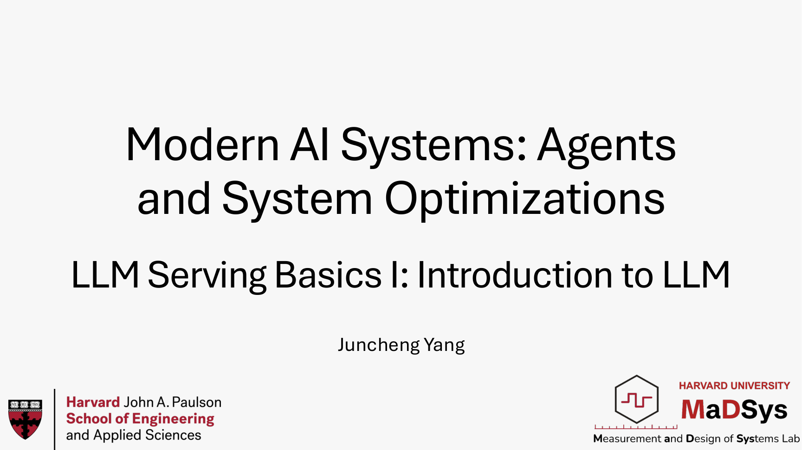

**本页讲什么：** 本讲主题是“大模型服务基础 I：LLM 入门”，隶属于智能体与系统优化课程。

**解读：** 这里的 Serving 指把已经训练好的模型部署成可以接收请求、生成结果的服务。理解 Serving，既要知道模型内部做什么计算，也要知道请求如何排队、显存如何分配，以及生成过程中哪些数据反复被读取。后面的内容因此从一次请求的生命周期进入，再拆解 Transformer，最后介绍改变计算和存储方式的架构。

**抓住重点：** 本讲的视角是“模型结构如何决定推理成本”。

## 第 02 页：课程事务（原 PPT 2）

**本页讲什么：** 作业 3、排行榜提交和项目海报展示的安排。

**解读：** 课件说明作业截止到周二 23:59，排行榜提交不允许使用延期天数；12 月 2 日 13:00–15:00 是无法参加 12 月 7 日展示者的替代场次，并提示报名已截止、需尽快联系课程团队。这里都是课件当时的教学安排，不能据此确定当前截止日期。

**抓住重点：** 本页没有模型或系统技术内容；作业规则需要与课程当期通知对应。

## 第 03 页：本讲路线图（原 PPT 3）

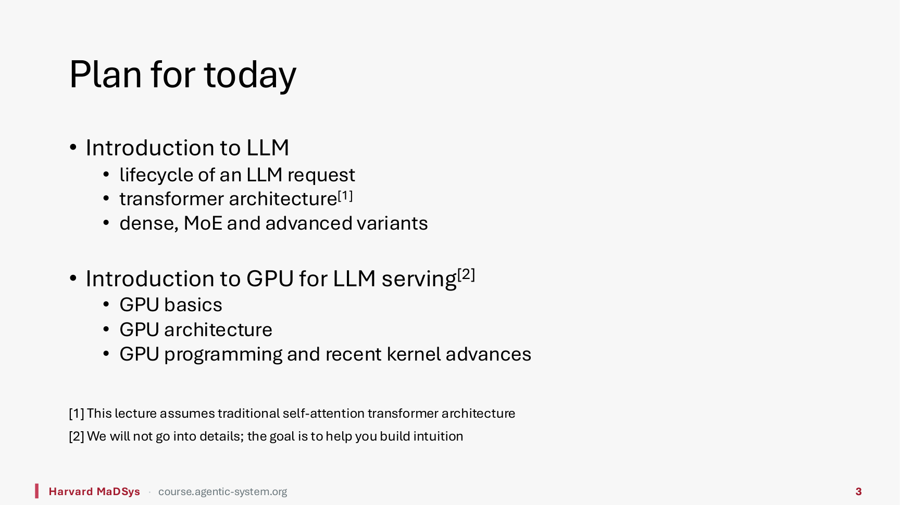

**本页讲什么：** 两条主线：LLM 基础，以及面向 LLM Serving 的 GPU 基础。

**解读：** 第一部分依次讨论请求生命周期、Transformer、Dense/MoE 和其他变体。第二部分计划涉及 GPU 架构、编程与 kernel 优化，目标是建立直觉。课件明确以传统自注意力 Transformer 为基础，因此后续的复杂度和缓存结论有架构前提。

**范围说明：** 当前提供的 36 页实际主要覆盖第一部分，没有出现完整的 GPU 基础章节。不要把议程当成这份文件已经包含的全部内容。

## 第 04 页：一次 LLM 请求的六个阶段（原 PPT 4）

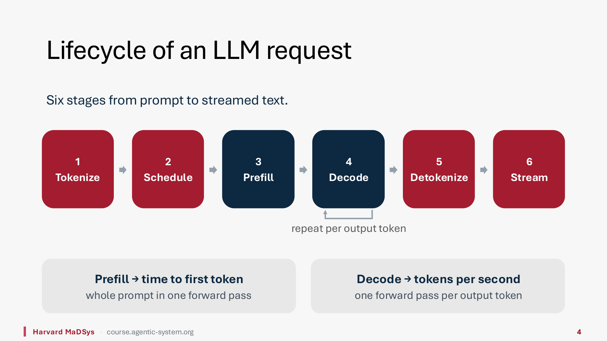

**本页讲什么：** Tokenize → Schedule → Prefill → Decode → Detokenize → Stream。

**解读：** 用户输入先被编码为 token ID，调度器安排它进入 GPU 批次；Prefill 处理整个提示词并建立缓存；Decode 利用已有上下文逐步预测后续 token；最后把 ID 还原为文字并发送给用户。图中 Decode 下方的回路表示它需要反复执行。

两个重要体验指标由此出现：**TTFT（Time to First Token，首 token 延迟）**反映多久看到第一段输出；**生成速度**反映开始输出后有多快。课件用 Prefill 对应前者、Decode 对应后者。实际端到端 TTFT 还包括排队、分词和传输等开销。

**抓住重点：** “开始得快”和“持续输出得快”是两个不同的优化目标。

## 第 05 页：分词——模型处理的是 token（原 PPT 5）

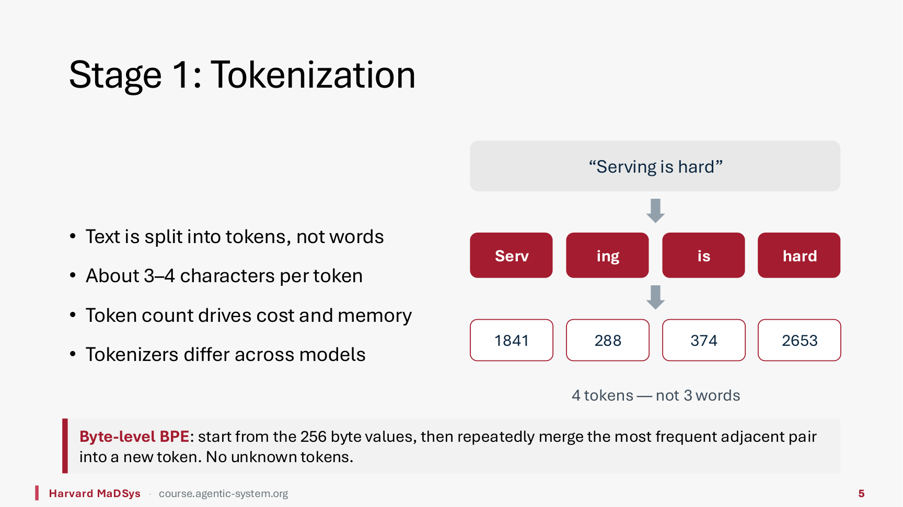

**本页讲什么：** 文本要先拆成 token，再转换为词表中的整数 ID。

**图示解读：** “Serving is hard” 有 3 个单词，图中却分为 `Serv / ing / is / hard`，得到 4 个 token。ID 是词表索引，本身不表示语义大小；示例切分与 ID 不应当成所有模型通用的编码结果。

Byte-level BPE 从 256 种字节值出发，在构建词表时反复合并高频相邻片段；使用时再按已学到的词表和合并规则编码。保留字节级回退能力，可以表示任意输入字节序列，避免普通意义上的未知词问题。

**对服务的影响：** token 数决定上下文长度、很多接口的计费单位和 KV cache 大小。课件的“每 token 约 3–4 个字符”是粗略经验，不能直接套到中文、代码或任意 tokenizer。词表变大可能减少 token 数，但也会增大嵌入表和输出层。

## 第 06 页：调度与连续批处理（原 PPT 9）

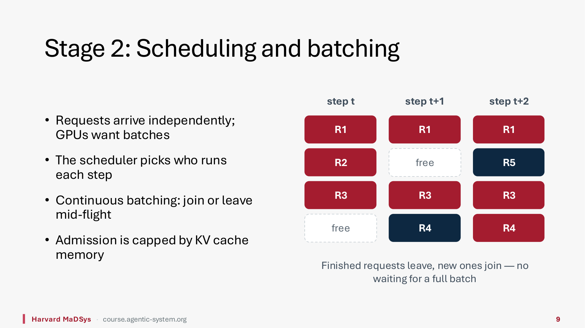

**本页讲什么：** 请求独立到达，GPU 则通常需要批处理才能提高利用率。

**图示解读：** 在 step t，R1、R2、R3 正在运行；到下一步，R2 完成离开，R4 加入；再下一步，R5 填入空位。这就是 Continuous Batching：以迭代步为单位更新请求集合，而不是等整批中最慢的请求完成后再开始新一批。

**为什么受 KV cache 限制：** 每个活跃请求都要保存历史 token 的 K、V。即使 GPU 还有计算余量，显存不足也可能无法接纳新请求。批次大小因此不能只按请求数量设置，还要看每个请求的上下文与预留生成空间。

**抓住重点：** 调度是在吞吐、等待时间、公平性和显存容量之间做取舍；图中的格子只是示意，不代表请求实际占用相同内存。

## 第 07 页：Prefill——一次处理提示词（原 PPT 10）

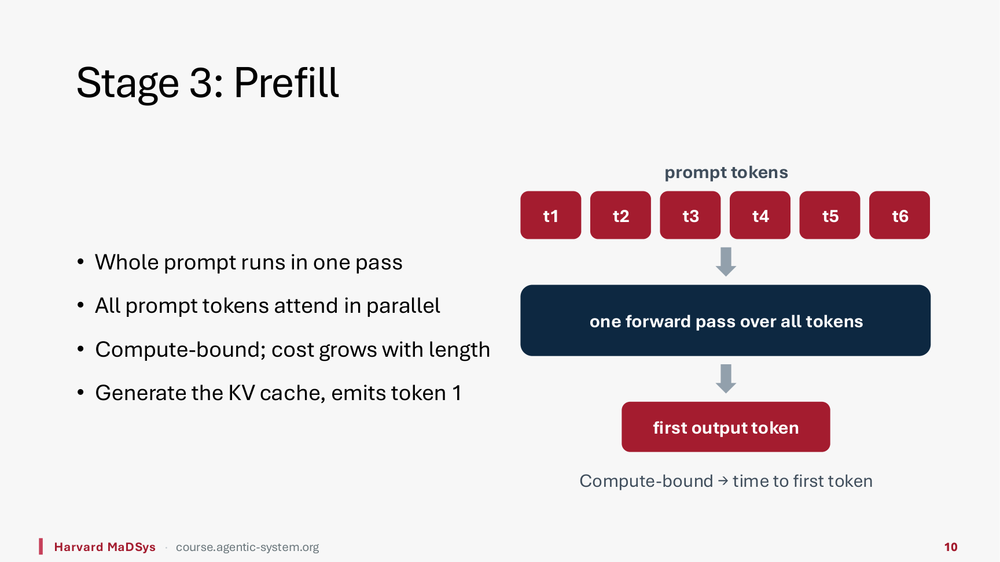

**本页讲什么：** 对整个提示词执行前向计算，形成 KV cache，并得到预测第一个输出 token 所需的结果。

**图示解读：** 提示词 t1–t6 的各个位置可以在同一轮前向中并行计算，因为输入 token 已经全部已知。并行不表示可以看见未来：因果 mask 仍然限制每个位置只读取自己和前面的内容。

**对服务的影响：** Prefill 包含较大的矩阵乘法，通常更容易利用 GPU 算力；提示词越长，计算量越大。课件将其概括为 compute-bound，但实际瓶颈仍取决于模型、输入长度与实现。工程中也可以把长提示词分块处理，而不是必须一次调度完成。

**抓住重点：** Prefill 是“读取并编码已知上下文”，不是逐个生成提示词。

## 第 08 页：Decode 与采样（原 PPT 11）

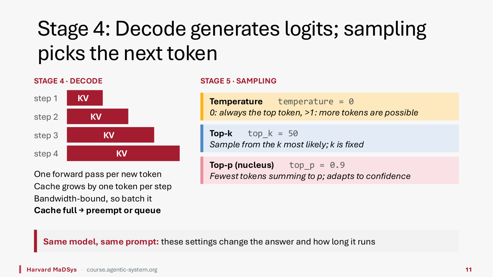

**本页讲什么：** Decode 产生词表分数 logits，采样策略从中选出下一个 token。

**左图解读：** KV 条形逐步变长，表示新位置的 K、V 不断加入缓存。历史 K、V 被复用，避免每一步从头重算整个前缀；但新查询仍需读取相关历史数据。生成的 token 通常在下一轮前向中进入模型，其 K、V 随之写入。

**右图解读：** Temperature 调整概率分布的尖锐程度，通常写作 `softmax(logits / T)`；`T=0` 一般作为贪心选择的接口约定，不能直接代入除法。Top-k 只保留概率最高的 k 个候选；Top-p 则保留累计概率达到阈值 p 的最小高概率候选集合，再归一化采样。

**对服务的影响：** 小批量 Decode 常受显存带宽限制，因为每步都要读取大量权重和缓存，却只为每个请求推进一个位置。增大批次可以分摊权重读取。采样会改变输出内容、结束时机和总生成长度，进而改变资源占用。

**编号说明：** 本页把 Sampling 标为 Stage 5，而前面的总览把 Stage 5 定为 Detokenize。这是课件划分口径不完全一致；理解时把采样视为生成下一 token 的子步骤即可。

## 第 09 页：反分词与流式输出（原 PPT 12）

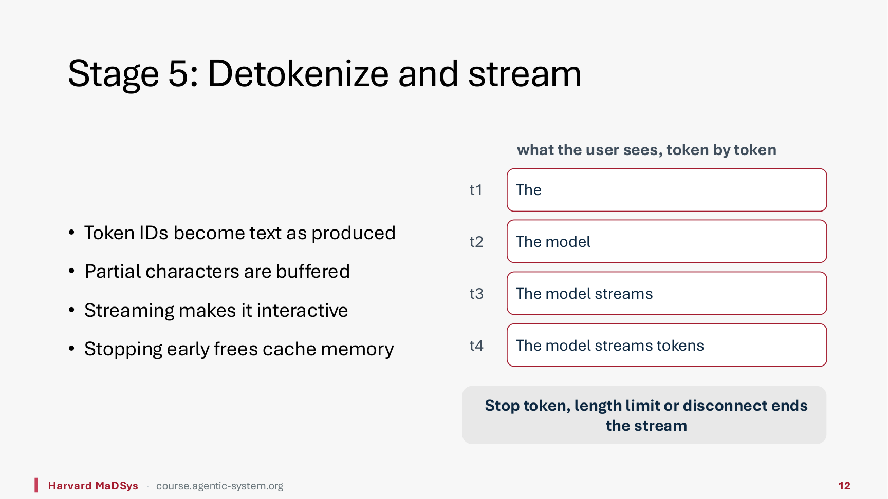

**本页讲什么：** 将生成的 token ID 增量还原为文字，并持续发送给用户。

**图示解读：** 用户依次看到 “The” → “The model” → “The model streams” → 完整短句。流式传输改善的是等待体验，并没有消除模型逐步生成的计算。一个 token 也不一定正好对应一个完整字符或单词，底层可能需要缓冲不完整的字节序列。

**对服务的影响：** 遇到终止 token、长度限制或用户断开连接后，应及时结束计算并回收该请求的 KV cache。仅仅关闭前端展示、后端仍继续运行，会继续消耗资源。

**抓住重点：** 输出协议和请求取消机制，也是推理服务效率的一部分。

## 第 10 页：生命周期总结（原 PPT 13）

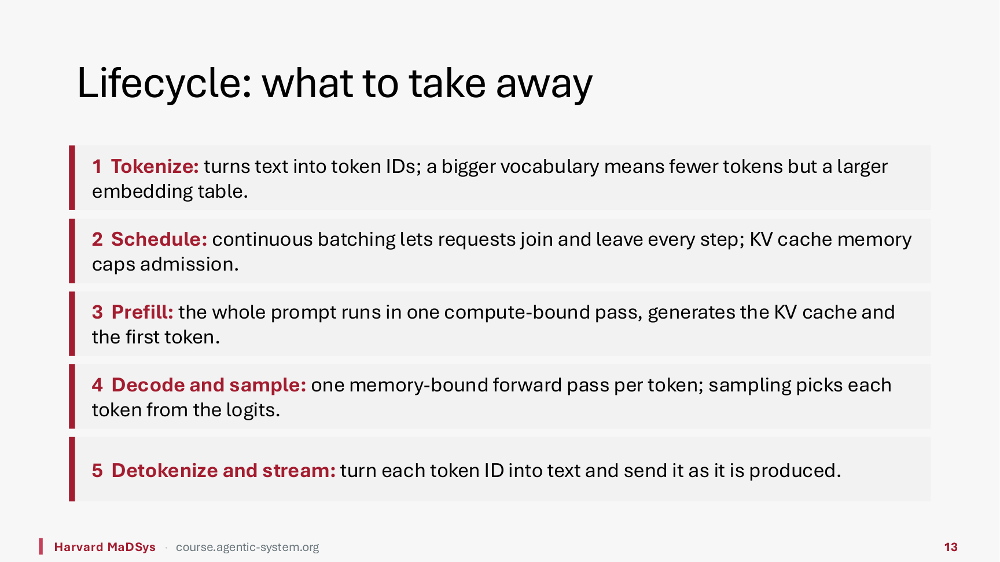

**本页讲什么：** 将前面的流程压缩为五组系统结论。

**解读：** 分词影响序列长度；调度决定谁在什么时候运行；Prefill 建立上下文缓存；Decode 与采样决定逐步输出；反分词和流式传输把内部 token 变成可见文本。

遇到问题时可以沿链路定位：输入很长且首字慢，先看排队与 Prefill；首字正常但后续很慢，先看 Decode 批次和带宽；并发上不去，先检查 KV cache 与显存。它们是排查方向，不能仅凭现象确定唯一原因。

**抓住重点：** 不要用一个“tokens/s”数字概括所有用户体验和服务瓶颈。

## 第 11 页：进入模型内部（原 PPT 14）

**本页讲什么：** 章节过渡页，标题为 Peeking into the model。

**解读：** 前面从请求外部看执行过程，接下来转向模型内部的数据形状和算子。要解释为什么显存、计算量和带宽会形成不同瓶颈，就要把“一个模型”拆成权重矩阵、注意力运算、FFN 和 KV cache。

**抓住重点：** 后续符号和矩阵维度，是把模型结构换算成系统成本的工具。

## 第 12 页：符号与模型配置（原 PPT 15）

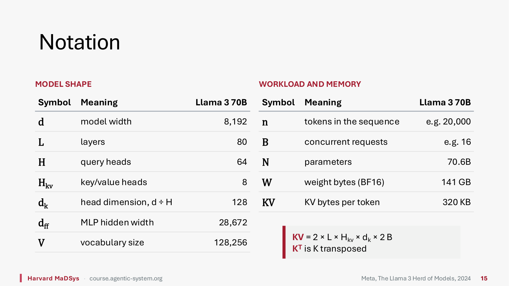

**本页讲什么：** 以 Llama 3 70B 为例定义后面使用的符号。

| 符号 | 含义 | 课件示例 |
| --- | --- | --- |
| d | token 隐向量宽度 | 8,192 |
| L | Transformer 层数 | 80 |
| H / Hkv | 查询头数 / KV 头数 | 64 / 8 |
| dk | 单头维度 | 128 |
| dff | FFN 中间维度 | 28,672 |
| V | 词表大小 | 128,256 |
| n / B | 单请求序列长度 / 并发请求数 | 随工作负载变化 |
| N / W | 参数量 / 权重字节数 | 约 70.6B / 141 GB |

**公式解读：** 每个 token 在全部层上的 KV 占用为 `2 × L × Hkv × dk × 每元素字节数`。第一个 2 表示 K 和 V 两份；BF16 每元素再占 2 字节。代入后得到 327,680 字节，即 **320 KiB/token**。课件写作 320 KB，使用了常见的宽松单位表示；后面的 GB 估算需留意十进制与二进制差别。

**抓住重点：** 记住“模型有多大”和“每增加一个上下文 token 要多占多少缓存”是两类不同的问题。

## 第 13 页：Transformer 的整体结构（原 PPT 16）

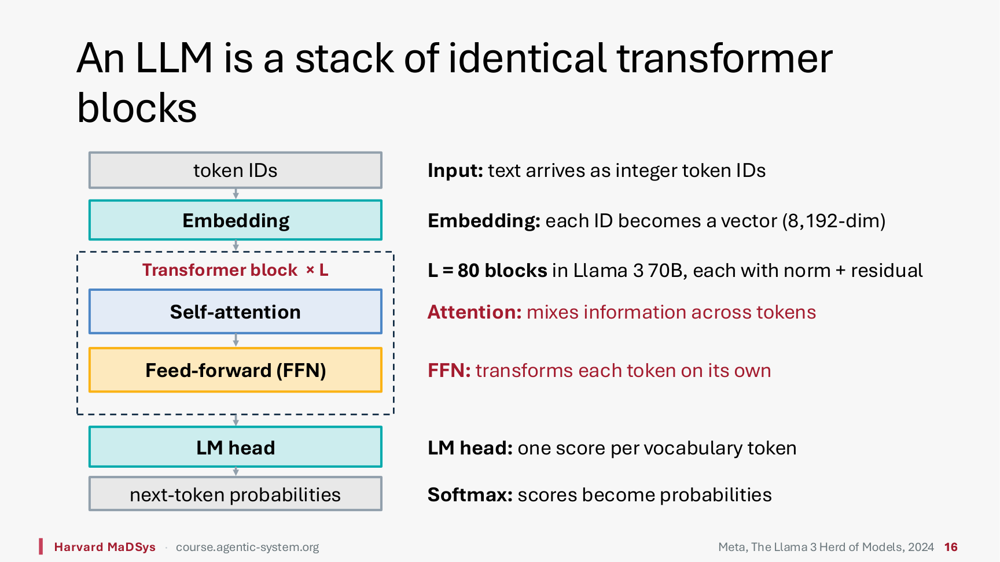

**本页讲什么：** token ID → Embedding → 多层 Transformer block → LM head → 概率。

**图示解读：** Embedding 将离散 ID 查表变成 d 维向量；每个 block 包含自注意力与 FFN。注意力在不同 token 之间交换信息，FFN 则对各位置的向量独立施加同一组变换。LM head 把最终隐向量映射到词表大小的分数，再通过 softmax 获得概率。

**容易误读：** 标题里的“identical blocks”指结构重复，通常不指各层共用同一份权重。普通 Transformer 各层有独立参数；第 33 页的循环 Transformer 才专门讨论跨循环共享权重。

**抓住重点：** 跨 token 的交互主要由注意力完成；大量参数和矩阵计算也集中在 FFN 中。

## 第 14 页：RMSNorm、Pre-norm 与残差（原 PPT 17）

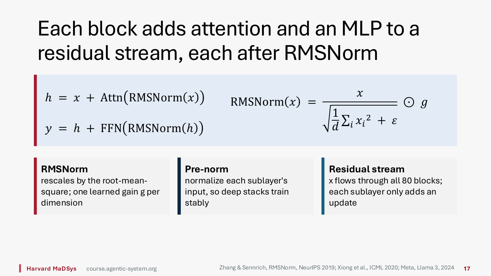

**本页讲什么：** 一个 block 如何通过归一化与残差连接更新表示。

$$
h=x+\operatorname{Attn}(\operatorname{RMSNorm}(x)),\qquad
y=h+\operatorname{FFN}(\operatorname{RMSNorm}(h))
$$

$$
\operatorname{RMSNorm}(x)=\frac{x}{\sqrt{\frac{1}{d}\sum_i x_i^2+\epsilon}}\odot g
$$

**公式解读：** RMSNorm 按向量的均方根缩放数值，再乘以可学习的逐维增益 g；ε 防止数值不稳定。它不包含标准 LayerNorm 中的减均值步骤。Pre-norm 指先归一化再送入注意力或 FFN。

残差中的 `+x` 和 `+h` 保留原信息，每个子层只添加一份更新，使深层网络更容易训练。把 residual stream 理解为贯穿网络的主干数据流即可，不是额外保存的一整份历史 token 数据库。

**抓住重点：** 除大矩阵乘法外，归一化与残差等算子也有数据搬运和 kernel 调用成本。

## 第 15 页：因果自注意力（原 PPT 18）

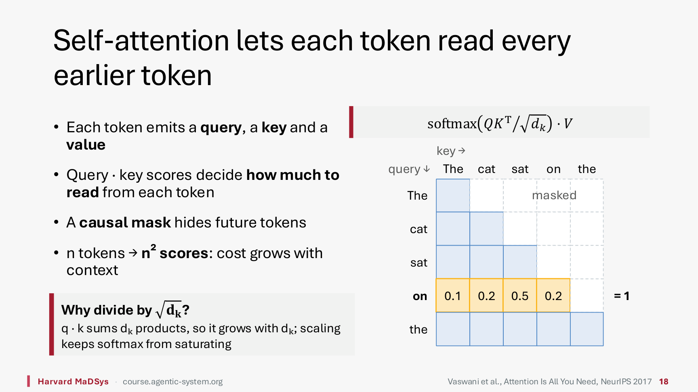

**本页讲什么：** 每个 token 用 Query 与历史 Key 匹配，再按权重读取 Value。

$$
\operatorname{Attention}(Q,K,V)=\operatorname{softmax}\left(\frac{QK^T}{\sqrt{d_k}}+M\right)V
$$

**图示解读：** 行表示当前查询位置，列表示可读取的位置。右上角被遮挡，意味着不能读取未来 token；对角线通常保留，所以更准确地说是“读取自己和更早位置”。示例中 `on` 对前四个位置的权重为 0.1、0.2、0.5、0.2，总和为 1。

**为什么除以 √dk：** 在常用的分量统计假设下，点积的方差随 dk 增大；缩放可避免 logits 过大，使 softmax 过分饱和。这里的权重是动态算出来的，不是人工指定的固定规则。

**抓住重点：** 全序列注意力要考虑约 n² 个位置配对，长上下文因此昂贵。

## 第 16 页：从 X 投影出 Q、K、V（原 PPT 19）

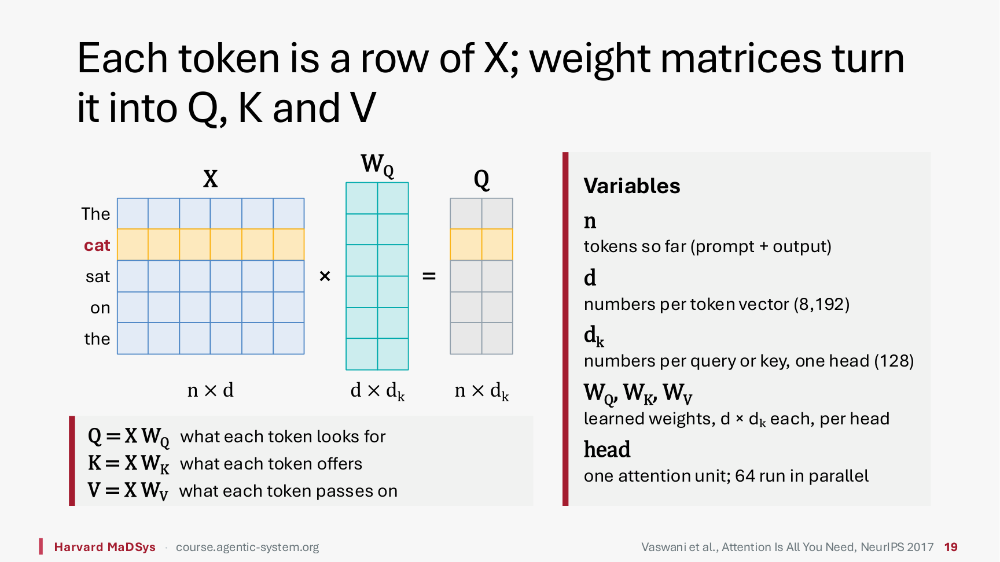

**本页讲什么：** 注意力的 Q、K、V 来自对输入表示的可学习线性投影。

**形状解读：** X 的每一行代表一个 token，所以形状为 `n × d`。单个头的 WQ 为 `d × dk`，相乘得到 `n × dk` 的 Q；K 和 V 也通过各自权重生成。图中高亮 `cat` 的行，说明投影先对各位置独立进行。

Query 可理解为“这个位置在寻找什么”，Key 为“这个位置提供什么匹配线索”，Value 为“实际传递什么内容”。三者都是数值向量，这些说法是帮助理解的类比。

**与缓存的联系：** 模型权重 WQ/WK/WV 在请求间共享；请求运行时生成的 K、V 属于上下文状态。GQA 中多个查询头共享 KV 头，不能把图中的单头描述直接理解为每个查询头都有独立缓存。

## 第 17 页：打分、掩码、归一化和加权求和（原 PPT 20）

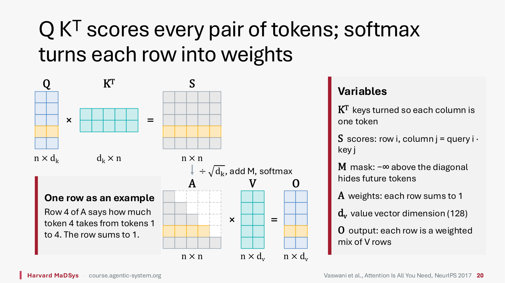

**本页讲什么：** 从 Q、K、V 逐步得到注意力输出 O。

1. `Q(n×dk) × Kᵀ(dk×n)` 得到 `n×n` 的匹配分数。
2. 除以 √dk，再加因果掩码 M；未来位置加上负无穷，使其 softmax 权重为 0。
3. 对每一行做 softmax，得到权重矩阵 A。
4. `A(n×n) × V(n×dv)` 得到 `O(n×dv)`。

**图示解读：** 第 4 行描述第 4 个 token 如何混合前 4 个 token 的 Value。输出不是挑选一个 Value，而是按权重做向量加权求和。

**对服务的影响：** 图展示全序列计算。带 KV cache 的单步 Decode 通常只有新位置的 Query，因此相应注意力分数是约 `1×n`，不必每步重新生成完整的 `n×n` 矩阵。

## 第 18 页：二次复杂度与 FlashAttention（原 PPT 21）

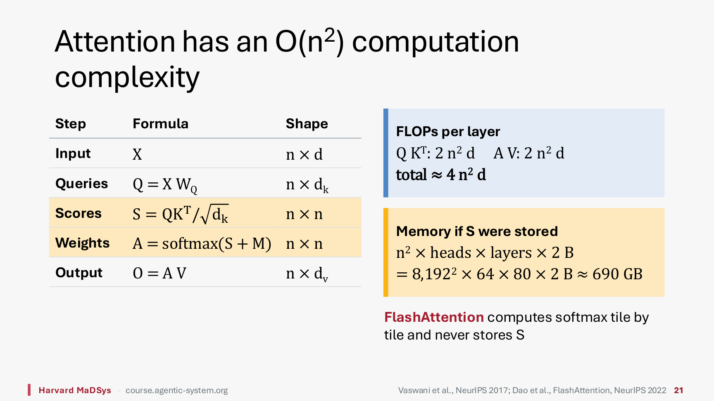

**本页讲什么：** 标准注意力的算术量随序列长度平方增长，朴素存储分数矩阵也非常昂贵。

**公式解读：** 对所有头合计，一层中 QKᵀ 与 AV 的密集矩阵计算各约 `2n²d` FLOPs，总计约 `4n²d`，暂不计投影、softmax 等；利用因果三角结构可减少有效计算常数。因此第 24 页的因果注意力估算会使用不同系数。

课件把 `8192² × 64 × 80 × 2 字节` 相乘，得到约 687 GB，即约 690 GB。这表示“假如同时保留所有层、所有头的完整分数矩阵”的总量级，**不是普通推理必须同时占用的峰值显存**；逐层执行时可以复用临时空间。

**FlashAttention 解读：** 它分块计算并用在线 softmax 累积结果，避免把完整 n×n 分数/权重矩阵写入显存。它减少中间存储与显存读写，但精确全注意力的算术复杂度依然是 O(n²)，也不会消除持久 KV cache。

## 第 19 页：多头注意力的公式（原 PPT 22）

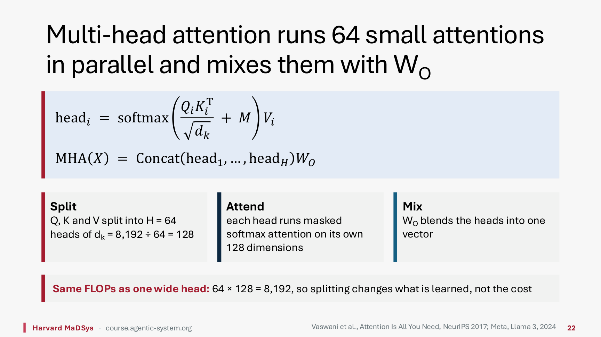

**本页讲什么：** 多个头分别计算注意力，然后拼接并通过 WO 混合。

$$
\mathrm{head}_i=\operatorname{softmax}\left(\frac{Q_iK_i^T}{\sqrt{d_k}}+M\right)V_i,
\qquad \mathrm{MHA}(X)=\operatorname{Concat}(\mathrm{head}_1,\ldots,\mathrm{head}_H)W_O
$$

**解读：** 64 个头各输出 128 维，拼接后恢复为 8,192 维；WO 再把不同头的信息融合。每个头有独立的注意力分布，因此同一位置可以同时使用不同的上下文关系。

**成本说明：** 在固定总宽度 `H×dk=d` 的标准 MHA 比较中，拆成多个头不会把主要矩阵乘法 FLOPs 简单乘以头数；但 softmax、存储和实际 kernel 效率可能不同。这里是通用 MHA 讲解，不应与 Llama 3 70B 的 GQA 配置混为一谈。

## 第 20 页：不同头学习不同模式（原 PPT 23）

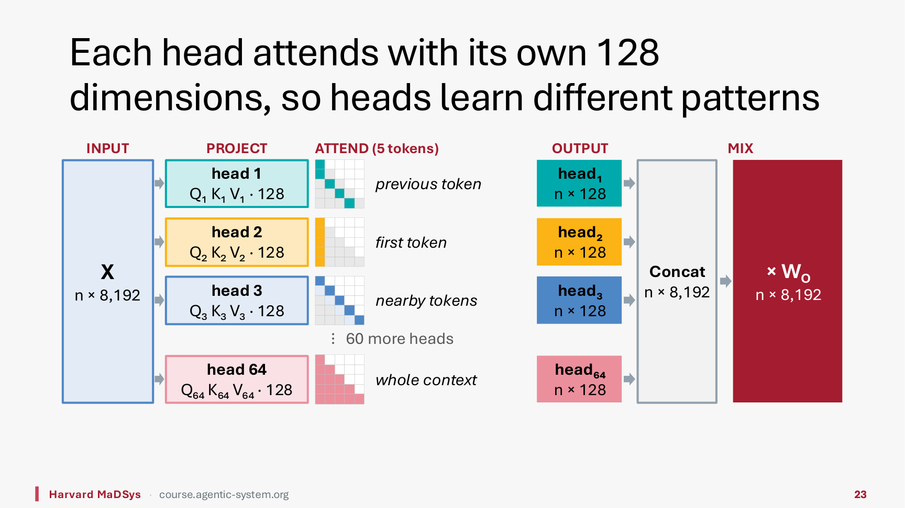

**本页讲什么：** 用矩阵热图直观展示多头的不同关注方式。

**图示解读：** 从左到右是输入、各头投影、各头注意力、输出拼接和 WO 混合。图中有的头偏向前一个 token，有的偏向首 token，有的偏向邻近区域，还有的分散到整个前缀。

这些模式用于说明多头表达能力，不能理解为“第 1 头永远负责前一个词、第 2 头永远负责首词”。实际模式由训练结果、层次和当前输入共同决定，同一个头也未必只有一种功能。

**抓住重点：** 多头提供多种并行的信息选择方式，最终仍要融合回单个 token 表示。

## 第 21 页：MHA、GQA 与 MQA（原 PPT 25）

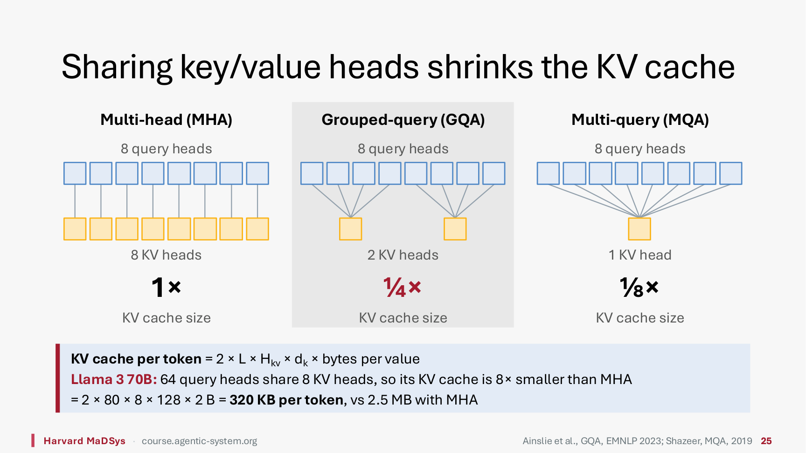

**本页讲什么：** 在保留多个 Query 头的同时，共享 K、V 可以减小缓存。

| 图中方案 | Query 头 | KV 头 | 相对 KV cache |
| --- | --- | --- | --- |
| MHA | 8 | 8 | 1 |
| GQA | 8 | 2 | 1/4 |
| MQA | 8 | 1 | 1/8 |

**解读：** GQA 把 Query 头分组，同组共享一个 KV 头；MQA 则全部 Query 头共享一个 KV 头。共享的是 K、V 表示，不等于所有头的 Query 或最终注意力分布相同。

Llama 3 70B 的示例是 64 个 Query 头共享 8 个 KV 头，因此每 token 缓存为 `2×80×8×128×2=327680` 字节，即 320 KiB。若改成 64 个 KV 头，则为 2.5 MiB，相差 8 倍。

**抓住重点：** 减少 KV 头能够同时降低缓存容量和相关读取量，但不代表整个模型的显存或 FLOPs 都减少 8 倍。

## 第 22 页：把 Llama 3 70B 的维度连起来（原 PPT 28）

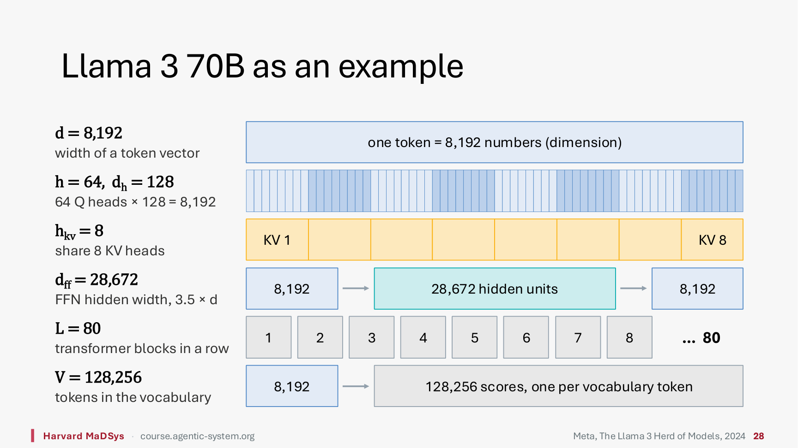

**本页讲什么：** 把前面的符号放进一个具体模型。

**图示解读：** 一个 token 的主干表示有 8,192 个数；Query 分成 `64×128`，KV 则使用 8 个头。FFN 的中间宽度为 28,672，随后回到 8,192 维；这种 block 叠加 80 层。最后输出层把隐表示映射为 128,256 个词表分数。

**容易混淆：** 向量维度 8,192 是“每个位置的特征宽度”，上下文长度 n 是“有多少个位置”，词表大小 V 是“下一步有多少种候选 ID”。它们是不同的轴，不能互换。

**抓住重点：** 读懂模型配置，才能判断哪个矩阵大、缓存按哪个维度增长。

## 第 23 页：70B 参数分布在哪里（原 PPT 29）

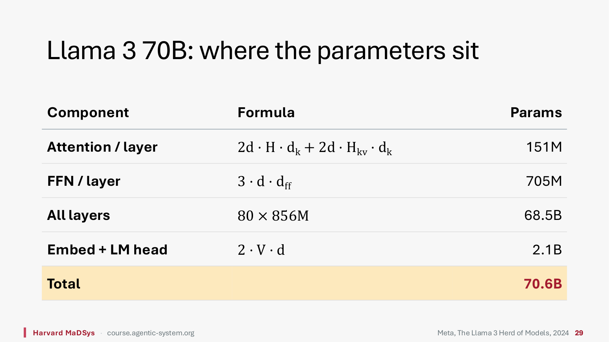

**本页讲什么：** 用矩阵形状估算 Attention、FFN 与词表层的参数量。

**公式解读：** Attention 每层约为 `2d·H·dk + 2d·Hkv·dk`：前一部分计入 Query 投影与输出投影，后一部分计入 K、V 投影，约 151M。FFN 为 `3d·dff`，约 705M；系数 3 对应门控 FFN 的三组主要矩阵，不能直接套到所有 FFN 结构。

80 层合计约 68.5B；独立的 Embedding 与 LM head 合计 `2Vd≈2.1B`，总数约 70.6B。表中是忽略少量归一化等参数后的近似估算；如果模型共享输入输出词表权重，也需要改写这部分计算。

**对服务的影响：** 这个例子里每层 FFN 参数约占 Attention+FFN 的 82%。因此“注意力的长序列计算很贵”和“FFN 占据多数权重”可以同时成立。

## 第 24 页：把结构换算成时间和显存（原 PPT 30）

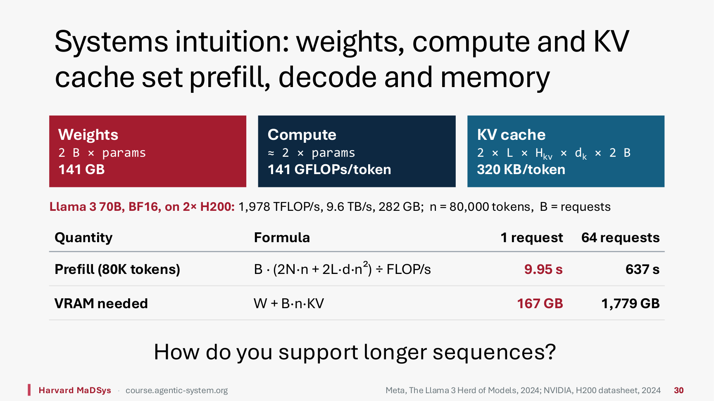

**本页讲什么：** 用权重、FLOPs 和 KV cache 建立容量规划的数量级直觉。

**课件前提：** Llama 3 70B、BF16、2 张 H200；聚合峰值约 1,978 TFLOP/s、9.6 TB/s 带宽和 282 GB 显存；每个请求 80,000 token。

$$
T_{\mathrm{prefill}}\approx\frac{B(2Nn+2Ldn^2)}{F},\qquad
M\approx W+B n\,\mathrm{KV}_{\mathrm{per\ token}}
$$

**公式解读：** `2Nn` 近似表示参数矩阵参与的线性计算；`2Ldn²` 表示利用因果结构后的注意力二次项；除以算力 F 得到理想化计算时间。显存公式则把共享权重与所有请求各自的缓存相加。

单个 80K 请求的 KV 约 `80000×327680=26.2 GB`，加约 141 GB 权重得到约 167 GB。64 个请求的 KV 约 1,678 GB，加权重约 1,819 GB。**课件表中写 1,779 GB，与上述精确字节数不完全一致**；若将 320 KB 直接按 320,000 字节估算，则约为 1,779 GB。这是单位近似造成的差异，实际规划应统一字节单位。无论采用哪种近似，64 请求都远超 282 GB。

课件给出的 Prefill 时间约为 9.95 秒和 637 秒，是按总工作量与峰值算力推算的理想数值。64 请求对应的缓存已超出该配置容量，因此后者不是这两张卡可直接执行该批次的实测延迟；实际还存在通信、临时空间、利用率和调度开销。

**抓住重点：** 长上下文不只是“模型支持多长”，还必须回答“在目标并发下能否放入显存、能否接受首字延迟”。

## 第 25 页：MoE 用专家替代 FFN（原 PPT 35）

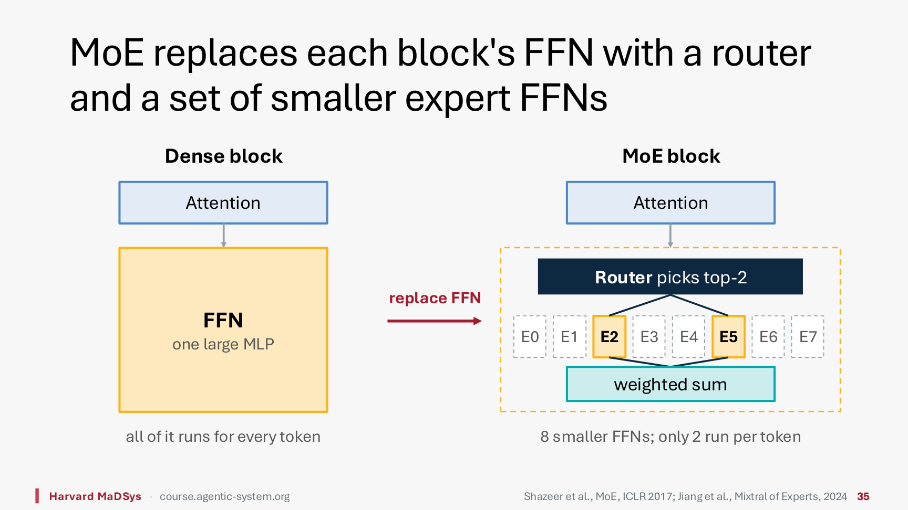

**本页讲什么：** Dense block 的单个 FFN 被 Router 和多个专家 FFN 替代。

**图示解读：** 左侧每个 token 都经过同一个完整 FFN；右侧 Router 对 8 个专家打分，只选其中 2 个处理当前 token，再将结果按权重合并。Attention 仍然存在，并没有被 MoE 取消。图中的专家大小是结构示意，并不规定所有 MoE 专家必须比某个 Dense FFN 更小。

**对服务的影响：** 每个 token 只激活部分专家，能在较少计算下使用更大的总参数容量。但整个模型的权重仍要存放在某处；专家分布在不同 GPU 时，token 路由还会产生通信和负载均衡问题。

**抓住重点：** MoE 把“总参数量”和“每个 token 的激活参数量”分开了。

## 第 26 页：Dense 与 MoE 的成本对比（原 PPT 36）

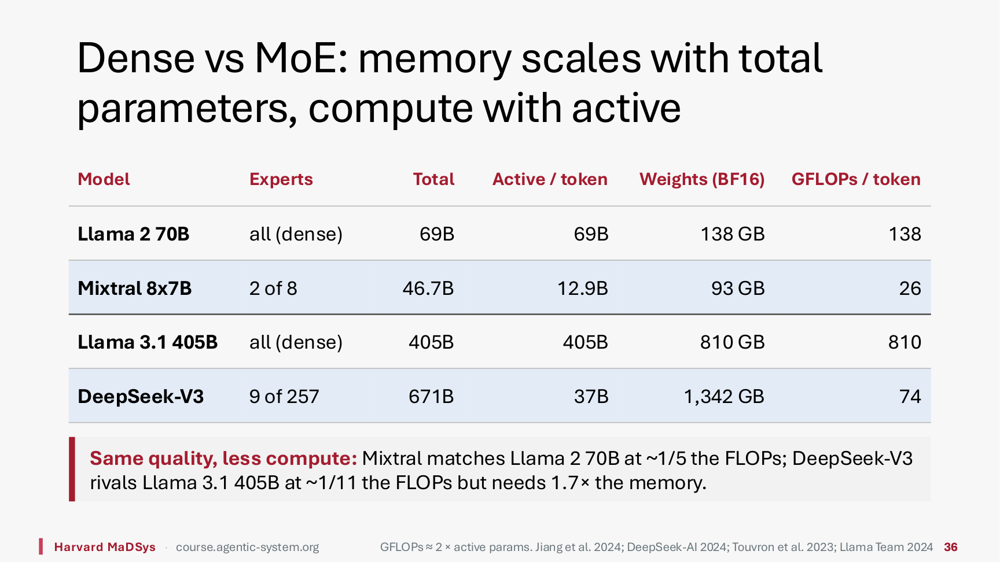

**本页讲什么：** 权重存储主要看总参数，主要线性层计算量近似看激活参数。

**表格解读：** 课件列出 Mixtral 8×7B 的总参数约 46.7B、每 token 激活约 12.9B；DeepSeek-V3 则为总参数约 671B、激活约 37B。在 BF16 且不考虑其他开销时，权重字节数近似是总参数量的 2 倍；主要线性计算的 FLOPs 近似是激活参数数目的 2 倍。

Mixtral 的名称并不表示总参数简单等于 8×7B，因为 Attention 等部分并非复制成 8 份。DeepSeek-V3 的“9 of 257”是课件简写，需要区分共享专家与路由专家，不能理解为从 257 个完全同类专家中任意选 9 个。

**结果如何理解：** 课件用“约 1/5、约 1/11 FLOPs”展示 MoE 的计算效率潜力；“质量相当”依赖具体评测，并非所有任务等价。更少理论 FLOPs 也不保证等比例降低实际延迟，因为通信、专家批次大小和不均衡仍会影响速度。

## 第 27 页：高级架构路线图（原 PPT 37）

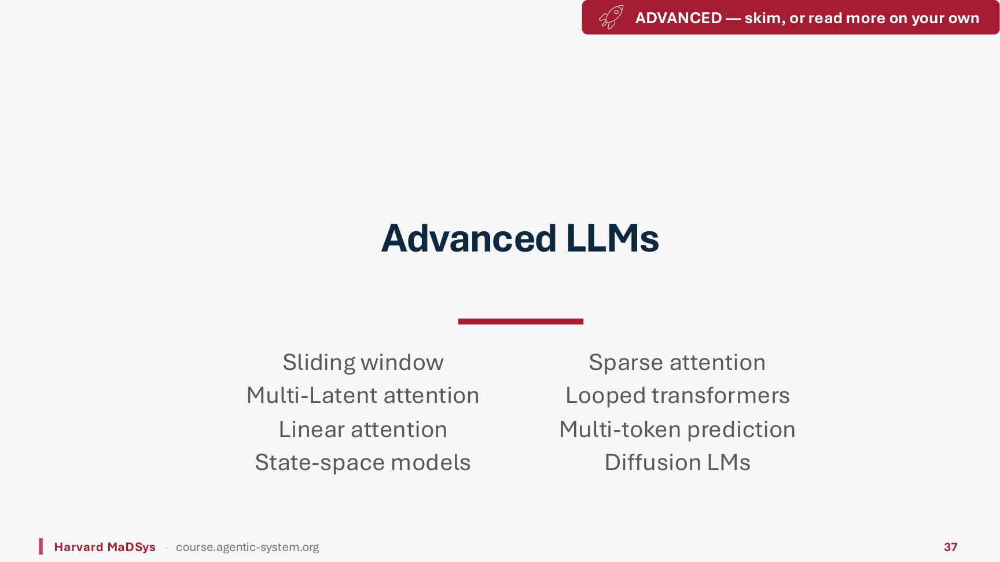

**本页讲什么：** 列出滑动窗口、MLA、线性注意力、状态空间、稀疏注意力、循环 Transformer、多 token 预测和扩散语言模型。

**解读：** 可以带着三个问题阅读：是否减少每次读取的历史范围？是否压缩或替换长期状态？是否改变生成时执行计算的方式？这些方案优化的对象不同，不应全部归为“减少注意力复杂度”。

**范围说明：** 当前 PDF 后面没有独立的 Multi-token prediction 讲解页，因此这里只记录它被列入路线图，不补造对应课件内容。页面上的 Advanced 提示说明这是拓展阅读部分。

## 第 28 页：滑动窗口与全局层（原 PPT 38）

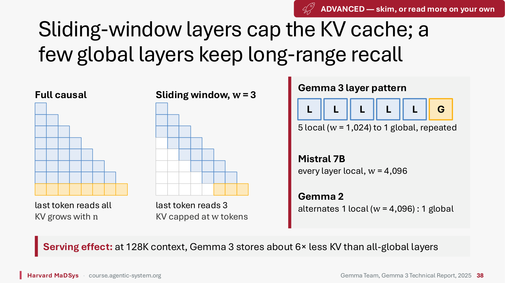

**本页讲什么：** 局部层只读取最近 w 个 token，全局层保留长距离访问。

**图示解读：** 左图全因果注意力覆盖全部前缀；中图只保留对角线附近宽度为 w 的区域。推理时，如果某个局部层不会再读取更旧的 K、V，就可以将其移出该层的缓存，使该层缓存长度被窗口上限约束。

课件举例：Mistral 7B 使用局部窗口；Gemma 2 交替局部与全局层；Gemma 3 采用 5 个局部层配 1 个全局层。若局部窗口为 1,024，序列为 128K，并简化假设各层 KV 宽度相同，则相对全局层缓存比例约为 `(5×1024+n)/(6n)`，约 0.17，即减少到约六分之一。

**抓住重点：** 少数全局层仍随 n 增长，所以混合模型的总缓存不是常数；局部窗口也限制单层的直接读取范围，需要通过层间传播或全局层补充远程信息。

## 第 29 页：MLA 压缩每个 token 的缓存（原 PPT 39）

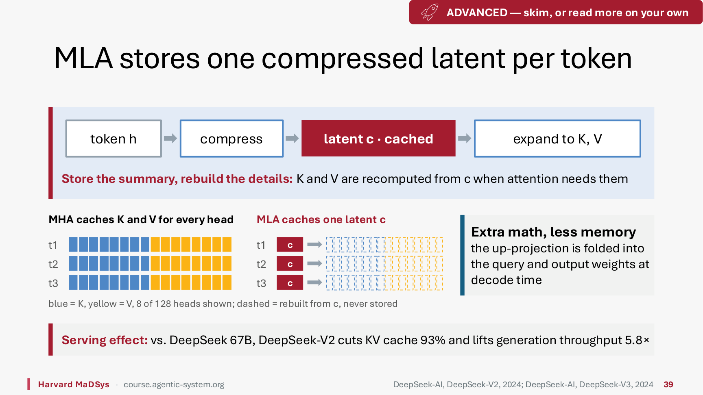

**本页讲什么：** Multi-head Latent Attention 用压缩 latent 表示降低每个历史位置的缓存成本。

**图示解读：** 原本每个头存储 K、V，现在先把 token 表示压缩成 c，缓存 c；需要时再利用投影关系参与注意力。虚线框说明完整的各头 K、V 不需要始终以展开形式保存在显存中。

“重建 K、V”是教学抽象。课件也指出，Decode 时可将部分上投影代数合并到查询和输出权重中，从而避免朴素地重复物化全部展开向量。真实 MLA 还涉及位置编码等额外缓存分量，不能把图中单个 c 当成实现的完整缓存清单。

**对服务的影响：** 课件引用 DeepSeek-V2 相比 DeepSeek 67B 的 KV 降低 93%、生成吞吐提高 5.8 倍，属于特定模型与测试条件的报告。MLA 主要降低每 token 缓存常数，总缓存通常仍随上下文长度线性增加。

## 第 30 页：线性注意力与固定大小状态（原 PPT 40）

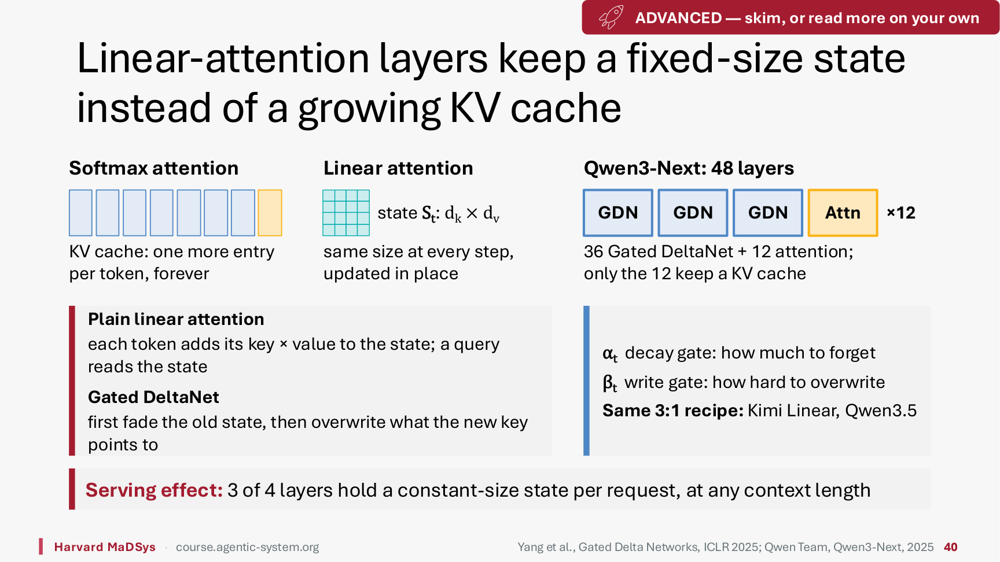

**本页讲什么：** 将不断增长的历史 KV 列表替换为固定形状的递归状态。

**图示解读：** 普通注意力不断增加缓存条目；线性注意力维护一个形如 `dk×dv` 的状态矩阵。新 token 到来后更新矩阵，Query 从矩阵中读取摘要。最基础的形式可理解为积累 key/value 外积；具体特征映射、归一化和门控取决于算法。

Gated DeltaNet 不只是把新信息相加，还利用遗忘与写入机制更新状态：α 控制保留多少旧信息，β 控制写入强度；Delta 更新还与当前状态对新键的预测误差有关，所以不能简单等同于普通衰减外积累加。

**混合结构：** 课件用 Qwen3-Next 的 48 层举例，36 层 Gated DeltaNet 加 12 层 Attention。前三类层的递归状态大小不随 n 增长，但剩下的 Attention 层仍保存增长的 KV cache。页面提到的其他模型沿用相似比例，是课件中的架构陈述。

**抓住重点：** 固定状态降低长序列存储增长，却把历史信息压入有限容量；混合模型整体不等于常数缓存模型。

## 第 31 页：状态空间模型 Mamba（原 PPT 41）

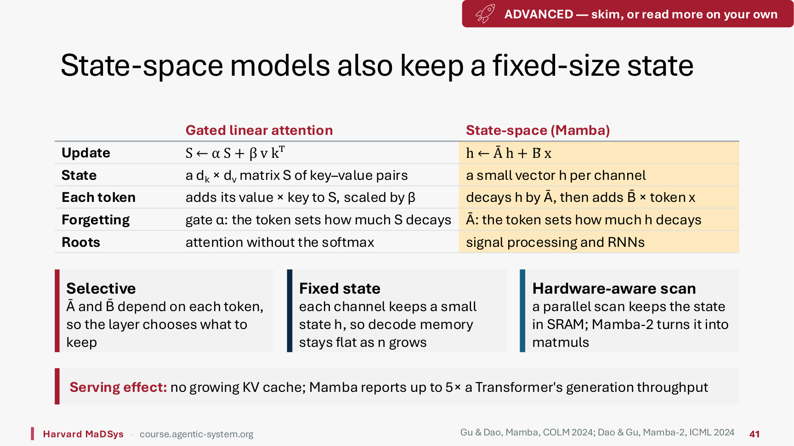

**本页讲什么：** 状态空间模型也通过固定形状的状态递推处理序列。

$$
h_t=\bar A_t h_{t-1}+\bar B_t x_t
$$

**公式解读：** 新状态由旧状态的变换和当前输入贡献组成。Selective 表示相关更新量随输入变化，让模型根据当前 token 选择保留和写入的信息。这里是简化状态更新式，不包含完整模型的所有输出与门控计算。

**与线性注意力比较：** 课件用前者的 KV 矩阵状态和后者的逐通道状态作直观区分，强调不同构造来源；两类方法都可以利用递推表示避免保存完整历史 KV，部分形式也存在数学联系。

**对服务的影响：** Decode 的核心递归状态不随上下文长度增长。训练或 Prefill 可利用并行 scan、分块与矩阵乘法等方式提高硬件效率。课件中的“最高 5 倍生成吞吐”属于特定比较条件，不能作为任意 Mamba 部署的保证。

## 第 32 页：稀疏注意力挑选历史 token（原 PPT 43）

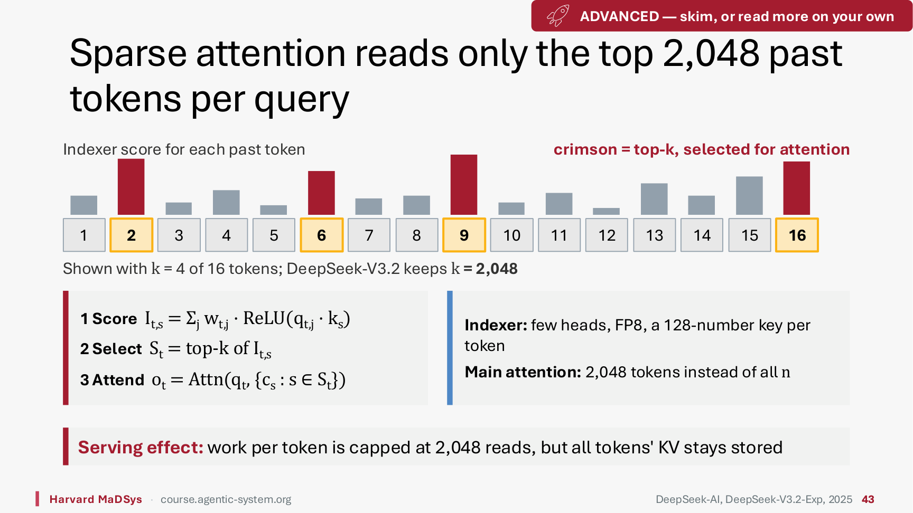

**本页讲什么：** 先用轻量 Indexer 找出重要历史位置，再执行主要注意力。

**图示解读：** 16 个历史位置中，红色柱对应被挑选的 4 个位置；真实示例使用 k=2,048。执行顺序为 Score → Select → Attend：为历史位置打分，选出 top-k，再对对应缓存做主注意力。

**关键区别：** 滑动窗口按距离选位置，动态稀疏注意力按相关性选位置，可能读到很远的历史。由于未来查询可能选中任意旧位置，这类方法通常仍要保留全部历史缓存。

**复杂度边界：** 课件说“每 token 最多读取 2,048 个位置”，应理解为主要注意力读取数量的上限。Indexer 仍可能扫描随 n 增长的历史键，top-k 选择也有成本，不能据此认定整个 Decode 步的总工作量已与上下文长度无关。

## 第 33 页：循环 Transformer 共享权重（原 PPT 45）

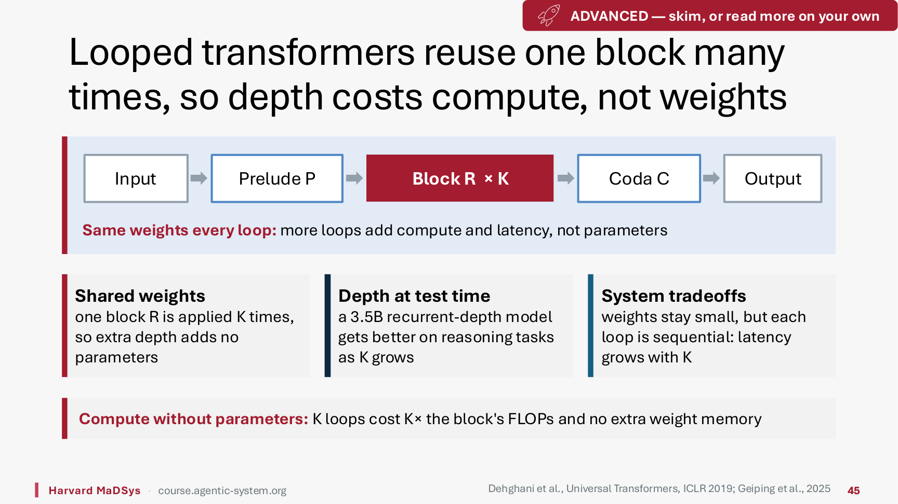

**本页讲什么：** 同一个 block R 重复执行 K 次，用更多计算换取更深的处理。

**图示解读：** Input → Prelude P → Block R×K → Coda C → Output。中间每次循环使用相同参数，所以增加 K 不需要复制 K 份 R 的权重，但循环之间存在先后依赖。

**成本解读：** R 部分计算大致随 K 线性增加；固定的 P、C 开销并不随 K 同比例增长。权重变小与推理变快是两回事，串行循环往往会增加延迟。课件展示的推理任务改善是某个递归深度模型的实验现象，不意味着任意模型多循环就一定更好。

**抓住重点：** 共享权重节省的是参数存储；不自动保证激活、KV 或其他运行状态都保持不变，具体仍取决于循环与缓存设计。

## 第 34 页：扩散语言模型并行填空（原 PPT 47）

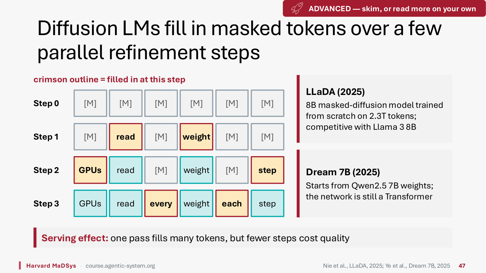

**本页讲什么：** 从多个被遮盖的位置出发，用若干轮并行预测逐步形成文本。

**图示解读：** 第 0 步是 6 个 `[M]`；后面每轮填入部分位置，最后得到 “GPUs read every weight each step”。红框表示本轮新填入的 token。它展示的是多位置精炼思路，不应把固定的 3 轮示例当成真实系统通用配置。

课件介绍 LLaDA 与 Dream 7B，强调即使生成过程不再是传统逐 token 自回归，底层网络仍可以使用 Transformer。模型结构与生成算法是两个不同层面的选择。

**对服务的影响：** 一次前向能预测多个位置，有机会摊薄每轮读取权重的开销；但精炼可能反复处理许多位置，执行轮数、序列长度和质量要求共同决定成本。减少步骤可能降低质量，且输出确认方式与传统逐 token 流式生成不同。

**抓住重点：** “每轮生成多个 token”不等于无条件更快，要比较同等质量下的总计算、端到端延迟与实际可用的输出时机。

## 第 35 页：下节课（原 PPT 50）

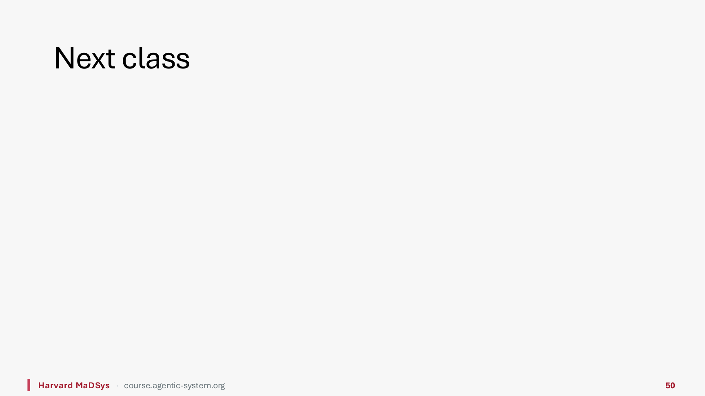

**本页讲什么：** 只有 Next class 标题，没有具体安排或知识点。

**解读：** 这是结束过渡页，当前文件无法据此判断下节课的具体内容。虽然前面的议程提到 GPU，但本页没有提供进一步说明。

## 第 36 页：选读材料（原 PPT 51）

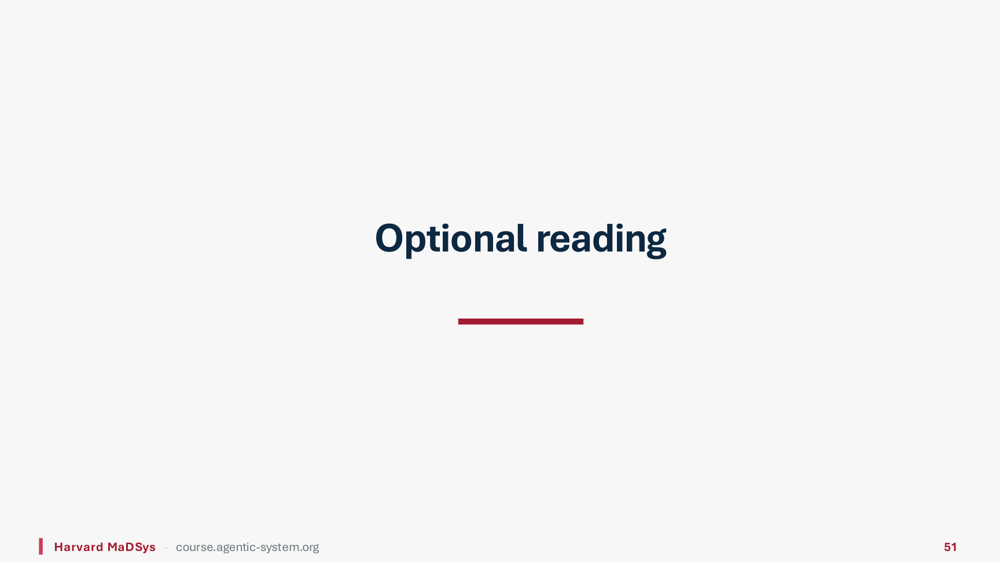

**本页讲什么：** 只有 Optional reading 标题，没有列出阅读清单。

**解读：** 不能将技术页脚中出现的论文自动当成本页明确指定的作业。若需要追溯概念，可从各页截图保留的参考文献开始，例如 Transformer、RMSNorm、FlashAttention、GQA、MoE、DeepSeek MLA 与 Mamba 相关论文。

---

## 复习索引

| 想弄清的问题 | 对应 PDF 页 |
| --- | --- |
| 请求从输入到输出经历什么 | 4–10 |
| TTFT、Decode 速度与并发为什么不同 | 4、6–10、24 |
| Q/K/V、因果掩码与矩阵形状 | 15–17 |
| FlashAttention 到底节省什么 | 18 |
| 多头注意力与 GQA 如何影响缓存 | 19–22 |
| 70B 参数与显存怎样估算 | 12、23–24 |
| MoE 为何省计算却仍占显存 | 25–26 |
| 各类长上下文与生成架构优化什么 | 27–34 |

贯穿全讲的三个量是：**权重大小决定基础存储负担，执行的算子与形状决定计算量，历史状态的表示与长度决定缓存和读取开销。** 实际 Serving 性能还要把调度、kernel 效率和多卡通信放在一起看。
