# BPE 分词：从相邻合并到 Embedding

> **整理日期：** 2026-11-09  
> **视频来源：** 阿栗学长，《一个视频讲清楚大模型核心算法 BPE 分词》，2026-10-14 发布，约 6 分钟。  
> **原视频：** [抖音视频](https://www.douyin.com/video/7696328999605194011)  
> **内容范围：** 沿视频顺序讲解分词粒度、相邻合并、词表、字节与 Embedding；另补充完整手算、可运行代码、训练与编码的区别及原始资料。补充内容不作为视频逐字转录。

大模型处理文本时，通常先将文本切成 Token，再映射到整数 ID，最后从 Embedding 表中取出向量。BPE（Byte Pair Encoding）解决的是如何构造和使用一套可复用的文本片段；向量的意义则通过模型训练形成。

```text
文本 → Tokenizer → Token ID 序列 → Embedding 查表 → Transformer → 输出分布
```

查表、向量训练与字符任务可继续阅读 [Token 与 Embedding：从 strawberry 计数到向量查表](../Embedding/Token与Embedding_从strawberry计数到向量查表.md)。

建议结合 [Transformer 全流程](../Transformer全流程/Transformer_从输入到自回归生成.md) 阅读，理解 Tokenizer 输出怎样进入模型。

## 一、一个汉字、一个词，还是一个 Token？


视频用“我想喝一杯咖啡”说明：7 个汉字不一定对应 7 个 Token。视频展示某个分词器将其切成“我想 / 喝 / 一杯 / 咖啡”。这个结果属于视频所用分词器，不是中文统一规则。


| 概念 | 含义 | 示例 |
| --- | --- | --- |
| 字符 | 文本中的字符单位；还需区分码点与用户感知字符 | “咖”是一个 Unicode 码点 |
| 词 | 按语言习惯理解的词汇 | “咖啡”可以是一个词 |
| 字节 | 编码后的存储单位 | UTF-8 中“咖”为三个字节 |
| Token | 分词器定义的离散单位 | 可以是字、词片段、多字组合或字节片段 |
| Token ID | 词表中对应 Token 的整数标识 | 只在对应分词器及模型内有意义 |

分词结果由词表、合并顺序、预处理及特殊 Token 配置共同决定。比较两个模型的 Token 数时，不能直接沿用另一套分词器的结果。

## 二、为什么不总按字切，也不总按词切？

### 2.1 切得细：覆盖好，但序列可能很长

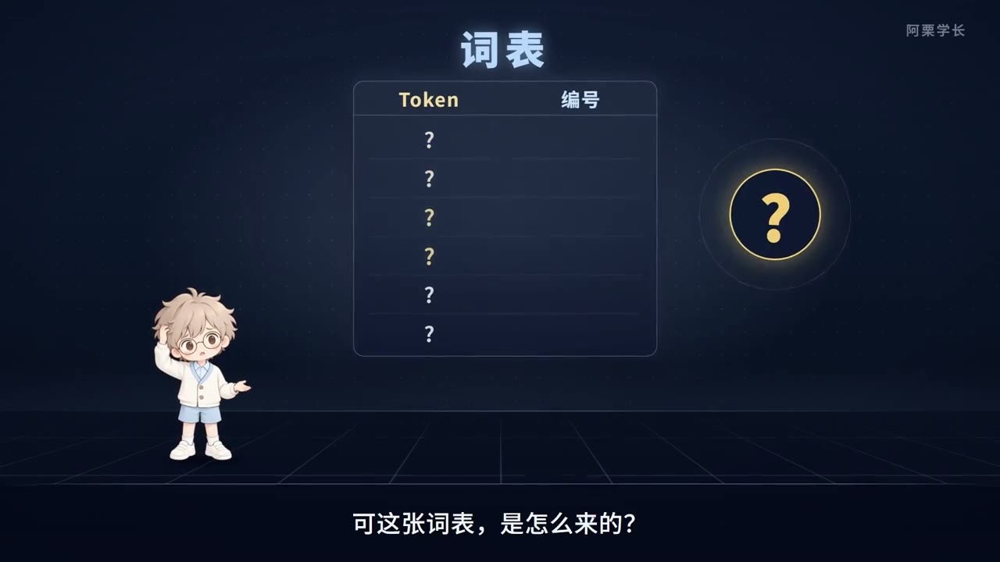

英文 `coffee` 按字母切是六个单位。若词表支持完整的 `coffee` Token，则可能只需要一个。更短的 Token 序列通常能节约部分计算和上下文预算，但不能据此推断所有任务效果都更好。

### 2.2 切得粗：词表会膨胀，也难覆盖新词


若每个完整词都占一个词表条目，人名、术语、拼写变化和新词会不断增加词表需求。纯词级系统还可能把未登录词映射到统一的未知标记，丢掉词内部信息。

### 2.3 子词：在两者之间选择可组合的片段


子词方法希望高频组合有机会成为较大单位，少见组合仍可拆成较小单位。这里的“常见”取决于训练语料、当前合并阶段及边界约束，不代表按语义查词典。

例如一个未在词表中整体出现的新词，可能拆成多个已知片段；字节级体系还可继续退回基础字节。能编码新词，并不等于模型理解了新词。

## 三、BPE 的核心：统计相邻对，合并，再统计

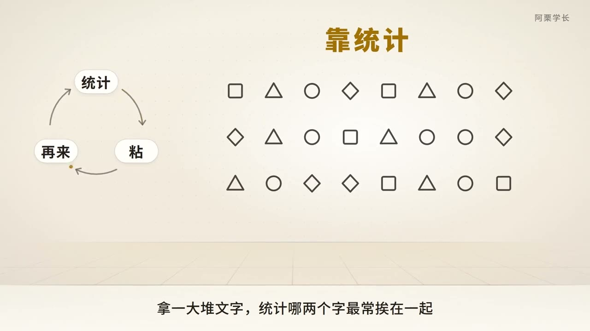

教学版 BPE 训练可写为：

1. 将训练文本表示为初始符号序列，例如字符或字节。
2. 统计当前序列中每一对相邻符号的加权出现次数。
3. 选择频次最高的一对，将它合并成一个新符号。
4. 更新序列、词表，并记录本轮合并的顺序。
5. 达到合并次数、目标词表大小或其他停止条件后结束。

设语料中第 $i$ 种序列为 $s_i$，出现次数为 $f_i$，则相邻对 $(a,b)$ 的计数为：

$$
C(a,b)=\sum_i f_i\sum_{j=1}^{|s_i|-1}
\mathbf1[s_{i,j}=a\land s_{i,j+1}=b].
$$

本轮选择：

$$
(a^*,b^*)\in\operatorname*{argmax}_{(a,b)} C(a,b).
$$

若频次相同，需要稳定的平局规则。计数可以统计所有相邻位置，但实际替换不能让同一个位置参与两次重叠合并。例如 `a a a` 有两个 `a a` 相邻位置，按从左到右非重叠替换，只会得到 `aa a`。

### 3.1 视频的汉字演示：它学的是组合统计


视频用“不知何处吹芦管”及诗词语料演示合并：较小片段可能先形成“不知”“何处”，之后再形成“不知何处”。这说明合并是分阶段发生的，不表示每个中文词都按固定词性或语义边界生成。

诗词语料、日常对话和程序代码的片段统计不同，训练出的词表也可能不同。

## 四、完整手算：三轮合并怎样改变词表？

以下是本文自建的字符级教学语料，不是视频中的真实模型词表。为便于计算，将每个字符串视为独立片段，不跨片段合并。

| 字符串 | 频次 | 初始切分 |
| --- | --- | --- |
| `abc` | 4 | `a b c` |
| `abd` | 2 | `a b d` |
| `ab` | 1 | `a b` |

初始词表为 `{a,b,c,d}`，共 4 个符号。

### 第 1 轮：合并 `a + b → ab`

$$
C(a,b)=4+2+1=7,\quad C(b,c)=4,\quad C(b,d)=2.
$$

因此选择 `(a,b)`。更新结果为：

```text
abc × 4 : ab c
abd × 2 : ab d
ab  × 1 : ab
```

新增 Token `ab`，词表大小变成 5。按语料频次加权的总 Token 数由 $4\times3+2\times3+1\times2=20$ 降到 $4\times2+2\times2+1=13$。

### 第 2 轮：合并 `ab + c → abc`

重新统计当前序列，得到 $C(ab,c)=4$、$C(ab,d)=2$，选择前者。

```text
abc × 4 : abc
abd × 2 : ab d
ab  × 1 : ab
```

词表大小为 6，总 Token 数为 $4+4+1=9$。

### 第 3 轮：合并 `ab + d → abd`

唯一剩余的相邻对为 `(ab,d)`，频次为 2。

```text
abc × 4 : abc
abd × 2 : abd
ab  × 1 : ab
```

词表大小为 7，总 Token 数为 $4+2+1=7$。这个例子每轮恰好新增一个不同 Token，没有特殊 Token；实际词表大小还受工具实现和配置影响。

| 合并顺序 rank | 规则 | 新增 Token |
| --- | --- | --- |
| 0 | `(a,b)` | `ab` |
| 1 | `(ab,c)` | `abc` |
| 2 | `(ab,d)` | `abd` |

注意：即使语料中的 `a b` 全部被合并，基础 Token `a`、`b` 通常仍保留在词表中，供其他输入使用。

## 五、训练与使用是两件事

**训练时**在语料上统计相邻对频次、学习合并规则。**编码时**通常冻结这套规则，按已学到的优先级合并当前输入；不会每收到一句话就重新训练词表。

例如用上一节的规则编码 `abcd`：

```text
a b c d → ab c d → abc d
```

第一步使用 rank 0，第二步使用 rank 1，最终得到 `abc / d`，随后映射到对应 ID。

### 为什么不能直接换成“最长词表匹配”？

考虑另一个合并表：先学到 `(b,c)→bc`，再学到 `(a,b)→ab`。词表包含 `a,b,c,bc,ab`。编码 `abc` 时，优先合并 rank 更小的 `bc`，结果是 `a / bc`；从左到右最长匹配却可能给出 `ab / c`。

两种算法一般不等价。实现可以通过堆、缓存等加速，但应保持对应分词器定义的合并语义。特殊 Token、预分词和随机化训练选项还会引入额外规则。

## 六、真实词表：为什么会有多字片段和奇怪片段？

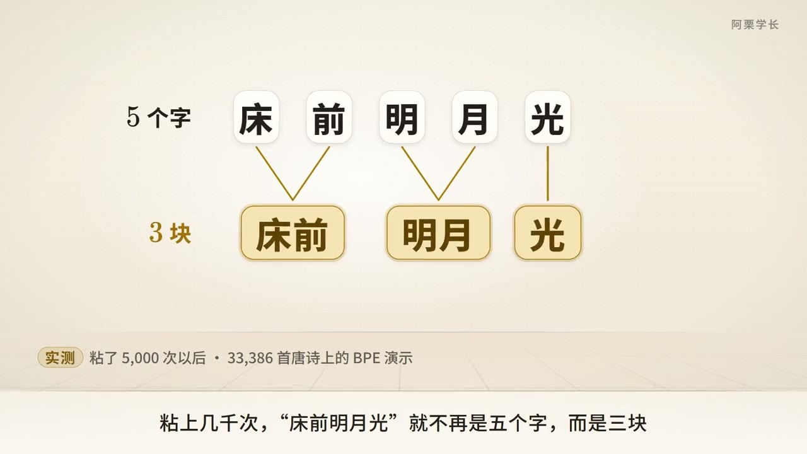


一个片段能进入 BPE 词表，关键是其构造路径上的相邻组合在训练中获得了合并机会。常用词、固定短语、网址片段、代码和重复模板都可能留下痕迹。

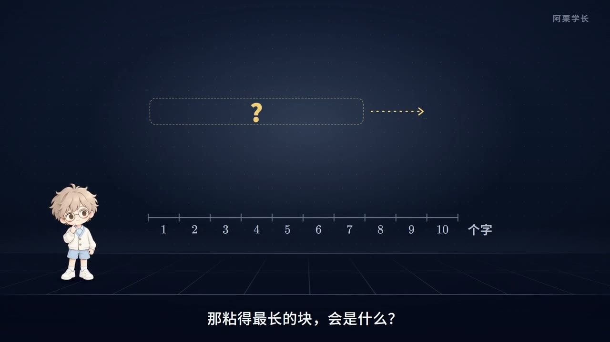

视频展示真实词表中的较长条目，用来说明词表不等于人工词典。不能把某个条目的出现当作模型“认为它有重要语义”的证据，也不能仅凭视频截图还原模型完整训练语料。

### 6.1 预分词决定哪些边界可以跨越

工程中的 Tokenizer 可能先做文本规范化、按正则或空格进行预分词，再在各片段内部执行 BPE。若边界不允许跨越，即使跨边界组合很常见，也不能直接合并。

因此，“把整段文本里最常见的任意相邻内容一直粘起来”只是简化描述。完整流程还包含规范化、预分词、模型编码、后处理与解码。可对照 [Hugging Face Tokenizers 组件文档](https://huggingface.co/docs/tokenizers/main/en/components) 查看各组件的职责。

## 七、字节级 BPE：汉字为什么可能被拆开？

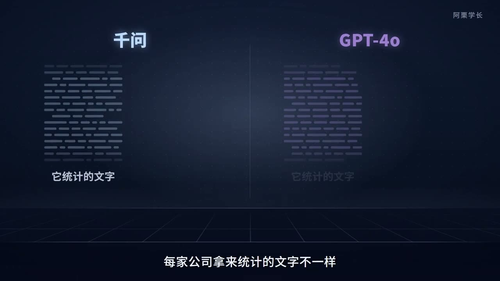

视频展示另一套分词器对相同中文句子的切分，Token 数甚至可能超过汉字数。理解这一点，需要从字符走到字节。


在 UTF-8 中：

```text
咖 → E5 92 96
啡 → E5 95 A1
```

字节级 BPE 可从 256 个可能字节值作为基础单位出发，再把常见字节序列合并成更长 Token。所以一个 Token 可能对应完整汉字、多个汉字，也可能只对应某个汉字的部分字节。

并非所有汉字都占三个 UTF-8 字节；部分扩展区汉字需要四个字节。更广泛的 Unicode 文本还包括多码点组合，不能把字符数、字节数和 Token 数混用。

### 7.1 没有完整新词 Token，仍可组合编码


如果系统保留全部基础字节，并且预处理和实现支持相应输入，就能在没有整个新词 Token 时把它表示为多个字节片段，而不必全部映射到 `<unk>`。字符级 BPE 若初始字符表没有覆盖输入字符，则不自动具有这种能力。

### 7.2 单个 Token 不一定能单独显示成字符

部分 Token 的字节不是完整 UTF-8 字符，单独解码可能失败或显示替代符号。应先按顺序拼接 Token 对应字节，再按 UTF-8 解码。文本规范化若改动了原文，即使编码本身可逆，也不代表能逐字恢复规范化之前的文本。

## 八、Token ID：整数编号没有天然语义距离

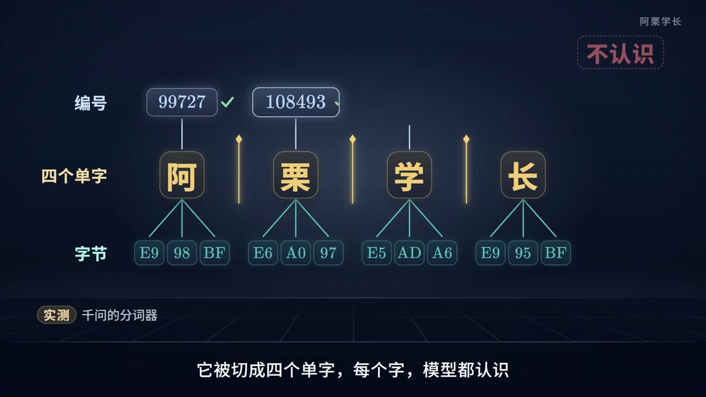


同一词表中，ID 100 与 ID 101 数字接近，不表示对应内容语义接近。词表排列与 ID 分配依赖实现；某些 BPE 表将普通 Token ID 与合并 rank 关联，但不能推广为所有分词器的规则，特殊 Token 也可能单独分配。

两个不同模型即使都出现 ID 100，也不意味着它们表示同一段文本。Tokenizer、Embedding 权重和模型检查点必须相互匹配。

## 九、从 ID 到向量：Embedding 是另一张表

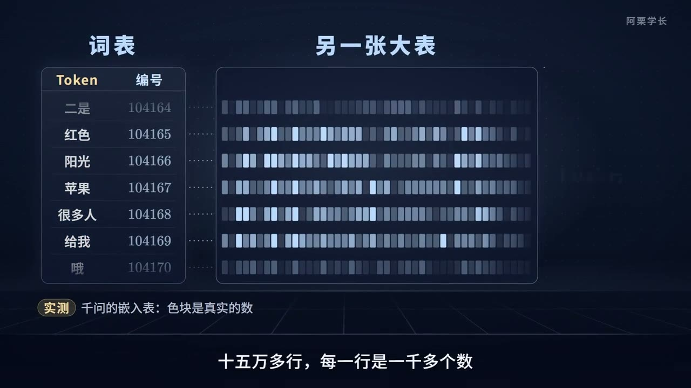

设词表大小为 $V$，隐藏维度为 $d$，Embedding 矩阵为：

$$
E\in\mathbb R^{V\times d}.
$$

Token ID 为 $t$ 时，输入向量就是第 $t$ 行：$x=E[t,:]$。例如设：

$$
E=\begin{bmatrix}0.1&0.2&-0.1\\0.0&0.5&0.4\\-0.3&0.7&0.2\\0.8&-0.2&0.1\end{bmatrix},
$$

则 ID 序列 `[2,0]` 对应两个向量：$[-0.3,0.7,0.2]$ 和 $[0.1,0.2,-0.1]$。查表通常不需要真的构造 one-hot；数学上可等价表示为 one-hot 向量与 $E$ 相乘。

### 9.1 Tokenizer 学合并，模型训练学向量


普通 BPE 训练根据离散频次决定合并；Embedding 通常通过语言模型损失和反向传播更新。二者是不同阶段、不同优化机制。Embedding 的初始化方式还取决于从头训练、继承检查点或扩充词表等设置。

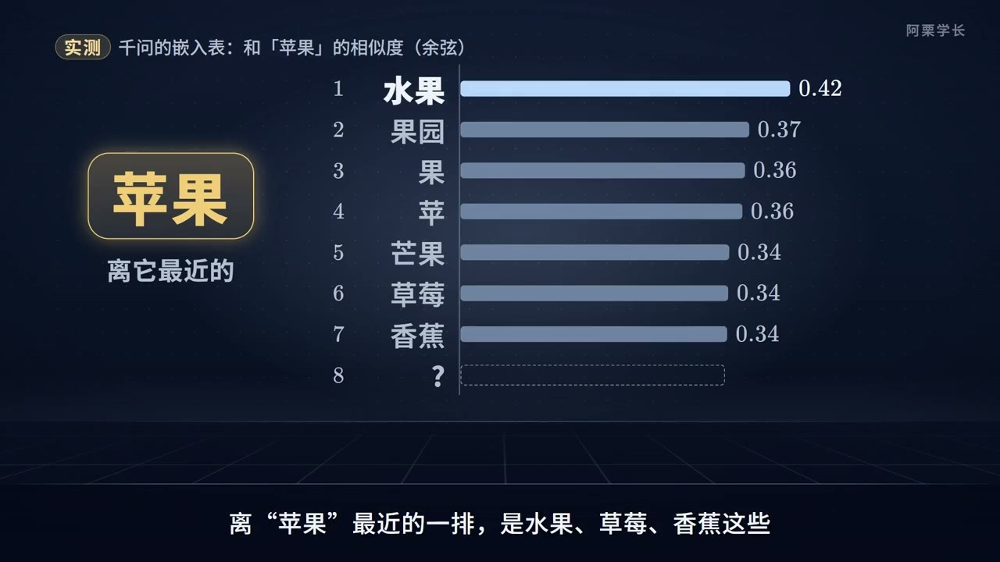

视频用箭头说明语义关联，适合建立直觉。但向量某个坐标并不天然对应“水果程度”或“科技程度”，实际语义通常分布在多维表示中。

### 9.2 同一个初始向量怎样适应不同上下文？

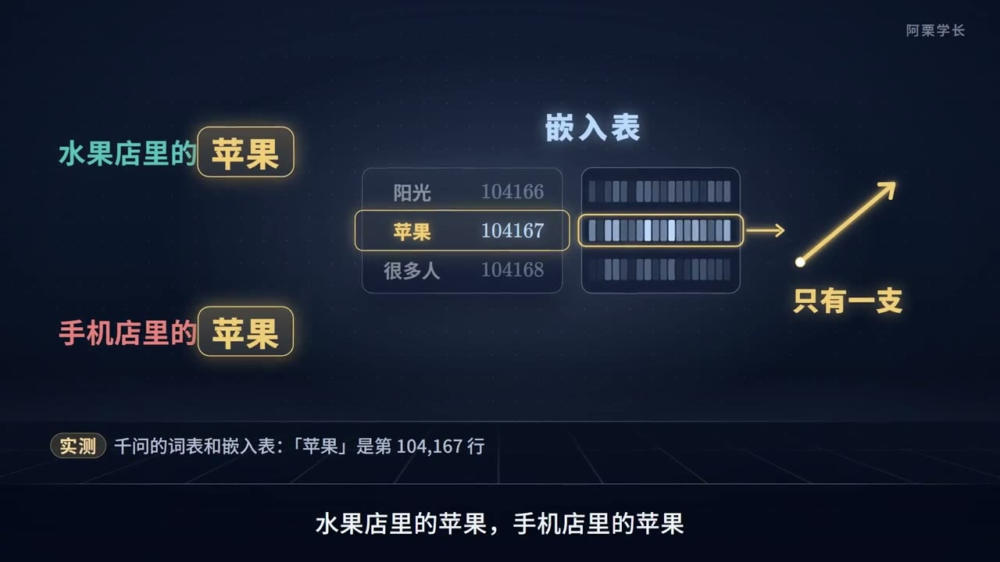

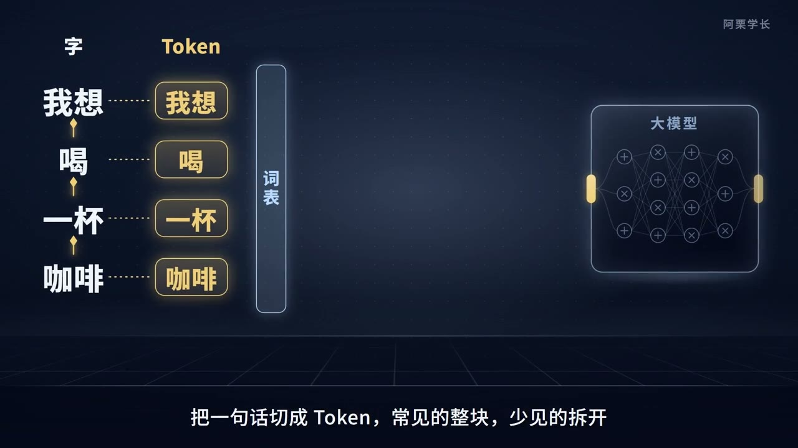

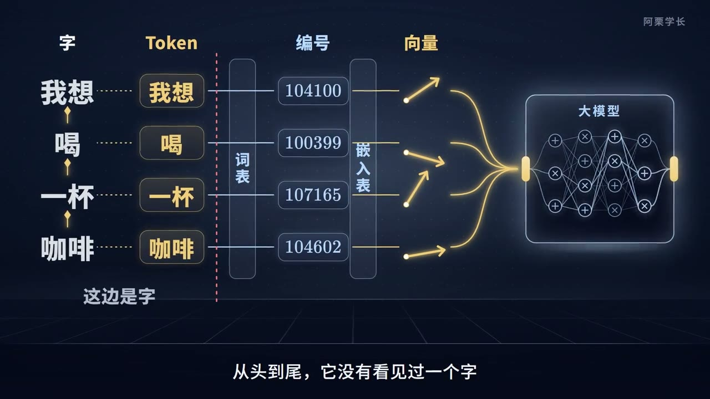

同一个 Token ID 从输入表取出的基础向量相同；进入 Transformer 后，各位置通过注意力及其他计算结合上下文，得到不同的隐藏状态。因此“我吃苹果”与“苹果发布手机”中，同一 Token 的初始查表结果可以相同，后续表示仍能不同。

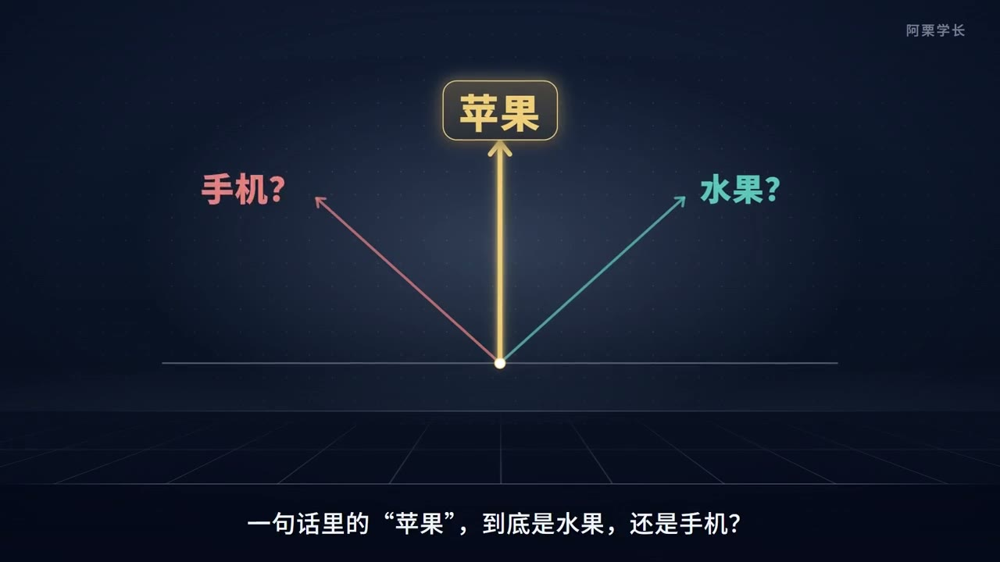

## 十、词表大小、序列长度与计算成本

BPE 的价值不只在于让文本能变成整数，也在于在词表规模与序列长度之间做取舍。

| 调整 | 可能收益 | 对应代价或限制 |
| --- | --- | --- |
| 更多可合并片段 | 部分文本 Token 数减少 | Embedding 和输出层可能更大；低频条目训练不足 |
| 更细的基础单位 | 覆盖灵活、新组合易表示 | 序列可能更长 |
| 增加领域语料 | 领域高频模式可能被更紧凑地表示 | 对其他分布的效果需实测 |
| 固定词表 | 与既有模型权重保持接口一致 | 新领域内容可能编码较碎 |

Embedding 参数量为 $Vd$。例如 $V=50{,}000,d=4096$ 时，有 $204{,}800{,}000$ 个参数；仅以每参数 2 字节计算，表权重约 409.6 MB，不含梯度、优化器状态及其他开销。若输入输出权重不共享，输出映射还可能需要另一张类似规模的矩阵。

对于标准全注意力，固定其他条件，注意力分数计算随序列长度 $T$ 具有 $O(T^2d)$ 量级。相同文本若从 100 个 Token 降到 80 个，二次项比例是 $0.8^2=0.64$。这只是该项的理论比例，不等于端到端速度提升 36%；FFN、输出词表计算、硬件和实现也会影响耗时。

## 十一、可运行的最小手算复现

配套 [bpe_toy.py](bpe_toy.py) 使用 Python 标准库，复现第四节的字符级 BPE 和第五节编码过程。它用于教学，省略字节基础表、正则预分词、特殊 Token 及高性能数据结构，不作为生产分词器。

```bash
python3 bpe_toy.py
```

预期合并规则为 `a+b→ab`、`ab+c→abc`、`ab+d→abd`，`abcd` 编码为 `['abc', 'd']`，加权 Token 总数依次为 `20 → 13 → 9 → 7`。脚本同时核对 UTF-8 字节、重叠对替换，以及合并顺序与最长匹配不等价的例子。

## 十二、技术来源与作者

| 时间 | 资料与作者 | 与本篇的关系 |
| --- | --- | --- |
| 1994 | Philip Gage，*A New Algorithm for Data Compression*，[原文存档](https://jacobfilipp.com/DrDobbs/articles/CUJ/1994/9402/gage/gage.htm) | BPE 的数据压缩来源；现代子词版本沿用了反复合并相邻对的思想 |
| 2016 | Rico Sennrich、Barry Haddow、Alexandra Birch，*Neural Machine Translation of Rare Words with Subword Units*，[ACL 原文](https://aclanthology.org/P16-1162/) | 将 BPE 思路用于神经机器翻译的开放词汇与子词表示 |
| 2018 | Taku Kudo、John Richardson，*SentencePiece: A simple and language independent subword tokenizer and detokenizer for Neural Text Processing*，[论文](https://aclanthology.org/D18-2012/) | 直接从原始文本训练子词模型的工具；支持 BPE 等方法，不能把 SentencePiece 与 BPE 当作同义词 |

工程阅读还可参考 [Hugging Face Tokenizers](https://github.com/huggingface/tokenizers)。视频中出现的具体模型切分、词表条目和 ID 作为视频演示记录；本文没有据截图声称复现完整分词器，也不把这些 ID 当作通用标准。

## 十三、视频截图索引与来源说明

本文 23 张截图均提取自指定视频，文件名标注秒数，图片版权归原作者或相应权利人所有。截图用于学习解释，补充手算和代码由本文提供。

| 时间点 | 主题 | 对应章节 |
| --- | --- | --- |
| 00:15、00:30 | 字符、Token、编号 | 一 |
| 00:45、01:00、01:15 | 粒度与新词 | 二 |
| 01:30、01:45、02:00 | 统计与合并、诗词演示 | 三 |
| 02:15、02:30、02:45 | 词表条目及统计特征 | 六 |
| 03:00、03:15、03:30 | 不同分词器、字节与新词 | 七 |
| 03:45、04:00 | Token ID | 八 |
| 04:15、04:45、05:00、05:15、05:30、05:45、05:55 | Embedding、训练与上下文 | 九 |

读完应能手算一次相邻对统计，解释为什么编码时不重新统计语料频次，区分字符、字节、Token、ID 和向量，并说明“可以编码”与“理解含义”之间还隔着模型训练及上下文计算。
