# 梯度消失与爆炸：从链式法则到残差连接

> **整理日期：** 2026-11-09  
> **视频来源：** 神经元出逃计划，《神经网络越深，为什么越难训练？看懂梯度消失与爆炸》，2026-09-16 发布，约 14 分 29 秒。  
> **原视频：** [抖音视频](https://www.douyin.com/video/7685939303301532934)  
> **阅读方式：** 按视频演示顺序整理，结合原视频截图、公式推导和手算。文中的初始化、交叉熵与训练排查属于补充解释，并非视频逐字转录。

深层网络反向传播时，需要把各层的局部导数连续相乘。某些方向上的梯度可能越来越小，也可能越来越大。决定这一过程的是权重、激活函数的导数、传播方向和网络结构，不能只看用了什么激活函数。

建议先读 [激活函数：从非线性到 SwiGLU](../激活函数/激活函数_从非线性到SwiGLU.md)，再将本篇与 [残差连接](../../技术拆解-残差链接/残差连接_从ResNet到Transformer.md)、[归一化](../../技术拆解-归一化/归一化_从LayerNorm到RMSNorm.md) 连起来。

## 一、先分清损失、梯度与参数更新

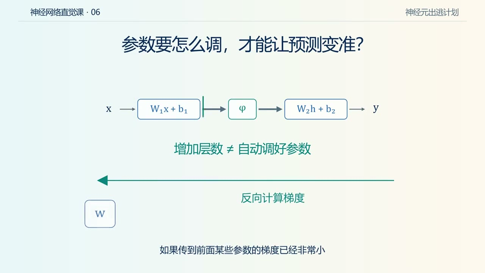

对一个参数 $w$，普通梯度下降更新为：

$$
w_{\mathrm{new}}=w_{\mathrm{old}}-\eta\frac{\partial L}{\partial w}.
$$

$L$ 表示当前损失，$\partial L/\partial w$ 表示该位置损失对参数的局部敏感程度，$\eta$ 是学习率。损失高，不代表梯度一定大。

例如 $L(w)=100+0.001w^2$，在 $w=1$ 时，损失为 $100.001$，梯度只有 $0.002$。取 $\eta=0.01$，参数改动仅为 $0.00002$。其中常数 100 抬高损失，却不改变导数。

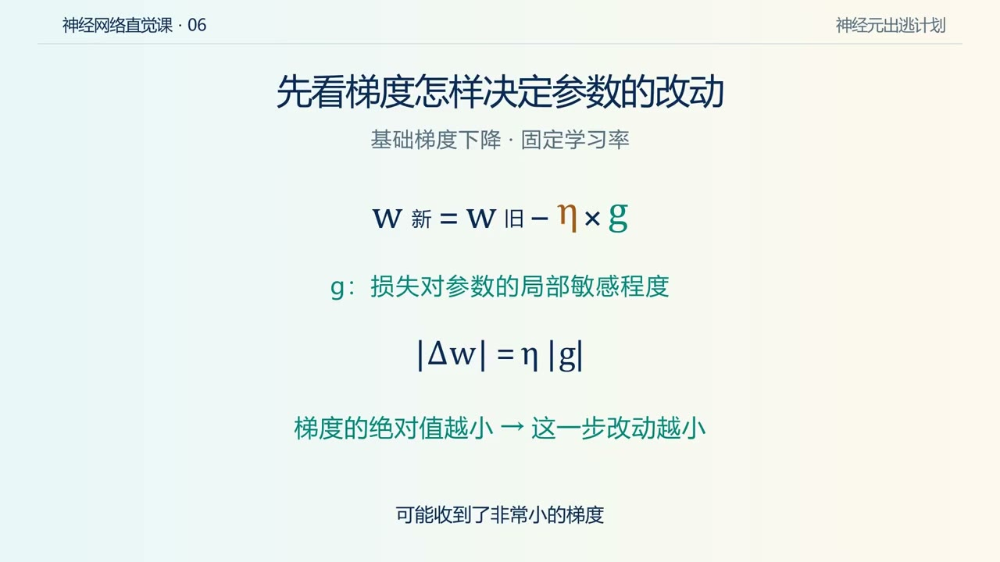

这里的更新公式用于建立直觉。Adam 等优化器还会根据历史梯度调整更新，所以“小梯度对应同比例小更新”并非所有优化器下的精确规律。

## 二、链式法则：反向传的是导数

设网络为：

$$
h_1=f_1(h_0),\quad h_2=f_2(h_1),\quad h_3=f_3(h_2),\quad L=\ell(h_3).
$$

标量情况下：

$$
\frac{\partial L}{\partial h_0}
=\frac{\partial L}{\partial h_3}
\frac{\partial h_3}{\partial h_2}
\frac{\partial h_2}{\partial h_1}
\frac{\partial h_1}{\partial h_0}.
$$

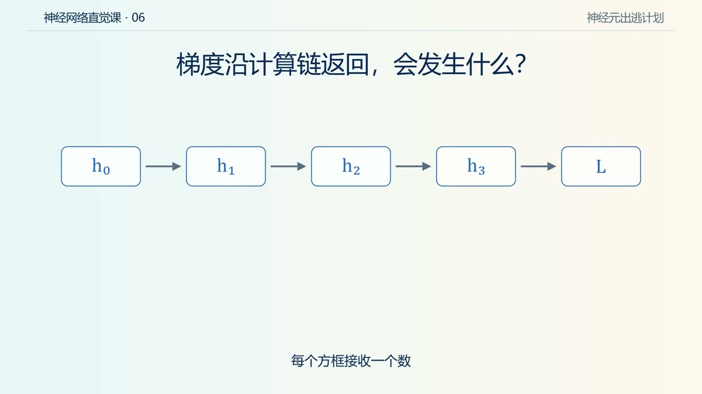

每个局部导数回答：“这个输入改变一点，当前输出会改变多少？”反传把后续损失对当前输出的敏感度，换算为损失对当前输入的敏感度。

### 2.1 每步乘 0.5：十步后只剩 1/1024

令末端梯度为 1，连续经过 $n$ 个局部因子 0.5，则梯度为 $0.5^n$。

| 经过的局部因子数量 | 梯度 |
| --- | --- |
| 0 | 1 |
| 1 | 0.5 |
| 4 | 0.0625 |
| 10 | 0.0009765625 |
| 20 | 0.0000009536743164 |

十步后得到的是对某个隐藏状态的梯度；若继续求参数梯度，还要乘该参数到隐藏状态的局部导数。

在普通 SGD、学习率为 0.01、参数局部因子为 1 的教学条件下，更新从 $0.01$ 缩小到：

$$
0.01\times\frac1{1024}=0.000009765625.
$$

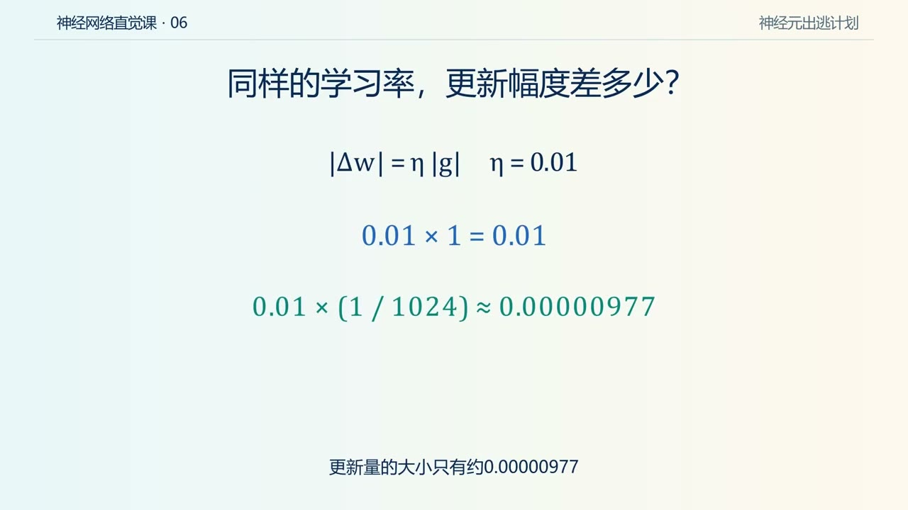

### 2.2 每步乘 2：十步后放大到 1024

同样从 1 出发，连续乘十次 2，得到 $2^{10}=1024$。过大的梯度可能产生过大的更新，导致训练震荡或数值溢出。

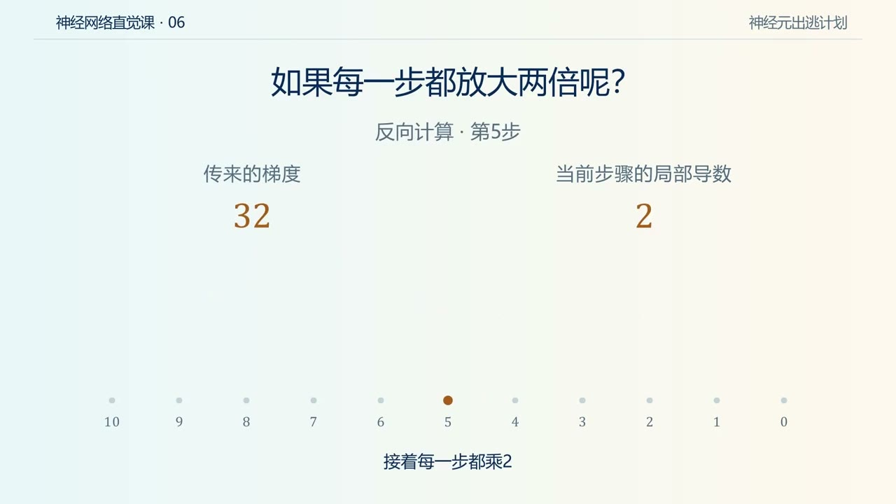

例如 $L(w)=w^2$，梯度下降为 $w_{t+1}=(1-2\eta)w_t$。当 $0<\eta<1$ 时收敛到零；$\eta>1$ 时绝对值逐步放大。这个单参数例子解释更新稳定性，不能单独证明某个深层网络发生了梯度爆炸。

## 三、拆开神经元：局部因子究竟来自哪里？

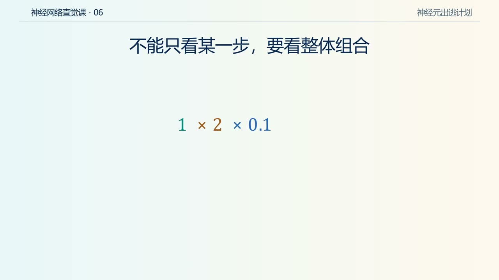

对单个神经元：

$$
z=wh+b,\qquad a=\phi(z).
$$

若后续传来的梯度是 $g_a=\partial L/\partial a$，则：

$$
\frac{\partial a}{\partial h}=\phi'(z)w,
\qquad
\frac{\partial L}{\partial h}=g_a\phi'(z)w,
$$

$$
\frac{\partial L}{\partial w}=g_a\phi'(z)h,
\qquad
\frac{\partial L}{\partial b}=g_a\phi'(z).
$$

这三种梯度分别对应输入、权重和偏置。求导目标不同，局部因子不同。

### 3.1 ReLU 正区间：激活斜率为 1，仍然要乘权重

取 $h=2,w=0.5,b=-0.5$，有 $z=0.5$，$a=\operatorname{ReLU}(0.5)=0.5$。因为 $z>0$，$\phi'(z)=1$，所以：

$$
\frac{\partial a}{\partial h}=1\times0.5=0.5.
$$

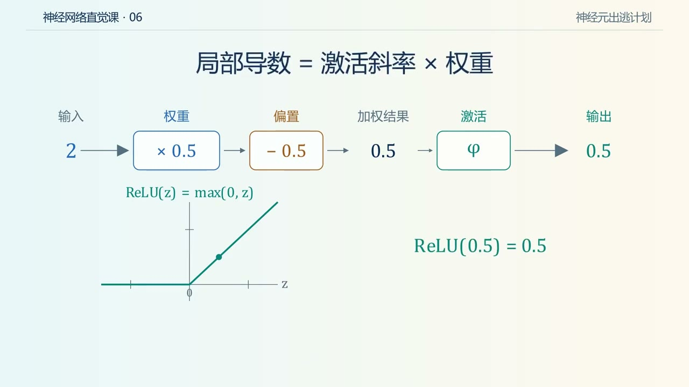

### 3.2 偏置不出现在乘积里，却会改变激活区间

把偏置改成 $b=-1.5$，则 $z=0.5\times2-1.5=-0.5$。此时 ReLU 的局部导数为零，上述三种梯度在这个样本的这条路径上都变为零。

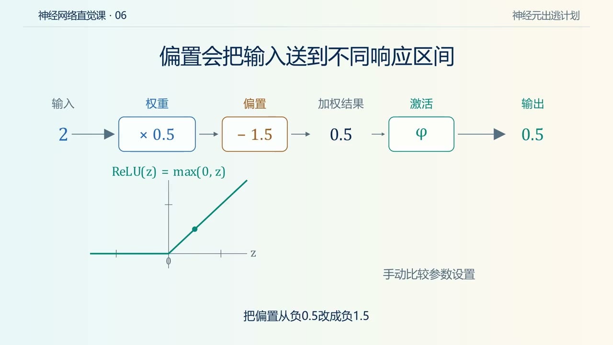

因此，偏置虽然不直接出现在 $\partial a/\partial h=\phi'(z)w$ 的外部乘积中，但会通过 $z$ 影响 $\phi'(z)$。一个样本上的零梯度，也不足以判定神经元对所有样本都“死亡”。ReLU 在零点不可微，实际框架采用约定的次梯度。

### 3.3 输入梯度与权重梯度：手算一次

回到 $h=2,w=0.5,b=-0.5$，令 $g_a=3$：

$$
\frac{\partial L}{\partial h}=3\times1\times0.5=1.5,
\quad
\frac{\partial L}{\partial w}=3\times1\times2=6,
\quad
\frac{\partial L}{\partial b}=3.
$$

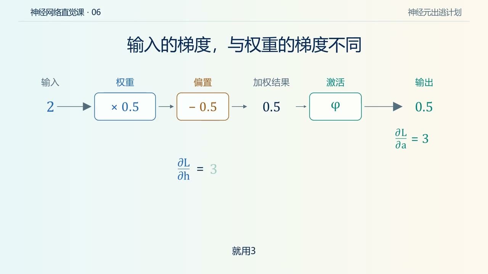

## 四、从一条路径到矩阵：为什么反传出现转置？

设列向量输入 $h\in\mathbb R^n$，权重 $W\in\mathbb R^{m\times n}$，$z=Wh+b$，$a=\phi(z)$。先经过激活函数：

$$
g_z=g_a\odot\phi'(z).
$$

再通过线性层：

$$
g_h=W^Tg_z,\qquad \nabla_WL=g_zh^T,\qquad \nabla_bL=g_z.
$$

其中 $\odot$ 是逐元素乘法。输入梯度形状为 $n$，权重梯度形状为 $m\times n$。batch 情况下还需按损失定义求和或平均。

### 4.1 两个输入、两个输出的手算

视频在此隔离线性变换，不经过激活，取：

$$
W=\begin{bmatrix}0.5&0.2\\0.1&0.4\end{bmatrix},
\qquad g_z=\begin{bmatrix}1\\2\end{bmatrix}.
$$

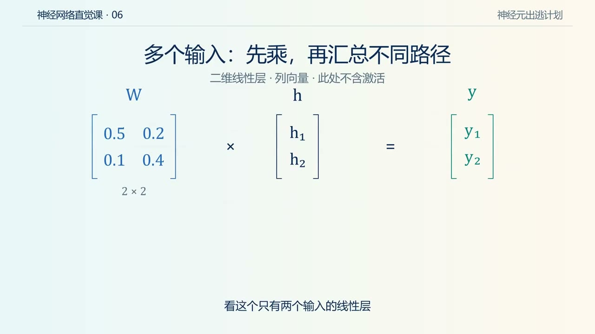

第一个输入影响两个输出，所以对应贡献相加：$0.5\times1+0.1\times2=0.7$。第二个输入同理：$0.2\times1+0.4\times2=1.0$。

$$
g_h=W^Tg_z=
\begin{bmatrix}0.5&0.1\\0.2&0.4\end{bmatrix}
\begin{bmatrix}1\\2\end{bmatrix}
=\begin{bmatrix}0.7\\1.0\end{bmatrix}.
$$

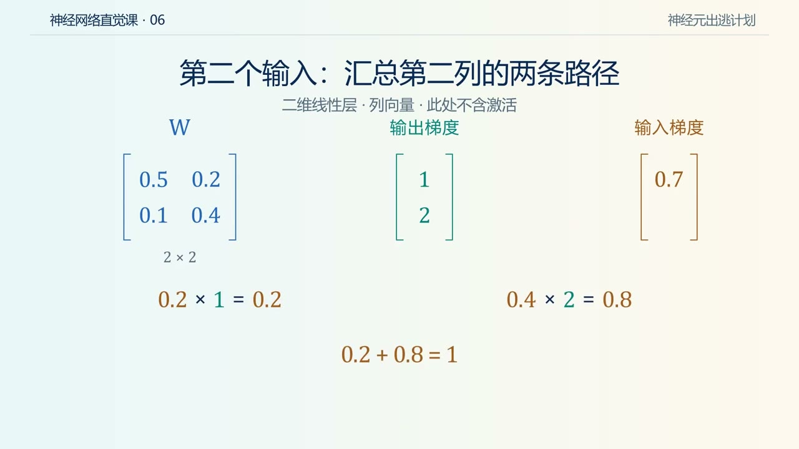

转置来自“把所有输出对同一输入的贡献汇总”。不能把多维网络简单理解成每层只有一个数字相乘：矩阵还会改变方向，多条路径的贡献也可能增强或抵消。

## 五、Sigmoid：为什么饱和区容易衰减？

$$
\sigma(z)=\frac1{1+e^{-z}},\qquad
\sigma'(z)=\sigma(z)(1-\sigma(z)).
$$

令 $p=\sigma(z)$，即可直接由输出求局部导数 $p(1-p)$。

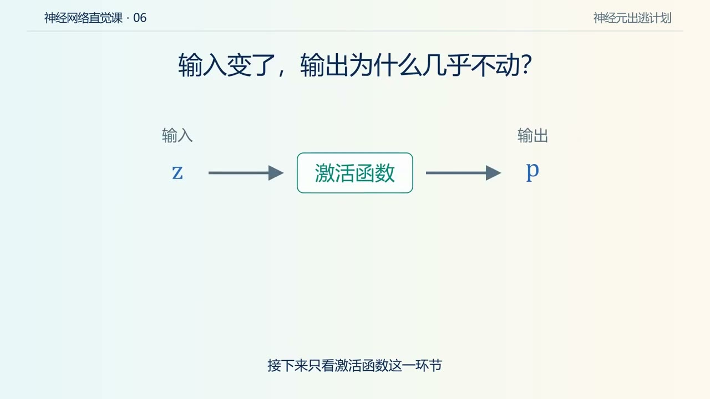

| 输出 $p$ | 导数 $p(1-p)$ | 含义 |
| --- | --- | --- |
| 0.5 | 0.25 | 最大斜率 |
| 0.99 | 0.0099 | 接近上端饱和 |
| 0.01 | 0.0099 | 接近下端饱和 |

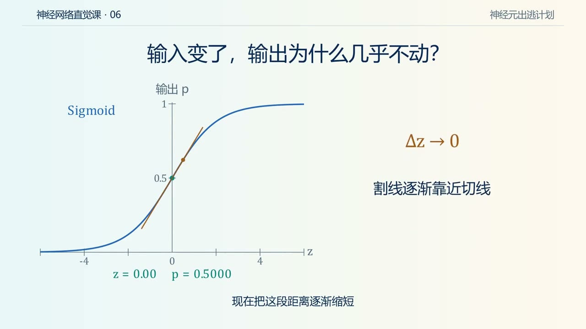

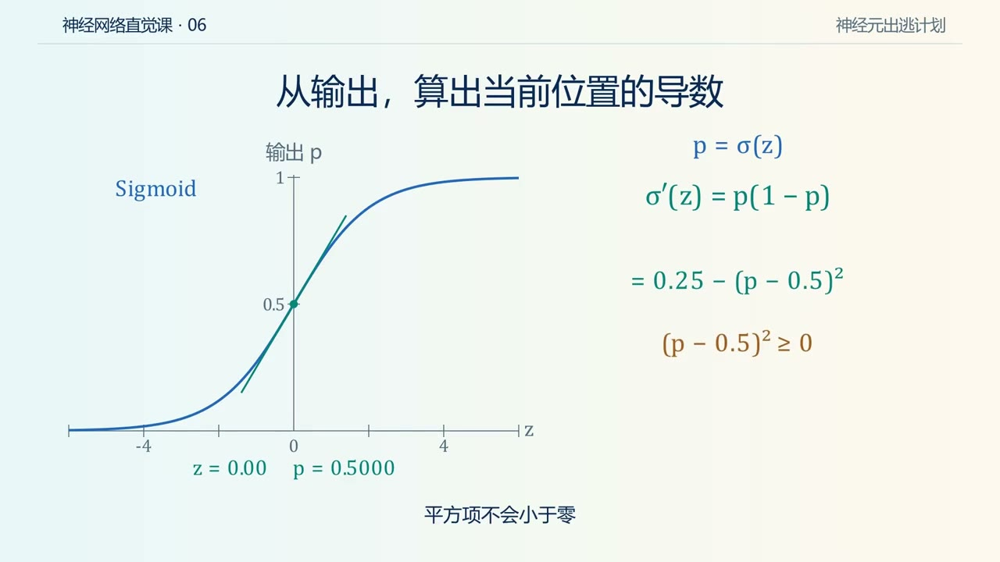

只隔离激活导数、假定其他局部因子为 1，连续经过三个导数为 0.0099 的位置：

$$
1\times0.0099^3=9.70299\times10^{-7}.
$$

这是对特定路径的教学计算。真实网络还包含权重矩阵；Sigmoid 的导数上限为 0.25，并不意味着整个层的 Jacobian 范数必然小于 1。

**补充：输出层的损失搭配也重要。** 二分类交叉熵 $L=-y\log p-(1-y)\log(1-p)$ 与 $p=\sigma(z)$ 结合，可化简为 $\partial L/\partial z=p-y$。因此不能看到输出层 Sigmoid 就额外乘一次 $p(1-p)$；那会重复计算。隐藏层的链式传播仍需使用其局部导数。

## 六、换成 ReLU，改善了什么？

$$
\operatorname{ReLU}(z)=\max(0,z),\qquad
\operatorname{ReLU}'(z)=\begin{cases}1&z>0\\0&z<0.\end{cases}
$$

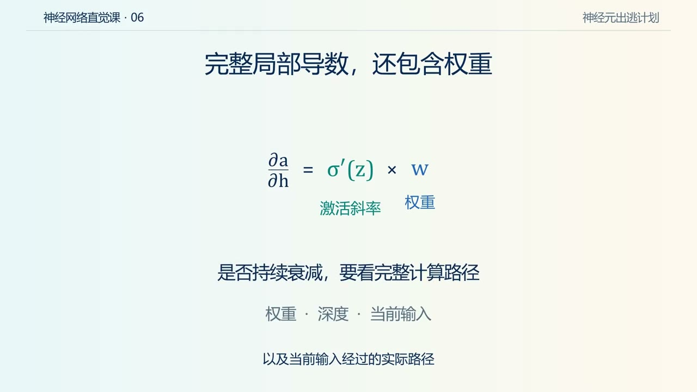

正区间没有 Sigmoid 那种随正输入增大而接近零的激活导数，但负区间导数为零。

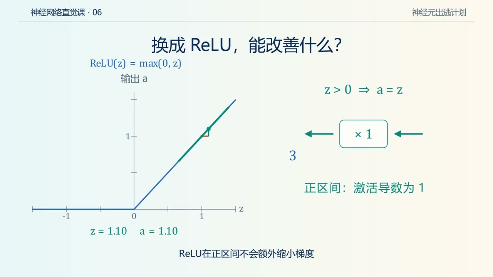

即使各层 ReLU 都处于正区间，仍然存在 $W_l^T$ 连乘。标量例子中若每层权重为 0.5，十层后仍乘 $0.5^{10}$；若每层权重为 2，则乘 $2^{10}$。

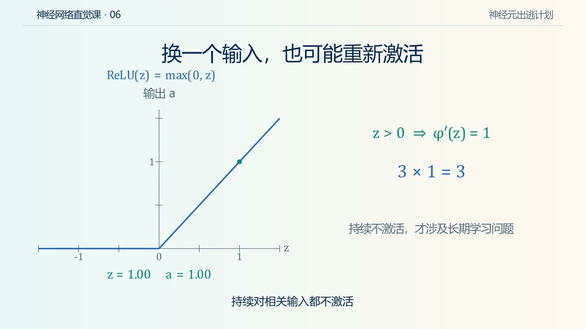

**结论：** ReLU 改变激活导数这一环，初始化、权重尺度和网络结构仍影响梯度传播。

## 七、多维网络的准确表达：Jacobian 连乘

令 $J_l=\partial h_l/\partial h_{l-1}$，采用列向量梯度，则：

$$
g_{l-1}=J_l^Tg_l,\qquad
g_0=J_1^TJ_2^T\cdots J_L^Tg_L.
$$

对 $h_l=\phi(W_lh_{l-1}+b_l)$，有 $J_l=D_lW_l$，其中 $D_l=\operatorname{diag}(\phi'(z_l))$。

由谱范数的次乘性：

$$
\|g_0\|_2\le\left(\prod_{l=1}^L\|J_l\|_2\right)\|g_L\|_2.
$$

若所有层的范数都被同一个小于 1 的常数控制，就得到指数衰减的上界。但各层范数大于 1，只说明这个上界可能很大，不能据此断言当前梯度必然爆炸；实际梯度方向、奇异值及层间方向变化都重要。

## 八、引出残差连接：增加直接路径

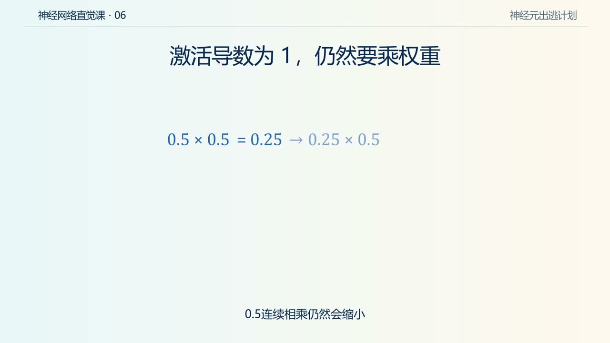

对于 $y=h+F(h)$：

$$
\frac{\partial y}{\partial h}=I+J_F(h),\qquad
\nabla_hL=\nabla_yL+J_F(h)^T\nabla_yL.
$$

与串行结构相比，反传中多了一项直接来自恒等路径的梯度。后续可继续阅读 [残差连接：从 ResNet 到 Transformer](../../技术拆解-残差链接/残差连接_从ResNet到Transformer.md)。

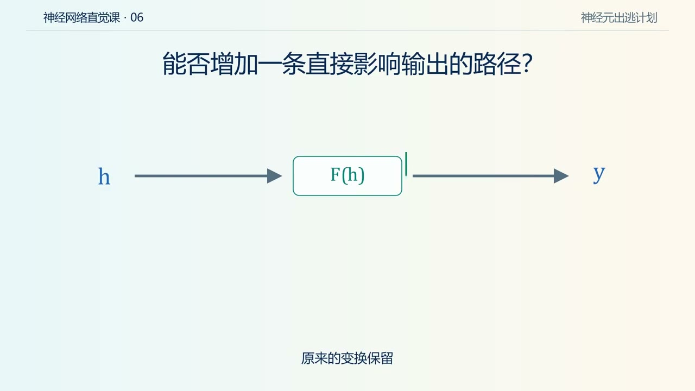

残差连接不是绝对保证：分支梯度可能与直接项抵消，$I+J_F$ 也可能具有很大的奇异值。它提供了更有利的结构，仍需配合初始化、归一化和合理训练设置。

## 九、补充：常见方法分别作用在哪里？

| 方法 | 改变什么 | 主要收益与限制 |
| --- | --- | --- |
| Xavier 初始化 | 按输入输出宽度设置初始方差 | 在相应假设下改善信号尺度；不是任意非线性网络的保证 |
| He 初始化 | 针对整流激活设置初始方差 | 常见 ReLU 前向保持方案为 $\operatorname{Var}(W)=2/\mathrm{fan\_in}$，依赖分布假设 |
| ReLU 等激活 | 激活函数局部导数 | 缓解部分饱和问题；仍需考虑零导数及权重 |
| 残差连接 | 传播路径及层 Jacobian | 增加直接梯度通路；不保证所有方向稳定 |
| LayerNorm / RMSNorm | 特征尺度与计算图 | 改善尺度管理；梯度仍取决于归一化及周围算子 |
| 梯度裁剪 | 反传完成后的梯度 | 限制大梯度；不能恢复已经消失的梯度 |
| 调整学习率 | 梯度到更新的转换 | 控制更新幅度；不改变本次已计算的反向 Jacobian |

全局范数裁剪可写为：

$$
\widetilde g=g\min\left(1,\frac{c}{\|g\|_2+\epsilon}\right).
$$

其中 $g$ 是所有待裁剪参数梯度拼接后的向量，$c>0$ 为阈值。它整体缩放梯度，与逐元素截断不同。混合精度训练的 loss scaling 处理有限精度下的下溢，不能消除数学上的梯度衰减。

实际排查时，联合观察各层激活、参数梯度范数、更新量与参数量的比值以及非有限值。单个 batch 的梯度很小，可能来自样本、接近最优、损失平均方式或梯度累积设置，不能直接判定为深度导致的梯度消失。

## 十、论文、作者与原始资料

以下论文用于扩展理解，不表示视频逐一介绍了这些论文。

| 年份 | 论文与作者 | 对应问题 |
| --- | --- | --- |
| 2010 | Xavier Glorot、Yoshua Bengio，*Understanding the difficulty of training deep feedforward neural networks*，[AISTATS 原文](https://proceedings.mlr.press/v9/glorot10a.html) | 激活、饱和与初始化的关系 |
| 2013 | Razvan Pascanu、Tomas Mikolov、Yoshua Bengio，*On the difficulty of training recurrent neural networks*，[ICML 原文](https://proceedings.mlr.press/v28/pascanu13.html)；[2012 年预印本](https://arxiv.org/abs/1211.5063) | RNN 的梯度消失、爆炸与梯度裁剪；沿时间展开同样产生 Jacobian 连乘 |
| 2015 | Kaiming He、Xiangyu Zhang、Shaoqing Ren、Jian Sun，*Delving Deep into Rectifiers: Surpassing Human-Level Performance on ImageNet Classification*，[ICCV 原文](https://openaccess.thecvf.com/content_iccv_2015/html/He_Delving_Deep_into_ICCV_2015_paper.html) | 整流网络与方差初始化 |

## 十一、视频截图索引与来源说明

本文 22 张截图均取自指定视频，时间点见图片说明及文件名；图片版权归原作者或相应权利人所有。截图用于学习讲解，不代表作者认可本文的补充推导。

| 时间段 | 内容 | 本文章节 |
| --- | --- | --- |
| 00:40、01:20 | 梯度更新、损失与梯度大小 | 一 |
| 02:00—04:40，每 40 秒一帧 | 链式法则、连续缩小及更新过大 | 二 |
| 05:20—07:20，每 40 秒一帧 | 神经元、激活斜率、权重与偏置 | 三 |
| 08:00、08:40 | 多路径汇总与矩阵转置 | 四 |
| 09:20—11:20，每 40 秒一帧 | Sigmoid 饱和及连乘 | 五 |
| 12:00—13:20，每 40 秒一帧 | ReLU 正负区间及权重影响 | 六 |
| 14:00、14:20 | 直接路径与残差连接的引入 | 八 |

阅读后应能独立回答：为什么损失高而梯度小？为什么输入梯度乘权重、权重梯度乘输入？为什么矩阵反传要转置？为什么 ReLU 正区间斜率为 1，仍可能梯度消失？残差连接增加的恒等项来自哪里？
