# 激活函数：从“为什么需要非线性”到 SwiGLU

> **整理日期：** 2026-11-09  
> **内容定位：** 深度学习基础，连接神经元、反向传播、Transformer FFN 与门控网络。  
> **主要参考：** 阿栗学长《AI 原理拆解》第 8、9 集；正文采用实际视频截图，并结合原论文核对。完整来源和截图时间表见文末。  
> **符号约定：** 除特别说明，向量按行向量书写，$\odot$ 表示逐元素相乘；$\sigma$ 表示 logistic sigmoid，$\Phi$ 表示标准正态累积分布函数。

激活函数是在神经网络计算中对中间数值施加的变换。理解它不能只背“引入非线性”，还需要看清：**哪些计算在没有它时会合并，非线性怎样形成不同的局部规则，导数怎样影响学习，以及现代 FFN 为什么又加入两路投影与乘法。**

本文按两条视频的线索展开：先拆掉激活函数，看纯仿射网络的限制；再装回 ReLU，手算折线与图像特征响应；随后比较 Sigmoid、Tanh、ReLU、SiLU、GELU，最后完整展开 GLU / SwiGLU。

## 阅读导航

| 学习阶段 | 章节 | 要回答的问题 |
| --- | --- | --- |
| 建立直觉 | 一至五 | 没有激活会怎样？ReLU 怎样产生转折？ |
| 理解训练 | 六至十 | 输出形状和导数分别意味着什么？ |
| 理解现代大模型 | 十一至十四 | SiLU 与 SwiGLU 有什么区别？门控如何计算？ |
| 查论文与实现 | 十五至十九 | 作者是谁？实验能说明什么？代码如何对应？ |

## 一、先拆开一个神经元：参数、加权和与激活

单个神经元通常可以写成：

$$
z=\sum_{i=1}^{d}x_iw_i+b,\qquad h=\phi(z).
$$

| 组成 | 做什么 | 常见误解 |
| --- | --- | --- |
| 输入 $x$ | 当前样本的特征表示 | 不一定是原始像素，也可能是前一层隐藏状态 |
| 权重 $w$ | 学习输入坐标的组合方式 | 并不逐个固定对应人类语义概念 |
| 偏置 $b$ | 调整响应阈值与位置 | 并不只是训练后的额外修正 |
| 预激活 $z$ | 加权求和后的中间数 | 不是原始输入本身 |
| 激活 $\phi$ | 对 $z$ 施加规则 | 基本 ReLU 的规则固定，训练改变的是其输入 |

一层网络将多个神经元并排计算：

$$
Z=XW+b,\qquad H=\phi(Z).
$$

对 ReLU、Sigmoid、Tanh、SiLU、GELU，$\phi$ 通常逐元素应用，不改变张量形状。Softmax 则需要在一个选定轴上联合处理多个坐标，后文单独说明。

## 二、没有激活函数，为什么深层网络会合并？

### 2.1 从一维乘法开始

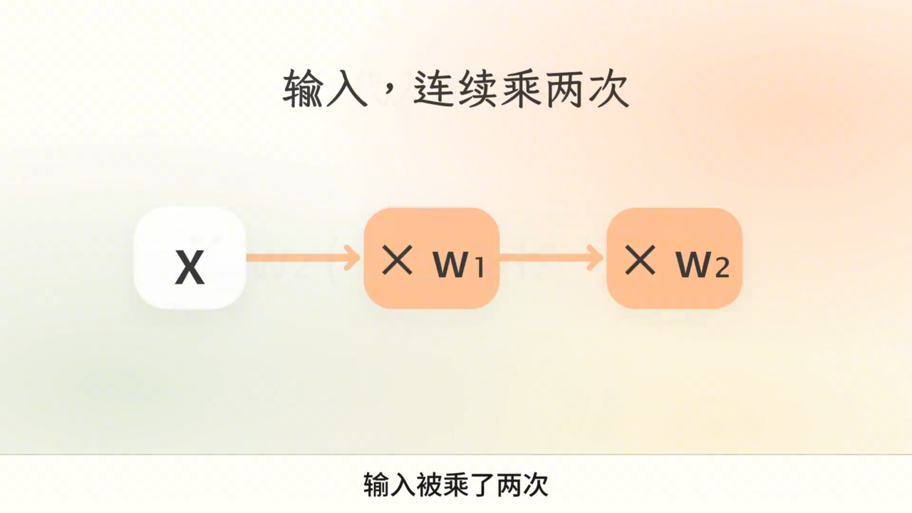

*视频 A，约 00:50：输入连续经过两次权重乘法。先看计算关系，再看网络画了多少层。*

没有偏置时：

$$
h=w_1x,\qquad y=w_2h=w_2w_1x.
$$

给定参数后，令 $w_{\mathrm{eff}}=w_2w_1$，函数就是一次乘法。有偏置时同样成立：

$$
h=w_1x+b_1,
$$

$$
y=w_2h+b_2=(w_2w_1)x+(w_2b_1+b_2).
$$

严格来说，有偏置是**仿射映射**；教学中常把它和线性层一起称为“线性”。本文讨论合并时包含这两种情形。

### 2.2 矩阵形式与手算

采用行向量约定：

$$
h=xW_1+b_1,\qquad y=hW_2+b_2
=x(W_1W_2)+(b_1W_2+b_2).
$$

取：

$$
x=[1,2],\quad W_1=\begin{bmatrix}1&2\\3&4\end{bmatrix},
\quad b_1=[1,-1],\quad
W_2=\begin{bmatrix}2\\-1\end{bmatrix},\quad b_2=0.5.
$$

逐层计算：

$$
h=[1,2]W_1+[1,-1]=[8,9],\qquad y=8\times2-9+0.5=7.5.
$$

先合并参数也一样：

$$
W_{\mathrm{eff}}=W_1W_2=\begin{bmatrix}0\\2\end{bmatrix},
\qquad b_{\mathrm{eff}}=b_1W_2+b_2=3.5,
$$

$$
y=[1,2]\begin{bmatrix}0\\2\end{bmatrix}+3.5=7.5.
$$

### 2.3 “等于一层”说的是函数形式，不是训练过程完全相同

多层仿射映射的复合仍然是仿射映射。但因矩阵分解而产生的优化过程、隐式偏好、秩约束，未必等同于直接训练一个不受约束的矩阵。例如中间宽度为 $m$，则 $\operatorname{rank}(W_1W_2)\leq m$。

这里也有明确适用范围：**计算路径中只有仿射操作**。如果保留 softmax attention、LayerNorm、逐元素乘法或其他非线性，就不能因为“删掉了 ReLU”而宣布整个 Transformer 都变成一个线性层。

## 三、问题不在直线斜率，而在“始终只能是一条直线”

### 3.1 拟合 $x^2$：移动直线不能让它弯起来

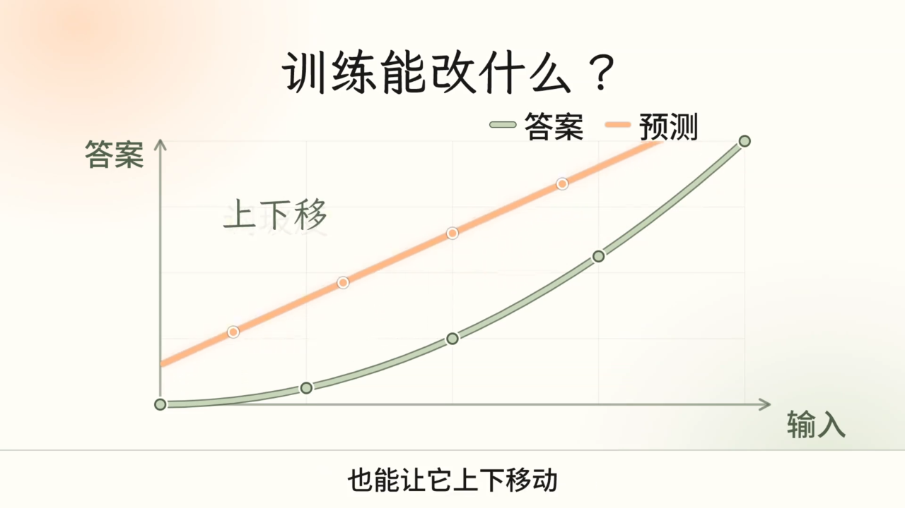

*视频 A，约 02:05：训练可以改变直线的位置和斜率，但无法把整个仿射函数变成二次曲线。*

设目标为 $y=x^2$，取样本 $(0,0),(1,1),(2,4)$。若仿射模型 $ax+b$ 同时满足前两点，则 $b=0,a=1$；到第三点只能得到 2，而非 4。继续添加纯仿射层不改变这个矛盾。

“需要非线性”并不意味着每个任务都必须复杂：若目标本来就接近仿射关系，简单模型可能已经合适。这里说明的是函数族的限制。

### 3.2 XOR：换成二维也有同样的限制

| $x_1$ | $x_2$ | XOR 目标 |
| --- | --- | --- |
| 0 | 0 | 0 |
| 0 | 1 | 1 |
| 1 | 0 | 1 |
| 1 | 1 | 0 |

单一仿射打分加阈值无法把对角线上的两类点分开。引入非线性隐藏单元则可以构造：

$$
s=x_1+x_2,\qquad h_1=\operatorname{ReLU}(s),
\qquad h_2=\operatorname{ReLU}(s-1),
$$

$$
f(x_1,x_2)=h_1-2h_2.
$$

当 $s=0,1,2$ 时输出分别为 $0,1,0$，正好覆盖这四个二值输入。这是函数构造示例，不表示随机初始化必然一步学到这些参数。

## 四、ReLU 怎样把一个规则变成分段规则？

### 4.1 定义：正数保留，负数归零

$$
\operatorname{ReLU}(z)=\max(0,z)
=\begin{cases}0,&z\leq0,\\z,&z>0.\end{cases}
$$

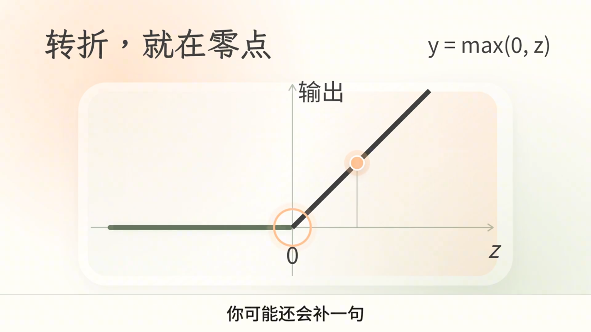

*视频 A，约 02:55：观察横轴是预激活 $z$。转折发生在 $z=0$，并不总是原始输入 $x=0$。*

对 $h(x)=\operatorname{ReLU}(wx+b)$，转折位置由 $wx+b=0$ 决定。一维且 $w\ne0$ 时是 $x=-b/w$；高维则是一条超平面。

因此，训练不需要改变 ReLU 自身的公式，也能移动转折位置、改变方向与有效斜率。

### 4.2 两个神经元，合成三段规则

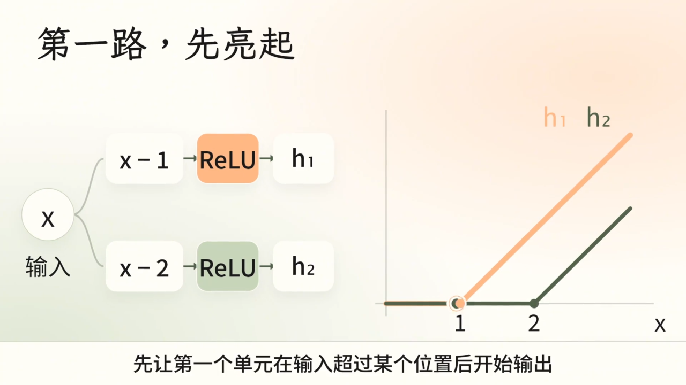

*视频 A，约 03:45：两个单元分别接收不同偏置的输入，因而在不同位置开始输出。*

令：

$$
h_1=\operatorname{ReLU}(x-1),\qquad
h_2=\operatorname{ReLU}(x-2),\qquad f=h_1+h_2.
$$

则：

$$
f(x)=\begin{cases}
0,&x\leq1,\\
x-1,&1<x\leq2,\\
2x-3,&x>2.
\end{cases}
$$

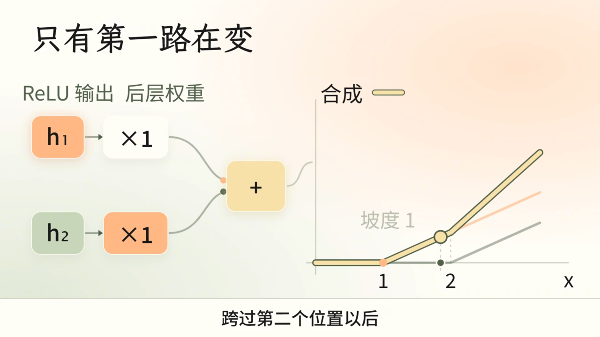

*视频 A，约 04:10：两个 ReLU 输出经后层权重组合。这里不是只选择一条路线，而是把各单元的当前响应相加。*

| 输入区间 | 第一个单元 | 第二个单元 | 总输出的斜率 |
| --- | --- | --- | --- |
| $x<1$ | 关闭 | 关闭 | 0 |
| $1<x<2$ | 活跃 | 关闭 | 1 |
| $x>2$ | 活跃 | 活跃 | 2 |

某个激活模式固定后，网络在对应区域仍是仿射的；整体由多个区域拼接，因此整体非线性。“分段线性”通常也包含带常数项的分段仿射。

### 4.3 多个转折可以逼近曲线：把 $x^2$ 手算出来


*视频 A，约 04:35：曲线逼近来自多个单元的组合。ReLU 网络得到的是折线，目标曲线可以被越来越细的分段近似。*

在 $x\in[0,4]$ 上构造：

$$
f(x)=\operatorname{ReLU}(x)
+2\operatorname{ReLU}(x-1)
+2\operatorname{ReLU}(x-2)
+2\operatorname{ReLU}(x-3).
$$

其各段斜率为 $1,3,5,7$，恰好连接 $x^2$ 在整数节点上的取值：

| $x$ | $h_0$ | $h_1$ | $h_2$ | $h_3$ | $f=h_0+2h_1+2h_2+2h_3$ | $x^2$ |
| --- | --- | --- | --- | --- | --- | --- |
| 0 | 0 | 0 | 0 | 0 | 0 | 0 |
| 1 | 1 | 0 | 0 | 0 | 1 | 1 |
| 1.5 | 1.5 | 0.5 | 0 | 0 | 2.5 | 2.25 |
| 2 | 2 | 1 | 0 | 0 | 4 | 4 |
| 3 | 3 | 2 | 1 | 0 | 9 | 9 |
| 4 | 4 | 3 | 2 | 1 | 16 | 16 |

该折线在每个单位区间上的最大绝对误差为 $0.25$。增加节点密度可以减小这个插值误差，但也增加表示所需的单元。有限个 ReLU 的分段仿射函数不会在整段实数区间上精确等于光滑二次函数。

### 4.4 谁在学习？ReLU 固定，权重与偏置在改变


*视频 A，约 05:25：区分固定的激活规则和可训练的 $w,b$。不要把所有能力都归给一个 max 函数。*

通用的一维浅层网络可写成：

$$
f(x)=c+\sum_{j=1}^m a_j\operatorname{ReLU}(w_jx+b_j).
$$

$w_j,b_j$ 决定各单元响应的方向与阈值，$a_j$ 决定它如何参与最后组合。基本 ReLU 本身没有可训练参数；后面的 PReLU 则会额外学习负半轴斜率。

## 五、从数字到图片：激活的是特征响应，不是“删除像素”

### 5.1 同一张图片产生多个预激活

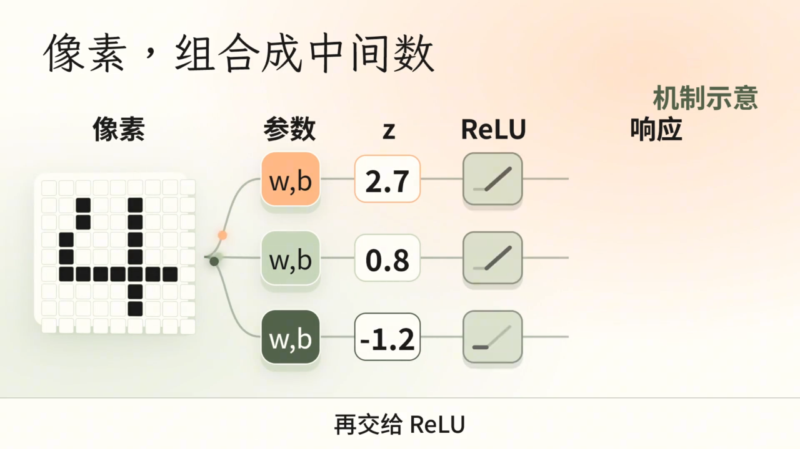

*视频 A，约 05:50：图中像素通过不同参数组合成多个 $z$。这里是机制示意，不能把某个单元直接等同于永久固定的语义概念。*

假设三个单元给出：

$$
z=[2.7,0.8,-1.2],\qquad
\operatorname{ReLU}(z)=[2.7,0.8,0].
$$

负的加权响应被截断，原始图片并未被改写。后层继续把这些响应组合成新的表示；在 CNN 中，这些操作还会与局部卷积、空间结构配合。

### 5.2 输入变化，活跃的单元组合也变化

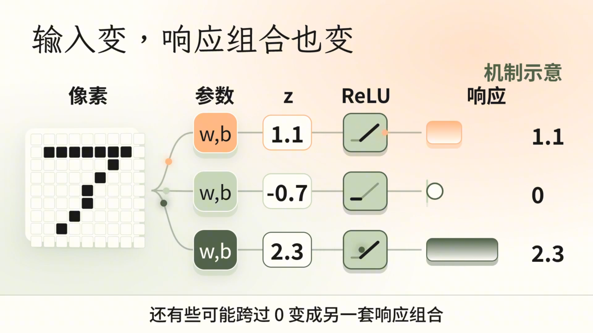

*视频 A，约 06:15：换一个输入后，预激活变为不同数值，因而激活模式也改变。*

若另一输入给出 $[1.1,-0.7,2.3]$，输出就是 $[1.1,0,2.3]$。网络现在使用了不同的局部仿射规则；它不是对所有输入始终执行相同的有效矩阵。

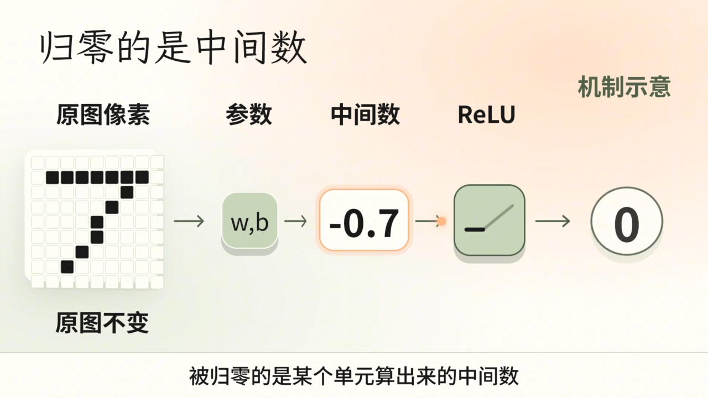

*视频 A，约 06:40：图中明确区分原图、参数组合后的数值和激活结果。*

“负数代表不重要”也不是普遍真理：负值可能携带有用信息。ReLU 是一种结构选择，允许负响应的激活则做出不同取舍。

## 六、激活函数如何参与反向传播？

### 6.1 一条链式法则贯穿所有激活

对单个单元：

$$
z=wx+b,\qquad h=\phi(z),\qquad
\frac{\partial\mathcal L}{\partial w}
=\frac{\partial\mathcal L}{\partial h}\phi'(z)x.
$$

激活的导数决定上游梯度如何局部传回。它不独自决定整个网络的梯度大小，因为权重矩阵、损失、其他分支也参与传播。

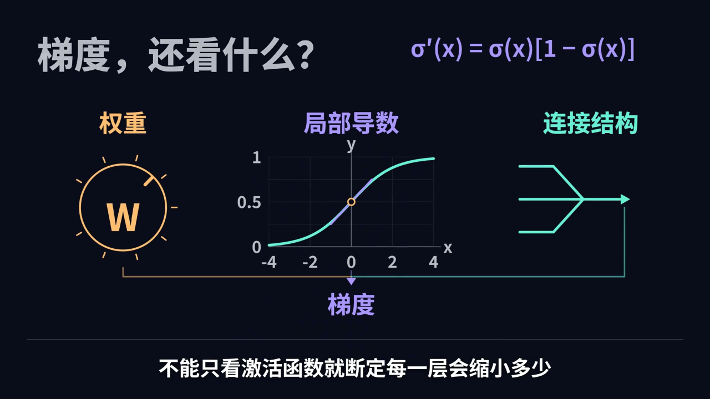

*视频 B，约 01:40：把激活局部导数、权重和连接结构放在一起看。局部性质不能直接代替完整网络的分析。*

行向量写法中，若 $Z=XW+b$、$H=\phi(Z)$，则：

$$
G_Z=G_H\odot\phi'(Z),\qquad
G_W=X^TG_Z,\qquad G_X=G_ZW^T.
$$

这也解释了为什么“前向输出很小”和“反向梯度一定很小”不是同一句话：要看导数以及完整计算图。

### 6.2 多层的乘积会放大局部差异

标量示例中，若十层激活导数都不超过 $0.25$，仅这些导数的乘积就不超过：

$$
0.25^{10}=\frac1{1{,}048{,}576}\approx9.54\times10^{-7}.
$$

这用于展示衰减机制；它忽略权重导数，不能作为任意 Sigmoid 网络梯度的实际数值。完整向量网络要分析 Jacobian 的乘积、方向与奇异值。

## 七、Sigmoid：概率输出很自然，深层隐藏单元会遇到什么？

$$
\sigma(x)=\frac1{1+e^{-x}},\qquad
\sigma'(x)=\sigma(x)(1-\sigma(x)).
$$

它把实数映射到 $(0,1)$，在二分类输出与门控结构中很有用。但隐藏层大量使用时需要注意：

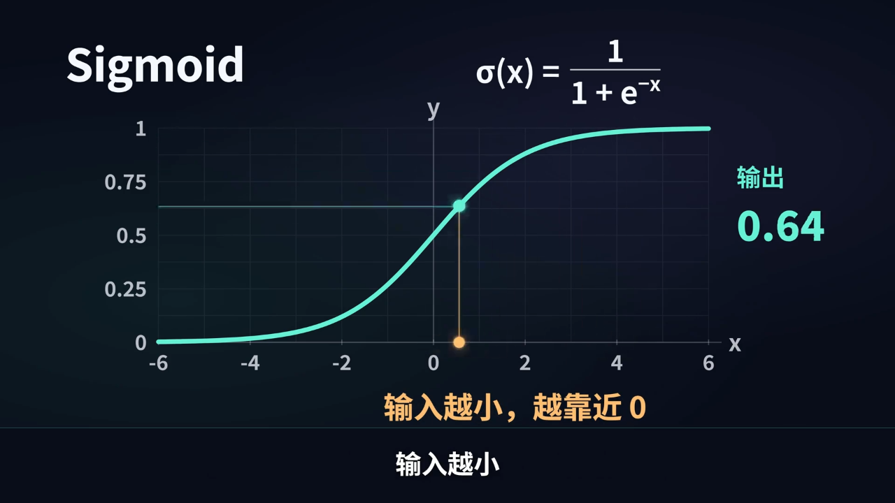

*视频 B，约 00:25：中间较陡，两端逐渐变平；数值越正越接近 1，越负越接近 0。输出范围和局部斜率是两个不同属性。*

- $x$ 很正或很负时，曲线进入饱和区，导数接近 0。
- 最大导数只有 $1/4$，发生在 $x=0$。
- 输出全为正，输入与权重初始化不当时可能影响层间分布和优化。

| $x$ | $\sigma(x)$ | $\sigma'(x)$ |
| --- | --- | --- |
| -5 | 0.0067 | 0.0066 |
| 0 | 0.5000 | 0.2500 |
| 5 | 0.9933 | 0.0066 |

“Sigmoid 已被淘汰”是不准确的。它仍是许多概率输出和门控的基础，只是不必把它作为所有深层隐藏单元的默认选择。

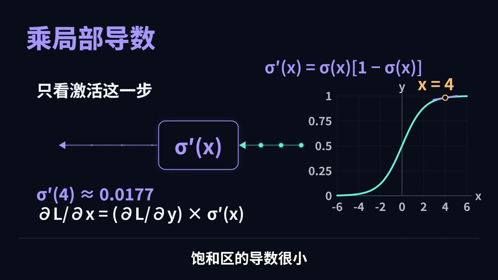

*视频 B，约 01:15：以 $x=4$ 为例，局部导数约为 $0.0177$。上游梯度通过这个位置时，要乘上该局部导数。*

## 八、Tanh：以零为中心，但饱和仍在

$$
\tanh(x)=\frac{e^x-e^{-x}}{e^x+e^{-x}},\qquad
\tanh'(x)=1-\tanh^2(x).
$$

输出范围 $(-1,1)$，关于原点对称，允许正负响应；在零点导数为 1。与 Sigmoid 相比，它改善了输出中心偏移这一方面，却没有消除两端饱和。

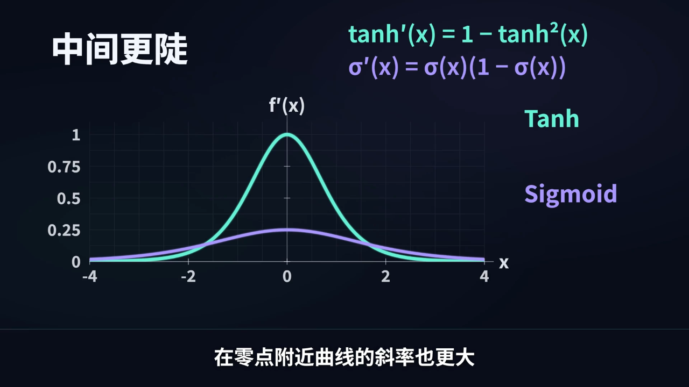

*视频 B，约 02:05：图中比较的是导数曲线，中间峰值更高，不等于全部输入范围都保持大梯度。*

例如 $\tanh(3)\approx0.9951$，导数约 $0.0099$。因此不能把“Tanh 零中心”直接等同于“深层梯度永不消失”。

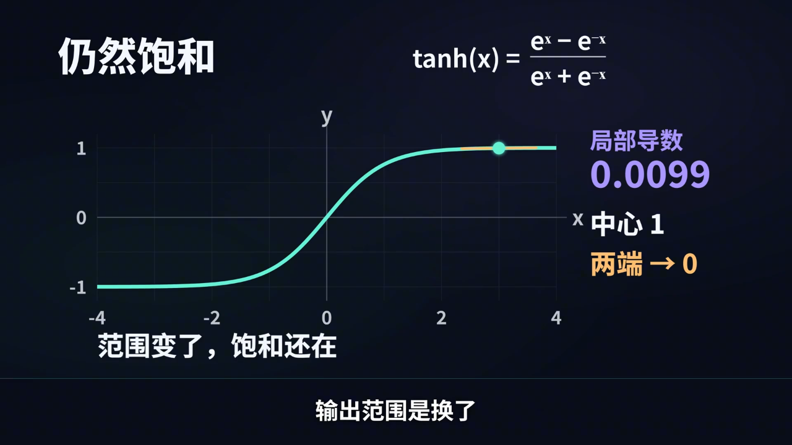

*视频 B，约 02:30：输出接近上界后，继续改变输入，输出只变化很少。范围换成 $(-1,1)$ 并没有消除这个现象。*

关于深层训练、饱和与初始化的经典研究，见 Glorot、Bengio 的 [Understanding the difficulty of training deep feedforward neural networks](https://proceedings.mlr.press/v9/glorot10a.html)（AISTATS 2010）。

## 九、ReLU 的收益与边界：稀疏、不可导点与死亡单元

### 9.1 导数与计算成本

$$
\operatorname{ReLU}'(x)=\begin{cases}0,&x<0,\\1,&x>0.\end{cases}
$$

零点的数学导数不存在；自动微分实现通常选定一个约定值，例如 0。反向传播能处理这种几乎处处可导的结构，不要求所有激活都处处光滑。

正半轴没有 Sigmoid 式饱和，比较和截断也容易实现。但正区间的导数为 1 不保证全网梯度为 1；负半轴的导数则严格为 0。

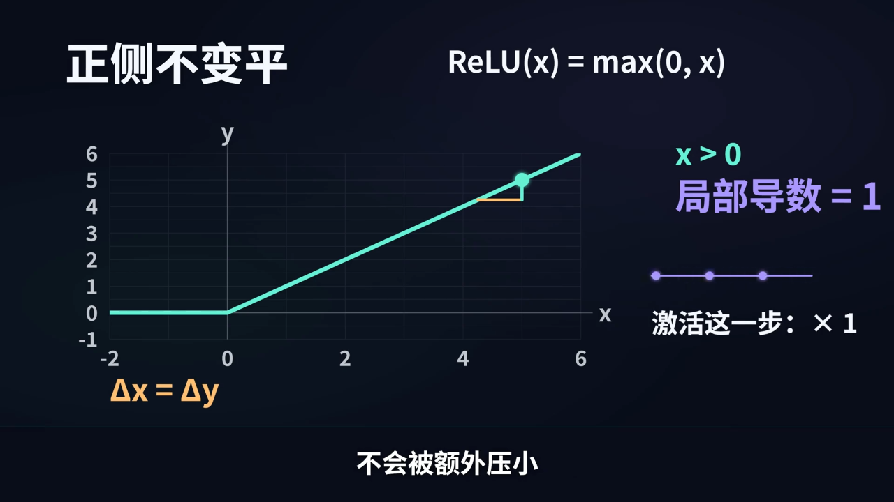

*视频 B，约 02:55：这里的“正侧不变平”指 ReLU 这个局部算子。前后权重与其他层仍会改变梯度。*

### 9.2 一次输出零，不等于神经元死亡

某个样本使 $z<0$，是正常的条件响应。通常说“死亡 ReLU”，指某个单元对所关心的训练样本长期处于负半轴，沿这条路径无法得到有效梯度。

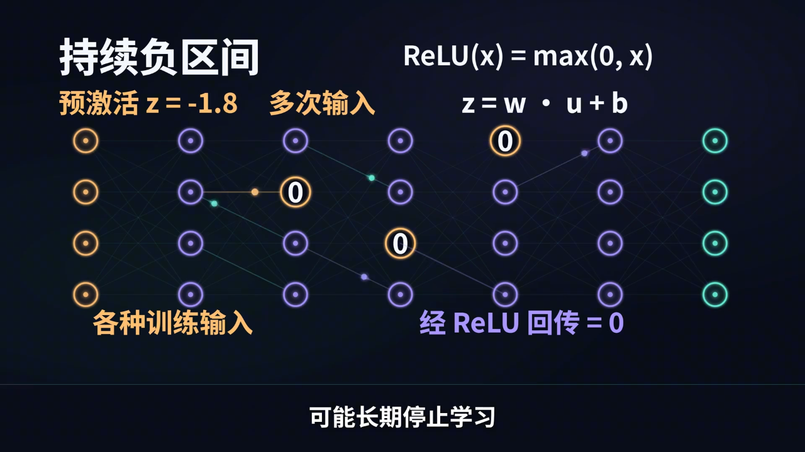

*视频 B，约 03:20：重点是“持续负区间”和“多种输入”，不是看到某一次输出为零就宣告单元死亡。*

若上游梯度为 2，$x=3$，但 $z=-0.7$，则本次：

$$
\frac{\partial\mathcal L}{\partial w}=2\times0\times3=0.
$$

其他样本可能使它重新活跃；共享参数、优化器状态等也可能改变状态。不能从某一张图的一个零值断言这个神经元已永久失效。

### 9.3 Leaky ReLU、PReLU、ELU 做了哪些改动？

| 方法 | 负半轴定义 | 主要变化 | 仍需注意 |
| --- | --- | --- | --- |
| Leaky ReLU | $\alpha x$，固定 $\alpha>0$ | 负区保留斜率 | 小斜率跨很多层仍可能衰减 |
| PReLU | $a_jx$，$a_j$ 可学习 | 学习负区响应 | 斜率参数不自动保证稳定 |
| ELU | $\alpha(e^x-1)$ | 负区平滑趋近 $-\alpha$ | 很负时仍饱和；$\alpha=1$ 时零点一阶导数连续 |

它们的正半轴通常都是 $x$。PReLU 论文还研究了适配整流网络的初始化，这与改激活是两个配套问题，不能把所有实验收益归因于一个负斜率。

来源：[He 等，PReLU / 初始化论文](https://arxiv.org/abs/1502.01852)；[Clevert、Unterthiner、Hochreiter，ELU](https://arxiv.org/abs/1511.07289)。

### 9.4 激活稀疏，不等于矩阵计算已经稀疏

ReLU 产生真零值可以形成稀疏表示，但普通 Dense GEMM 通常仍执行完整矩阵乘法。只有相应稀疏布局、内核和工作负载能利用这些零，才可能转化为计算节省。它也不同于 MoE 路由只执行少数专家。

## 十、SiLU 与 GELU：从硬截断到平滑加权

### 10.1 SiLU：输入给自己一个 Sigmoid 权重

$$
\operatorname{SiLU}(x)=x\sigma(x).
$$

它是输入与其 Sigmoid 值的乘积，可以理解为自门控。Sigmoid 系数在 $(0,1)$，但乘积本身可以为负，也没有上界 1。

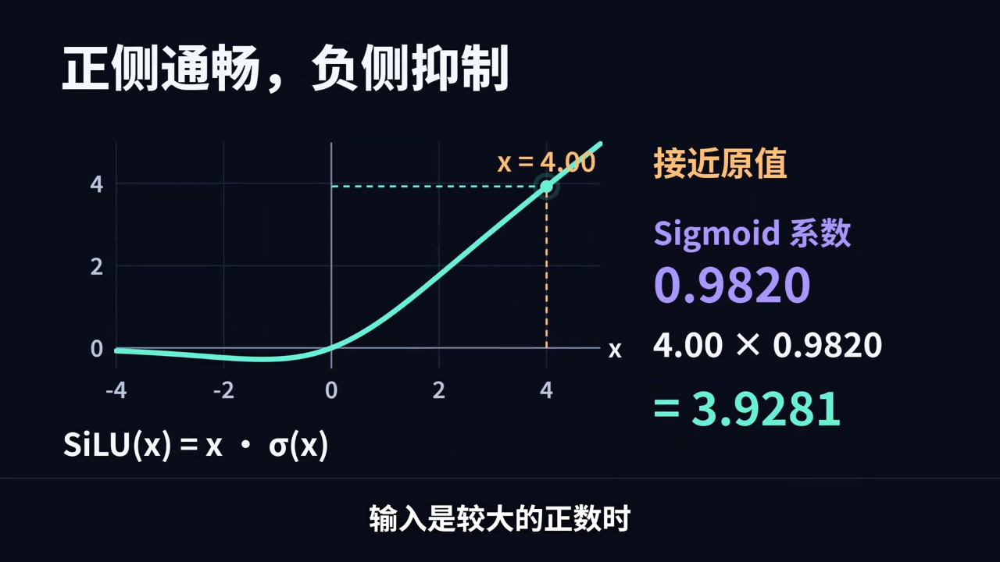

*视频 B，约 04:10：当 $x=4$ 时，$\sigma(4)\approx0.9820$，所以 $4\sigma(4)\approx3.9281$。大正数处输出接近输入。*

求导：

$$
\operatorname{SiLU}'(x)=\sigma(x)+x\sigma(x)(1-\sigma(x)).
$$

在 $x=0$ 时导数为 $0.5$；在很负的区域，导数仍趋近零。平滑不等于“负区梯度永远不小”。

在 $x=-2$ 时，输出约为 $-0.2384$，导数约为 $-0.0908$，因此 SiLU 并非单调递增。允许少量负输出与非单调形状，是它区别于 ReLU 的一部分。

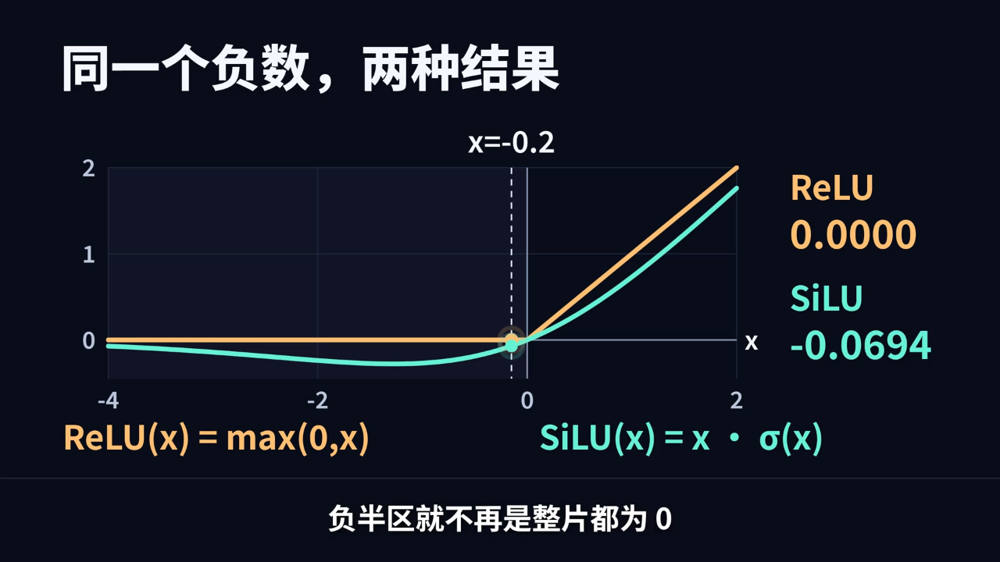

*视频 B，约 04:35：负区输出不再全部为零。注意画面输入只显示一位小数、输出显示四位，不能将其直接当成精确输入输出对：若精确取 $x=-0.2$，SiLU 应约为 $-0.0900$；画面中的 $-0.0694$ 则与更细的输入 $x\approx-0.15$ 相符，可能涉及动画和显示精度。本文手算采用明确的精确输入。*

### 10.2 Swish 与 SiLU 是什么关系？

$$
\operatorname{Swish}_{\beta}(x)=x\sigma(\beta x).
$$

取 $\beta=1$ 就得到通常实现的 SiLU。$\beta$ 可以作为固定或可学习配置，但并非所有叫 Swish 的实现都会训练它。

历史应谨慎表述：Hendrycks、Gimpel 的 GELU 工作及其版本记录中包含 SiLU 的讨论；Elfwing、Uchibe、Doya 在 2017 年研究了 SiLU 用于强化学习；Ramachandran、Zoph、Le 的 2017 年工作则通过激活搜索系统研究并推广 Swish。不能简单写成“Google 在 2017 年首次发明了 $x\sigma(x)$”。

来源：[GELU 论文 Appendix B 与版本记录](https://arxiv.org/html/1606.08415v5)、[SiLU 强化学习论文](https://arxiv.org/abs/1702.03118)、[Searching for Activation Functions](https://arxiv.org/abs/1710.05941)。有关早期命名的回顾应视为作者的历史叙述，不以此推断个人贡献比例。

### 10.3 GELU：高斯累积分布函数给输入加权

$$
\operatorname{GELU}(x)=x\Phi(x),\qquad
\Phi(x)=\frac12\left[1+\operatorname{erf}\left(\frac{x}{\sqrt2}\right)\right].
$$

注意是累积分布函数 CDF，不是概率密度 PDF。令标准正态密度为 $\varphi(x)$，则：

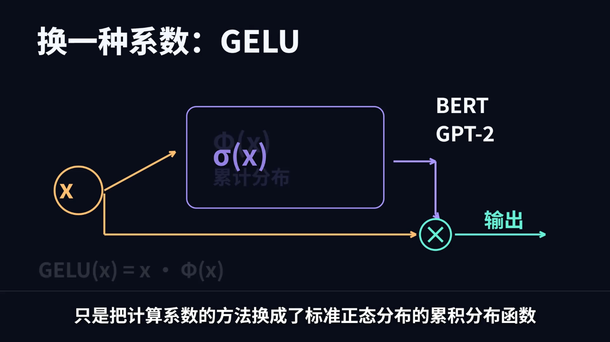

*视频 B，约 05:00：图中的 $\Phi(x)$ 是调节系数。GELU 与 SiLU 都可以写成“输入乘一个随输入变化的权重”，但两个权重函数不同。*

$$
\operatorname{GELU}'(x)=\Phi(x)+x\varphi(x),\qquad
\varphi(x)=\frac{1}{\sqrt{2\pi}}e^{-x^2/2}.
$$

GELU 同样平滑、允许负输出，并且并非全域单调。公式中出现高斯函数不要求输入真的服从标准正态分布，也不意味着算子内部需要随机采样。

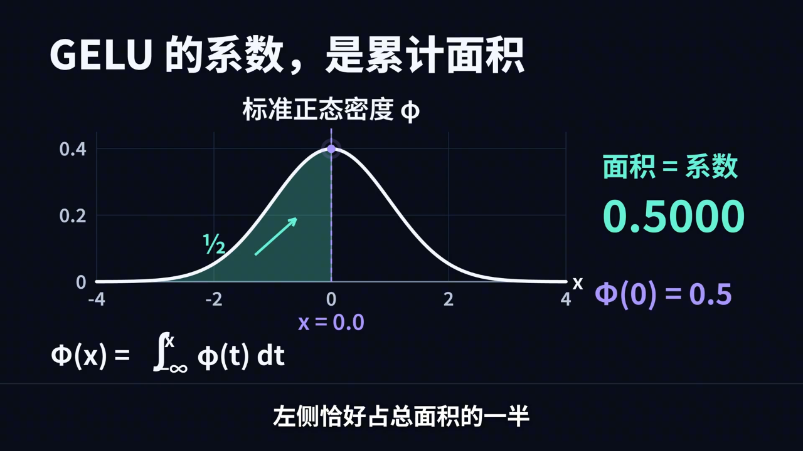

*视频 B，约 05:25：标准正态密度曲线左侧累计面积构成 $\Phi(x)$。在零点左侧面积为 $0.5$，所以 $\Phi(0)=0.5$，但 $\operatorname{GELU}(0)=0\times0.5=0$。*

论文给出一种概率直觉：若以 $\Phi(x)$ 的概率保留 $x$，否则置零，这个随机结果的期望是 $x\Phi(x)$。实际常用的 GELU 直接计算确定性函数；它不是训练时自动做一次随机 Dropout。

### 10.4 精确式、tanh 近似式与 Sigmoid 近似式

常见 tanh 近似为：

$$
\operatorname{GELU}_{\mathrm{tanh}}(x)
=\frac12x\left[1+\tanh\left(\sqrt{\frac2\pi}(x+0.044715x^3)\right)\right].
$$

论文还讨论了 $x\sigma(1.702x)$ 这类近似。它们与精确 $x\Phi(x)$ 很接近，但不是数学恒等式。复现模型时要核对配置与内核；不能只看到 `gelu` 字样就忽略近似方式。

来源：[Hendrycks、Gimpel，GELU 原文](https://arxiv.org/html/1606.08415v5)、[PyTorch GELU 定义与 approximate 参数](https://docs.pytorch.org/docs/stable/generated/torch.nn.GELU.html)。

### 10.5 相同输入，直接比较输出与导数

| $x$ | Sigmoid | Tanh | ReLU | SiLU | 精确 GELU |
| --- | --- | --- | --- | --- | --- |
| -2 | 0.1192 | -0.9640 | 0 | -0.2384 | -0.0455 |
| -1 | 0.2689 | -0.7616 | 0 | -0.2689 | -0.1587 |
| 0 | 0.5000 | 0 | 0 | 0 | 0 |
| 1 | 0.7311 | 0.7616 | 1 | 0.7311 | 0.8413 |
| 2 | 0.8808 | 0.9640 | 2 | 1.7616 | 1.9545 |

| $x$ | Sigmoid 导数 | Tanh 导数 | ReLU 导数 | SiLU 导数 | 精确 GELU 导数 |
| --- | --- | --- | --- | --- | --- |
| -2 | 0.1050 | 0.0707 | 0 | -0.0908 | -0.0852 |
| 0 | 0.2500 | 1 | 零点不可导；实现选约定值 | 0.5000 | 0.5000 |
| 2 | 0.1050 | 0.0707 | 1 | 1.0908 | 1.0852 |

SiLU、GELU 在部分正区间的导数可以大于 1。不能因为它们带一个小于 1 的权重，就断言完整导数始终处于 $[0,1]$；求导时还要计算权重本身随输入的变化。

## 十一、从标量函数到 Transformer FFN：先看普通两层结构

### 11.1 逐 Token，先混合特征，再激活，再混合

$$
\operatorname{FFN}(x)=\phi(xW_1+b_1)W_2+b_2.
$$

若 $x\in\mathbb R^{1\times d}$，中间宽度为 $m$，则：

$$
W_1\in\mathbb R^{d\times m},\qquad
W_2\in\mathbb R^{m\times d}.
$$

同一套 FFN 参数通常用于所有位置，但每个 Token 的输入不同，激活模式与输出也不同。激活本身逐元素，前后的矩阵负责混合特征坐标；不能因为激活逐元素，就说整个 FFN 没有跨特征交互。


*视频 B，约 06:05：图中的 $[2,1]$ 被投影为四个中间响应。这里先看完整向量的投影，避免把 FFN 误解为对原始输入各坐标分别独立算到底。*

### 11.2 视频中的输出投影：四个响应重新组合

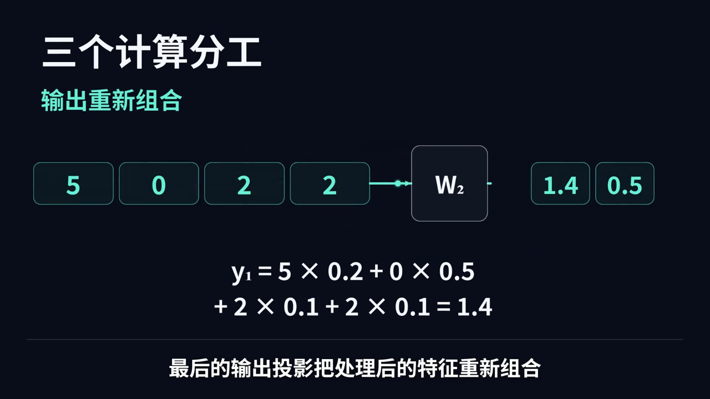

*视频 B，约 06:15：图中激活后的 $[5,0,2,2]$ 进入输出矩阵。第一个输出坐标是一次新的加权求和。*

例如第一列权重为 $[0.2,0.5,0.1,0.1]^T$，则：

$$
y_1=5\times0.2+0\times0.5+2\times0.1+2\times0.1=1.4.
$$

到这里仍是普通 FFN。仅把 $\phi$ 从 ReLU 换成 SiLU，不会凭空多出独立的内容投影与门控投影。

## 十二、GLU 到 SwiGLU：变化的不只是曲线，还有连接方式

### 12.1 原始 GLU：两路投影，一路产生门控

对同一个 $x$ 分别计算：

$$
u=xW_u+b_u,\qquad a=xW_g+b_g,
$$

$$
h=u\odot\sigma(a).
$$

$u$ 可称为内容分支，$a$ 经过 Sigmoid 后产生调节系数。$\odot$ 是对应坐标相乘，不是矩阵乘法，也不是对两个向量求点积。

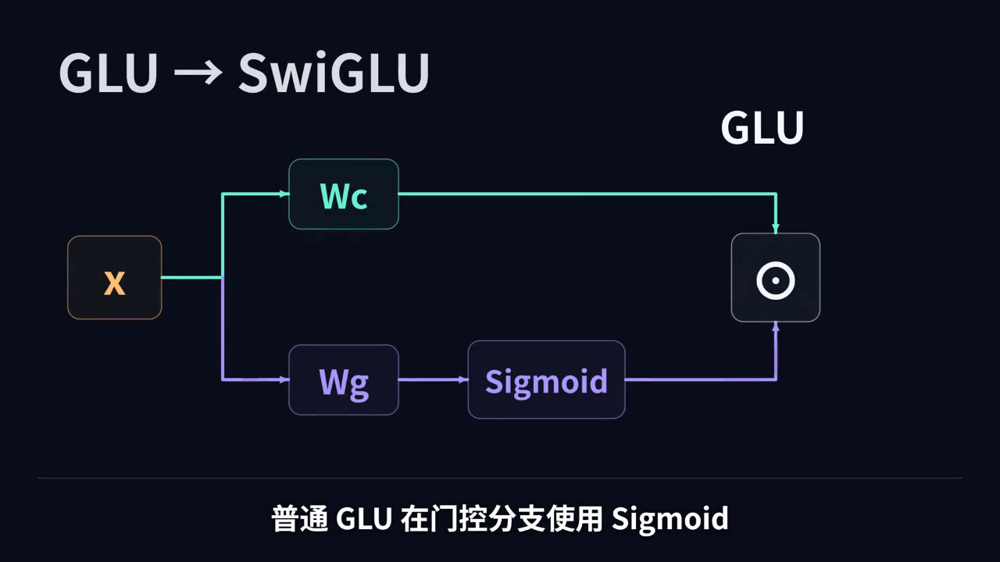

*视频 B，约 07:05：图中 $W_c$ 对应本文 $W_u$；$W_g$ 产生门控预激活。两路来自同一输入，但参数矩阵不同。*

GLU 的早期代表论文是 Dauphin、Fan、Auli、Grangier 的 [Language Modeling with Gated Convolutional Networks](https://arxiv.org/abs/1612.08083)，首次公开于 2016 年，正式发表于 ICML 2017。原始研究语境是卷积语言模型，不应直接写成“GLU 最初就是 Transformer FFN”。

### 12.2 SwiGLU：在门控分支使用 Swish / SiLU

常见固定 $\beta=1$ 的 SwiGLU FFN 为：

$$
u=xW_u,\qquad a=xW_g,
$$

$$
g=\operatorname{SiLU}(a)=a\odot\sigma(a),
$$

$$
h=u\odot g,\qquad y=hW_d.
$$

这里省略偏置，与一些常见实现一致，但是否有 bias 应按具体模型核对。

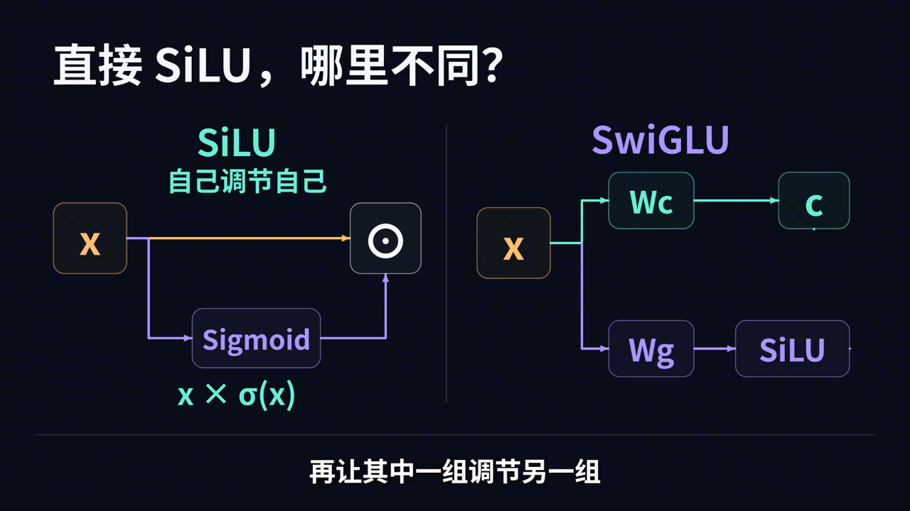

*视频 B，约 07:30：左侧 SiLU 对同一个数做 $z\sigma(z)$；右侧 SwiGLU 用一组投影后的特征去调节另一组投影后的特征。*

普通 SiLU FFN 可写成 $\operatorname{SiLU}(xW_1)W_2$；SwiGLU FFN 则是 $(\operatorname{SiLU}(xW_g)\odot xW_u)W_d$。两者不能仅凭激活函数名称互换。

### 12.3 “门控”不一定意味着系数只能在 0 到 1

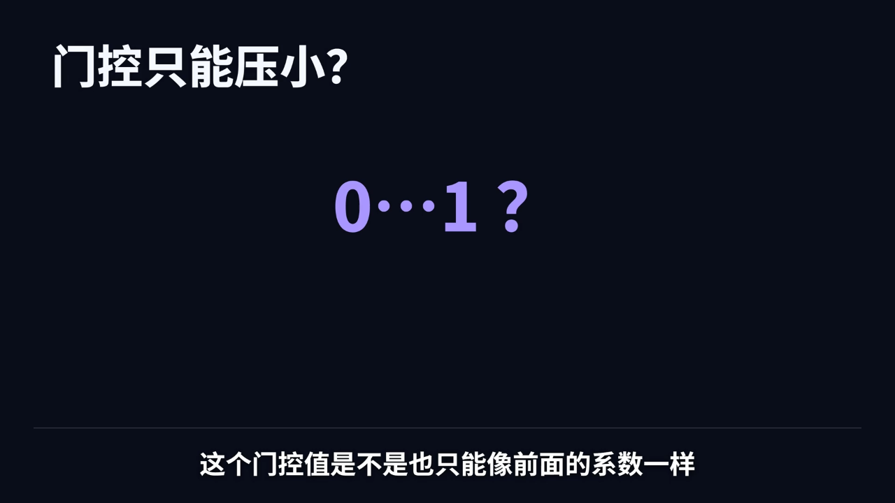

*视频 B，约 07:55：先区分原始 GLU 的 Sigmoid 门和 SwiGLU 的 SiLU 门。它们的值域不同。*

原始 GLU 中 $\sigma(a)\in(0,1)$。SwiGLU 中的 $g=a\sigma(a)$ 则可能为负，也可能大于 1。

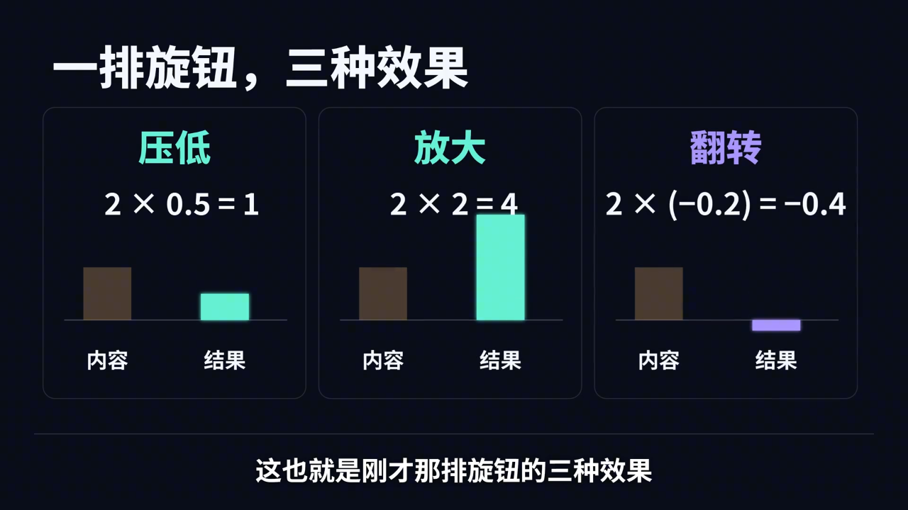

*视频 B，约 08:30：对内容坐标 2，示意系数 0.5、2、-0.2 分别得到 1、4、-0.4。这些是乘法作用的示意数，并不是在列出对应的门控预激活。*

因此，门控可以压低幅值、放大幅值，也可以翻转符号。它不是归一化后的概率分布，不要求所有坐标加起来为 1。SiLU 门的负值下界约为 $-0.2785$，也不是任意大的负系数；“可以为负”不等于“负值无界”。

### 12.4 GLU 家族的统一写法

| 结构 | 中间交互 $h$ | 门值性质 |
| --- | --- | --- |
| GLU | $u\odot\sigma(a)$ | 每个门值在 $(0,1)$ |
| ReGLU | $u\odot\operatorname{ReLU}(a)$ | 非负，可为零，也可大于 1 |
| GEGLU | $u\odot\operatorname{GELU}(a)$ | 可为负，也可大于 1 |
| SwiGLU | $u\odot\operatorname{SiLU}(a)$ | 可为负，也可大于 1 |
| Bilinear | $u\odot a$ | 两路仿射结果直接相乘 |

最后通常再乘输出投影 $W_d$。即使 Bilinear 没有显式标量激活，两路相乘也已经产生非线性；这与第二节“纯仿射复合可合并”的前提并不矛盾。

公式与对比来源：[Shazeer，GLU Variants Improve Transformer，Section 2](https://arxiv.org/html/2002.05202v1)。

## 十三、SwiGLU 完整手算：投影、门控、相乘、输出

### 13.1 先把所有矩阵写出来

这是本文独立构造的二维例子，方便逐项复算，不是从视频中补猜未展示的参数。

$$
x=[1,-1],\qquad
W_u=\begin{bmatrix}2&-1\\1&2\end{bmatrix},\quad
W_g=\begin{bmatrix}1&0\\0&1\end{bmatrix},\quad
W_d=\begin{bmatrix}1&2\\-1&1\end{bmatrix}.
$$

第一步，内容投影：

$$
u=xW_u=[1,-3].
$$

第二步，门控预激活与 SiLU：

$$
a=xW_g=[1,-1],\qquad
g=\operatorname{SiLU}(a)\approx[0.731059,-0.268941].
$$

第三步，对应坐标相乘：

$$
h=u\odot g\approx[0.731059,0.806824].
$$

第二个坐标中，负内容乘负门值，结果变为正数；门控不是只进行“保留或删除”。

第四步，输出投影：

$$
y=hW_d\approx[-0.075766,2.268941].
$$

| 阶段 | 数值 | 形状 |
| --- | --- | --- |
| 输入 $x$ | $[1,-1]$ | $1\times2$ |
| 内容 $u$ | $[1,-3]$ | $1\times2$ |
| 门控预激活 $a$ | $[1,-1]$ | $1\times2$ |
| 门值 $g$ | $[0.731059,-0.268941]$ | $1\times2$ |
| 门控后 $h$ | $[0.731059,0.806824]$ | $1\times2$ |
| 最终 $y$ | $[-0.075766,2.268941]$ | $1\times2$ |

### 13.2 两路分支怎样共同获得梯度？

令 $G=\partial\mathcal L/\partial h$，仍采用行向量约定，则：

$$
\frac{\partial\mathcal L}{\partial u}
=G\odot\operatorname{SiLU}(a),
$$

$$
\frac{\partial\mathcal L}{\partial a}
=G\odot u\odot\operatorname{SiLU}'(a).
$$

因此：

$$
\frac{\partial\mathcal L}{\partial x}
=\left(G\odot\operatorname{SiLU}(a)\right)W_u^T
+\left(G\odot u\odot\operatorname{SiLU}'(a)\right)W_g^T.
$$

若给定的是输出梯度 $G_y$，先通过输出投影得到 $G=G_yW_d^T$。参数梯度分别为 $x^T(\partial\mathcal L/\partial u)$ 和 $x^T(\partial\mathcal L/\partial a)$。

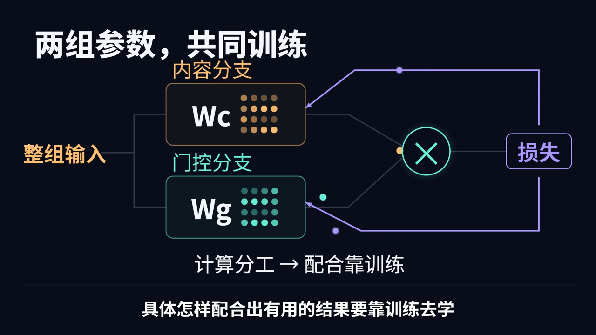

*视频 B，约 08:45：内容分支与门控分支都接收训练信号。门控没有单独的人工标签，最终损失通过乘法节点传回两路。*

若某一路输出很小，另一条路的局部梯度也可能受影响；乘法交互提供表达能力，不自动保证所有参数梯度健康。

### 13.3 不要把两路乘法与残差相加混在一起

SwiGLU 的内部是乘法，残差通路则常在整个 FFN 外相加：

$$
x_{l+1}=x_l+\operatorname{FFN}_{\mathrm{SwiGLU}}(N(x_l)).
$$

这里 $N$ 是归一化算子。SwiGLU、残差连接、归一化分别改变子层计算、连接方式和输入尺度，各自承担不同作用。

## 十四、多一组矩阵，比较是否公平？

### 14.1 普通 FFN 与 SwiGLU 的形状

| 结构 | 矩阵 | 忽略偏置的参数量 |
| --- | --- | --- |
| 普通两矩阵 FFN | $W_1:d\times m_0$，$W_2:m_0\times d$ | $2dm_0$ |
| SwiGLU FFN | $W_u:d\times m$，$W_g:d\times m$，$W_d:m\times d$ | $3dm$ |

如果中间宽度保持一样，即 $m=m_0$，门控版本的大矩阵参数量与主要矩阵乘法量约为普通版本的 1.5 倍。这时质量变化不能只解释成“SiLU 比 ReLU 好”。

### 14.2 为什么经常看到 $2/3$ 或 $8d/3$？

匹配主要矩阵参数量：

$$
3dm=2dm_0\quad\Rightarrow\quad m=\frac23m_0.
$$

如果普通 FFN 用 $m_0=4d$，得到：

$$
m=\frac83d.
$$

例如 $d=6$，普通中间宽度为 24，门控中间宽度取 16，则两者都是 288 个矩阵参数。真实实现还可能为硬件对齐取整，也可能主动选择不同预算；$8d/3$ 不是 SwiGLU 的数学定义。

### 14.3 算子数量与真实速度不是同一指标

两者都要读取权重和中间激活。SwiGLU 增加乘法、激活和一路投影，但可通过布局和融合减少额外开销；是否更快还受 batch、序列长度、精度、硬件与内核影响。

因此，比较应同时看参数量、主要 FLOPs、吞吐 / 延迟，以及达到同等质量所需的训练量。不能从一个公式直接得到部署加速倍数。

## 十五、作者与原论文：这条路线有哪些重要工作？

### 15.1 时间线与完整作者信息

| 时间 | 论文与作者 | 本文对应内容 |
| --- | --- | --- |
| ICML 2010 | *Rectified Linear Units Improve Restricted Boltzmann Machines*；Vinod Nair、Geoffrey E. Hinton | 早期推动整流单元应用的重要工作，研究语境是 RBM |
| AISTATS 2011 | *Deep Sparse Rectifier Neural Networks*；Xavier Glorot、Antoine Bordes、Yoshua Bengio | 深层整流网络与稀疏表示的实证研究 |
| arXiv 2015-02-06；ICCV 2015 | *Delving Deep into Rectifiers*；Kaiming He、Xiangyu Zhang、Shaoqing Ren、Jian Sun | PReLU 与整流网络初始化 |
| arXiv 2016-06-27 | GELU；Dan Hendrycks、Kevin Gimpel | $x\Phi(x)$、平滑加权与实验比较 |
| arXiv 2016-12-23；ICML 2017 | *Language Modeling with Gated Convolutional Networks*；Yann N. Dauphin、Angela Fan、Michael Auli、David Grangier | GLU 的双投影与门控乘法 |
| arXiv 2017-02-10 | *Sigmoid-Weighted Linear Units…*；Stefan Elfwing、Eiji Uchibe、Kenji Doya | SiLU 在强化学习中的研究 |
| arXiv 2017-10-16 | *Searching for Activation Functions*；Prajit Ramachandran、Barret Zoph、Quoc V. Le | 自动搜索、Swish 与多任务比较 |
| arXiv 2020-02-12 | *GLU Variants Improve Transformer*；Noam Shazeer | Transformer FFN 中的 GLU、GEGLU、SwiGLU 等对照 |

Sigmoid、Tanh 是有更长历史的数学函数，不能把它们简单归为这张表中的某个人在近年“发明”。ReLU 也有早期整流研究；2010、2011 年论文是重要应用与推广工作，不表示此前不存在整流思想。

GELU 的首次 arXiv 版本标题是 *Bridging Nonlinearities and Stochastic Regularizers with Gaussian Error Linear Units*；后续版本常见标题为 *Gaussian Error Linear Units (GELUs)*。查时间时应区分首次提交与当前修订日期。

### 15.2 GELU 论文怎么读？

读 [Section 2](https://arxiv.org/html/1606.08415v5) 时先区分概率动机与确定性函数，再核对精确式和近似式。读实验时看网络、数据集、优化器是否一致，而非只凭曲线更平滑推断一定更好。

GELU 工作覆盖了多种任务，但并未给出“所有模型中 GELU 都优于 ReLU”的普遍定理。平滑性、负区响应和训练设置需要共同考虑。

### 15.3 Swish 论文怎么读？

[Searching for Activation Functions](https://arxiv.org/html/1710.05941v2) 的重要内容不仅是最后一个公式，还包括搜索空间、候选操作以及跨模型验证。Section 4 讨论 $\beta$ 和函数性质，Section 5 给出实验。

该论文报告在特定 ImageNet 模型上替换激活后有收益，但这不支持“把任意已训练网络中的 ReLU 直接换成 SiLU，就会自动提高精度”。训练过程与模型分布都会改变。

### 15.4 GLU Variants 论文的关键是控制预算

作者 Noam Shazeer 在 [Section 2–3](https://arxiv.org/html/2002.05202v1) 中比较了多种 FFN 结构，并缩小门控层宽度，控制主要参数与计算预算。其 T5 风格实验采用 $d=768$，普通 FFN 宽度 3072，门控变体宽度 2048。

论文 Table 1 中，完成 524,288 个训练步后的 held-out **log-perplexity** 如下，越低越好：

| FFN 结构 | log-perplexity |
| --- | --- |
| ReLU 基线 | 1.677 |
| GELU | 1.679 |
| GEGLU | 1.633 |
| SwiGLU | 1.636 |

这是特定去噪预训练设置下的历史结果。它支持门控变体在该实验中的收益，也说明 SwiGLU 并非每项实验都排名第一。表中的值是 log-perplexity，不能把它直接写成 perplexity。


*视频 B，约 09:10：视频也明确指出“SwiGLU 不等于每项第一”。评价一项结构需要看受控实验，而非只看技术名称的先后。*

“大模型集体换掉 ReLU”适合做视频标题，论文解读中应改为具体模型、具体模块与具体配置。本文不把技术路线写成所有模型同步升级的单线历史。

## 十六、把激活、输出、注意力、归一化与 MoE 分开

### 16.1 隐藏层激活与输出端约束不同

| 使用位置 | 常见操作 | 目的 |
| --- | --- | --- |
| 普通实值回归输出 | 恒等映射 | 允许任意实数输出 |
| 二分类或多标签输出 | Sigmoid | 各坐标映射为二元概率形式 |
| 互斥多分类输出 | Softmax | 把一组 logits 映射为总和为 1 的分布 |
| 隐藏层 | ReLU、SiLU、GELU 等 | 改变表示与训练性质 |
| 门控 FFN | 双投影、非线性、乘法 | 引入可学习的特征交互 |

Softmax 为：

$$
p_i=\frac{e^{z_i}}{\sum_j e^{z_j}}.
$$

它的输出坐标相互耦合，Jacobian 为 $\operatorname{diag}(p)-pp^T$；这不同于普通逐元素激活的对角 Jacobian。实际计算常先减去最大 logit，避免指数溢出。

### 16.2 输出层 Sigmoid 的梯度，要和损失一起分析

对二分类交叉熵，若 $p=\sigma(z)$、标签为 $t$，则合并求导得到：

$$
\mathcal L=-t\log p-(1-t)\log(1-p),
\qquad\frac{\partial\mathcal L}{\partial z}=p-t.
$$

因此，不能把隐藏层中反复乘 Sigmoid 小导数的图景，原样套到“Sigmoid 加交叉熵”的最终 logit 梯度。实际训练常使用接收 logits 的融合损失，以提高数值稳定性。

### 16.3 Attention、Norm 与门控各自在做什么？

| 模块 | 主要改变 | 与激活的关系 |
| --- | --- | --- |
| Self-Attention | 根据内容在 token 间聚合信息 | softmax 等使其自身含非线性；不依赖 FFN 激活才变非线性 |
| Dense FFN | 对每个 token 混合特征 | 中间激活使两矩阵复合不能直接合并 |
| SwiGLU | 对两组特征进行乘法调节 | 不仅换标量曲线，还增加双投影交互 |
| LayerNorm / RMSNorm | 使用当前特征统计量调尺度 | 本身也是输入相关的非线性算子，作用不同于 FFN 激活 |
| 残差连接 | 把分支更新加回输入 | 与激活、归一化配合影响传播 |
| MoE Router | 选择或加权专家 | 门控专家计算，不等于 SwiGLU 对特征坐标的门控 |

一个 MoE 专家内部完全可以再使用 SwiGLU。两者分别回答“调用哪些专家”和“专家内部怎样计算”，不能因为都叫 gate 就当作同一件事。

相关专题：[归一化](../../技术拆解-归一化/归一化_从LayerNorm到RMSNorm.md)、[残差连接](../../技术拆解-残差链接/残差连接_从ResNet到Transformer.md)、[MoE](../../技术拆解-FNN层/MoE_核心论文与技术演进.md)。

## 十七、代码、初始化与数值检查

### 17.1 直接复算标量激活

下面代码只使用 Python 标准库，适合对照本文表格，不是高性能训练算子。

```python
import math


def sigmoid(x):
    # 分段避免对大负数直接计算 exp(-x) 而溢出
    if x >= 0:
        return 1.0 / (1.0 + math.exp(-x))
    e = math.exp(x)
    return e / (1.0 + e)


def relu(x):
    return max(0.0, x)


def silu(x):
    return x * sigmoid(x)


def gelu_exact(x):
    return 0.5 * x * (1.0 + math.erf(x / math.sqrt(2.0)))


def gelu_tanh(x):
    z = math.sqrt(2.0 / math.pi) * (x + 0.044715 * x**3)
    return 0.5 * x * (1.0 + math.tanh(z))
```

极端负数时，有限精度的 `1 + erf(...)` 可能发生抵消；高性能数学库可能使用更合适的实现。比较两种实现时应关注 dtype、误差范围与模型原有配置，而非只比较输出的小数位。

### 17.2 FFN 与 SwiGLU 的代码差别

```python
# NumPy 风格；x 可以是 [batch, tokens, d_model]
# W1: [d_model, hidden]
# W2: [hidden, d_model]
def ordinary_ffn(x, W1, W2, activation):
    return activation(x @ W1) @ W2


# Wu、Wg: [d_model, gated_hidden]
# Wd: [gated_hidden, d_model]
# silu_tensor 代表一个逐元素、支持张量的 SiLU 算子
def swiglu_ffn(x, Wu, Wg, Wd, silu_tensor):
    content = x @ Wu
    gate = silu_tensor(x @ Wg)
    return (content * gate) @ Wd
```

这里的 `activation`、`silu_tensor` 必须是张量版本，不能直接把上面只接收单个 Python 数值的函数当作 NumPy 数组函数使用。`*` 是逐元素乘法，`@` 是矩阵乘法；两路隐藏宽度必须一致。

### 17.3 初始化要适配激活，但公式有前提

在简化的独立、零均值等假设下，ReLU 网络常采用 fan-in 版本的 He 初始化：

$$
\operatorname{Var}(w)\approx\frac{2}{n_{\mathrm{in}}}.
$$

对负斜率为 $\alpha$ 的整流变体，对应形式可写为：

$$
\operatorname{Var}(w)\approx
\frac{2}{(1+\alpha^2)n_{\mathrm{in}}}.
$$

这来自对传播二阶矩的近似分析，不能忽略假设后宣布每层方差都严格不变。带残差、归一化、门控和深度缩放的网络，通常需要配套的整体初始化方案。来源：[He 等，Section 2.2](https://arxiv.org/abs/1502.01852)。

### 17.4 复现与排错时的检查顺序

1. **先核对位置：** 是隐藏层、门控分支还是输出端？
2. **再核对公式：** SiLU 还是广义 Swish？GELU 是精确式还是近似？
3. **检查结构与形状：** 普通两矩阵 FFN 还是三矩阵门控 FFN？广播是否掩盖了错误？
4. **检查数值：** 预激活范围、输出分布、零值比例、非有限值以及梯度范数。
5. **最后比较性能：** 参数量、中间宽度、训练预算与内核条件是否匹配？

更换预训练模型的激活会改变函数和中间分布，一般不能当作无损替换。是否需要重新训练或适配，取决于具体目标与误差要求。

## 十八、函数速查、常见误解与自测

### 18.1 一张表回顾主要取舍

| 方法 | 输出特征 | 主要优势 | 主要边界 |
| --- | --- | --- | --- |
| Sigmoid | $(0,1)$ | 概率形式、门控方便 | 两端饱和，隐藏层局部导数最大 1/4 |
| Tanh | $(-1,1)$ | 零中心、允许正负 | 两端仍饱和 |
| ReLU | $[0,\infty)$ | 简单、真零、正区不饱和 | 负区局部梯度为零 |
| Leaky ReLU | 负区线性 | 保留负区斜率 | 斜率选择与传播仍需分析 |
| PReLU | 可学习负斜率 | 负区响应可调 | 增加参数，需配套训练 |
| ELU | 负区趋近 $-\alpha$ | 平滑负区、允许负响应 | 很负时仍饱和 |
| SiLU | 平滑、有少量负值 | 自门控、正区接近恒等 | 非单调，负区梯度仍可能很小 |
| GELU | 平滑、高斯 CDF 加权 | 平滑调节、常见于 FFN | 近似式需核对，也不能保证梯度稳定 |
| SwiGLU | 两路投影后乘法 | 可学习的特征调节 | 改变结构与预算，不能视为单一标量函数 |

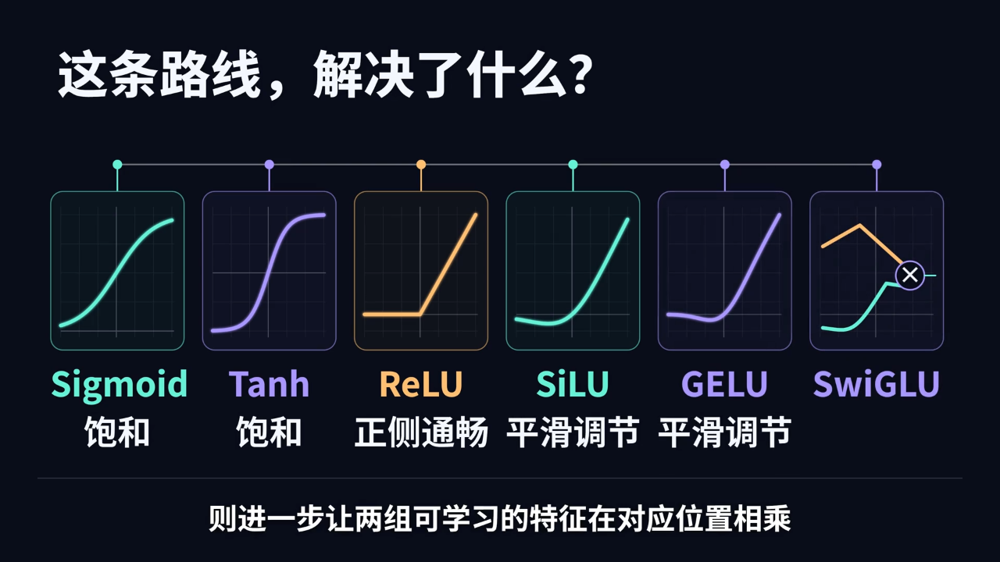

*视频 B，约 09:35：作为路线回顾。这里应理解为对不同设计取舍的整理，不是“后来的函数在一切任务中都胜过前者”的排行榜。*

### 18.2 经常混淆的几句话

| 说法 | 应怎样理解 |
| --- | --- |
| “非线性就是把直线画弯” | 可作直觉；ReLU 本身是折线，关键是整体不再满足单一仿射规则 |
| “激活在理解图片” | 参数化网络共同学习响应；固定激活只是其中的算子 |
| “ReLU 为零就代表对应像素没了” | 为零的是加权组合后的中间响应 |
| “平滑函数一定更好训练” | 平滑只是一个性质，还要看尺度、导数和完整架构 |
| “SiLU 负区不会梯度消失” | 很负时导数仍趋近零，特定负点还可能恰好导数为零 |
| “SwiGLU 的门就是概率” | SiLU 门可为负或大于 1，不要求坐标和为 1 |
| “SwiGLU 是 SiLU 的另一个名字” | 前者包含双投影和乘法结构，后者是标量激活 |
| “多一条门控肯定更好” | 需要控制宽度、参数、计算与训练预算后做实验 |
| “没有 FFN 激活，整个 Transformer 就线性了” | Attention、Norm 等仍可能含非线性 |
| “激活输出零就会自动跳过所有计算” | Dense 内核通常仍执行完整算子，计算稀疏需要额外支持 |

### 18.3 建议亲手完成的六道小题

1. 展开三个带偏置的仿射层，写出等效矩阵与偏置。中间有瓶颈时，等效矩阵有哪些限制？
2. 把 $\operatorname{ReLU}(x-1)+\operatorname{ReLU}(x-2)$ 在三个输入区域中的公式分别写出。
3. 用第四节的折线近似计算 $f(2.5)$，与 $2.5^2$ 比较误差。
4. 为什么 $x=-2$ 时 SiLU 输出为负，导数也为负？为什么这不表示网络不能训练？
5. 对 $u=[2,-3]$、$g=[0.5,-0.2]$ 求逐元素乘积。它与点积有什么区别？
6. 普通 FFN 宽度为 $4d$，若希望 SwiGLU 的主要矩阵参数量不变，门控宽度应取多少？

参考结果：第 3 题为 $6.5$，相对目标 $6.25$ 高 $0.25$；第 5 题为 $[1,0.6]$，点积则为标量 $1.6$；第 6 题为 $8d/3$，实际还需处理取整。其他题可对照前文推导。

## 十九、视频来源、截图索引与原始资料

### 19.1 两条视频的身份与用途

两条视频均为 **阿栗学长** 的《AI 原理拆解》系列。作者不同于本仓库残差、归一化文档所参考的“神经元出逃计划”，不要混淆署名。

| 标记 | 视频 | 页面显示发布时间 | 本文用途 |
| --- | --- | --- | --- |
| A | 第 8 集，标题开头《没有它，神经网络堆 1000 层也只等于 1 层》；时长约 07:20 | 2026-10-02 08:18 | 仿射合并、ReLU 转折、折线逼近、图像响应 |
| B | 第 9 集，标题开头《大模型为什么集体换掉 ReLU？》；时长约 09:59 | 2026-10-03 08:32 | 饱和与导数、SiLU / GELU、SwiGLU 结构与实验边界 |

视频 A：[用户提供的作者页入口](https://www.douyin.com/user/MS4wLjABAAAAUv81cxXz9kyT3Cwtq3euTsjxBv3QGK3oyf-DyYWszAPTq8TOPzmdzGk45fREttCD?from_tab_name=main&modal_id=7691759735363734810) · [直接视频入口](https://www.douyin.com/video/7691759735363734810)。

视频 B：[用户提供的作者页入口](https://www.douyin.com/user/MS4wLjABAAAAUv81cxXz9kyT3Cwtq3euTsjxBv3QGK3oyf-DyYWszAPTq8TOPzmdzGk45fREttCD?from_tab_name=main&modal_id=7692189952385223945) · [直接视频入口](https://www.douyin.com/video/7692189952385223945)。原消息第二个链接末尾带有中文逗号，访问时按视频 ID 去除了该标点。

### 19.2 30 张实际画面的对应关系

| 图号 | 时间点（约） | 内容 | 文件 |
| --- | --- | --- | --- |
| A-01 | 00:50 | 连续权重乘法 | [a-050s.png](assets/a-050s.png) |
| A-02 | 02:05 | 训练仍只能移动直线 | [a-125s.png](assets/a-125s.png) |
| A-03 | 02:55 | ReLU 零点转折 | [a-175s.png](assets/a-175s.png) |
| A-04 | 03:45 | 第一个单元越过阈值 | [a-225s.png](assets/a-225s.png) |
| A-05 | 04:10 | 多单元响应组合 | [a-250s.png](assets/a-250s.png) |
| A-06 | 04:35 | 更多转折与折线逼近 | [a-275s.png](assets/a-275s.png) |
| A-07 | 05:25 | 激活规则与可训练参数 | [a-325s.png](assets/a-325s.png) |
| A-08 | 05:50 | 像素组合为预激活 | [a-350s.png](assets/a-350s.png) |
| A-09 | 06:15 | 输入改变、响应组合改变 | [a-375s.png](assets/a-375s.png) |
| A-10 | 06:40 | 归零的是中间响应 | [a-400s.png](assets/a-400s.png) |
| B-01 | 01:40 | 权重、局部导数与结构 | [b-100s.png](assets/b-100s.png) |
| B-02 | 00:25 | Sigmoid 曲线 | [b-025s.png](assets/b-025s.png) |
| B-03 | 01:15 | Sigmoid 导数与链式法则 | [b-075s.png](assets/b-075s.png) |
| B-04 | 02:05 | Tanh 中间更陡 | [b-125s.png](assets/b-125s.png) |
| B-05 | 02:30 | Tanh 两端饱和 | [b-150s.png](assets/b-150s.png) |
| B-06 | 02:55 | ReLU 正区导数 | [b-175s.png](assets/b-175s.png) |
| B-07 | 03:20 | 持续负区间 | [b-200s.png](assets/b-200s.png) |
| B-08 | 04:10 | SiLU 正区响应 | [b-250s.png](assets/b-250s.png) |
| B-09 | 04:35 | ReLU / SiLU 负区；显示精度说明见图注 | [b-275s.png](assets/b-275s.png) |
| B-10 | 05:00 | GELU 加权结构 | [b-300s.png](assets/b-300s.png) |
| B-11 | 05:25 | 高斯 CDF 累计面积 | [b-325s.png](assets/b-325s.png) |
| B-12 | 06:05 | 前层投影 | [b-365s.png](assets/b-365s.png) |
| B-13 | 06:15 | 输出投影 | [b-375s.png](assets/b-375s.png) |
| B-14 | 07:05 | GLU 双投影 | [b-425s.png](assets/b-425s.png) |
| B-15 | 07:30 | SiLU 与 SwiGLU 的区别 | [b-450s.png](assets/b-450s.png) |
| B-16 | 07:55 | 门控值域问题 | [b-475s.png](assets/b-475s.png) |
| B-17 | 08:30 | 压低、放大、翻转 | [b-510s.png](assets/b-510s.png) |
| B-18 | 08:45 | 两路共同训练 | [b-525s.png](assets/b-525s.png) |
| B-19 | 09:10 | 实验结论的边界 | [b-550s.png](assets/b-550s.png) |
| B-20 | 09:35 | 技术路线回顾 | [b-575s.png](assets/b-575s.png) |

图片直接截取指定视频的实际画面，保留画面中的文字、字幕和可能出现的标识；未把它们标成论文原图。视频画面及其原始素材的权利归相关作者或权利人所有。播放器定位与动画状态可能带来帧级偏差，时间点用于返回原视频定位。

截图中的机制示意、实验结论、浮点数字分别核对：教学隐喻不代替证明；单个实验不代替普遍结论；B-09 的显示精度与精确手算结果的区别已在图注说明。本文额外的矩阵、XOR、折线与梯度例子均为教学构造。

### 19.3 原始论文与实现资料

1. Nair、Hinton. **Rectified Linear Units Improve Restricted Boltzmann Machines.** ICML 2010. [原文](https://icml.cc/Conferences/2010/papers/432.pdf)。
2. Glorot、Bengio. **Understanding the difficulty of training deep feedforward neural networks.** AISTATS 2010. [PMLR](https://proceedings.mlr.press/v9/glorot10a.html)。
3. Glorot、Bordes、Bengio. **Deep Sparse Rectifier Neural Networks.** AISTATS 2011. [PMLR](https://proceedings.mlr.press/v15/glorot11a.html)。
4. He、Zhang、Ren、Sun. **Delving Deep into Rectifiers: Surpassing Human-Level Performance on ImageNet Classification.** ICCV 2015. [arXiv](https://arxiv.org/abs/1502.01852)。
5. Clevert、Unterthiner、Hochreiter. **Fast and Accurate Deep Network Learning by Exponential Linear Units (ELUs).** ICLR 2016. [arXiv](https://arxiv.org/abs/1511.07289)。
6. Hendrycks、Gimpel. **Gaussian Error Linear Units (GELUs).** 首次公开于 2016 年. [版本记录](https://arxiv.org/abs/1606.08415) · [首次版本正文](https://arxiv.org/html/1606.08415v1)。
7. Dauphin、Fan、Auli、Grangier. **Language Modeling with Gated Convolutional Networks.** ICML 2017. [arXiv](https://arxiv.org/abs/1612.08083)。
8. Elfwing、Uchibe、Doya. **Sigmoid-Weighted Linear Units for Neural Network Function Approximation in Reinforcement Learning.** 2017. [arXiv](https://arxiv.org/abs/1702.03118)。
9. Ramachandran、Zoph、Le. **Searching for Activation Functions.** 2017. [arXiv](https://arxiv.org/abs/1710.05941)。
10. Shazeer. **GLU Variants Improve Transformer.** 2020. [arXiv](https://arxiv.org/abs/2002.05202)。
11. PyTorch 官方接口：[GELU](https://docs.pytorch.org/docs/stable/generated/torch.nn.GELU.html) · [SiLU](https://docs.pytorch.org/docs/stable/generated/torch.nn.SiLU.html)。复现时以目标模型锁定的库版本与配置为准。
