# FFN：从非线性特征到 SwiGLU 与参数记忆

> **整理日期：** 2026-11-09  
> **视频来源：** 神经元出逃计划，《大模型 FFN 前馈网络：注意力负责“听”，FFN 负责“想”》，2026-10-19 发布，约 12 分 59 秒。  
> **原视频：** [抖音视频](https://www.douyin.com/video/7698330063774715151)  
> **内容：** 26 张原视频截图，讲解逐位置计算、升维、非线性、降维、SwiGLU 和参数记忆；补充公式、手算、参数预算及可运行复算。视频中的具体模型配置与特征解释均注明演示性质。

**目录位置：** `技术拆解-FNN层/FFN/`。沿用仓库现有 `FNN` 目录拼写，其中实际技术名称是 FFN（Feed-Forward Network）。后续阅读 [MoE：从稠密 FFN 到稀疏路由](../MoE/MoE_从稠密FFN到稀疏路由与负载均衡.md)，论文路线见 [MoE 核心论文与技术演进](../MoE_核心论文与技术演进.md)。

## 一、注意力之外，为什么还有 FFN？


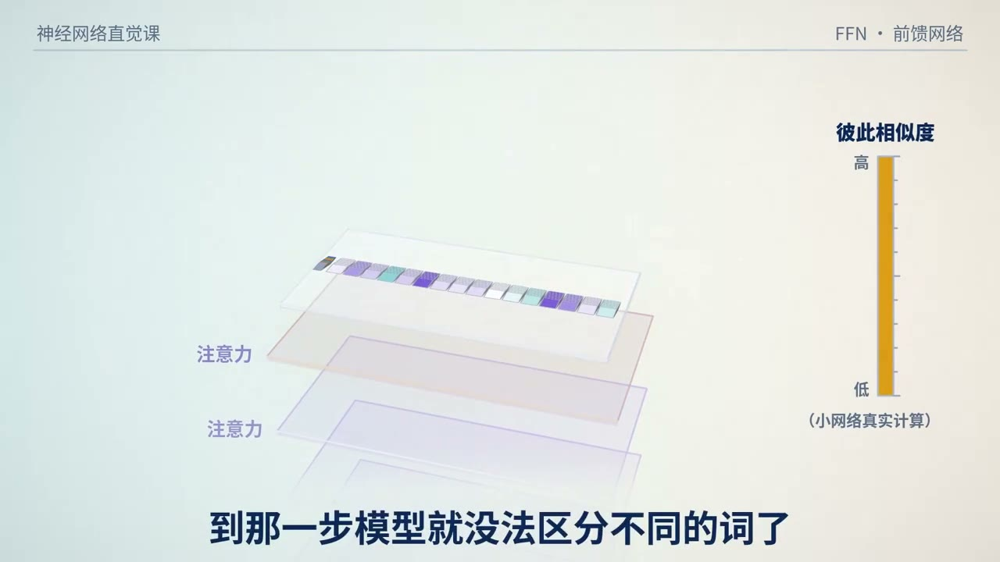

注意力按内容和位置建立 Token 之间的信息联系；标准 Transformer FFN 对每个位置的向量施加同一组可训练的非线性变换。两者组合，使信息既能跨位置流动，也能在特征维度内重新组织。

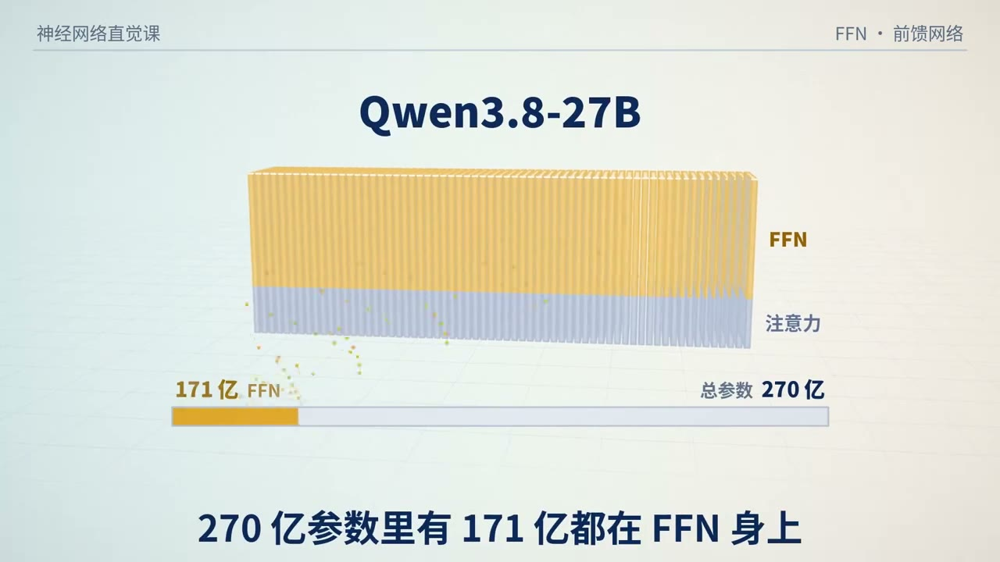

“注意力听，FFN 想”是教学比喻，不是两个模块的严格认知分工。注意力也包含可学习变换，FFN 的输入也已包含此前聚合的上下文，不能把推理或知识全部归到单一模块。

### 1.1 逐位置，是指没有直接混合序列轴

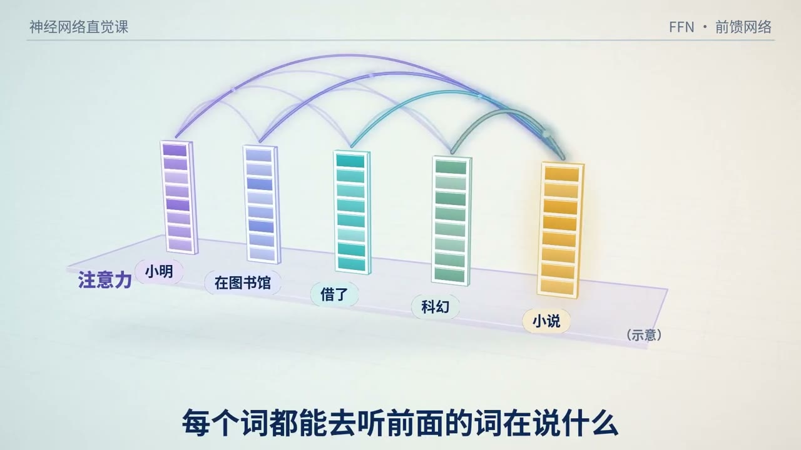

令 $X\in\mathbb R^{B\times T\times d}$。标准 Dense FFN 的同一套参数作用于所有 $B,T$ 位置，输出仍是 $[B,T,d]$。位置之间不会在这个 FFN 子层里直接互相加权，但它处理的向量可能已经携带上下文。

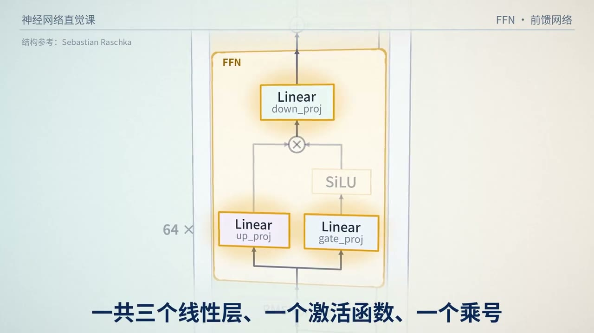

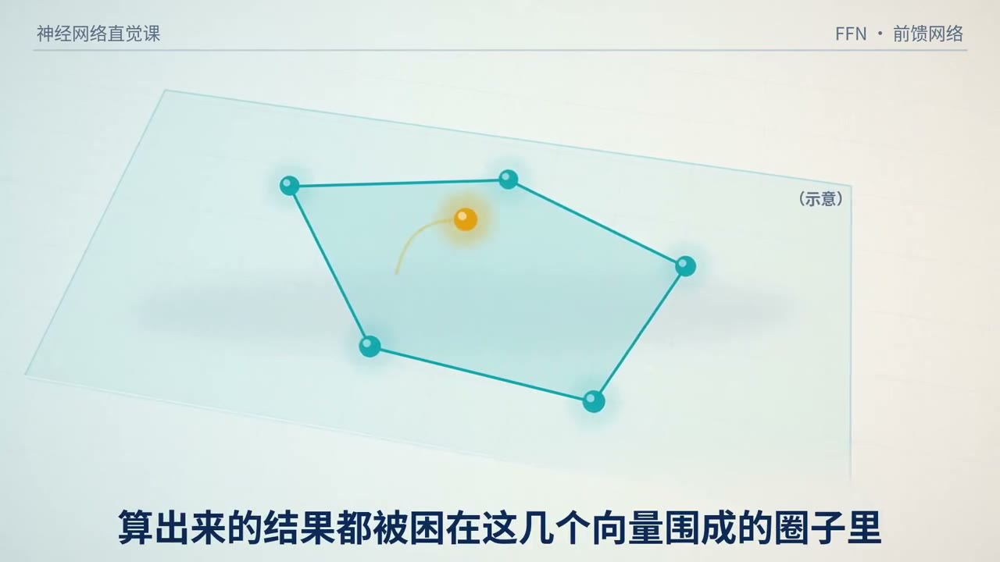

## 二、原始 FFN：升维 → 激活 → 降维

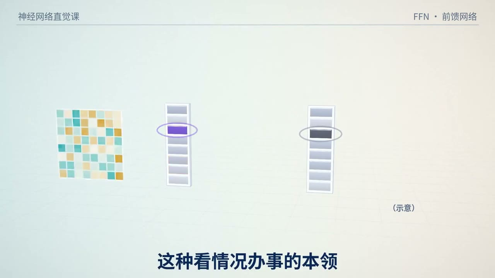

采用行向量记号，原始形式为：

$$
\operatorname{FFN}(x)=\phi(xW_1+b_1)W_2+b_2,
$$

其中 $x\in\mathbb R^{1\times d}$，$W_1\in\mathbb R^{d\times m}$，$W_2\in\mathbb R^{m\times d}$。常见选择 $m>d$，原始 Transformer 使用 ReLU。

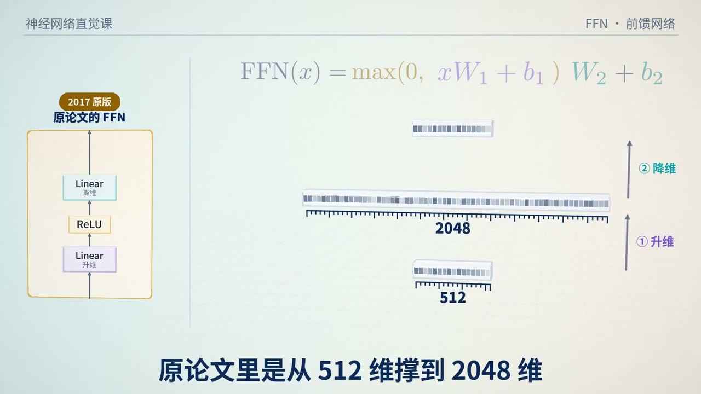

| 阶段 | 计算 | 形状 |
| --- | --- | --- |
| 输入 | $x$ | $1\times d$ |
| 升维 | $z=xW_1+b_1$ | $1\times m$ |
| 非线性 | $a=\phi(z)$ | $1\times m$ |
| 降维 | $y=aW_2+b_2$ | $1\times d$ |

“升维”增加可用的特征通道，不表示凭空增加原始信息；“降维”将中间响应映射回残差流宽度，也不意味着恢复输入的可逆压缩。

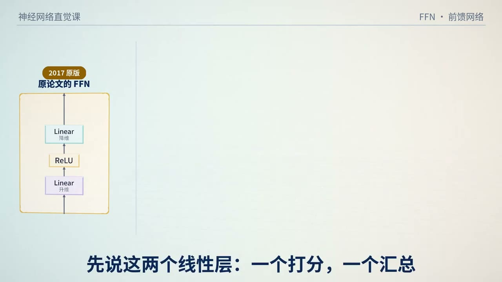

## 三、为什么两次线性层之间必须有非线性？

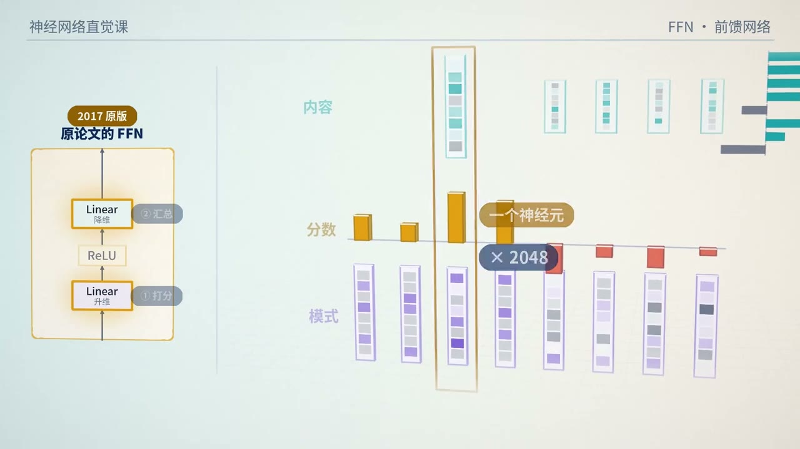

若 $\phi(z)=z$，则：

$$
(xW_1+b_1)W_2+b_2=x(W_1W_2)+(b_1W_2+b_2).
$$

仍只是一次仿射变换。中间再宽，也无法单靠串联线性层得到非线性函数。

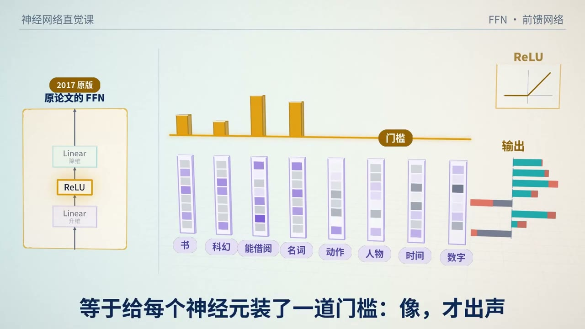

非线性可以让不同输入区域采用不同响应。以 ReLU 为例，激活集合改变时，整体函数会在不同区域呈现不同的仿射形式。

### 3.1 一个可手算的“折叠”例子

取一维输入 $u$，两条中间通道分别计算 $\operatorname{ReLU}(u)$ 和 $\operatorname{ReLU}(-u)$，再相加：

$$
f(u)=\operatorname{ReLU}(u)+\operatorname{ReLU}(-u)=|u|.
$$

$u=-2$ 与 $u=2$ 都映射到 2，形象地展示把数轴两侧“折”到同一侧。高维 FFN 的实际几何由权重决定，不保证真的形成视频中某个规则折纸形状。

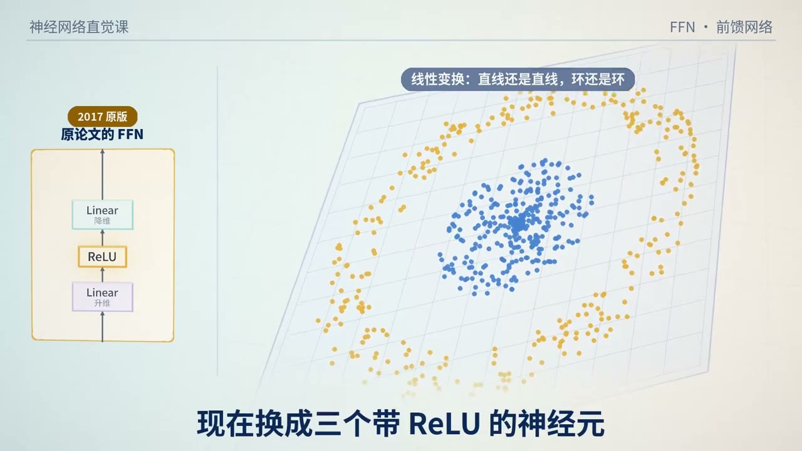

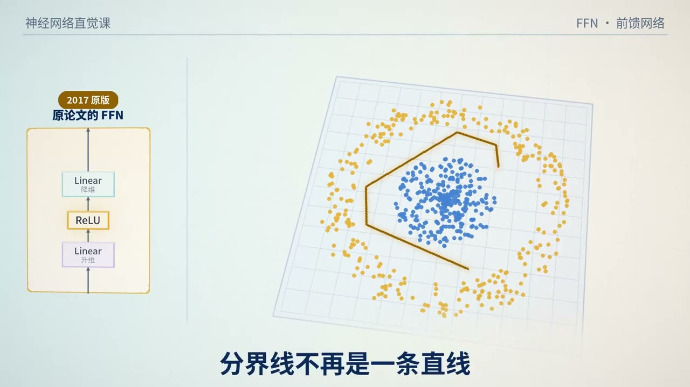

## 四、一次完整矩阵手算

以下是本文自建例子，取 $d=2,m=3$：

$$
x=[1,-2],\quad
W_1=\begin{bmatrix}1&0&1\\0&1&-1\end{bmatrix},\quad
b_1=[0,1,0].
$$

第一步：$z=xW_1+b_1=[1,-1,3]$。ReLU 后：$a=[1,0,3]$。

再取：

$$
W_2=\begin{bmatrix}1&0\\0&1\\1&-1\end{bmatrix},\qquad b_2=[0.5,0].
$$

则输出 $y=[4.5,-3]$。若这一子层直接采用残差 $x+y$，结果是 $[5.5,-5]$；实际模型还要按结构安排 Norm、残差与其他操作。

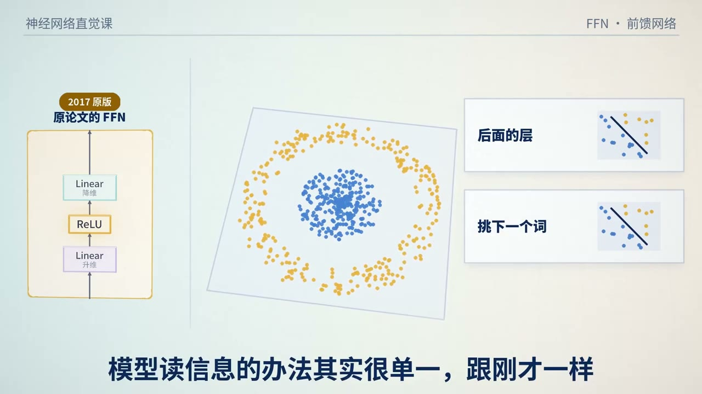

## 五、另一种读法：模式响应加权组合内容方向

对 $W_1$ 的第 $j$ 列记为 $k_j$，$W_2$ 第 $j$ 行记为 $v_j$：

$$
\operatorname{FFN}(x)=\sum_{j=1}^{m}\phi(xk_j+b_{1,j})v_j+b_2.
$$

这给出一种解释：输入与某个方向匹配后产生响应，再以该响应加权对应的输出方向。

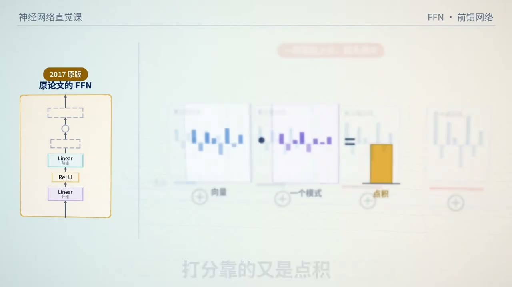

论文 *Transformer Feed-Forward Layers Are Key-Value Memories* 将这类结构解释为与训练文本模式关联的 Key，以及影响输出分布的 Value。这里的 Key / Value 是参数解释，不是注意力中的历史 Token KV，也不是 KV Cache。

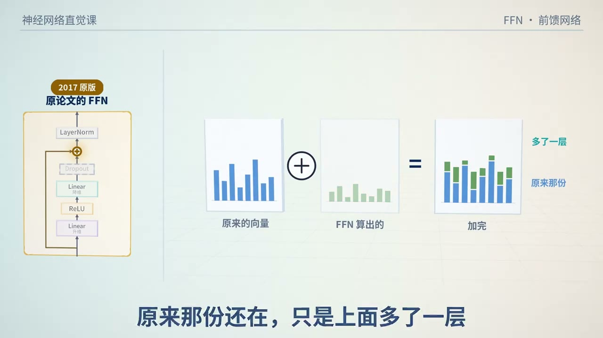

这种记忆解释不意味着“一个神经元只存一条事实”。多个通道可共同贡献，同一通道也可能响应多种模式。模型中的知识还依赖其他层、注意力与上下文计算。

## 六、Norm、残差和 Dropout 属于哪一层？

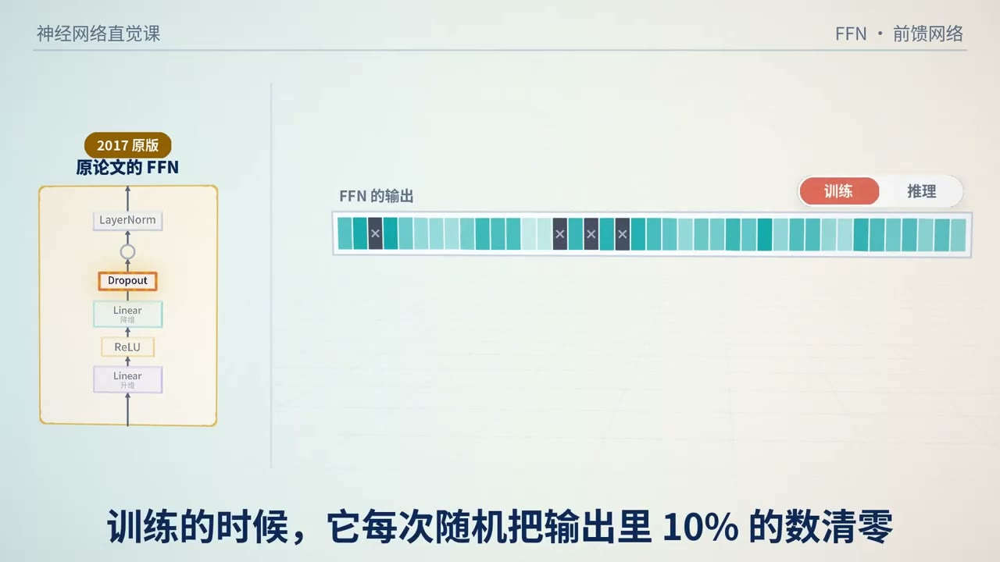

例如 Pre-Norm 子层可以写成：

$$
x_{\mathrm{next}}=x+\operatorname{FFN}(\operatorname{Norm}(x)).
$$

原始 Post-Norm 结构则将归一化放在子层输出与残差相加之后。Dropout 是否使用、放在哪里、训练时概率多少，都由实现决定，不能从一张简图推断所有现代模型都删除了 Dropout。

相关解释见 [归一化](../../技术拆解-归一化/归一化_从LayerNorm到RMSNorm.md) 与 [残差连接](../../技术拆解-残差链接/残差连接_从ResNet到Transformer.md)。

## 七、SwiGLU：两条升维支路，逐元素相乘

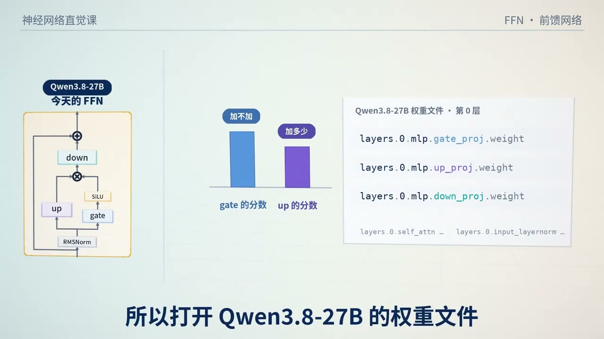

忽略偏置，采用相同的行向量约定：

$$
\operatorname{SwiGLU}(x)=
[\operatorname{SiLU}(xW_g)\odot(xW_u)]W_d,
\qquad \operatorname{SiLU}(z)=z\sigma(z).
$$

$W_g,W_u\in\mathbb R^{d\times m}$，$W_d\in\mathbb R^{m\times d}$。$\odot$ 是逐元素乘法，不是矩阵乘法。

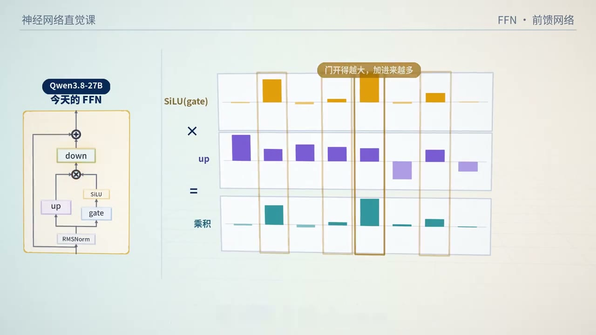

SiLU 输出可为负，也没有被限制在 $[0,1]$；所以 gate 不是普通的概率开关。“圆滑的 ReLU”可作形状直觉，但 SiLU 不等于 ReLU，负区间行为也不同。

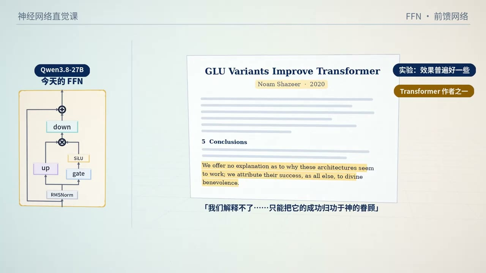

### 7.1 两维手算

给定两条投影结果 $g=[0,1]$、$u=[2,3]$，则：

$$
\operatorname{SiLU}(g)=[0,0.73105858],\qquad
\operatorname{SiLU}(g)\odot u=[0,2.19317574].
$$

再取 $W_d$ 为单位矩阵，输出就是这一向量。注意数值 2.193 并不是概率。更完整的激活推导见 [激活函数专题](../../技术前要-深度学习基础/激活函数/激活函数_从非线性到SwiGLU.md)。

## 八、参数量与计算预算：三块矩阵怎么数？

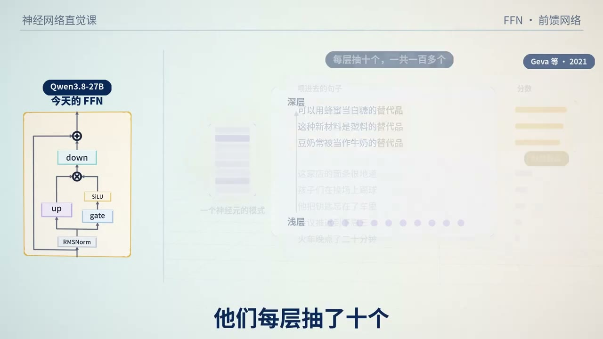

不含偏置：传统双矩阵 FFN 参数约 $2dm$，SwiGLU 为 $3dm$。如果普通 FFN 的中间宽度为 $4d$，要与它保持相近矩阵参数预算，门控 FFN 可取：

$$
3d\,m_{\mathrm{gated}}\approx2d(4d)
\quad\Rightarrow\quad m_{\mathrm{gated}}\approx\frac83d.
$$

真实宽度还要考虑硬件对齐、模型容量及训练选择，不能要求所有 SwiGLU 都遵守该比例。

按视频展示的教学配置 $d=5120,m=17408,L=64$，独立复算全部层 SwiGLU 矩阵参数：

$$
3\times5120\times17408\times64=17{,}112{,}760{,}320.
$$

即约 171.13 亿参数。此处只是复算视频给定形状，不声称已核验它展示的模型检查点。模型总参数还包含注意力、Embedding、Norm、输出层等。

若一次乘加按两次 FLOPs 计，双矩阵 FFN 的矩阵运算约 $4dm$ FLOPs / Token，SwiGLU 约 $6dm$，另有激活、逐元素乘法和其他开销。

## 九、训练出来的通道能直接贴语义标签吗？

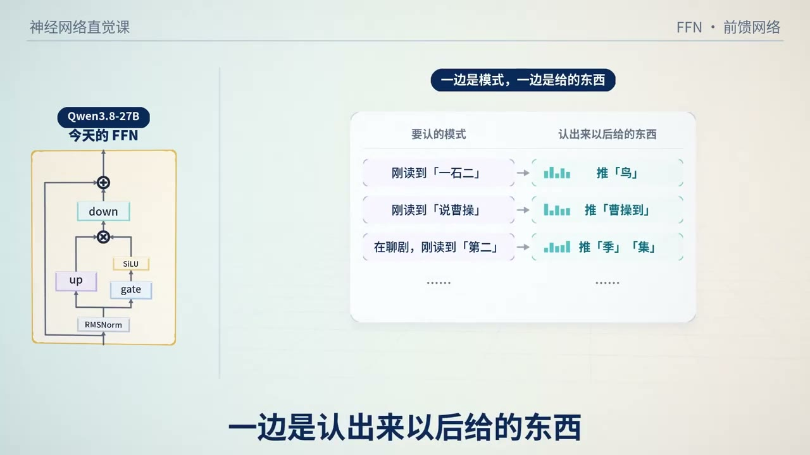

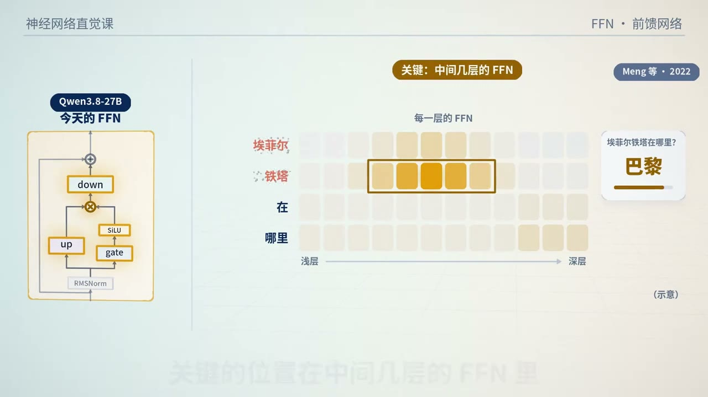

视频用真实权重或样本响应来建立“某些通道与主题或句法模式相关”的直觉。本文没有下载这些权重，也没有复现具体通道标签或分数；解释相关性需要说明模型层、输入数据、激活度量和验证方式。

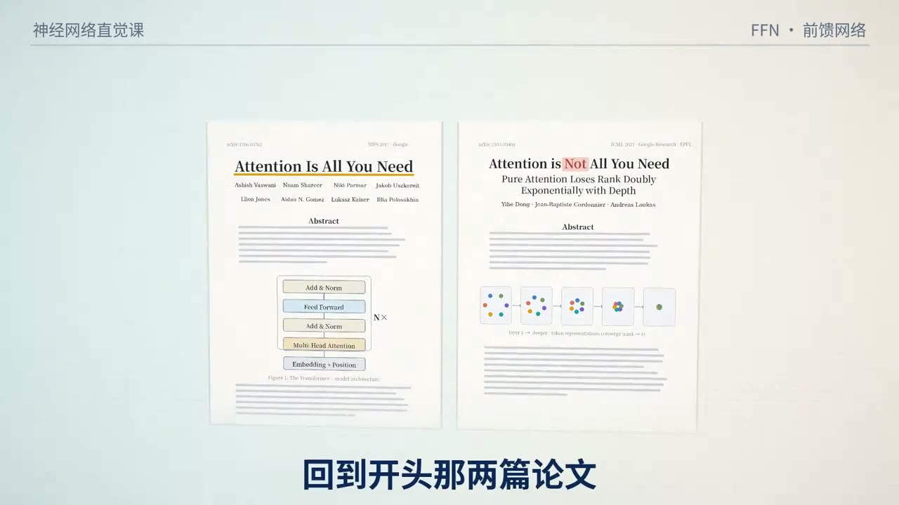

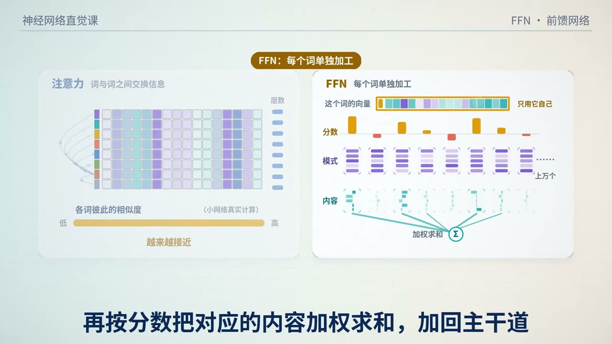

SwiGLU 的中间特征也是输入相关的组合，不能仅凭几条最大激活样本认定其唯一功能。参数记忆不保证事实正确或永远可被可靠调用。

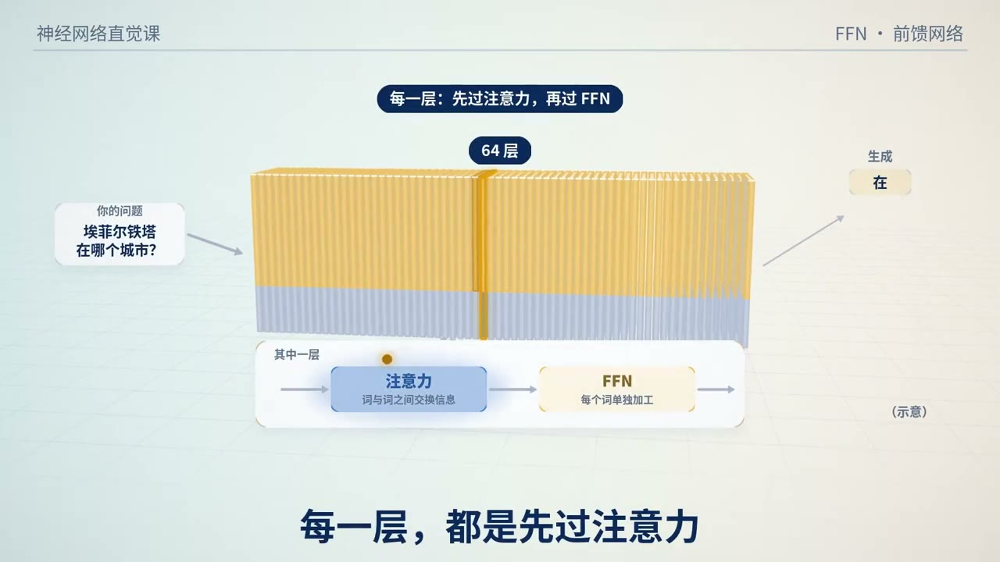

下一篇 [MoE](../MoE/MoE_从稠密FFN到稀疏路由与负载均衡.md) 将一个 FFN 子层扩展为多个可选专家，由路由器按输入选择少数专家计算。

## 十、配套复算与原始资料

[ffn_math.py](ffn_math.py) 仅用标准库核对矩阵手算、无激活时的仿射合并、ReLU 折叠、SwiGLU 数值和参数预算，不进行真实模型性能评测。

```bash
python3 ffn_math.py
```

| 资料 | 作者与用途 |
| --- | --- |
| [Attention Is All You Need](https://arxiv.org/abs/1706.03762)，2017 | Ashish Vaswani 等八位作者，完整署名见论文；Position-wise FFN 的基础 |
| [GLU Variants Improve Transformer](https://arxiv.org/abs/2002.05202)，2020 | Noam Shazeer；门控前馈层变体 |
| [Transformer Feed-Forward Layers Are Key-Value Memories](https://aclanthology.org/2021.emnlp-main.446/)，2021 | Mor Geva、Roei Schuster、Jonathan Berant、Omer Levy；FFN 的参数记忆解释 |

26 张截图覆盖 00:00—12:30，每 30 秒一帧。图注及文件名保留时间点；图片版权归原作者或相应权利人所有。几何、语义通道及模型数值均按上述范围解释，补充手算不作为作者原话。
