# MoE：从稠密 FFN 到稀疏路由与负载均衡

> **整理日期：** 2026-11-09  
> **视频来源：** 神经元出逃计划，《主流开源大模型为什么都改用 MoE？从稠密到稀疏一次性讲清楚》，2026-10-25 发布，约 14 分 48 秒。  
> **原视频：** [抖音视频](https://www.douyin.com/video/7700441235349130534)  
> **内容：** 30 张原视频截图，解释总参数与激活参数、Top-k、负载均衡、细粒度 / 共享专家及系统代价；补充概率、输出和参数手算。标题反映视频表述，不表示所有开源模型都使用 MoE。

**目录位置：** `技术拆解-FNN层/MoE/`。先读 [FFN 基础](../FFN/FFN_从非线性特征到SwiGLU与参数记忆.md)，论文时间线另见 [MoE 核心论文与技术演进](../MoE_核心论文与技术演进.md)。本篇按指定视频教学顺序组织，不替代已有综述。

MoE（Mixture of Experts）通过条件计算，让模型拥有多套专家参数，但对单个 Token 只运行其中少数专家。最常见的 Transformer MoE 将 FFN 替换为路由器及专家集合；它不意味着整个模型的所有模块都变成稀疏调用。

## 一、为什么同时标总参数与激活参数？


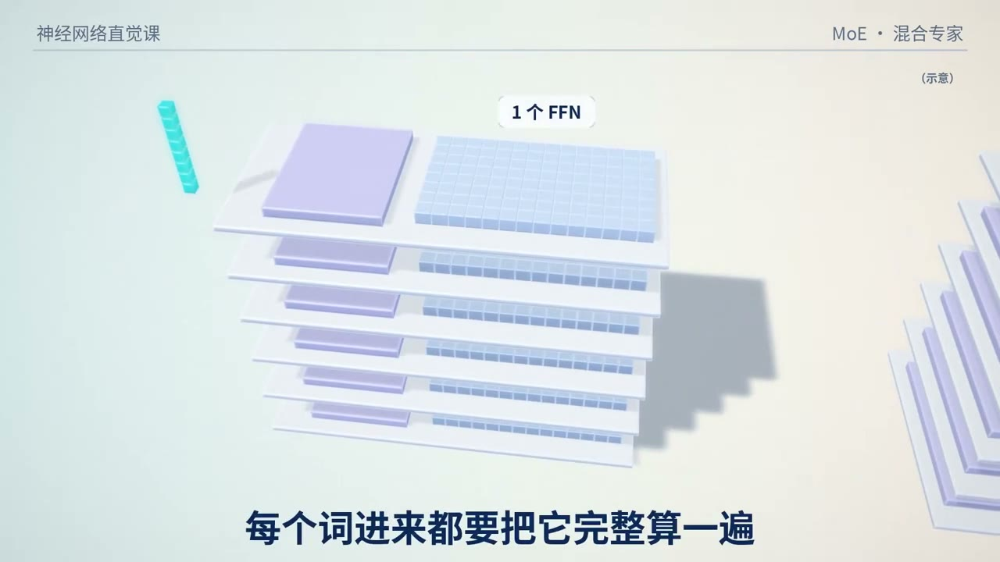

**总参数**统计模型拥有的参数；**激活参数**描述一个 Token 的前向计算涉及哪些参数，具体口径需要看模型报告。后者通常包括共享部分、路由器及选中的专家，不等于只数某一层的 Top-k 专家。

不能把所有模型的激活参数都直接当作 FLOPs、延迟或实际显存。批内不同 Token 可以激活不同专家，整批访问的专家并集可能很大。

视频开场展示的具体版本和大模型规模，本文保留为作者演示记录；没有据截图独立核验相应检查点，后文定量例子均明确给出教学参数。

## 二、专家通常是怎样的网络？

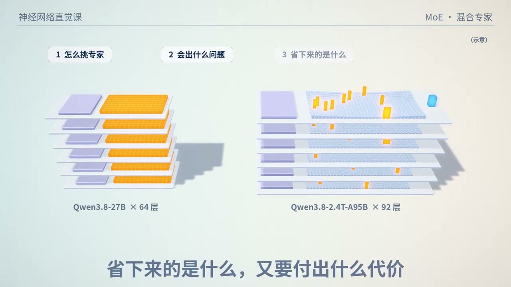

Dense FFN 对每个 Token 使用同一套参数。MoE 可维护 $E$ 个专家，每个专家仍可是一套普通 FFN 或 SwiGLU：

$$
F_e(x)=[\operatorname{SiLU}(xW_{g,e})\odot(xW_{u,e})]W_{d,e}.
$$

每个专家输入、输出都可以保持宽度 $d$，以接入残差流；中间宽度 $m_e$ 可以比对应 Dense FFN 更小。专家不是一个完整聊天模型，也不是天然按学科命名的外部工具。

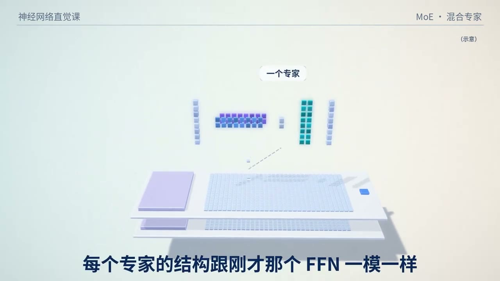

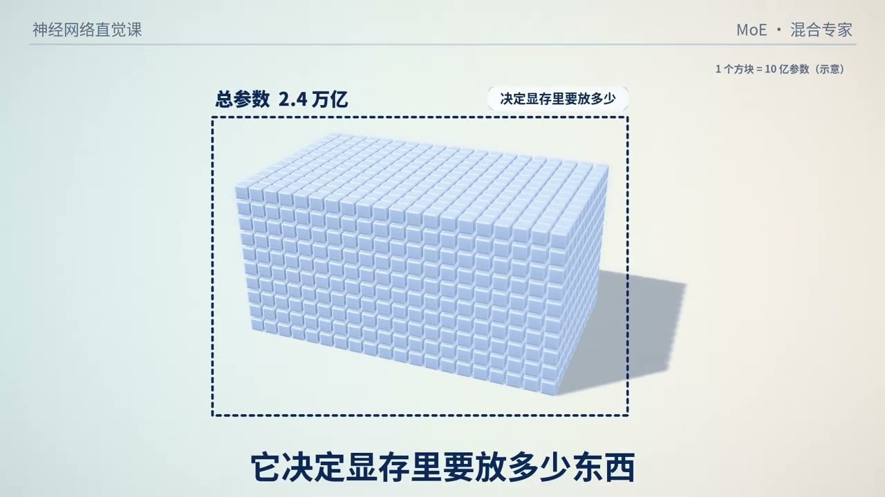

## 三、路由器：每个 Token、每个 MoE 层分别选择

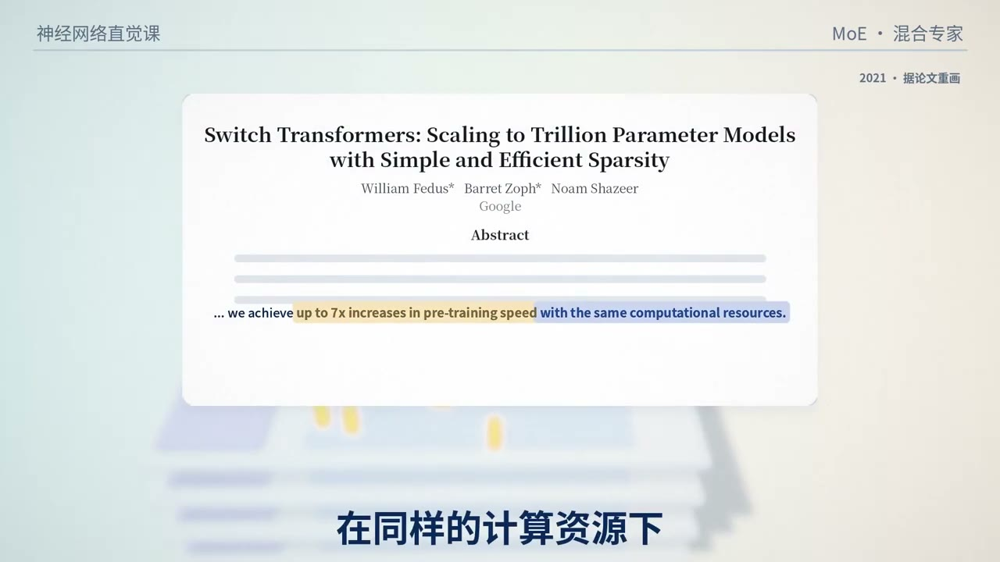

一个教学版 softmax 路由器：

$$
r(x)=xW_r+b_r\in\mathbb R^E,\qquad
p_e(x)=\frac{e^{r_e}}{\sum_j e^{r_j}},
\qquad S(x)=\operatorname{TopK}(p(x),k).
$$

路由输入是当前层的隐藏向量，已受到此前上下文计算影响。因此同一 Token 在不同上下文或不同层，可以选择不同专家。

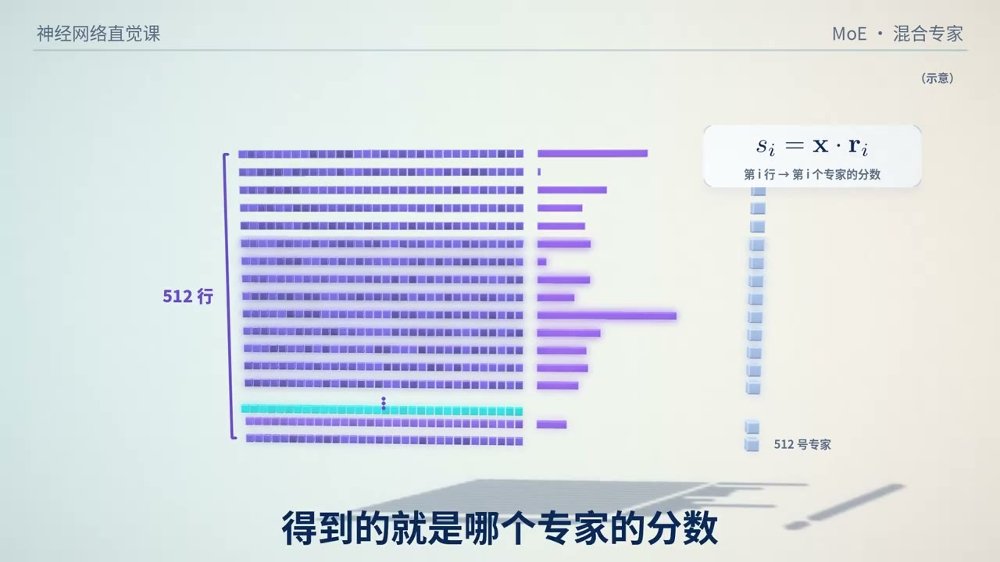

常见一种实现将选中权重重新归一化：

$$
\widetilde p_e=\frac{p_e}{\sum_{j\in S}p_j},\qquad
 y(x)=\sum_{e\in S(x)}\widetilde p_eF_e(x).
$$

但 sigmoid 路由、缩放、不重新归一化、分组选择或偏置选择也都可能存在。必须对照实现，不能把本节当作所有 MoE 的唯一公式。

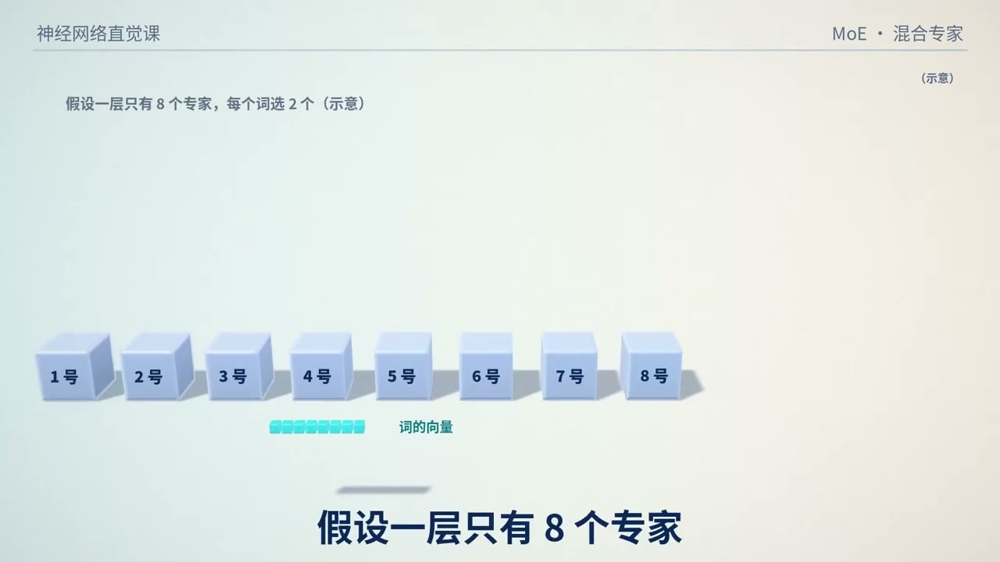

### 3.1 四个专家、Top-2 的手算

给定 logits 为 $[\ln0.5,\ln0.25,\ln0.15,\ln0.1]$，softmax 后恰为：

$$
p=[0.5,0.25,0.15,0.1].
$$

选专家 0、1，重归一化权重为 $[2/3,1/3]$。设它们的输出为 $F_0(x)=[3,0]$、$F_1(x)=[0,6]$，则：

$$
y=\tfrac23[3,0]+\tfrac13[0,6]=[2,2].
$$

如果某实现使用未归一化权重，相同输出组合会是 $[1.5,1.5]$；这说明权重定义会改变数值，不能跳过这一细节。

## 四、专家分工是谁规定的？

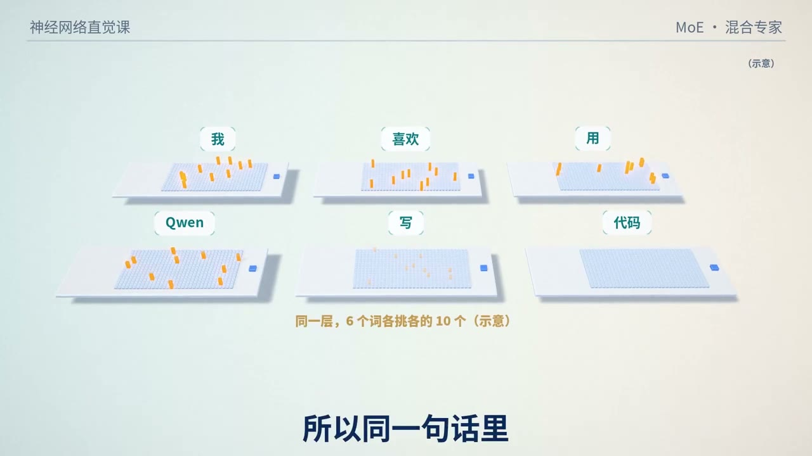

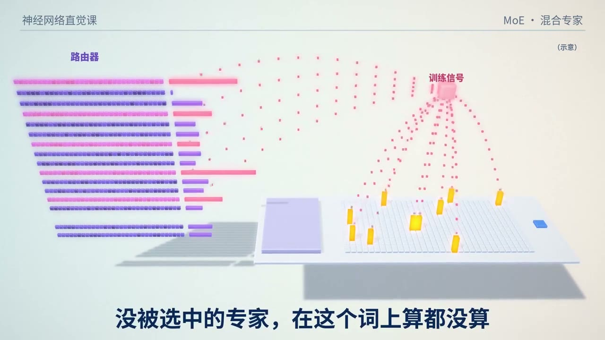

一般由训练过程中的路由与专家参数共同形成分工，而不是人工先规定“这个只管数学、那个只管法律”。某些训练方案可引入额外约束，但不属于所有 MoE 的默认机制。

Top-k 的离散选择不是处处平滑的；选中专家的输出和连续门控权重可收到梯度，未选专家通常不执行这次输入的专家计算。路由器还可能受到辅助损失等训练信号影响，不能简单说“没被选的所有相关参数永远不更新”。

## 五、为什么会出现少数专家过载？

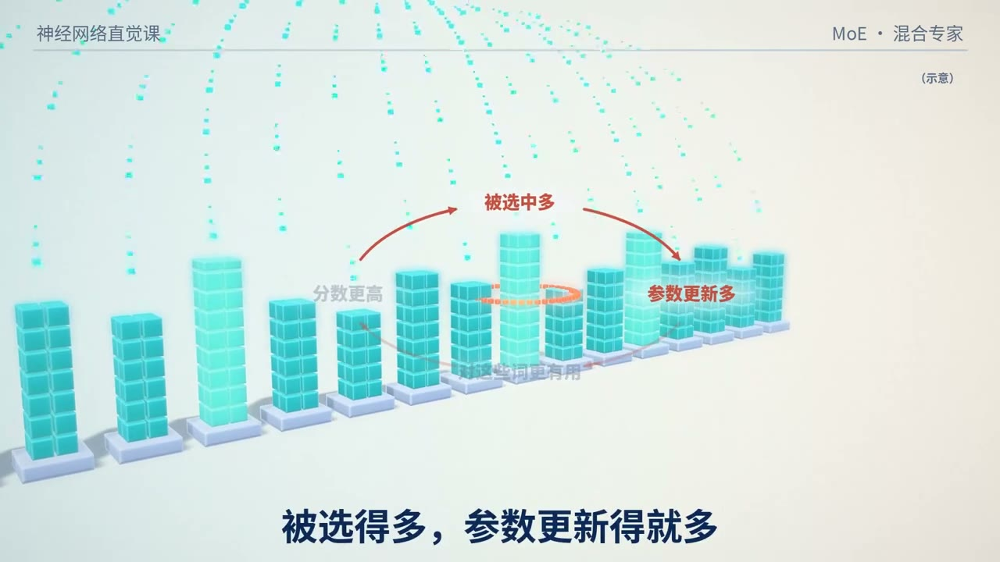

若少数专家经常被选中，它们获得更多训练样本，可能进一步吸引路由，形成不均衡。结果可能包括专家训练不足、设备负载不均、通信或容量瓶颈。

不均衡并不意味着每层每个专家必须在每个小 batch 中接到完全相同数量的 Token。均衡目标、统计窗口与任务质量之间有取舍。


### 5.1 一个 Top-1 辅助损失例子

为避免混用 Top-k 口径，这里限定每个 Token 只选择一个专家。设 $N$ 个 Token，$E$ 个专家：

$$
f_e=\frac1N\sum_t\mathbf1[\operatorname{Top1}(p_t)=e],\qquad
P_e=\frac1N\sum_t p_{t,e},
$$

$$
L_{\mathrm{balance}}=E\sum_e f_eP_e.
$$

训练总目标可加入 $\alpha L_{\mathrm{balance}}$。$f_e$ 是实际分配比例，$P_e$ 是平均概率，两者不是同一个统计量。

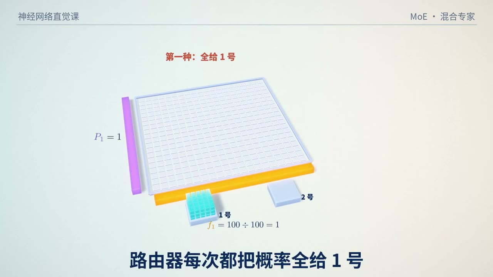

对于 2 个专家，若 $f=P=[0.5,0.5]$，该量为 1；若 $f=P=[1,0]$，为 2。这个对比说明它为何对同向集中的分配施加更大代价，但不能推断任意分布组合下其严格全局最小值一定是 1。

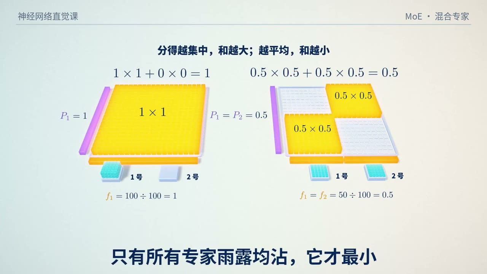

Top-k 的计数是否除以 $k$、是否按序列或批统计、是否使用其他损失，都需按论文和代码调整。视频某个配置的系数不能推广成普适最优值。

### 5.2 不加同一种辅助损失，也能调节选择

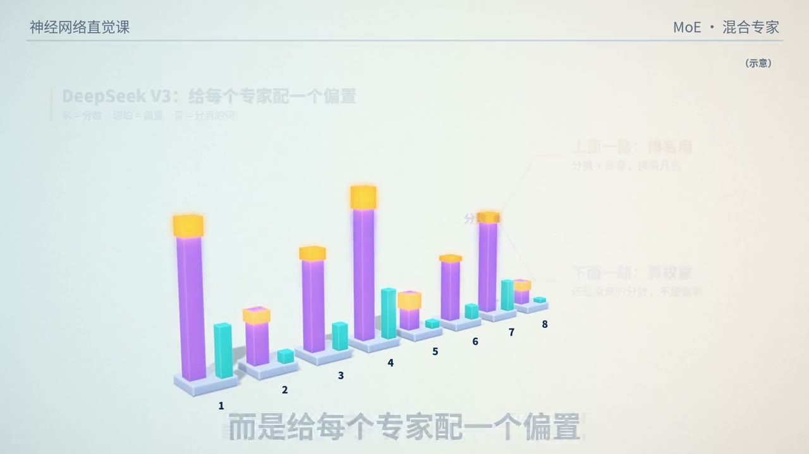

Loss-Free Balancing 的思路是在 Top-k 选择分数上引入专家偏置，并依据近期负载调整它：过载专家降低被选倾向，欠载专家提高倾向。偏置可以只用于选择，而实际输出权重仍来自原始亲和分数。

“不使用这一负载均衡辅助损失”不等于整个模型没有任何辅助目标，也不是训练无需均衡机制。原始策略见 [Auxiliary-Loss-Free Load Balancing](https://arxiv.org/abs/2408.15664)。

## 六、专家真会按学科划分吗？

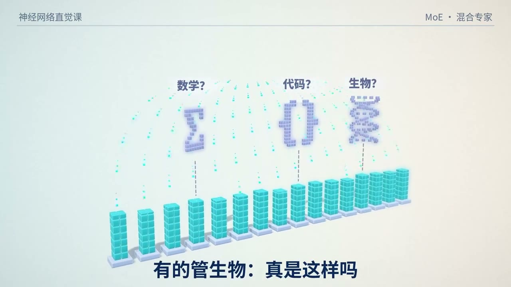


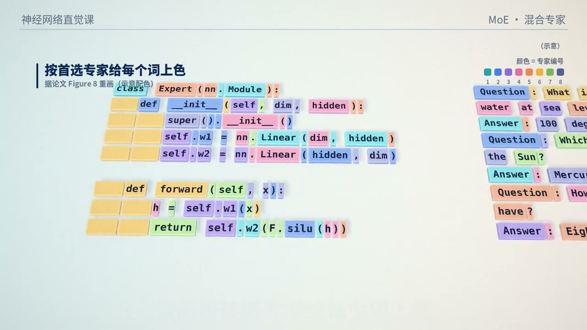

专家可能与词形、语法、位置、语言或局部内容相关，也可能表现出某些主题偏好。路由统计呈现相关性，不足以给每个专家贴上唯一且稳定的学科标签。

分析还需明确模型、层号、语料、路由计数和专家选择方式。本文未复现视频中的具体路由图，不能将其作为所有模型的固定结论。

## 七、细粒度专家：更多、更窄，组合更灵活

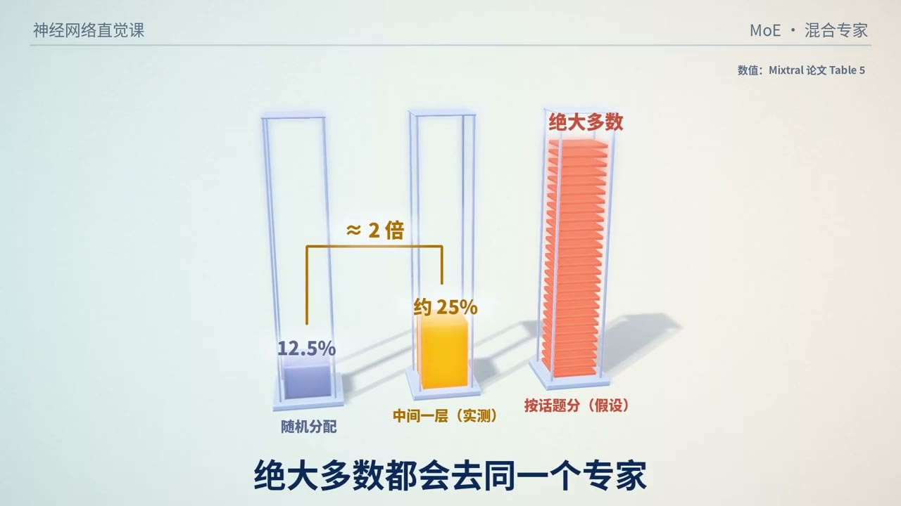


设原有 $E$ 个专家，每个中间宽度 $m$，每 Token 激活 $k$ 个。若每个专家拆成 $q$ 个宽度 $m/q$ 的专家，专家总数变成 $qE$；若同时激活 $qk$ 个，则理想的专家矩阵参数及激活矩阵运算量可近似保持。

SwiGLU 专家参数量近似 $3dm$，所以：

$$
(qE)\,3d(m/q)=E\,3dm,\qquad
(qk)\,3d(m/q)=k\,3dm.
$$

这里没把路由器增大、更多调度、通信、对齐和计算粒度开销算进去。组合更多不等于实际速度必然更快，已有 Dense 权重也不能无训练地随意拆分并声称等价。

## 八、共享专家：让公共变换始终参与

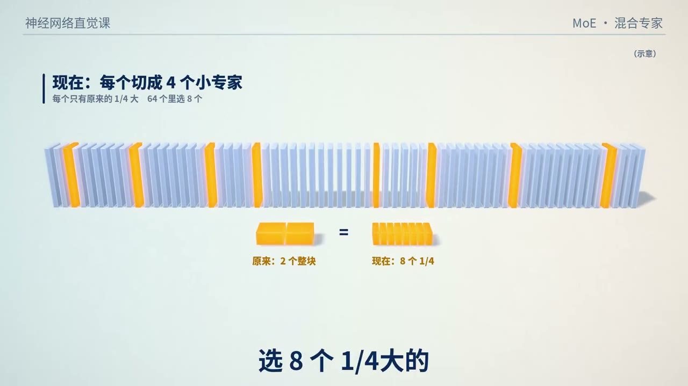

一种结构为：

$$
y(x)=F_{\mathrm{shared}}(x)+\sum_{e\in S(x)}\widetilde p_eF_e(x).
$$

共享分支旨在承担较通用的变换，路由专家可学习更有区别的模式。这是设计动机，不保证共享分支只学“常识”、其他专家只学“专长”。

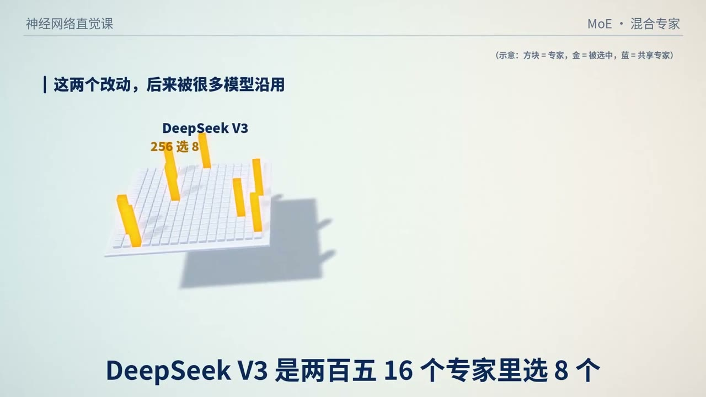

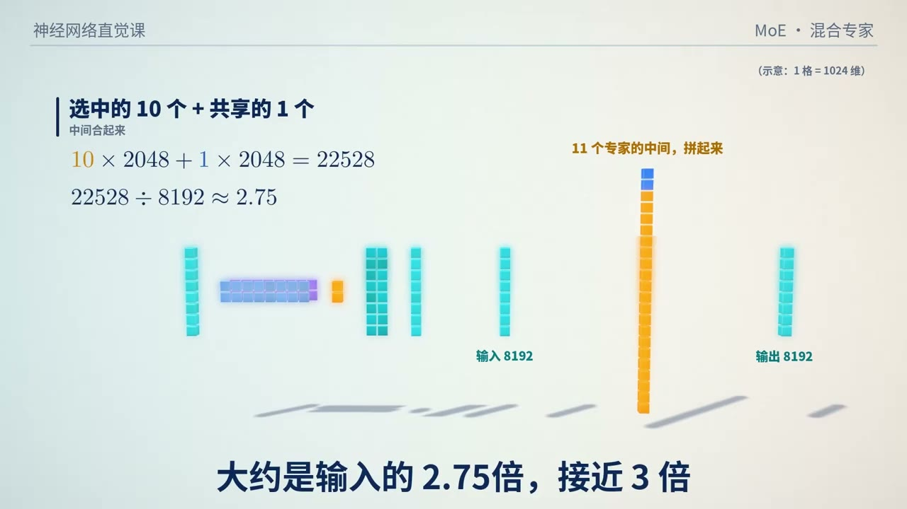

若共享分支还有标量门控 $a(x)$，则改为 $a(x)F_{\mathrm{shared}}(x)$。沿第三节输出 $[2,2]$，给定共享输出 $[1,-1]$、门控 0.5，总输出是 $[2.5,1.5]$。这是本文教学例子，不代表所有共享专家都使用相同门控。

## 九、总参数与激活参数完整手算

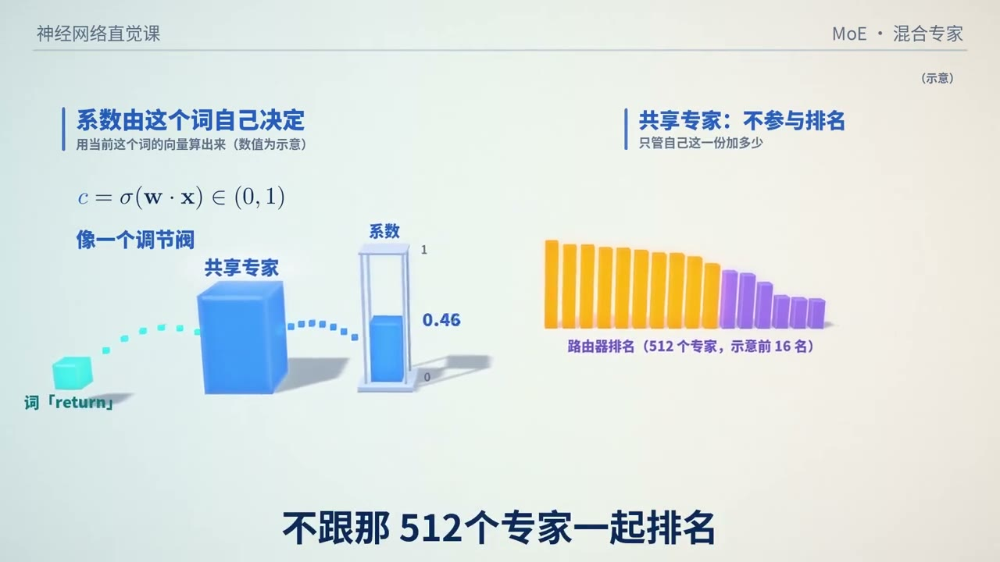

取单层教学配置：输入宽度 $d=4$，每个 SwiGLU 专家中间宽度 $m=8$，8 个路由专家，Top-2，另有一个同宽共享专家；路由器无偏置。

| 部分 | 总参数 | 单 Token 涉及的参数 |
| --- | --- | --- |
| 路由专家 | $8\times3\times4\times8=768$ | $2\times96=192$ |
| 共享专家 | 96 | 96 |
| 路由器 | $4\times8=32$ | 32 |
| 合计 | 896 | 320 |

未计注意力、Embedding、Norm、残差、共享分支额外门控及其他层。不能将 `896/320` 当作真实速度比，也不能把 320 当作完整模型激活参数。

更大模型中，“总参数相同”和“激活参数相同”是不同对比条件；质量、训练数据、计算预算和系统成本都需要分别评估。

## 十、激活少，为何仍需要大量显存和通信？

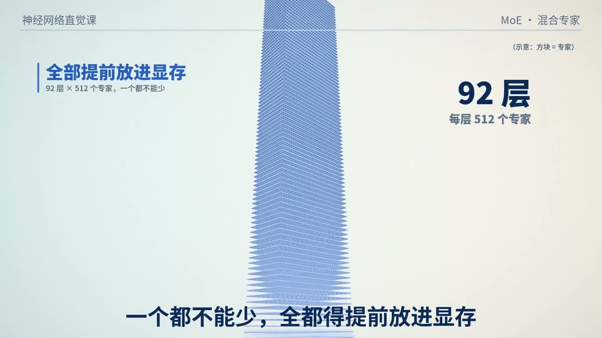

专家是否被当前 Token 使用，不会自动让其权重从总存储需求中消失。系统可以通过分片、量化或卸载安放权重，但这些方案各有带宽和调度代价。

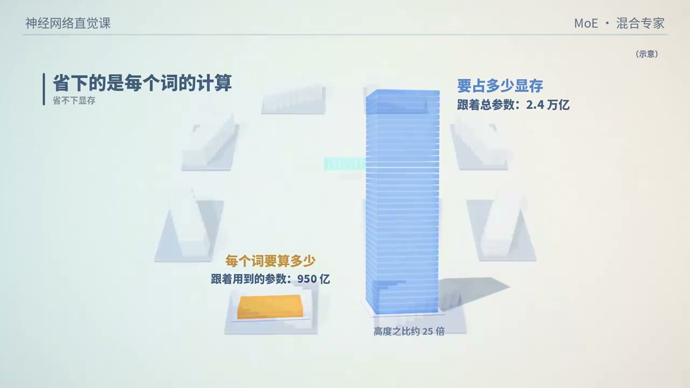

专家并行通常需要把 Token 发往持有对应专家的设备，再把结果合回原位置。跨设备通信、负载不均、小批量专家矩阵计算和等待时间都可能影响效率。

容量受限的路由实现可能丢弃、改派或另行处理超额分配，也有不丢 Token 的设计。不能把某种容量策略写成所有 MoE 的默认行为。

KV Cache 取决于注意力结构，不能由 MoE 专家激活比例直接推出。背景见 [KV Cache 基础](../../技术拆解-注意力机制/KVCache/KVCache基础_从因果不变性到Prefill与Decode.md)。

## 十一、每一层重新路由，不是整段请求只选一次

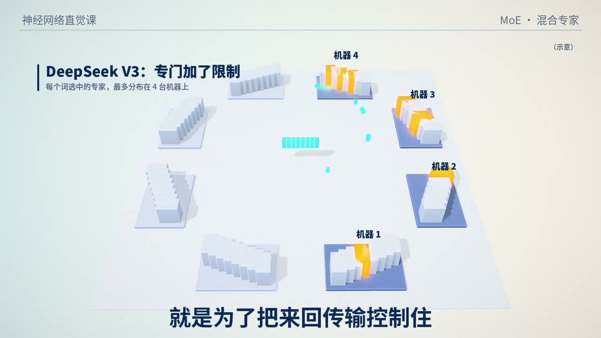

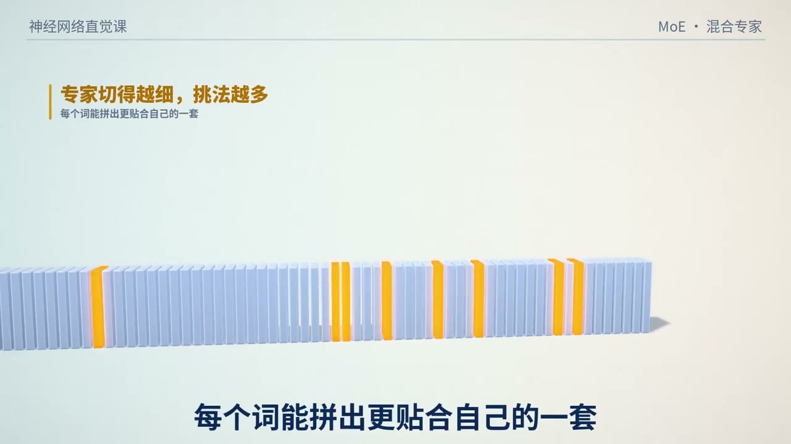

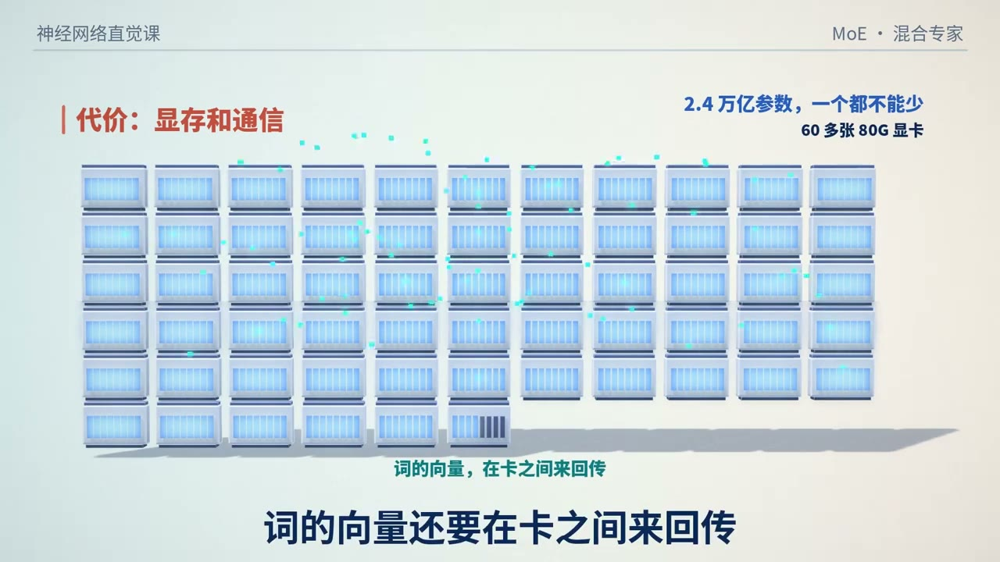

路由通常针对每个 Token 在每个 MoE 层的当前隐藏状态。不是输入一句话后先选“数学专家”，再由同一个专家完成整段模型推理；相邻 Token、不同层与不同生成步都可能有不同路径。


后续可读 [Token 与 Embedding](../../技术前要-深度学习基础/Embedding/Token与Embedding_从strawberry计数到向量查表.md)，把模型入口与各层计算连接起来。

## 十二、复算代码与论文来源

[moe_math.py](moe_math.py) 使用标准库核对 Top-2 权重与输出、共享分支、Top-1 均衡示例、细粒度参数等式及第九节预算。它不模拟分布式训练，也不以教学例子证明模型质量。

```bash
python3 moe_math.py
```

| 首次公开 | 作者与原始资料 | 对应问题 |
| --- | --- | --- |
| 2017-01-23 | Noam Shazeer、Azalia Mirhoseini、Krzysztof Maziarz、Andy Davis、Quoc Le、Geoffrey Hinton、Jeff Dean，[Sparsely-Gated MoE](https://arxiv.org/abs/1701.06538) | 稀疏专家层的重要早期研究，并非 MoE 思想的最早起源 |
| 2021-01-11 | William Fedus、Barret Zoph、Noam Shazeer，[Switch Transformers](https://arxiv.org/abs/2101.03961) | Top-1 路由、训练与均衡机制 |
| 2024-01-11 | Damai Dai 等 17 位共同作者，[DeepSeekMoE 完整论文与署名](https://arxiv.org/abs/2401.06066) | 细粒度专家和共享专家 |
| 2024-08-28 | Lean Wang、Huazuo Gao、Chenggang Zhao、Xu Sun、Damai Dai，[Auxiliary-Loss-Free Load Balancing](https://arxiv.org/abs/2408.15664) | 通过动态专家偏置控制负载 |

30 张截图覆盖 00:00—14:30，每 30 秒一帧。时间点见图注及文件名，图片版权归原作者或相应权利人所有。本文的独立数值例子与原论文机制说明均不作为视频逐字转录；未复现截图中的具体模型质量、路由统计或硬件成本。
