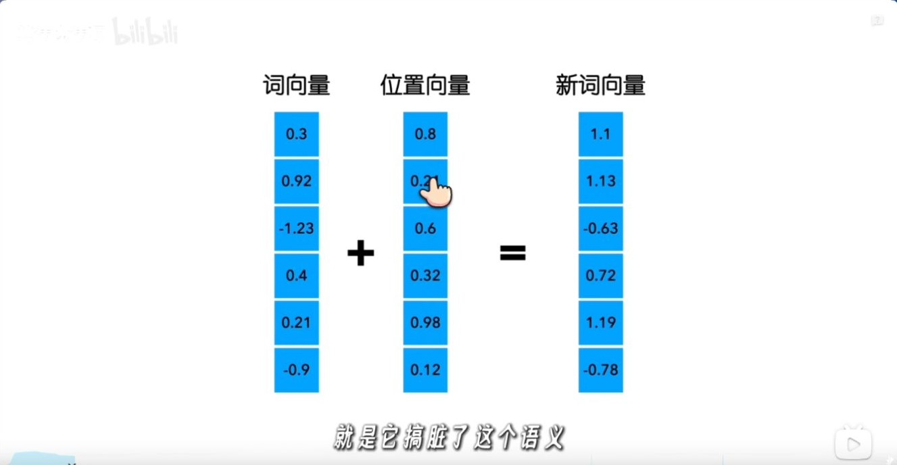
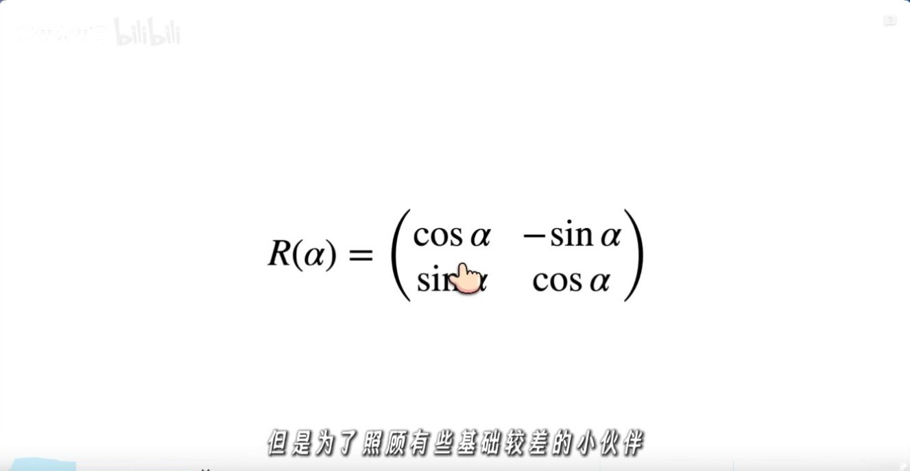
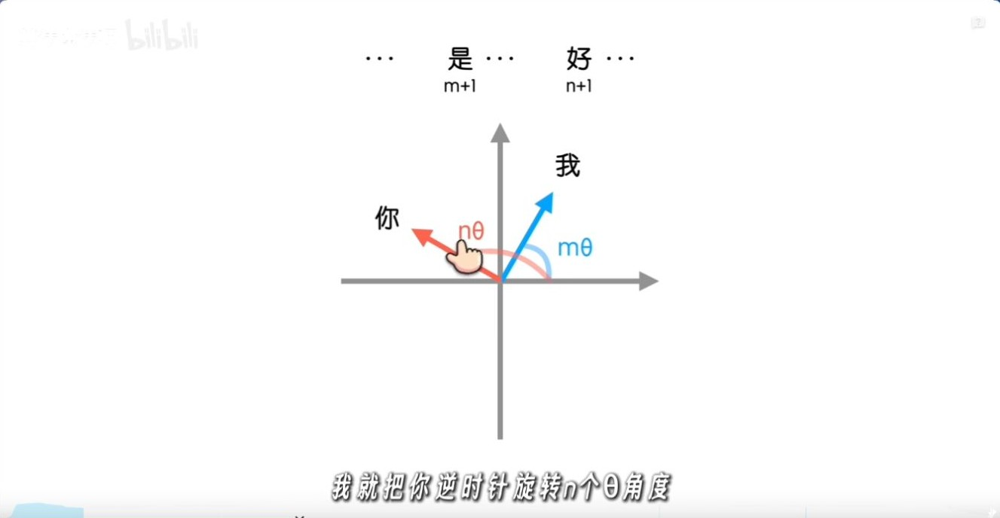
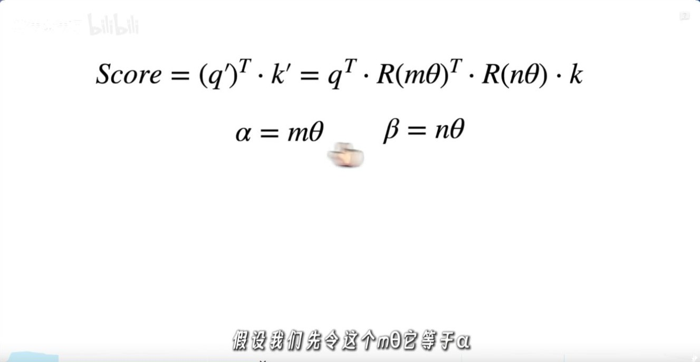
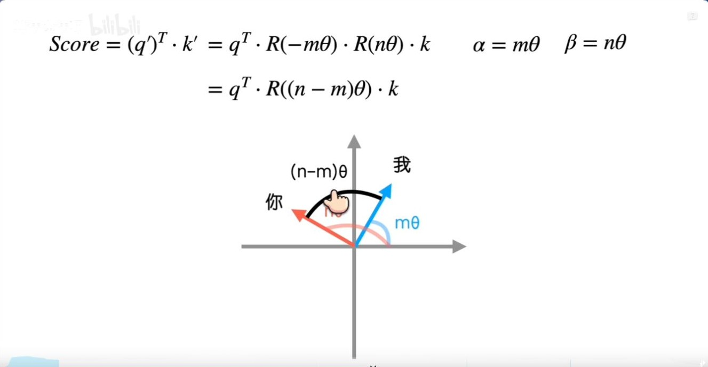
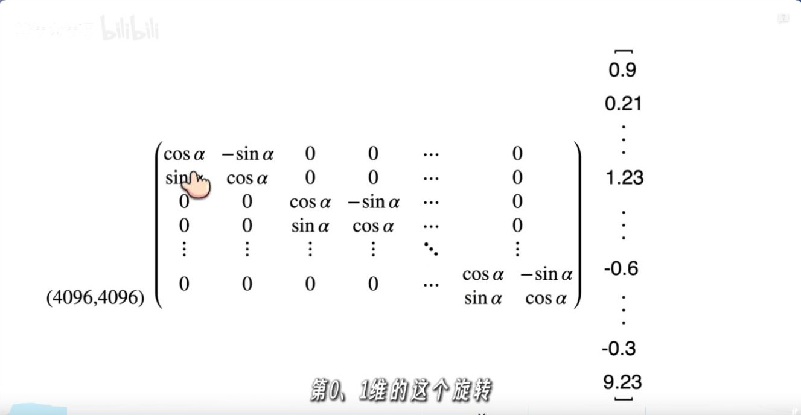
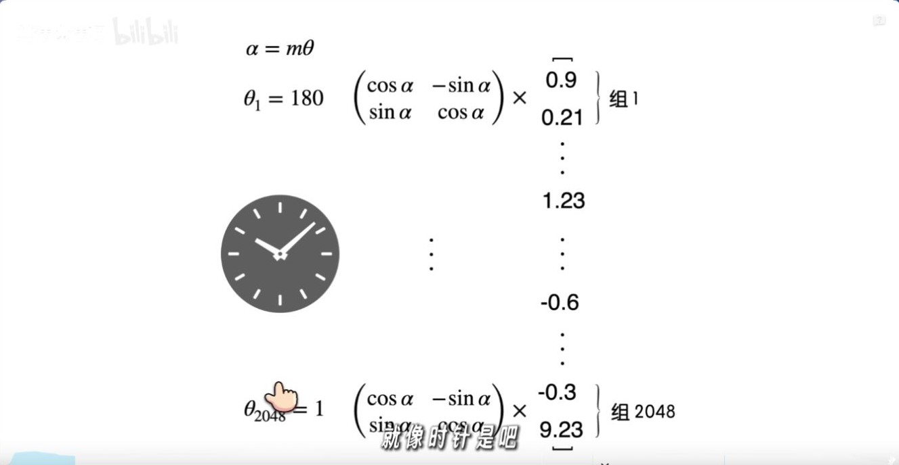
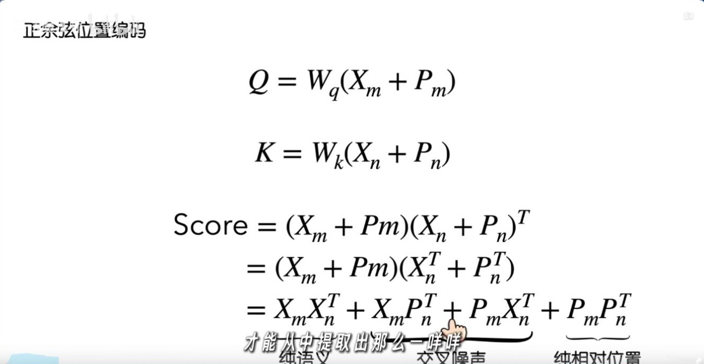

# RoPE：从旋转矩阵推导相对位置

算法魔法师，2026 年 1 月 16 日发布，时长 09:47。本文跟随视频推导二维旋转、Q/K 点积及高维分组，并补齐最后一段加法位置编码对照中的投影矩阵。 [B 站原视频](https://www.bilibili.com/video/BV1FjrCBdESo/)

## 00:38｜从加法位置编码出发

原版 Transformer 将位置向量加进输入。RoPE 在注意力层内先计算 Q 和 K，再按各自位置旋转它们。旋转让两个位置的**差值**进入注意力点积。 [RoFormer 论文 §3](https://arxiv.org/abs/2104.09864)

## 02:07–02:51｜两个向量各转一个角度

对列向量使用逆时针旋转矩阵

$$
R(\alpha)=\begin{bmatrix}\cos\alpha&-\sin\alpha\\\sin\alpha&\cos\alpha\end{bmatrix}.
$$

令查询位置为 $m$、键位置为 $n$，同一对通道使用频率 $\theta$。内容投影得到 $q,k$ 后，旋转结果分别是 $q'=R(m\theta)q$ 和 $k'=R(n\theta)k$。

## 03:37–05:09｜绝对旋转角在点积里合成角度差

旋转矩阵的转置等于反向旋转，即 $R(a)^\top=R(-a)$。同一平面上的旋转可合并为 $R(a)R(b)=R(a+b)$。因此

$$
(q')^\top k'
=q^\top R(m\theta)^\top R(n\theta)k
=q^\top R(-m\theta)R(n\theta)k
=q^\top R((n-m)\theta)k.
$$

固定内容向量时，把 $m,n$ 同时平移同样的步数，旋转后的点积保持一致。取 $q=k=[1,0]^\top$、$\theta=\pi/2$，位置对 $(2,3)$ 和 $(5,6)$ 的点积都是 $\cos(\pi/2)=0$。位置差相同的两个真实 token 仍可因内容不同得到不同分数。

## 05:54–06:38｜高维向量按二维子空间旋转

把需要旋转的通道两两配对，每对使用自己的 $\theta_i$，计算 $R(p\theta_i)$。截图用 4096 维向量帮助理解分块。实际实现通常在每个注意力头的旋转子空间中对 Q/K 做配对，并直接用逐元素乘加完成旋转。常见实现有相邻配对和前后半区配对两种布局，须与权重所用布局一致。 [RoFormer 论文 §3.2–3.3](https://arxiv.org/abs/2104.09864)

## 08:52｜对照加法位置编码的点积

沿用列向量约定，设 $x_p$ 为位置 $p$ 的词向量，$P_p$ 为位置向量。保留投影时，令 $A=W_Q^\top W_K$，则点积为

$$
(x_m+P_m)^\top A(x_n+P_n)
=x_m^\top A x_n+x_m^\top A P_n+P_m^\top A x_n+P_m^\top A P_n.
$$

中间两项分别让词内容与另一位置的位置向量交互。即使未经投影的正弦位置向量之间的点积可写成位置差的函数，完整表达式一般也没有 RoPE 的 $q^\top R((n-m)\theta)k$ 形式。反过来，RoPE 的相对位置性质描述的是这一层的旋转点积，模型在超出训练长度时的表现仍需验证。 [正弦位置编码的 B 站推导](../正弦位置编码/正弦位置编码_B站推导_为什么不用序列编号.md)
