# RoPE：从二维旋转到相对位置点积

> **整理日期：** 2026-11-09  
> **视频来源：** 神经元出逃计划，《大模型位置编码，看懂 RoPE 如何旋转 Q 和 K》，2026-09-27 发布，约 11 分 41 秒。  
> **原视频：** [抖音视频](https://www.douyin.com/video/7690069322424749348)  
> **内容：** 24 张原视频截图，从两根指针推导旋转矩阵、相对位移、多频率及长上下文边界；另附手算与复算代码。模型配置、频率扩展和实现注意事项中的补充内容不作为作者逐字表述。

**目录位置：** `技术拆解-位置编码优化/RoPE基础/`。先读 [正弦位置编码基础](../正弦位置编码/正弦位置编码_从序列编号到多频率坐标.md)，后续可读已有 [RoPE 原理与架构专题](../RoPE_原理与Qwen_DeepSeek架构解读.md)，对照应用。

RoPE（Rotary Position Embedding）先根据各自位置旋转 Query 和 Key，再计算点积。旋转使用的是绝对位置，旋转组合在点积中呈现相对位置差；它没有把位置内容简单加到输入 Embedding 上。

## 一、从出处与三个问题开始


视频介绍苏剑林及其相关思路。正式 RoFormer 论文由 Jianlin Su、Yu Lu、Shengfeng Pan、Ahmed Murtadha、Bo Wen、Yunfeng Liu 共同署名，首次公开于 2021-04-20，见 [RoFormer 原论文](https://arxiv.org/abs/2104.09864)。

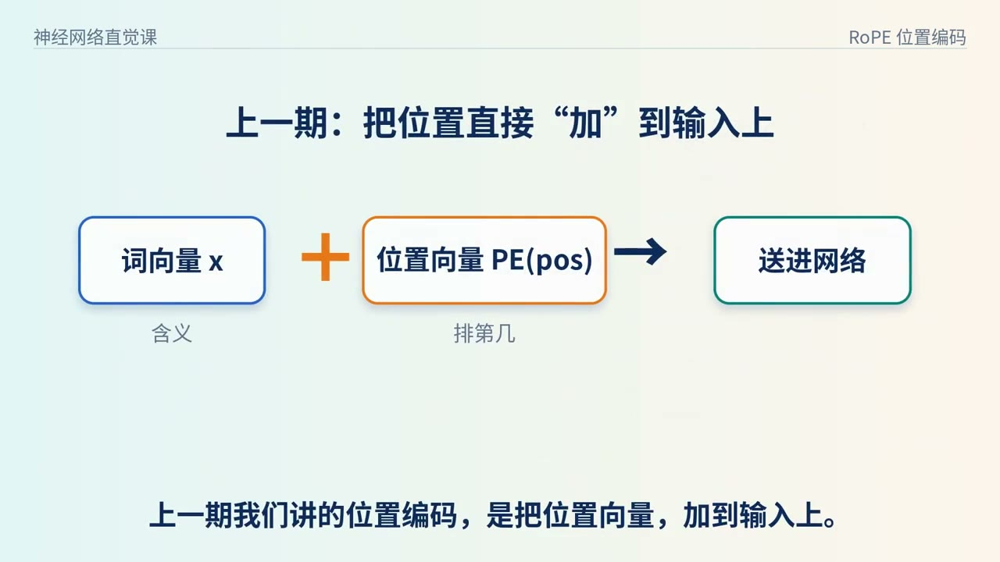

本篇依次回答：位置为什么可表示为角度？两个绝对角度怎样变成相对位移？一个指针会绕圈，为何要使用多个转速？

## 二、从加法方案的四项展开出发


若简化为把位置分别加到 Query、Key：

$$
(q+p_m)^T(k+p_n)
=q^Tk+q^Tp_n+p_m^Tk+p_m^Tp_n.
$$

这是解释内容项与位置项混合的教学简式。原始 Transformer 实际先在输入相加、再投影成 Q / K，对应项还要包含投影矩阵，不能省略后便当作精确的原始架构公式。

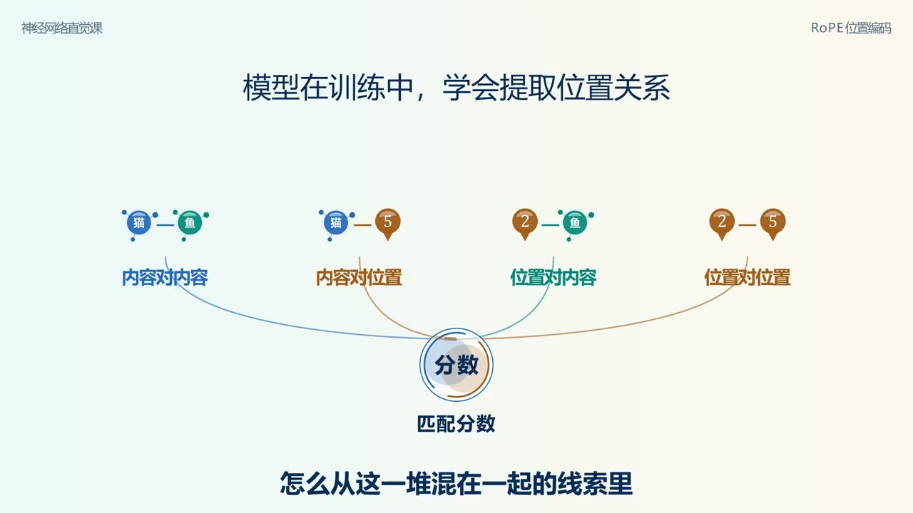

RoPE 采用另一种构造：让位置控制对内容向量的旋转，进而改变它们的点积。加法方案并非因此失效或不能使用；两者有不同的结构与归纳偏置。

## 三、一个二维旋转矩阵

对二维列向量 $x=[x_1,x_2]^T$，逆时针旋转 $\alpha$：

$$
R(\alpha)=\begin{bmatrix}\cos\alpha&-\sin\alpha\\\sin\alpha&\cos\alpha\end{bmatrix},
\qquad
R(\alpha)x=
\begin{bmatrix}x_1\cos\alpha-x_2\sin\alpha\\x_1\sin\alpha+x_2\cos\alpha\end{bmatrix}.
$$


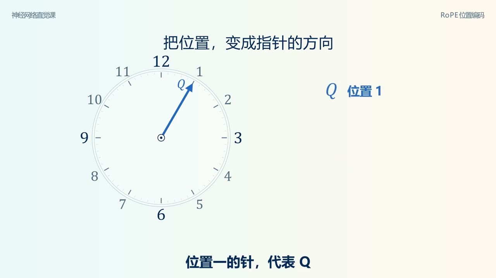

钟表按顺时针画也能帮助理解，但本篇公式统一逆时针，且代码用弧度。改变约定时，相关正负号及坐标排列必须保持一致。

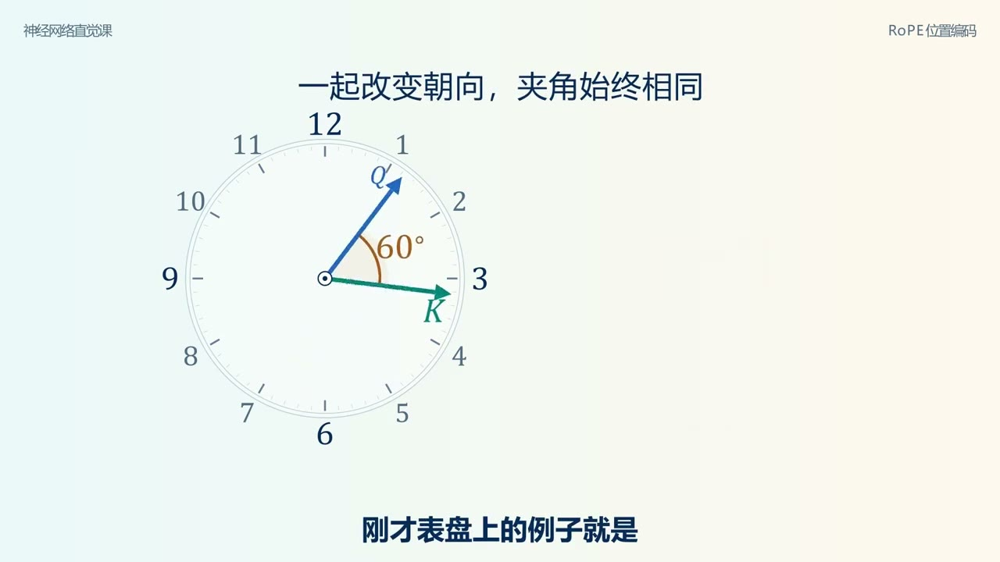

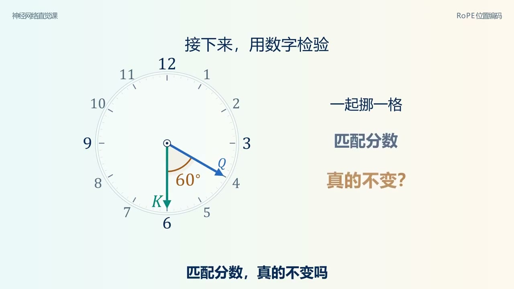

旋转满足：

$$
R(\alpha)^TR(\alpha)=I,\qquad
R(\alpha)^T=R(-\alpha),\qquad
R(\alpha)R(\beta)=R(\alpha+\beta).
$$

因此 $\|R(\alpha)x\|_2=\|x\|_2$：它改变方向，保持二维向量长度。保持范数并不表示“位置毫无影响”，因为不同位置可以旋转不同角度。

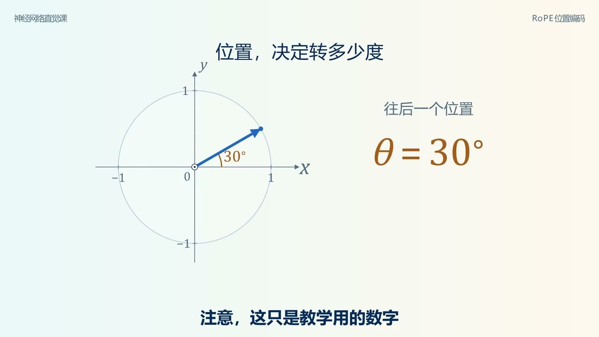

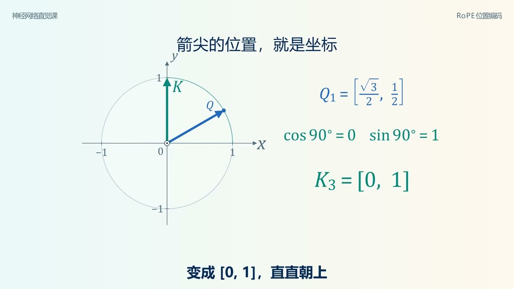

## 四、共同旋转为何不改变点积？

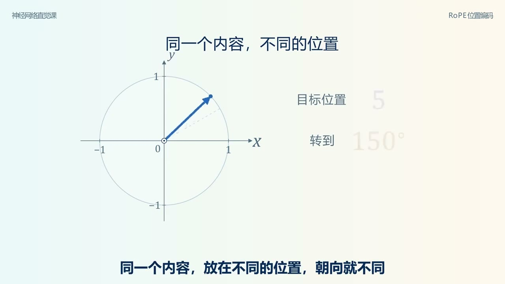

对相同角度 $\alpha$：

$$
(R(\alpha)q)^T(R(\alpha)k)=q^TR(\alpha)^TR(\alpha)k=q^Tk.
$$

直觉上，两根指针一起转同样的角度，彼此夹角保持不变。普通点积等于 $\|q\|\|k\|\cos\gamma$，不是总等于 $\cos\gamma$；只有长度都为 1 时才能直接如此简化。

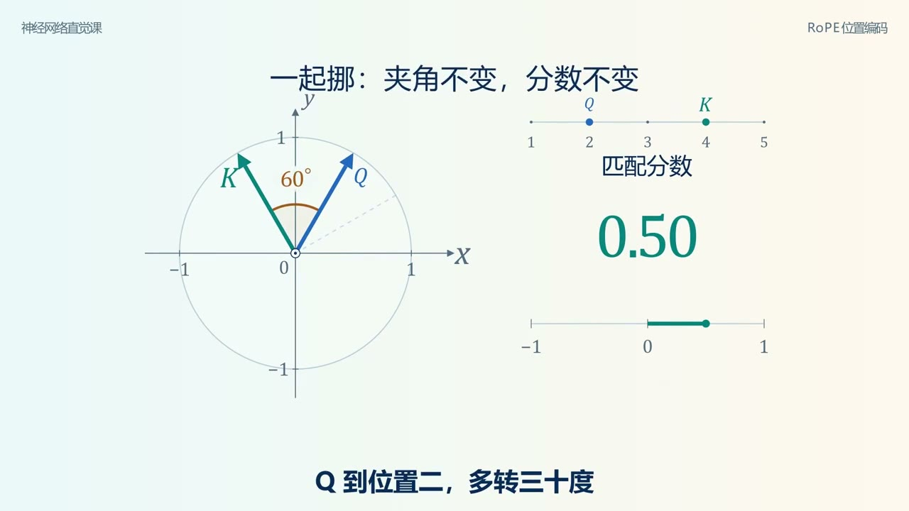

## 五、核心推导：绝对位置在点积中形成相对位移

令每前进一步旋转 $\theta$，位置 $m,n$ 的 Query 和 Key：

$$
q'_m=R(m\theta)q_m,\qquad k'_n=R(n\theta)k_n.
$$

则：

$$
\begin{aligned}
(q'_m)^Tk'_n
&=q_m^TR(m\theta)^TR(n\theta)k_n\\
&=\boxed{q_m^TR((n-m)\theta)k_n}.
\end{aligned}
$$

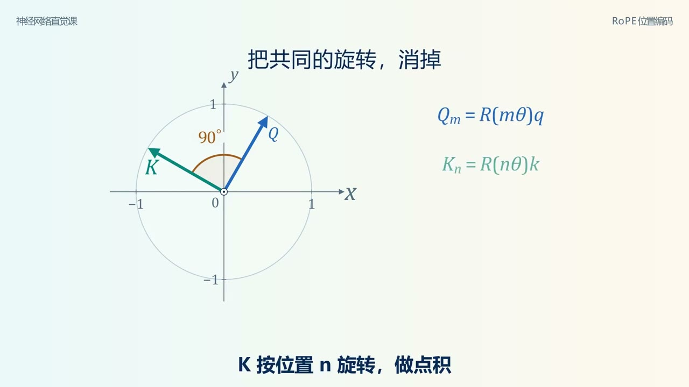

位置调制项依赖 $n-m$，不是分别依赖两个位置。符号与本篇旋转及点积顺序一致；若换行向量或改变配对约定，表达可能不同，需保持内部一致。

### 5.1 两个位置的手算

令 $q=k=[1,0]^T$，$\theta=30^\circ=\pi/6$，$m=1,n=3$。旋转后两者夹角是 $60^\circ$，所以：

$$
(q'_1)^Tk'_3=\cos60^\circ=0.5.
$$

共同平移到 $m=6,n=8$，位移仍是 2，固定相同的内容向量时点积仍为 0.5。

### 5.2 只说“取决于距离”还不够准确

若保持 $q=[1,0]^T$，把内容 Key 改成 $k=[0,1]^T$，相同位移下得到 $-\sin60^\circ\approx-0.866025$。内容方向改变，分数也改变。

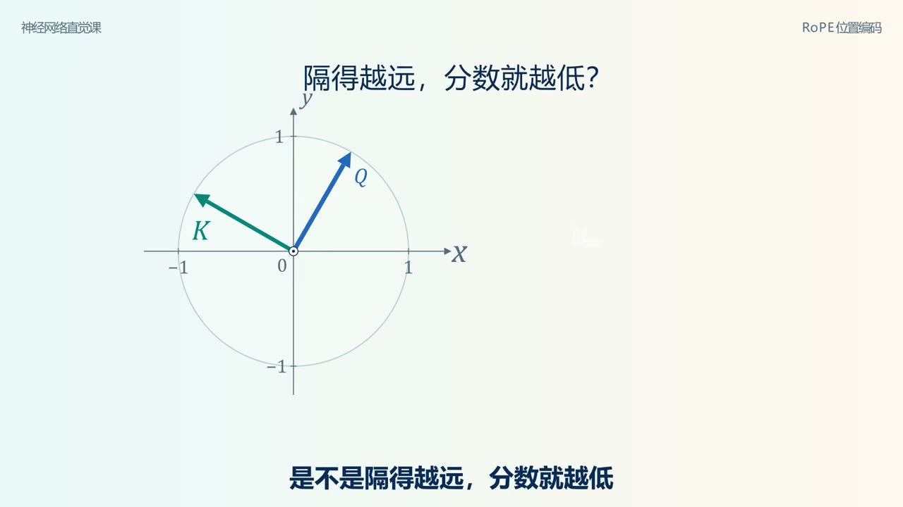

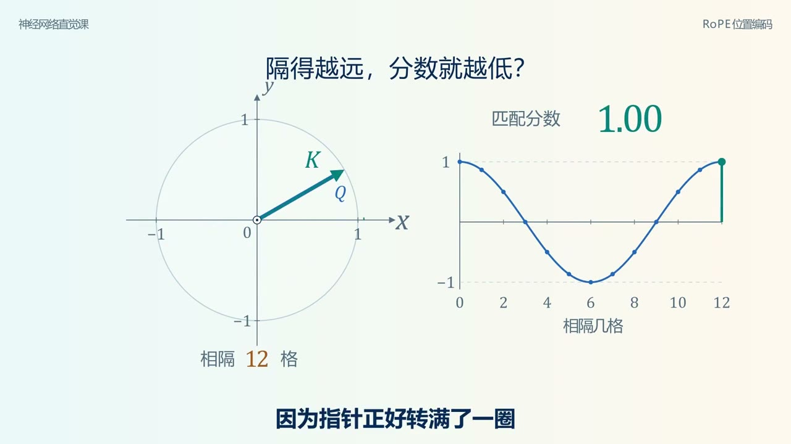

严格说，公式中的**位置调制结构**只依赖相对位移，完整分数还依赖内容。真实 $q_m,k_n$ 是上下文计算的产物；这个等式也不保证整个模型任意平移输入后输出完全不变。

## 六、RoPE 不是单调的距离惩罚

当 $q=k=[1,0]^T$，分数是 $\cos((n-m)\theta)$，它会周期变化。相距更远，分数不一定更低；相同距离、不同内容方向也可得到不同分数。

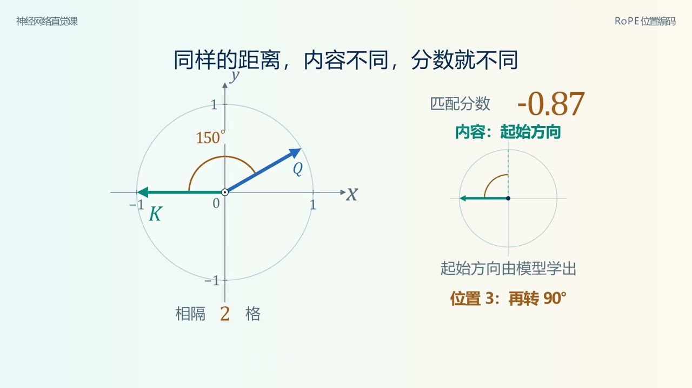

在本篇 $\theta=30^\circ$ 的单频教学例子中，12 步会转完一圈，位移 2 和 14 的位置旋转相同。真实常用频率不一定具有整数步长的精确周期，不能据此说标准 RoPE 每固定 12 个 Token 就完全重复。

论文有关距离性质的讨论也不能解释为对每个输入、每个头、任意距离都严格单调衰减。

## 七、多维 RoPE：把旋转维度拆成多个二维平面

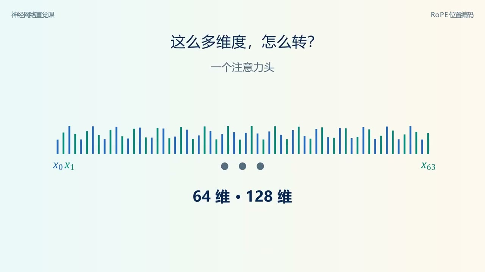

设参与旋转的维数 $d_r$ 为偶数，将向量按一种固定配对方式分成 $d_r/2$ 个二维块，每块使用不同频率：

$$
\theta_i=b^{-2i/d_r},\quad i=0,\ldots,d_r/2-1,
\qquad
R_p=\operatorname{blockdiag}(R(p\theta_0),\ldots,R(p\theta_{d_r/2-1})).
$$

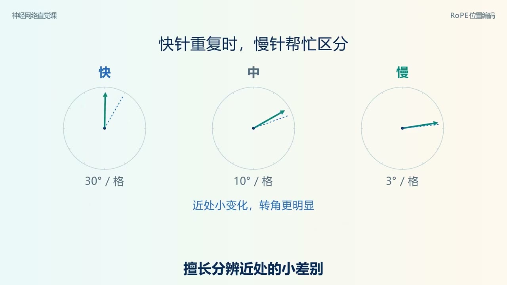

每个块满足相同相对位移恒等式，整体也满足：

$$
(R_mq)^T(R_nk)=q^TR_{n-m}k.
$$

多频率提供不同尺度的位置参照，减少单频旋转歧义的局限，但不自动保证无限长度有效或有限精度下绝不出现难以区分的情况。

### 7.1 d_r=4 的例子

取 $b=10000$，频率为 $[1,0.01]$ 弧度 / 步。给定 $x=[1,0,1,0]^T$，相邻配对后在位置 1：

$$
R_1x=[\cos1,\sin1,\cos0.01,\sin0.01]^T
\approx[0.540302,0.841471,0.999950,0.010000]^T.
$$

这与上一篇正弦位置向量的坐标顺序不同。正弦编码是构造位置向量再相加；RoPE 则用三角函数旋转内容向量，不能因为都出现 sin / cos 就当作同一种操作。

## 八、实现时，维度怎么配对非常重要

本篇代码按相邻维度 `(0,1)、(2,3)` 配对。实际模型也可能用前后半区对应配对，或只旋转部分头维度。它们可以通过一致的坐标重排建立关系，但不能对现有检查点单独更换一种配对方式而忽略权重布局。

旋转维数、base、频率缩放、位置 ID、旋转正负号和数据布局都需匹配模型。多个 Query 头与共享 KV 头的结构还需要正确广播，不能把“每头都有位置信息”理解成缓存必须重复保存很多份相同 Key。

## 九、Q、K 旋转，V 通常保留内容表示

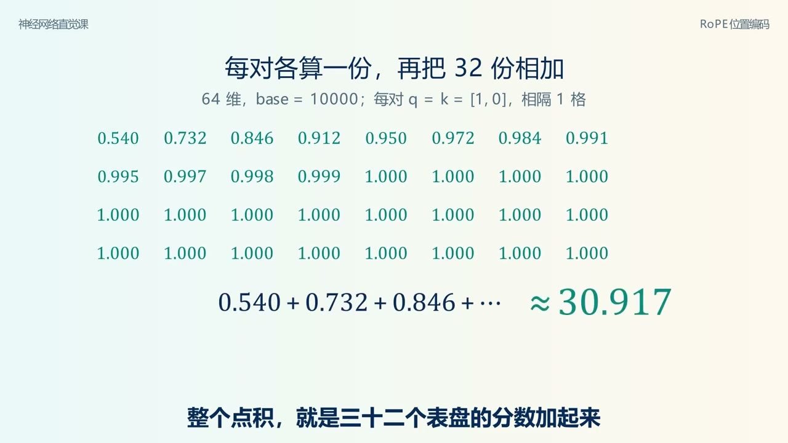

常见 RoPE 自注意力将旋转作用在 Q、K 上，通过匹配分数改变注意力权重，再用权重聚合 V。这里不是把 V 也按相同位置一起旋转；特殊变体另行判断。

在增量解码中，常见实现缓存已经按历史位置旋转过的 K。新位置 Q 用自己的位置旋转，与缓存 K 比较；不能每步把旧 K 再重复旋转一次，也不能把新位置索引重置为零。

详情可参照 [KV Cache 基础](../../技术拆解-注意力机制/KVCache/KVCache基础_从因果不变性到Prefill与Decode.md)。

## 十、为什么能计算长位置，不等于能可靠使用长上下文？

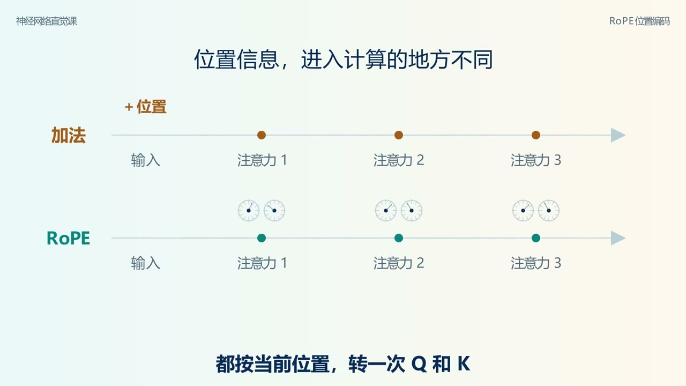

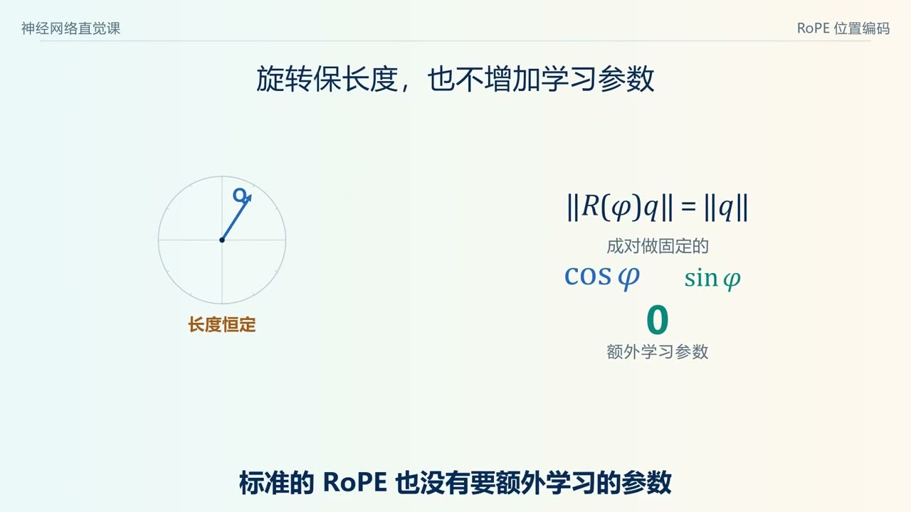

公式可以对更大位置计算角度，但超过训练范围后，频率组合及注意力行为可能进入模型不熟悉的区域。数值可计算与任务效果有效是不同问题。

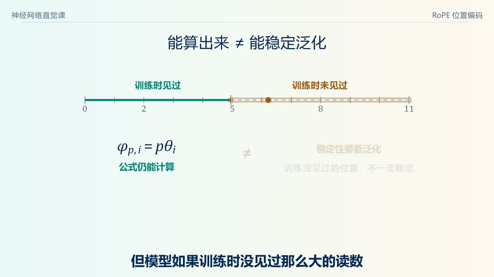

YaRN 等方法调整位置 / 频率的使用，并配合相应模型训练设置来扩展上下文。不能将它概括为“统一把所有频率除以同一个数”或无代价增加窗口。原始方法见 [YaRN](https://arxiv.org/abs/2309.00071)，本文不复现其训练实验。


## 十一、数值验证与原始资料

[rope_math.py](rope_math.py) 使用标准库验证二维范数、共同旋转不变性、相对位置恒等式、多频率块、内容方向影响和单频教学周期，不进行真实模型长上下文测试。

```bash
python3 rope_math.py
```

| 首次公开 | 原始资料与作者 | 作用 |
| --- | --- | --- |
| 2021-04-20 | Jianlin Su、Yu Lu、Shengfeng Pan、Ahmed Murtadha、Bo Wen、Yunfeng Liu，[RoFormer](https://arxiv.org/abs/2104.09864) | RoPE 原始论文及推导 |
| 2023-08-31 | Bowen Peng、Jeffrey Quesnelle、Honglu Fan、Enrico Shippole，[YaRN](https://arxiv.org/abs/2309.00071) | 上下文扩展方法；日期按 arXiv 首次提交，而非编号月份判断 |

24 张截图覆盖 00:00—11:30，每 30 秒一帧，版权归原作者或相应权利人所有。转速、二维向量与角度手算均为教学简化；具体模型配置及实验结果需对照原始报告。
