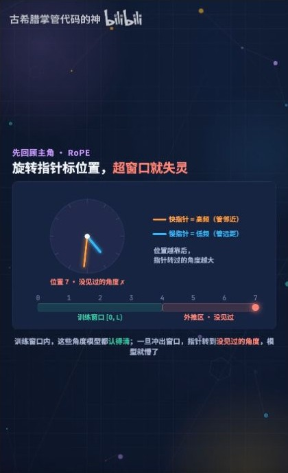
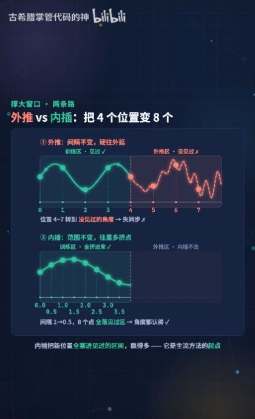
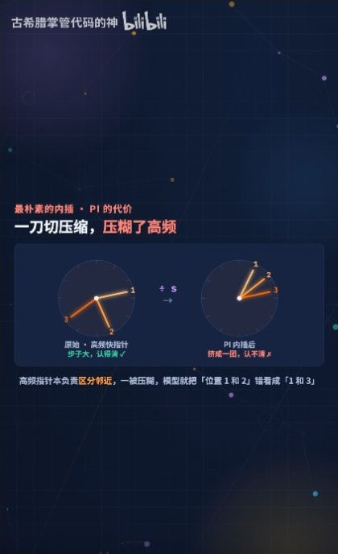
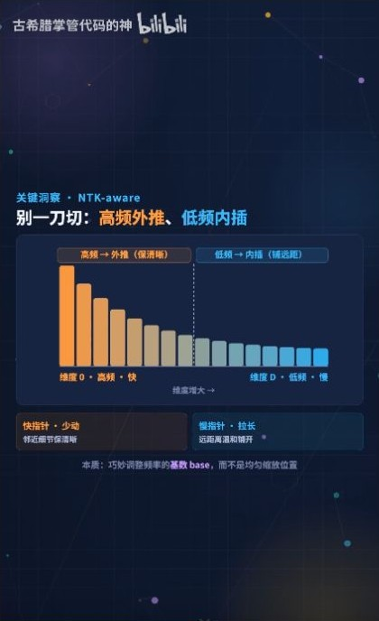
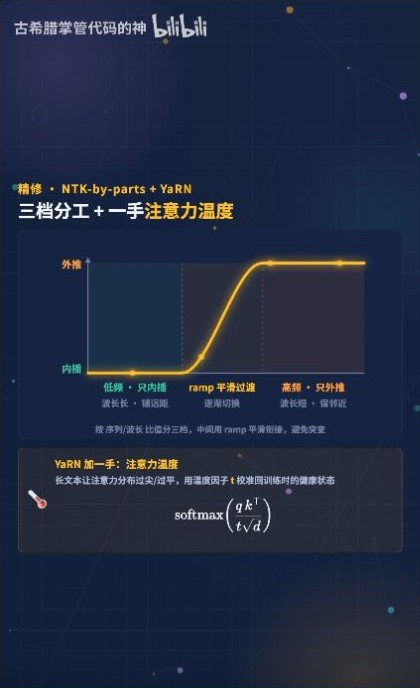

# YaRN 长度外推：RoPE 分频缩放与注意力温度

古希腊掌管代码的神，2026 年 7 月 13 日发布，时长 03:42。按视频顺序整理，并以 YaRN 论文补充频率分段和实验口径。 [B 站原视频](https://www.bilibili.com/video/BV1RNN36TEva/) · [YaRN 论文](https://arxiv.org/html/2309.00071)

## 00:29｜RoPE 的角度能算到训练窗口之外

RoPE 在第 $i$ 对通道上，将位置 $p$ 转换成角度 $p\theta_i$。Q 在位置 $m$、K 在位置 $n$ 时，点积里的旋转项由 $(n-m)\theta_i$ 决定。长度扩展会让模型遇到训练时较少见或从未见过的相对距离，以及相应的多频率相位组合。 [RoPE 的二维推导](../RoPE基础/RoPE_B站推导_从旋转矩阵到相对位置.md)

## 01:02–01:37｜直接外推与统一内插各保留什么

设原窗口为 $L$，目标窗口为 $L'=sL$。直接外推保留 $\theta_i$，因此相邻位置的角度差保持原样，但更长距离可能产生训练范围之外的相位组合。位置内插把 $p$ 改为 $p/s$，等价于把每个频率改为 $\theta_i/s$，把更长的序列映回原有的位置尺度。代价是相邻位置在所有频段的角度差都缩小为原来的 $1/s$。 [YaRN 论文附录 A.1](https://arxiv.org/html/2309.00071#A1.SS1)

## 01:53–02:11｜按频率决定缩放比例

YaRN 采用 NTK-by-parts。第 $i$ 组的波长是 $\lambda_i=2\pi/\theta_i$，在原窗口内转过约 $r_i=L/\lambda_i$ 圈。低频分量原来转得少，对它做内插可以控制长距离的相位范围。高频分量保留原频率，使短距离的角度变化仍接近预训练时的尺度。中间频段平滑过渡。

$$
\theta_i'=(1-\gamma_i)\frac{\theta_i}{s}+\gamma_i\theta_i,
\qquad
\gamma_i=\operatorname{clip}\!\left(\frac{r_i-\alpha}{\beta-\alpha},0,1\right).
$$

当 $r_i\le\alpha$ 时完全内插，当 $r_i\ge\beta$ 时保留原频率。以 $s=32$ 为例，低频相邻角差缩为原来的 $1/32$，高频相邻角差保持原值。 [YaRN 论文 §3.2](https://arxiv.org/html/2309.00071#S3.SS2)

## 02:28｜注意力温度调整 softmax 的集中程度

若注意力权重写成 $\operatorname{softmax}(QK^\top/(t\sqrt{d_h}))$，降低温度 $t$ 会放大 logits 之间的差异。在给定 logits 下，softmax 会更集中。对整个参与点积的 Q 和 K 各乘 $a=\sqrt{1/t}$，等价于把 logits 乘 $a^2$。论文给出的经验缩放为 $a\approx1+0.1\ln s$，当 $s=32$ 时 $a\approx1.347$，对应 logits 约乘 $1.813$。频率调整改变相位，温度调整改变 softmax 前的分数尺度。 [YaRN 论文 §3.3 与附录 A.3](https://arxiv.org/html/2309.00071#S3.SS3)

## 03:02｜4K 到 128K 的实验口径

$128\text{K}/4\text{K}=32$ 是目标窗口与原窗口的长度之比。论文中扩展至 128K 的 Llama 2 模型使用了 64K 长度的样本进行额外微调，随后在 128K 做检索测试。论文另有未微调模型的动态缩放实验。实际能力取决于模型与训练方案，长输入仍会增加注意力工作量和 KV Cache 占用。评估时可分别查看长文困惑度、跨位置检索和任务表现。 [YaRN 论文 §4 与附录 B.5](https://arxiv.org/html/2309.00071#S4)
