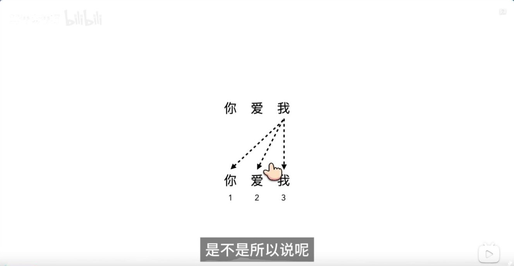
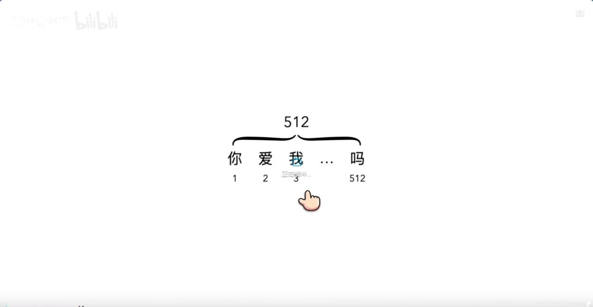
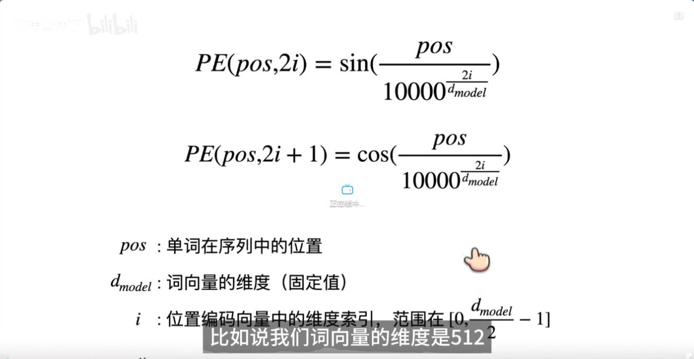
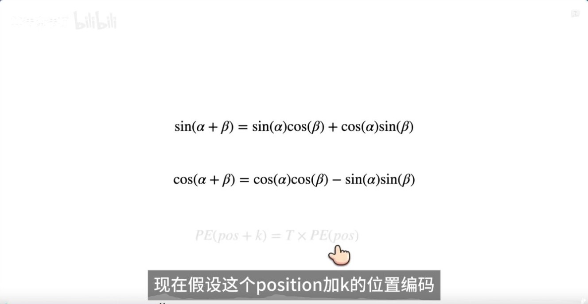
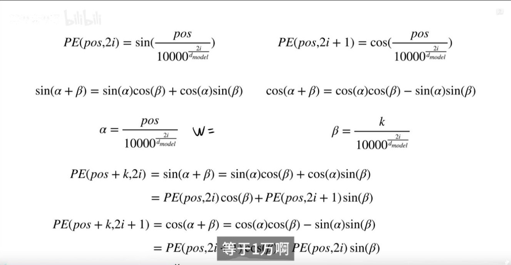
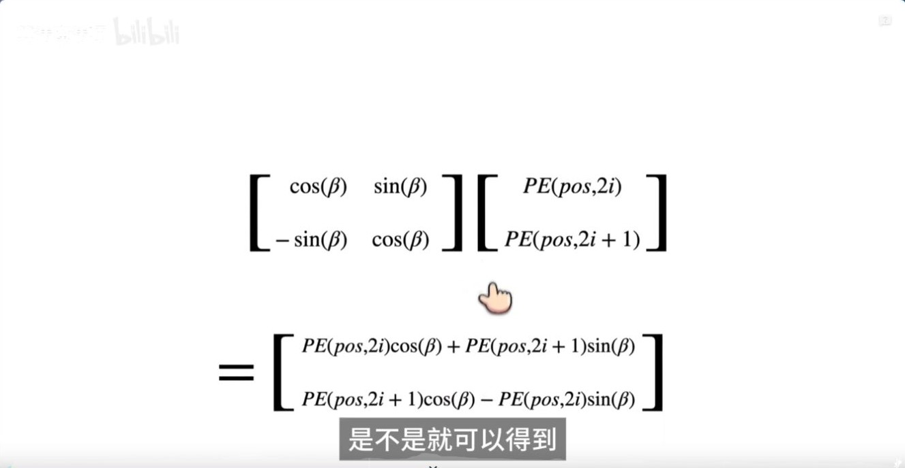
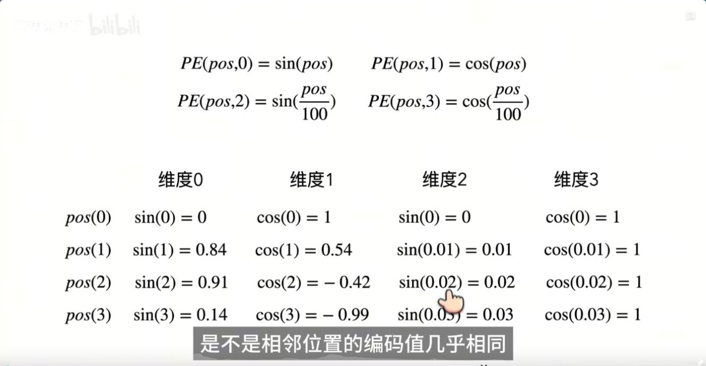
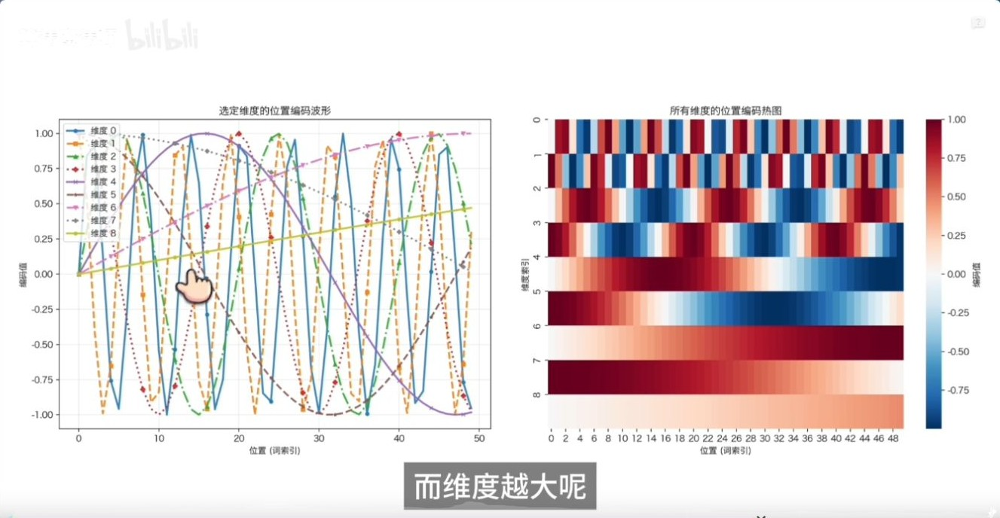
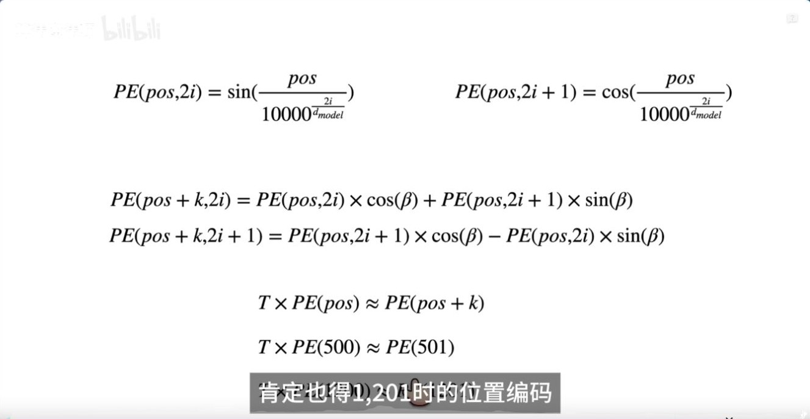

# 正弦位置编码：为什么不用 1、2、3？

算法魔法师，2025 年 11 月 13 日发布，时长 12:32。本文按视频中的问题、公式、位移推导和数值例子展开。 [B 站原视频](https://www.bilibili.com/video/BV1aLCsBhE7i/)

## 00:45–01:33｜从顺序信息到位置向量

Self-attention 的内容打分使用 Q 与 K，位置编号需要通过模型结构或显式编码进入计算。因果掩码提供了「只能看前面」的约束，原版 Transformer 仍为每个位置构造与词向量等宽的位置向量，在进入堆叠层前逐维相加。

整数编号本身有顺序，也能做差。直接把原始下标加到输入表示里，其幅度会随序列长度增长。正余弦方案提供有界的等宽向量，并把同一个位置放在多种频率下表示。 [Transformer 论文 §3.5](https://arxiv.org/abs/1706.03762)

## 02:26｜同一频率对应一对坐标

设模型维度为 $d$，位置为 $p$，第 $i$ 对坐标的角频率为 $\omega_i=10000^{-2i/d}$。则

$$
P_{p,2i}=\sin(p\omega_i),\qquad P_{p,2i+1}=\cos(p\omega_i).
$$

$i$ 编号的是坐标对，$p$ 编号的是 token 位置。每对坐标的幅度有界，且平方和为 1。

## 03:21–05:59｜固定偏移可以写成固定矩阵

取 $\alpha=p\omega_i$、$\beta=k\omega_i$。位置从 $p$ 移到 $p+k$ 时，对第 $i$ 对坐标有

$$
\begin{bmatrix}\sin(\alpha+\beta)\\\cos(\alpha+\beta)\end{bmatrix}
=
\begin{bmatrix}\cos\beta & \sin\beta\\-\sin\beta & \cos\beta\end{bmatrix}
\begin{bmatrix}\sin\alpha\\\cos\alpha\end{bmatrix}.
$$

把各频率的二维矩阵沿对角线拼起来，就有 $P_{p+k}=A_kP_p$。对于固定的 $k$，矩阵 $A_k$ 与起点 $p$ 无关。这是编码本身的精确恒等式。以 $p=0$、$k=1$、$\omega_0=1$ 为例，乘以位移矩阵会把 $[0,1]^\top$ 变成 $[\sin 1,\cos 1]^\top$。 [Transformer 论文 §3.5](https://arxiv.org/abs/1706.03762)

## 08:39–09:38｜多种频率提供不同尺度的变化

$d=4$ 时，两个频率是 $1$ 和 $0.01$。相邻位置相差一步时，第一对坐标的相位变化为 1 弧度，第二对只有 0.01 弧度。前者对短距离变化更敏感，后者转得更慢。单个频率会周期重复，整组编码同时提供多种尺度。

## 11:26｜公式可以外推，模型表现需要实测

任意整数位置都可以代入公式。模型能否在训练长度以外稳定找回信息，还取决于训练分布、注意力行为和部署支持的上下文长度。把位置向量加到词向量后，注意力点积也包含内容与位置之间的交叉项。下一篇可看 RoPE 如何把相对位移直接写进旋转后的 Q/K 点积。 [RoPE 的 B 站推导](../RoPE基础/RoPE_B站推导_从旋转矩阵到相对位置.md)
