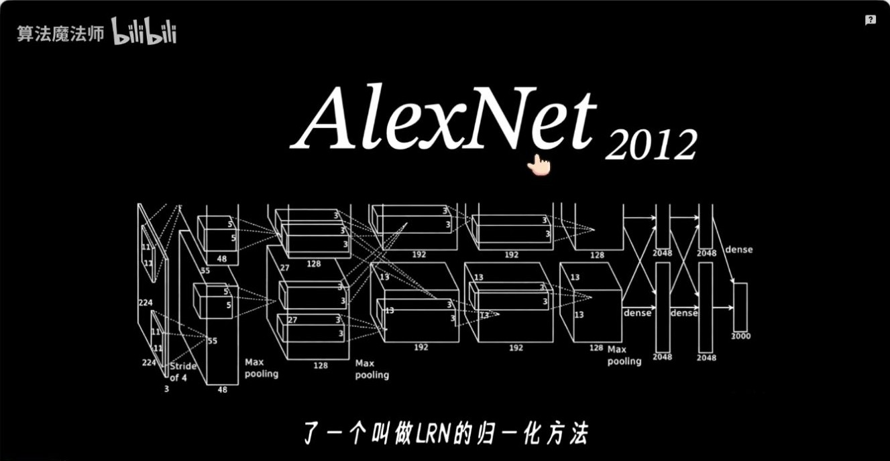
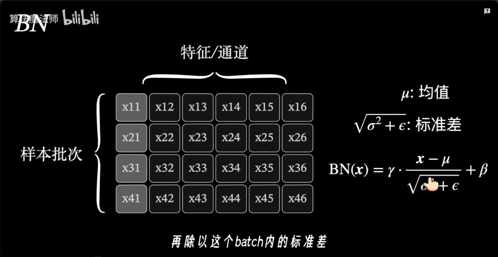
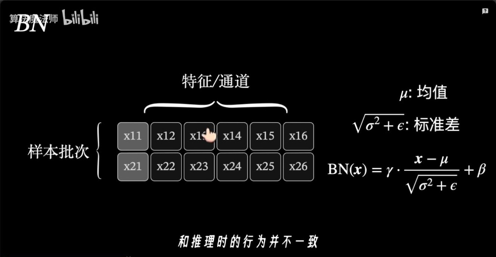
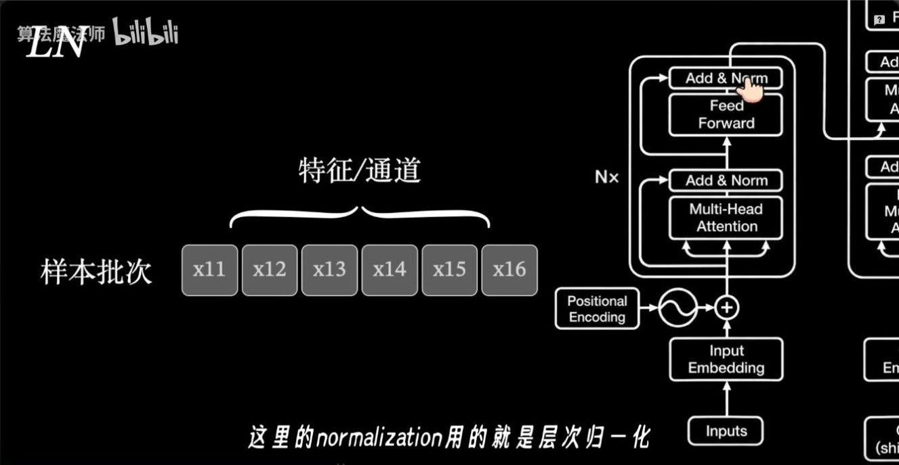
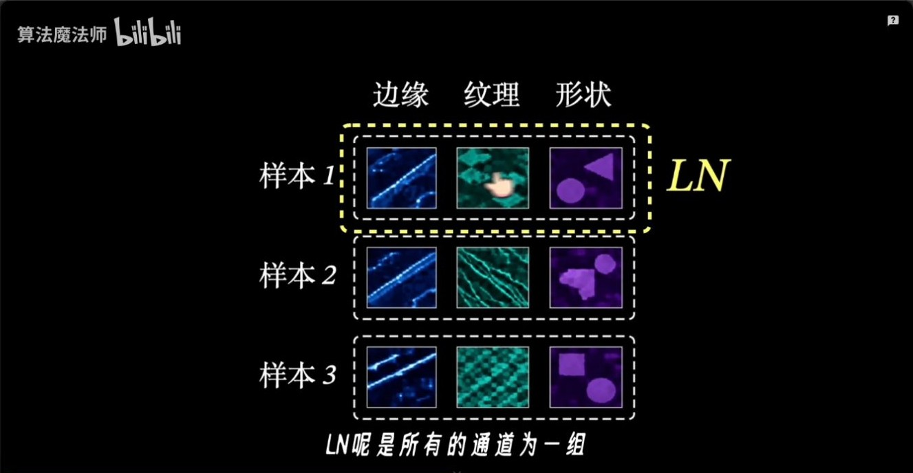
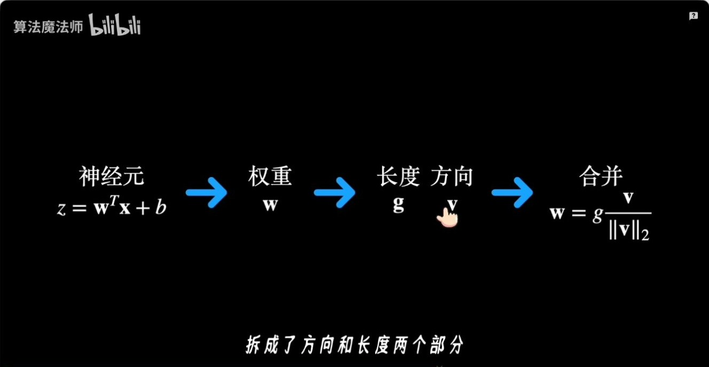
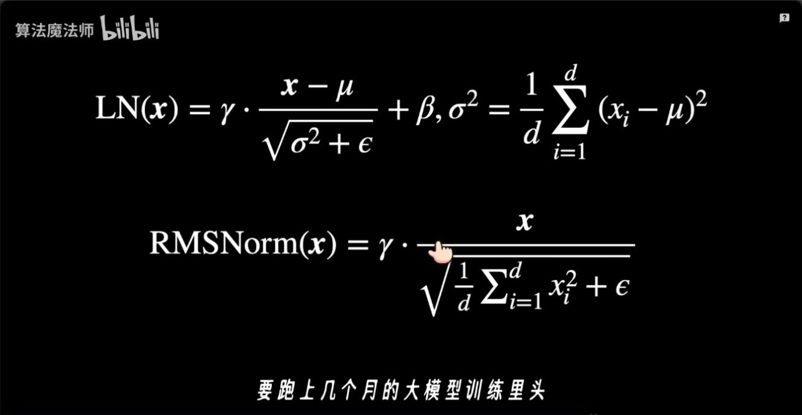
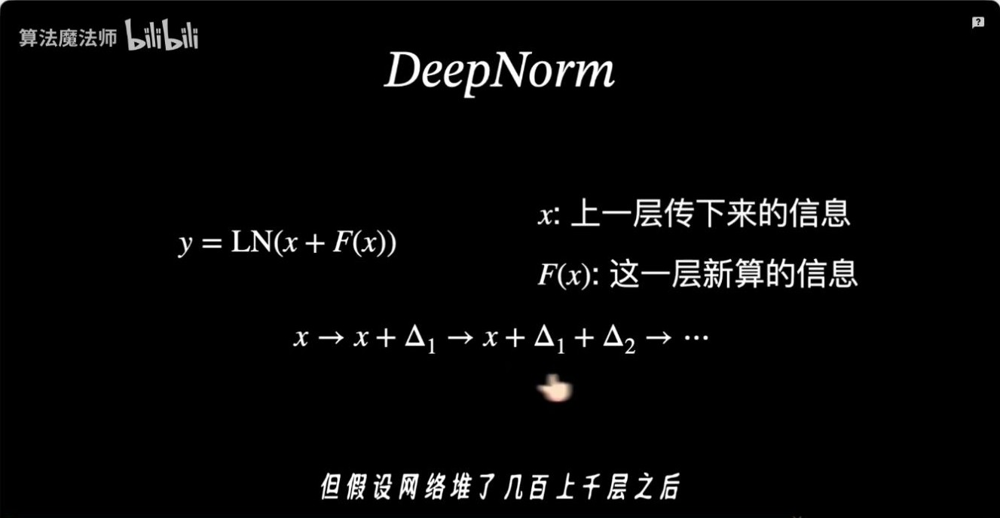
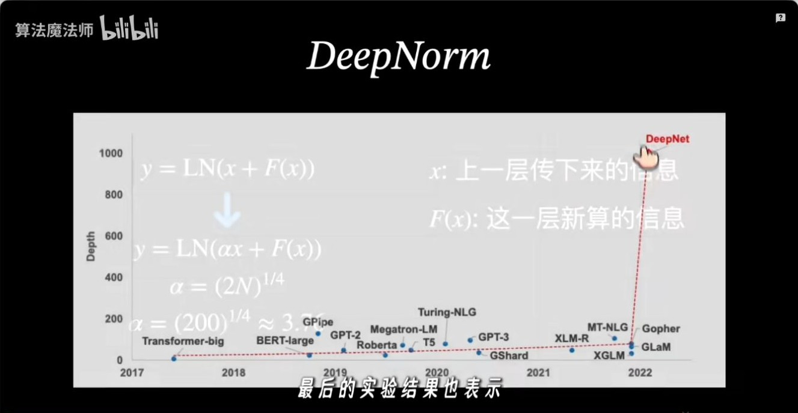
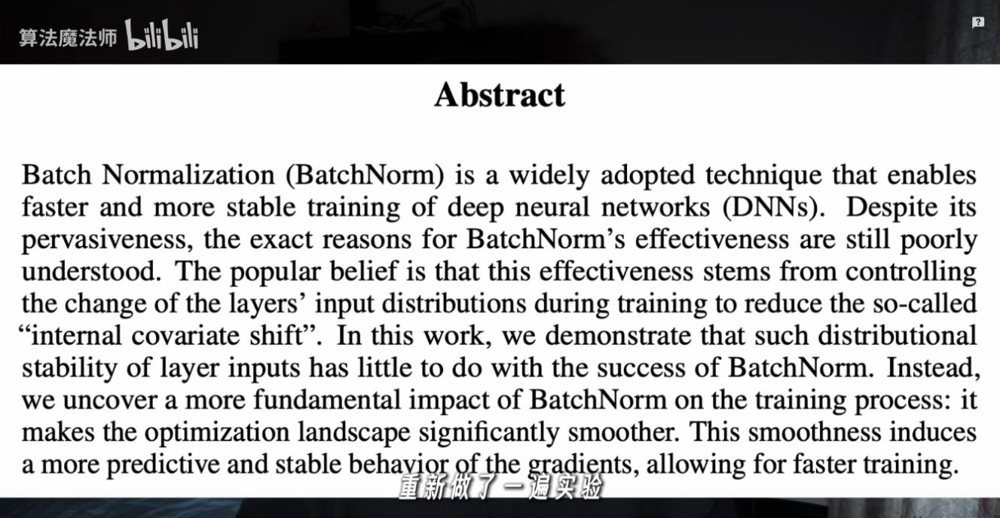

# 归一化演进：从 BatchNorm 到 LayerNorm 与 RMSNorm

算法魔法师，2026 年 9 月 2 日发布，时长 08:54。本文按视频顺序梳理各方法计算统计量的范围，以及它们在 Transformer 中解决的问题。 [B 站原视频](https://www.bilibili.com/video/BV1JwtW6TE3c/)

## 01:04｜AlexNet 的 LRN

LRN（Local Response Normalization）在同一个空间位置上，使用相邻通道的激活平方和缩放当前通道。它体现的是局部通道响应之间的竞争。后面的 BN、LN 等方法则通过选定统计轴，控制激活的中心和尺度。

## 01:39–02:14｜BatchNorm 沿批次估计每个特征的统计量

对形状为 $[B,D]$ 的激活，训练时 BN 对每列特征 $j$ 沿 $B$ 个样本求均值 $\mu_j$ 和方差 $\sigma_j^2$，再计算

$$
y_{bj}=\gamma_j\frac{x_{bj}-\mu_j}{\sqrt{\sigma_j^2+\epsilon}}+\beta_j.
$$

$\epsilon$ 用于数值稳定，$\gamma_j,\beta_j$ 是可学习的缩放和平移参数。常见卷积 BN 会按通道统计，同时汇总 batch 和空间位置。 [Batch Normalization 原论文](https://arxiv.org/abs/1502.03167)

训练时，一个样本的输出会受同批样本影响。常规推理使用训练期间累计的统计量，让单条样本也能独立推理。训练批次用于统计的元素很少时，均值和方差的估计更容易波动。

## 02:48–03:20｜LayerNorm 沿单个 token 的隐藏维求统计量

在 Transformer 常见的 $[B,T,D]$ 表示里，LN 固定样本和 token 位置，只沿隐藏维 $D$ 计算均值和方差。每个 token 使用自己的统计量，训练和推理使用相同计算。原版 Transformer 的 Add & Norm 把 LN 放在残差加法之后。归一化用哪个统计轴，与归一化放在残差前还是后，是两个独立的设计选择。 [Layer Normalization 原论文](https://arxiv.org/abs/1607.06450) · [Transformer 论文 §3.1](https://arxiv.org/abs/1706.03762)

## 04:27–05:32｜InstanceNorm、GroupNorm 与 WeightNorm

以卷积特征图 $[B,C,H,W]$ 为例，**InstanceNorm** 对单个样本的每个通道分别沿空间维统计。**GroupNorm** 把通道分组，在单个样本内沿组内通道及空间维统计。这两种方法都可以脱离 batch 统计工作。 [Instance Normalization 论文](https://arxiv.org/abs/1607.08022) · [Group Normalization 论文](https://arxiv.org/abs/1803.08494)

**WeightNorm** 调整的是权重参数化。它用 $w=g\,v/\lVert v\rVert_2$ 表示一组权重，其中 $v/\lVert v\rVert_2$ 表示方向，$|g|$ 控制长度。这一步直接作用于权重，模型仍可在其他位置使用激活归一化。 [Weight Normalization 论文](https://arxiv.org/abs/1602.07868)

## 06:39｜RMSNorm 保留缩放，省去中心化

RMSNorm 也可以沿每个 token 的隐藏维计算。它使用原始分量的均方根作为分母，常见形式为

$$
y_i=\gamma_i\,\frac{x_i}{\sqrt{\frac{1}{D}\sum_{j=1}^{D}x_j^2+\epsilon}}.
$$

取 $x=[1,3]$，令缩放为 1、偏置为 0，并忽略 $\epsilon$。LN 先减均值 2，再除以标准差 1，得到 $[-1,1]$。RMSNorm 除以 $\sqrt{5}$，得到约 $[0.447,1.342]$。这个例子展示了两种输出对输入均值的处理差异。 [RMSNorm 原论文](https://arxiv.org/abs/1910.07467)

## 07:10–07:44｜DeepNorm 调整深层残差的尺度

DeepNorm 保留 LayerNorm，将残差更新写成 $\operatorname{LN}(\alpha x+F(x))$，并配合按深度缩放的初始化。$\alpha$ 与初始化系数由网络深度和架构决定。这一节讨论的是怎样控制大量残差层堆叠后的更新尺度。 [DeepNet 论文](https://arxiv.org/abs/2203.00555)

## 08:17｜BN 为什么有效，论文给出了什么证据？

BN 原论文用 internal covariate shift（内部协变量偏移）解释设计动机。Santurkar 等人的实验发现，层输入分布的稳定程度和 BN 的优化收益联系有限，并观察到 BN 能使优化曲面更平滑、梯度行为更可预测。视频标题里的疑问指向**效果的解释**。BN 的实际效果以及它在某个任务上的收益，仍可通过训练结果衡量。 [BN 原论文](https://arxiv.org/abs/1502.03167) · [How Does Batch Normalization Help Optimization?](https://arxiv.org/abs/1805.11604)

| 方法 | 统计或调整范围 |
| --- | --- |
| BatchNorm | 每个特征跨 batch 统计，卷积中通常也汇总空间维 |
| LayerNorm | Transformer 中通常对每个 token 的隐藏维求均值与方差 |
| RMSNorm | Transformer 中通常对每个 token 的隐藏维求均方根 |
| DeepNorm | 在 LayerNorm 外调整残差支路系数与权重初始化 |

需要复习梯度以及 Pre-Norm、Post-Norm 的位置关系时，可以对照同目录的专题笔记。 [归一化：从 LayerNorm 到 RMSNorm](归一化_从LayerNorm到RMSNorm.md)
