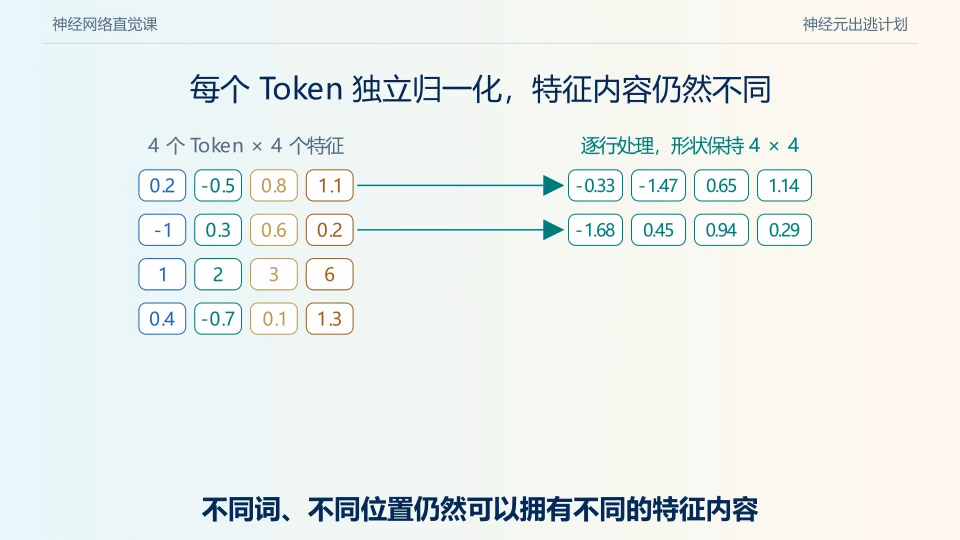
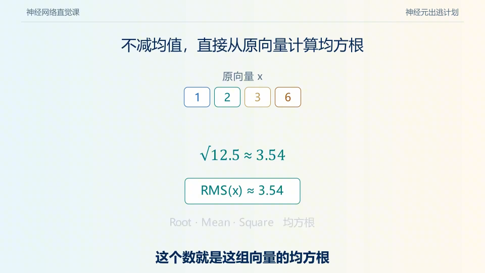
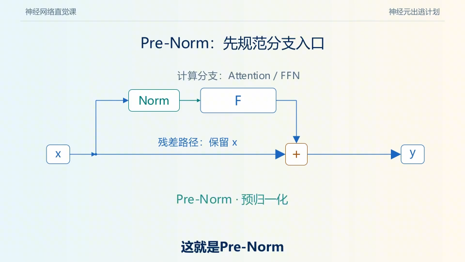
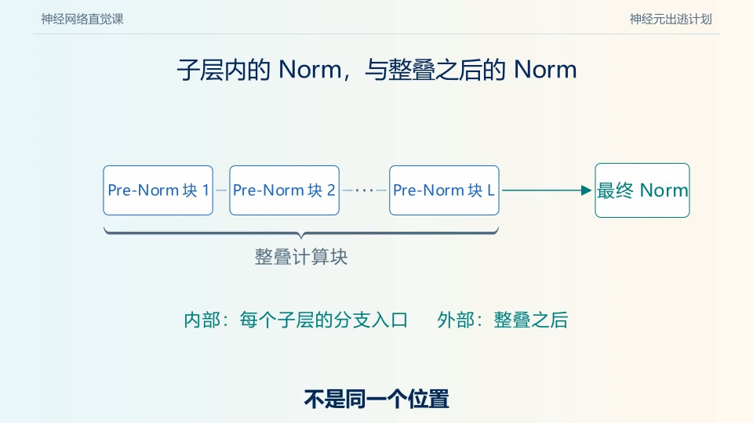
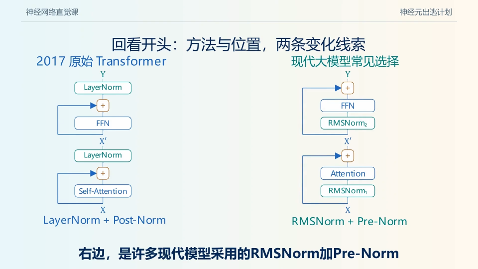

# 归一化：从 LayerNorm 到 RMSNorm

> **整理日期：** 2026-11-09  
> **主题：** 作者与核心论文、BatchNorm / LayerNorm / RMSNorm、公式手算与梯度，以及 Transformer 中的归一化位置。  
> **阅读方式：** 标准 Markdown、LaTeX 与本地图片；指定视频的画面来源、时间点见文末。建议先读 [残差连接：从 ResNet 到 Transformer](../技术拆解-残差链接/残差连接_从ResNet到Transformer.md)。

残差连接给信号提供直接通路，归一化则按选定的统计维度调整输入尺度。理解归一化，要分别回答两个问题：

1. **怎么算？** BatchNorm、LayerNorm、RMSNorm 分别对哪些数计算什么统计量？
2. **放哪里？** 在计算分支之前，还是残差相加之后？

这两条设计线不能混在一起。LayerNorm 可以用于 Pre-Norm 或 Post-Norm；把 LayerNorm 换成 RMSNorm，也不自动决定残差连接的位置。

**目录说明：** 沿用仓库 `技术演进-FNN层` 目录。Norm 属于 Transformer 的基础结构，通常在 Attention、FFN / MoE 周围使用，并不只属于 FFN。

## 一、作者与论文：先建立技术路线

| 首次公开 | 论文 | 作者（原文顺序） | 发表与核心问题 |
| --- | --- | --- | --- |
| 2015-02-11 | *Batch Normalization: Accelerating Deep Network Training by Reducing Internal Covariate Shift* | Sergey Ioffe、Christian Szegedy | ICML 2015；利用 mini-batch 统计量进行归一化 |
| 2016-07-21 | *Layer Normalization* | Jimmy Lei Ba、Jamie Ryan Kiros、Geoffrey E. Hinton | arXiv 技术论文；把统计范围改为单个样本内部的层输入 |
| 2019-10-16 | *Root Mean Square Layer Normalization* | Biao Zhang、Rico Sennrich | NeurIPS 2019；研究省去去中心化、仅调整均方根尺度的方案 |
| 2020-02-12 | *On Layer Normalization in the Transformer Architecture* | Ruibin Xiong、Yunchang Yang、Di He、Kai Zheng、Shuxin Zheng、Chen Xing、Huishuai Zhang、Yanyan Lan、Liwei Wang、Tie-Yan Liu | ICML 2020；分析归一化位置对初始化梯度与训练的影响 |

作者背景以论文发表时署名为准：BN 作者署名 Google；LN 作者主要来自多伦多大学，Hinton 同时署名 Google；RMSNorm 作者署名涉及爱丁堡大学、苏黎世大学。这里不推断作者当前任职，也不把某一位作者的贡献替代共同署名。

原始入口：[BN](https://arxiv.org/abs/1502.03167) · [LN](https://arxiv.org/abs/1607.06450) · [RMSNorm](https://arxiv.org/abs/1910.07467) · [Transformer 中的 LN](https://arxiv.org/abs/2002.04745)。

## 二、有残差连接，为什么还要关心尺度？

### 2.1 残差相加本身不会固定隐藏状态的方差

对 $x_{l+1}=x_l+F_l(x_l)$，选择一个特征坐标，把其在某个数据分布上的取值视为随机变量，则：

$$
\operatorname{Var}[x_{l+1}]
=\operatorname{Var}[x_l]+\operatorname{Var}[F_l(x_l)]
+2\operatorname{Cov}[x_l,F_l(x_l)].
$$

这是方差恒等式。进一步推断增长速度，需要说明条件：

- 若协方差近似为零、每层更新方差近似恒定，累积方差可能随深度近似线性增长。
- 若分支与输入正相关，增长可以更快；负相关时也可能相互抵消。
- 若分支带缩放、特殊初始化或其他约束，增长规律会改变。

所以，“有加号”不能推出尺度稳定，也不能推出方差每层必然倍增。视频用尺度增长引出 Norm，这是有用的动机；具体模型仍需结合初始化、相关性和残差系数分析。

这里讨论的是**数据分布上的方差**。下面 LayerNorm 计算的则是**同一 Token 内不同特征坐标的方差**。二者相关，但不是同一个统计量，不能不加说明地互换。

### 2.2 大数值为什么可能妨碍训练？

尺度变化会影响线性层输出、激活函数工作区间、注意力 logits 和梯度。例如固定 Q、K 方向，仅将两者都乘以正数 $c$，其点积会乘以 $c^2$；若不同位置 logits 的差距随之变大，softmax 可能变得更尖锐。

这只是受控例子，不能推出“大范数一定使所有注意力失效”。Q/K 的方向、投影权重、精度以及其他缩放也会影响结果。

Norm 提供的是一种可学习网络中的尺度调节机制。它不代替初始化、学习率、梯度裁剪或残差设计；使用 Norm 也不意味着模型绝对不会数值溢出。

## 三、最重要的问题：到底对哪些数求统计量？

令 Transformer 隐藏状态为：

$$
X\in\mathbb R^{B\times T\times d},
$$

其中 $B$ 是 batch size，$T$ 是序列长度，$d$ 是隐藏维度。

### 3.1 Transformer 常见 LayerNorm：每个 Token 单独处理

固定一个样本 $b$ 和位置 $t$，取该 Token 的 $d$ 维向量：

$$
x=X_{b,t,:}.
$$

均值和方差只在这个向量内部计算。因此共有 $B\times T$ 组统计量，每组对应 $d$ 个数。一个 Token 的归一化不使用其他样本或其他位置的特征。



*图 1：视频约 03:20，作者“神经元出逃计划”。每一行独立处理，输出形状与输入相同；这不表示所有 Token 会变成相同向量。*

### 3.2 BatchNorm 与 LayerNorm 的轴不同

| 方法与场景 | 计算统计量的范围 | 特征之间是否使用同一个标量分母？ | 是否依赖其他样本？ |
| --- | --- | --- | --- |
| BN，输入为 $[B,d]$ | 固定特征 $j$，跨 $B$ 个样本 | 各特征有自己的统计量 | 训练阶段通常依赖 |
| 卷积 BN，输入为 $[B,C,H,W]$ | 固定通道 $c$，跨 $B,H,W$ | 各通道有自己的统计量 | 训练阶段通常依赖 |
| Transformer LN，输入为 $[B,T,d]$ | 固定 $b,t$，跨最后的 $d$ 个特征 | 同一 Token 共用标准差，再逐维仿射 | 不依赖 |
| Transformer RMSNorm | 固定 $b,t$，跨最后的 $d$ 个特征 | 同一 Token 共用 RMS，再逐维缩放 | 不依赖 |

“Layer”一词不能简单理解成“整个 batch、整个序列一起归一化”。实际轴由算子配置决定，例如 `LayerNorm(d)` 与 `LayerNorm((T, d))` 的统计范围不同。

对序列使用跨时间统计的 BN 时，还要处理 padding 与因果性：如果训练统计量包含当前位置之后的 token，就可能引入不符合自回归约束的信息依赖。这里的问题来自具体统计范围，不能概括为 BN 在任何序列任务中都不可用。

## 四、LayerNorm 公式：去中心化、调尺度、可学习仿射

对单个向量 $x\in\mathbb R^d$：

$$
\mu=\frac1d\sum_{j=1}^d x_j,
\qquad v=\frac1d\sum_{j=1}^d(x_j-\mu)^2,
$$

$$
\hat x_j=\frac{x_j-\mu}{\sqrt{v+\epsilon}},
\qquad y_j=\gamma_j\hat x_j+\beta_j.
$$

| 符号 | 含义 | 是否通过训练更新？ |
| --- | --- | --- |
| $\mu,v$ | 当前 Token 的均值、方差 | 由输入即时计算，不是优化器参数 |
| $\epsilon>0$ | 稳定分母的常数 | 通常为配置超参数 |
| $\gamma\in\mathbb R^d$ | 每个特征的缩放 | 通常是参数 |
| $\beta\in\mathbb R^d$ | 每个特征的偏移 | 通常是参数，也可按实现省略 |

使用的是除以 $d$ 的方差，不能在手算中悄悄换成无偏样本方差的 $d-1$。

### 4.1 完整手算：$[1,2,3,6]$


*图 2：视频约 05:00，展示中心归零、按标准差缩放后的坐标；下面展开每一步计算。*

为便于展示，本例先忽略 $\epsilon$：

$$
x=[1,2,3,6],\qquad \mu=3,
$$

$$
x-\mu=[-2,-1,0,3],
$$

$$
v=\frac{4+1+0+9}{4}=3.5,\qquad \sqrt v\approx1.8708.
$$

因此：

$$
\hat x\approx[-1.0690,-0.5345,0,1.6036].
$$

若 $\gamma=[1,1,1,1]$、$\beta=[0,0,0,0]$，输出就是以上结果。若另取：

$$
\gamma=[1,2,1,0.5],\qquad \beta=[0,0,1,-1],
$$

则：

$$
y\approx[-1.0690,-1.0690,1,-0.1982].
$$

输出均值已不再为零。**“均值零、方差一”描述的是理想化的归一化中间量，不是任意学习后输出的硬约束。**

### 4.2 加入 $\epsilon$ 后，方差也不严格为一

归一化中间量的均值仍为零，其方差为：

$$
\operatorname{Var}_{j}[\hat x_j]=\frac{v}{v+\epsilon}.
$$

当 $v\gg\epsilon$ 时接近 1；若输入全部相同，则 $v=0$，中间量为全零，输出为 $\beta$。

这一点也提醒我们：Norm 不会把任何向量都变成正态分布，不会把任意两个特征去相关，也不是把所有值压到 $[0,1]$。

公式来源：[Layer Normalization，Section 3](https://arxiv.org/html/1607.06450v1)；实现轴与方差约定可对照 [PyTorch LayerNorm](https://docs.pytorch.org/docs/stable/generated/torch.nn.LayerNorm.html)。手算为本文教学示例。

## 五、RMSNorm：不减均值，也能调节整体尺度

### 5.1 公式与 LayerNorm 的差别

本文采用常见的无偏移形式：

$$
r=\sqrt{\frac1d\sum_{j=1}^d x_j^2+\epsilon},
\qquad y_j=\gamma_j\frac{x_j}{r}.
$$

RMS 是 root mean square，即均方根。RMSNorm 直接使用平方均值，不先减去均值；因此省去了中心化相关计算。具体复现仍需核对实现的偏移项与 $\epsilon$ 位置。

利用恒等式：

$$
\frac1d\sum_j x_j^2=v+\mu^2,
$$

可知 LN 与 RMSNorm 的分母通常不同。只有例如 $\mu=0$、两者 $\epsilon$ 一致且仿射配置相同等条件下，两种计算才会对应起来。

### 5.2 用同一个向量手算



*图 3：视频约 06:20，用 $[1,2,3,6]$ 直接求均方根，不先减去均值。*

继续使用 $x=[1,2,3,6]$，取 $\gamma=\mathbf1$，忽略 $\epsilon$：

$$
\operatorname{RMS}(x)=\sqrt{\frac{1+4+9+36}{4}}
=\sqrt{12.5}\approx3.5355,
$$

$$
\operatorname{RMSNorm}(x)
\approx[0.2828,0.5657,0.8485,1.6971].
$$

它的均方根为 1，但均值约为 $0.8485$，不为零。它的 L2 范数为 $\sqrt d=2$，也不是 1。

| 同一输入 $[1,2,3,6]$ | LN，无仿射、忽略 $\epsilon$ | RMSNorm，无仿射、忽略 $\epsilon$ |
| --- | --- | --- |
| 是否减均值 | 是 | 否 |
| 分母 | $\sqrt{3.5}$ | $\sqrt{12.5}$ |
| 输出 | $[-1.0690,-0.5345,0,1.6036]$ | $[0.2828,0.5657,0.8485,1.6971]$ |
| 输出均值 | 0 | 约 0.8485 |
| 输出 RMS | 1 | 1 |

对 LN，零均值使均方根等于标准差；对 RMSNorm，不能从均方根为 1 推出标准差为 1。

### 5.3 哪些变化会被抵消？

暂时忽略 $\epsilon$，讨论归一化核心：

- 对任意常数 $b$，LN 对 $x+b\mathbf1$ 的结果与 $x$ 相同，因为整体平移被减均值抵消。
- RMSNorm 通常不具有这个平移不变性，因为不做去中心化。
- 对正数 $c$，两者都能抵消整体正缩放 $x\mapsto cx$。
- 若 $c<0$，通常会改变输出符号；若保留 $\epsilon$，尺度不变性一般只是近似。

所以 RMSNorm 并非“与 LN 完全一样，只是代码更短”。它保留了不同的信息，也施加了不同的不变性。

来源：[RMSNorm，Section 4–5](https://arxiv.org/html/1910.07467v1)。

## 六、论文精读：每篇究竟提出了什么？

### 6.1 BatchNorm：重要起点，但要区分方法与解释

**作者：** Sergey Ioffe、Christian Szegedy。**正式发表：** ICML 2015。

建议读 [原论文](https://proceedings.mlr.press/v37/ioffe15.html) 的 Algorithm 1：训练时用 mini-batch 的均值、方差归一化，再通过可学习缩放与偏移恢复表达自由度。推理时通常使用估计的总体统计量，避免预测依赖当前测试 batch。

标题中的 Internal Covariate Shift 是原论文的解释框架。后续 Santurkar、Tsipras、Ilyas、Madry 的 *How Does Batch Normalization Help Optimization?*（NeurIPS 2018）对这一解释提出质疑，并从优化平滑性给出分析。不能把“稳定输入分布”写成已经穷尽 BN 有效原因的定论。

参见 [后续研究原文](https://proceedings.neurips.cc/paper/2018/hash/905056c1ac1dad141560467e0a99e1cf-Abstract.html)。它的分析也不能不加条件地移植为所有 LN / RMSNorm 模型的完整理论。

### 6.2 LayerNorm：把统计量从样本之间移到样本内部

**作者：** Jimmy Lei Ba、Jamie Ryan Kiros、Geoffrey E. Hinton。

读 [Section 3](https://arxiv.org/html/1607.06450v1) 时，重点标出统计量的下标；读 Section 5 时区分不同变换下的不变性；读 Section 6 时看实验涵盖的任务和模型。

论文的重要价值是解除对 mini-batch 统计量的依赖，并研究包括 RNN 在内的模型。Transformer 尚未在 2016 年提出，因此不能把 LN 的发明动机直接写成“专门为大语言模型设计”。

LN 自身在训练、推理时按当前输入计算相同类型的统计量；这不代表整个模型两种模式的所有行为都相同，例如 dropout 仍可能不同。

### 6.3 RMSNorm：中心化是否总是必要？

**作者：** Biao Zhang、Rico Sennrich。**正式发表：** NeurIPS 2019。

建议读 [Section 4](https://arxiv.org/html/1910.07467v1) 的定义与不变性分析，再看 Section 5 的 partial RMSNorm：用部分坐标估计 RMS，属于额外的计算近似，不能把所有 RMSNorm 都理解为抽样计算。

实验部分需要同时比较按训练步数与按墙钟时间的曲线：每步收敛更快，不一定意味着达到同一目标所需的真实时间更短。论文报告在所测试的不同模型中相对 LN 减少约 7%–64% 运行时间；这是特定任务、实现和硬件下的历史实验区间，不能写成现代 LLM 的通用加速倍数。

### 6.4 Transformer 中的 LN：方法相同，放置位置也影响训练

Xiong 等人的 [ICML 2020 论文](https://proceedings.mlr.press/v119/xiong20b.html) 分析了初始化时归一化位置与参数梯度的关系，并用实验研究 warm-up。

应分别读理论假设和训练设置：论文为 Pre-LN 在相应条件下的训练稳定性提供支持，但并不证明任意模型只要改成 Pre-LN 就不需要 warm-up，也不代表 Pre-LN 在所有任务上的最终效果都更好。

## 七、Pre-Norm 与 Post-Norm：归一化放在哪里？

令 $F$ 代表 Attention 或 FFN 分支，以下省略 dropout。

### 7.1 Post-Norm：先相加，再归一化

$$
y=\operatorname{Norm}(x+F(x)).
$$

原始 Transformer 使用 LayerNorm，常称 Post-LN。这里 Norm 同时处理输入与分支的相加结果，输出尺度由该归一化操作和仿射参数共同决定。

来源：[Attention Is All You Need，Section 3.1](https://arxiv.org/html/1706.03762v7)。

### 7.2 Pre-Norm：先归一化分支输入，再把更新加回去

$$
y=x+F(\operatorname{Norm}(x)).
$$



*图 4：视频约 09:10，Norm 在分支入口；输入沿 shortcut 直接到达加法节点。*

这个结构使计算分支读取归一化后的表示，但**残差流 $x$ 本身并没有在每次相加之后被归一化**。因此，Pre-Norm 中残差流的范数仍可能随深度增长。不能写成“用了 Pre-Norm，所以每一层隐藏状态都被固定成单位方差”。

### 7.3 与残差梯度推导连接起来

记 $J_F$、$J_N$ 为相应位置处的 Jacobian，列向量约定下：

$$
J_{\text{Pre}}=I+J_F(N(x))J_N(x),
$$

$$
J_{\text{Post}}=J_N(x+F(x))(I+J_F(x)).
$$

前者局部存在显式 $I$ 项，后者的完整输出还要经过 $J_N$。这解释了归一化位置为什么会改变直接传播路径；它不是梯度永不消失或爆炸的保证。

### 7.4 子层 Norm 与 final norm 不是同一个位置



*图 5：视频约 10:20，区分每个子层分支入口的 Norm 与堆叠末尾的 final norm。*

常见 Pre-Norm Decoder 的示意为：

$$
h_l=x_l+\operatorname{Attention}(N_{l,1}(x_l)),
$$

$$
x_{l+1}=h_l+\operatorname{FFN}(N_{l,2}(h_l)),
$$

$$
z=N_f(x_L),\qquad \operatorname{logits}=zW_{\text{vocab}}.
$$

不同子层的 Norm 通常拥有各自参数；最后的 $N_f$ 又是独立位置。具体模型还可能有额外 Norm、并行分支或其他设计，应以实际结构为准。

### 7.5 方法与位置，画成两个轴就清楚了



*图 6：视频约 12:40，将计算方法与放置位置并列比较。右图是常见配置的示意，不代表全部现代模型。*

| 计算方法 | 分支之前 | 相加之后 |
| --- | --- | --- |
| LayerNorm | $x+F(\operatorname{LN}(x))$，Pre-LN | $\operatorname{LN}(x+F(x))$，Post-LN |
| RMSNorm | $x+F(\operatorname{RMSNorm}(x))$，Pre-RMSNorm | $\operatorname{RMSNorm}(x+F(x))$，也是可定义的结构 |

比较两个模型时，要分别核对这两个轴，再看 final norm、残差缩放与参数配置。

## 八、归一化会怎样影响梯度？

### 8.1 一个 Token 内部的坐标会相互影响

LN 不跨 Token 求统计量，但同一 Token 内任意坐标的变化会改变共同的均值和方差。因此各坐标的梯度通常会耦合，“逐 Token 独立”不等于“逐特征独立”。

以下只分析归一化核心，不含 $\gamma,\beta$。令 $\mathbf1\in\mathbb R^d$，

$$
P=I-\frac1d\mathbf1\mathbf1^T,
\quad a=Px=x-\mu\mathbf1,
\quad s=\sqrt{\frac1d a^Ta+\epsilon}.
$$

对 $\hat x=a/s$ 求导得到：

$$
J_{\text{LN-core}}=\frac1sP-\frac1{ds^3}aa^T.
$$

RMSNorm 的核心 $x/r$ 则为：

$$
J_{\text{RMS-core}}=\frac1rI-\frac1{dr^3}xx^T,
\quad r=\sqrt{\frac1d x^Tx+\epsilon}.
$$

加入逐维缩放后，两者的 Jacobian 都要在左侧乘 $\operatorname{diag}(\gamma)$。偏移 $\beta$ 对输入导数没有直接贡献。

### 8.2 如何读这两个矩阵？

- LN 中的 $P$ 对应去均值；共同分母产生坐标之间的耦合项。
- 分母与 $\gamma$ 都会影响梯度大小，Norm 并不把梯度范数固定为 1。
- 小方差时，$\epsilon$ 对数值稳定性尤其重要；它不是对任意激活与参数的绝对安全界。

这些公式来自对本文前向定义的直接求导。它们用于解释局部算子，不能单独替代完整深网络的收敛分析。

## 九、代码对应关系：轴、精度与参数

以下为 PyTorch 风格教学实现：明确选择最后一维、固定 $\epsilon$，在 FP32 中计算统计量，便于对照公式。它不是融合内核或完整高性能实现。

```python
def layer_norm_reference(x, gamma, beta, eps=1e-5):
    # x: [batch, tokens, d_model]
    # gamma, beta: [d_model]
    z = x.float()
    mean = z.mean(dim=-1, keepdim=True)
    centered = z - mean
    var = centered.square().mean(dim=-1, keepdim=True)
    normalized = centered * (var + eps).rsqrt()
    y = normalized * gamma.float() + beta.float()
    return y.to(x.dtype)


def rms_norm_reference(x, gamma, eps=1e-5):
    z = x.float()
    mean_square = z.square().mean(dim=-1, keepdim=True)
    normalized = z * (mean_square + eps).rsqrt()
    y = normalized * gamma.float()
    return y.to(x.dtype)
```

检查实际模型时，重点看：

| 检查项 | 为什么需要核对 |
| --- | --- |
| `dim` / `normalized_shape` | 决定哪些数共享统计量；错误的轴也可能产生看似正常的输出形状 |
| 方差的分母 | LN 通常使用除以 $d$ 的总体形式，需避免默认无偏估计 |
| $\epsilon$ 的位置和值 | $\sqrt{v+\epsilon}$ 与 $\sqrt v+\epsilon$ 不是同一个算子 |
| 是否有 bias | 标准 LN 常有缩放与偏移；具体模型可省略偏移，常见 RMSNorm 仅有缩放 |
| 缩放参数如何表示 | 某些实现使用 $1+w$ 等等效参数化，不能只看参数初值判断行为 |
| 统计量与输出 dtype | 半精度平方和可能溢出；是否升精度、何时转回会影响数值 |
| 是否使用融合内核 | 数学操作减少，不等于端到端时间按相同比例减少 |

对隐藏维度 $d$，带缩放和偏移的 LN 参数量为 $2d$；仅有缩放的 RMSNorm 为 $d$。例如 $d=4096$ 时分别为 8192 和 4096。相对大型投影矩阵，这部分参数差异很小，效率差异还涉及归约、访存与内核实现。

接口可对照 [PyTorch LayerNorm](https://docs.pytorch.org/docs/stable/generated/torch.nn.LayerNorm.html)、[PyTorch RMSNorm](https://docs.pytorch.org/docs/stable/generated/torch.nn.RMSNorm.html)。上面代码显式传入 eps，不依赖不同接口的默认值恰好相同。

## 十、与 FFN / MoE 怎么衔接？

在 Pre-Norm FFN 子层中：

$$
z=N(x),\qquad
\Delta x=W_2\phi(W_1z+b_1)+b_2,\qquad y=x+\Delta x.
$$

本式采用列向量约定，$W_1\in\mathbb R^{m\times d}$，$W_2\in\mathbb R^{d\times m}$。Norm 不改变 $d$，FFN 中间扩张到 $m$，最后回到 $d$ 再相加。

将 FFN 换成 MoE，示意为：

$$
z=N(x),\qquad
y=x+\sum_{i\in\mathcal S(z)}g_i(z)E_i(z).
$$

是否让 Router 与 Expert 都接收同一个归一化表示，需要查看具体模型。归一化可以改变路由 logits 的尺度，但不自动保证专家负载均衡，也不替代路由正则化。

关联阅读：[MoE 核心论文与技术演进](../技术拆解-FNN层/MoE_核心论文与技术演进.md)、[残差连接](../技术拆解-残差链接/残差连接_从ResNet到Transformer.md)。

## 十一、常见误解与自检

| 常见说法 | 更准确的理解 |
| --- | --- |
| “Norm 就是把数变到 0 到 1” | 这里是按均值、方差或 RMS 调尺度，不是 min-max 缩放 |
| “LN 后所有 Token 都一样” | 每个 Token 独立处理，归一化后仍可以有不同方向与坐标关系 |
| “LN 输出必然零均值、单位方差” | 要区分中间量、$\epsilon$ 与学习后的逐维仿射 |
| “RMSNorm 也必须零均值” | 它不减均值，通常不是零均值 |
| “RMSNorm 把 L2 范数变为 1” | 无仿射、忽略 $\epsilon$ 时 L2 范数为 $\sqrt d$ |
| “Pre-Norm 就是 RMSNorm” | 前者描述位置，后者描述计算方法 |
| “用了 Norm，残差流就不增长了” | Pre-Norm 主要归一化分支输入，残差流仍可能累积尺度 |
| “归一化完全不损失信息” | LN 去掉共同平移信息；无 $\epsilon$ 的归一化核心还会抵消正尺度 |
| “LN 推理时用训练集统计量” | 常见 LN / RMSNorm 用当前 Token 统计量；常见 BN 推理方式不同 |
| “没有 Norm 就必然训练不了” | 需要结合初始化与整体架构，不能作普遍断言 |

可以用三个问题检查理解：LN 处理 $[1,2,3,6]$ 时为什么除以 $\sqrt{3.5}$，RMSNorm 为什么除以 $\sqrt{12.5}$？Pre-Norm 中哪一条路径没有经过子层 Norm？为什么最后仍可能需要 final norm？

## 十二、视频来源与图示对应

**视频作者：** 神经元出逃计划。  
**标题开头：**《有了残差连接，为什么大模型还需要归一化？》  
**页面显示发布时间：** 2026-09-20 16:34。  
**用户提供链接：** [作者页中的指定视频](https://www.douyin.com/user/MS4wLjABAAAA_ygszDRK-qMWn_87MWCX19jqvAnt_ODAkUR6UHRB-1Q?modal_id=7687532953877876009)。  
**直接入口：** [抖音视频 7687532953877876009](https://www.douyin.com/video/7687532953877876009)。

| 本文图号 | 定位时间点（约） | 内容与用途 |
| --- | --- | --- |
| 图 1 | 03:20 | 逐 Token 归一化，说明统计范围与输出差异 |
| 图 2 | 05:00 | LayerNorm 去中心化与尺度调整 |
| 图 3 | 06:20 | 从原向量计算 RMS |
| 图 4 | 09:10 | Pre-Norm 分支入口与残差旁路 |
| 图 5 | 10:20 | 子层 Norm 与 final norm 的位置区别 |
| 图 6 | 12:40 | 计算方法与放置位置两条变化线 |

本文沿用视频“逐 Token → LN → RMSNorm → 放置位置”的讲解顺序，并补充 BN 背景、作者与原始论文、独立手算和梯度分析。视频画面只用于相应概念讲解；论文结论以链接的原始资料为准。

图片为指定视频的实际画面，保留作者标识与字幕，未将视频重绘图称为论文原图。权利归视频作者及相关素材权利人所有。时间点按播放器定位，可能存在关键帧级偏差。

## 十三、原始资料索引

1. Ioffe、Szegedy. **Batch Normalization: Accelerating Deep Network Training by Reducing Internal Covariate Shift.** ICML 2015. [PMLR](https://proceedings.mlr.press/v37/ioffe15.html) · [arXiv](https://arxiv.org/abs/1502.03167)。重点：Algorithm 1、训练与推理的统计量。
2. Ba、Kiros、Hinton. **Layer Normalization.** 2016. [arXiv](https://arxiv.org/abs/1607.06450)。重点：Section 3、5、6。
3. Zhang、Sennrich. **Root Mean Square Layer Normalization.** NeurIPS 2019. [arXiv](https://arxiv.org/abs/1910.07467)。重点：Section 4–6、按步数与按时间的对比。
4. Xiong 等. **On Layer Normalization in the Transformer Architecture.** ICML 2020. [PMLR](https://proceedings.mlr.press/v119/xiong20b.html) · [arXiv](https://arxiv.org/abs/2002.04745)。重点：初始化分析、Pre-LN / Post-LN 与 warm-up。
5. Santurkar、Tsipras、Ilyas、Madry. **How Does Batch Normalization Help Optimization?** NeurIPS 2018. [论文页](https://proceedings.neurips.cc/paper/2018/hash/905056c1ac1dad141560467e0a99e1cf-Abstract.html)。重点：区分 BN 方法的有效性与其机制解释。
6. Vaswani 等. **Attention Is All You Need.** NeurIPS 2017. [arXiv](https://arxiv.org/abs/1706.03762)。重点：原始 Transformer 的 Add & Norm。

本文手算和局部 Jacobian 推导用于教学；历史速度数据注明来源范围，不用于预测当前模型的训练或推理性能。
