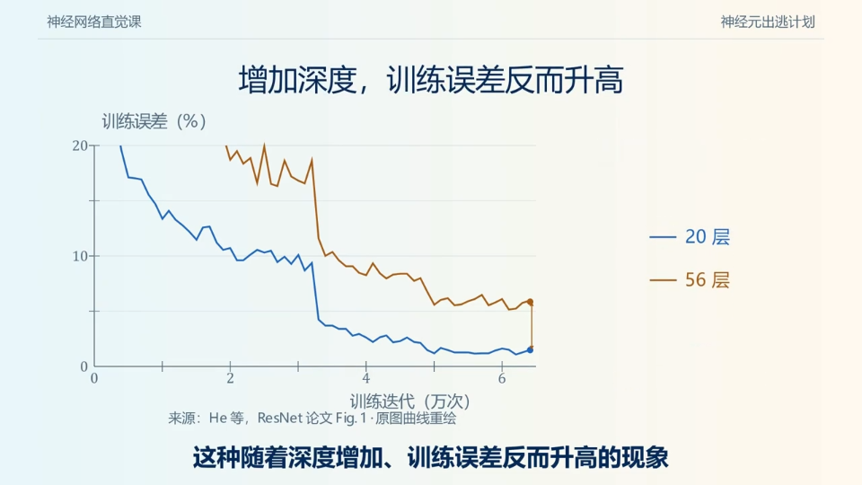
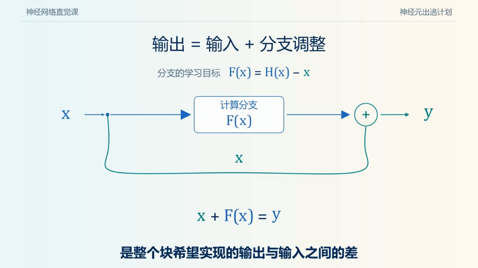
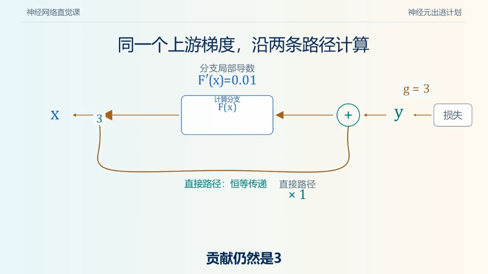
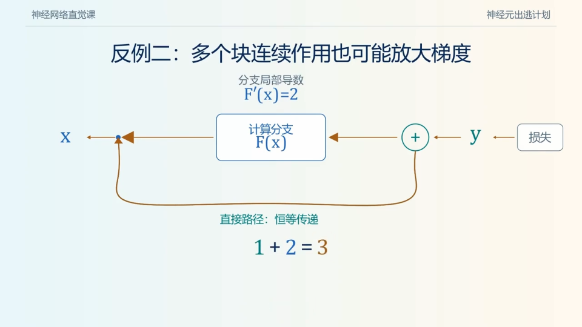
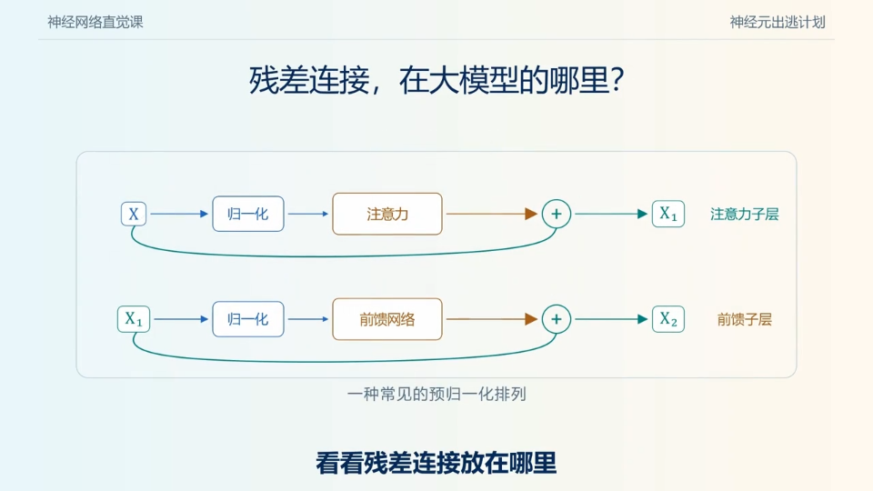

# 残差连接：从 ResNet 到 Transformer

> **整理日期：** 2026-11-09  
> **主题：** 作者与论文、网络退化、残差学习、梯度推导，以及 FFN / MoE 外的残差结构。  
> **阅读方式：** 标准 Markdown、LaTeX 公式与本地图片；视频截图的来源、时间点见文末。

残差连接最核心的操作是：**保留输入，让计算分支产生一个增量，再把两者相加。**

$$
y=x+F(x;\theta)
$$

它改变了深层网络的参数化方式和信号传播路径。本文先从“为什么加深网络反而可能训练得更差”讲起，再解释加号怎样影响前向计算与反向传播，最后回到 Transformer。

**目录归属说明：** 沿用仓库的 `技术演进-FNN层` 目录名，正文使用标准缩写 FFN。残差连接属于子层之间的连接结构，Attention、Dense FFN 和 MoE 都可以处在残差分支中。

## 一、先认识作者与两篇核心论文

| 论文 | 作者（按论文署名顺序） | 当时署名机构 | 首次提交与会议 | 阅读重点 |
| --- | --- | --- | --- | --- |
| *Deep Residual Learning for Image Recognition* | Kaiming He（何恺明）、Xiangyu Zhang（张祥雨）、Shaoqing Ren（任少卿）、Jian Sun（孙剑） | Microsoft Research（微软研究院） | arXiv 2015-12-10；CVPR 2016 | 把目标映射改写为残差映射，用 shortcut 改善深网络优化 |
| *Identity Mappings in Deep Residual Networks* | 同上四位作者 | Microsoft Research | arXiv 2016-03-16；ECCV 2016 | 分析恒等通路，提出 full pre-activation 残差单元 |

第一篇通常简称 **ResNet 论文**；第二篇常与 **ResNet v2 / Pre-activation ResNet** 联系起来。两篇论文由四人共同署名，介绍贡献时应保留完整作者信息，而非只写第一作者。

原始来源：[ResNet arXiv](https://arxiv.org/abs/1512.03385)、[CVPR 正式论文页](https://www.cv-foundation.org/openaccess/content_cvpr_2016/html/He_Deep_Residual_Learning_CVPR_2016_paper.html)、[Identity Mappings arXiv](https://arxiv.org/abs/1603.05027)。文中的机构指论文发表时的署名，不代表作者当前任职。

## 二、为什么网络更深，却可能学得更差？

### 2.1 表达能力与可训练性是两件事

假设一个浅网络已经学到了有用的函数。我们在它后面添加若干层：如果新增层能够执行恒等映射，原来的输出就可以保留下来。从这个构造看，深网络至少应当有机会复现浅网络的解。

但“存在这样的参数”不等于“优化器容易找到这样的参数”。多层线性变换、非线性和归一化的组合，会使搜索这个解变得困难。

### 2.2 退化问题先看训练误差



*图 1：视频约 01:40，作者为“神经元出逃计划”。视频中的曲线是教学示意，标注参考 ResNet 论文 Figure 1；不要从这张重绘图读取精确实验数据。*

需要区分三个现象：

| 现象 | 如何辨认 | 含义 |
| --- | --- | --- |
| 过拟合 | 训练集表现很好，验证或测试表现较差 | 泛化存在问题 |
| 深度退化 | 更深的普通网络连训练误差都更高 | 至少说明当前优化过程未充分利用模型容量 |
| 梯度消失 / 爆炸 | 反向传播中的梯度过小或过大 | 信号传播与数值稳定性存在问题 |

这些现象可能相互关联，但不能互相替代。ResNet 论文强调：在采用合适初始化和归一化后，普通网络仍会出现随深度增加而训练变差的现象，因此只说“残差连接解决梯度消失”没有覆盖论文的完整动机。

来源：[原论文 Introduction、Figure 1 与 Section 4](https://arxiv.org/html/1512.03385v1)。

## 三、核心思路：从学习完整输出，到学习相对输入的调整

### 3.1 三个符号不要混淆

| 符号 | 含义 |
| --- | --- |
| $x$ | 模块输入 |
| $H(x)$ | 模块希望实现的目标映射 |
| $F(x;\theta)$ | 带参数的计算分支，拟合相对于输入的修正 |

普通模块让计算分支直接拟合 $H(x)$。残差模块把目标重写成：

$$
F(x;\theta)\approx H(x)-x,
\qquad y=x+F(x;\theta)\approx H(x).
$$

“残差”指相对于输入的差值，不是训练完成后才计算的预测误差。损失函数仍然可以是交叉熵；网络也不需要为每个中间层额外提供 $H(x)-x$ 标签。



*图 2：视频约 05:40，输入走 shortcut，计算分支产生 $F(x)$，两路相加。*

### 3.2 一个手算例子

设模块输入与目标输出分别为：

$$
x=\begin{bmatrix}2\\-1\\0.5\end{bmatrix},
\qquad H(x)=\begin{bmatrix}1.7\\-0.8\\0.5\end{bmatrix}.
$$

分支需要给出的修正是：

$$
F(x)=H(x)-x=\begin{bmatrix}-0.3\\0.2\\0\end{bmatrix}.
$$

相加后：

$$
y=\begin{bmatrix}2\\-1\\0.5\end{bmatrix}
+\begin{bmatrix}-0.3\\0.2\\0\end{bmatrix}
=\begin{bmatrix}1.7\\-0.8\\0.5\end{bmatrix}.
$$

这个例子说明，修正可以为正、为负，也可以为零。残差连接不要求每层都做“小幅修改”，更不约束 $\|F(x)\|<\|x\|$。

### 3.3 为什么有利于恒等映射？

如果这一层暂时不需要改变输入，理想目标是 $H(x)=x$。在纯加法结构中，只需 $F(x)=0$，便有 $y=x$。

这是**参数化上的便利**：零输出分支能直接表达“不修改”。它不是优化器必定收敛的证明，也不意味着任意深网络都能无代价地训练。

还要看加法后面有没有操作。如果实际模块是 $y=\operatorname{ReLU}(x+F(x))$，即使 $F(x)=0$，负输入也会被截断；此时不能把完整模块笼统地视为恒等映射。

## 四、加号怎样改变梯度传播？

以下推导先假设 shortcut 为恒等映射、加法之后没有额外激活或归一化，并把向量梯度记为列向量。

### 4.1 单个模块：同一个上游梯度沿两路返回

对 $y=x+F(x)$，令 $J_F=\partial F/\partial x$，则：

$$
\frac{\partial y}{\partial x}=I+J_F,
\qquad
\nabla_x\mathcal L=(I+J_F)^T\nabla_y\mathcal L.
$$

展开得到：

$$
\nabla_x\mathcal L
=\underbrace{\nabla_y\mathcal L}_{\text{直接通路}}
+\underbrace{J_F^T\nabla_y\mathcal L}_{\text{计算分支}}.
$$

直接通路的局部 Jacobian 是 $I$。这给反向传播提供了一项不必经过分支内部权重乘积的贡献。



*图 3：视频约 07:00。视频用标量导数讲解；这里写成向量 Jacobian，适用于隐藏状态。*

若标量情形中 $\partial\mathcal L/\partial y=3$，且 $F'(x)=0.01$，则：

$$
\frac{\partial\mathcal L}{\partial x}=3(1+0.01)=3.03.
$$

同样的上游梯度若只经过导数为 $0.01$ 的普通分支，则为 $0.03$。这只是局部示例，两种网络实际训练时的上游梯度未必相同。

### 4.2 多层：前向是累加，反向仍需分析整体 Jacobian

若每层都满足 $x_{l+1}=x_l+F_l(x_l)$，可逐层展开：

$$
x_L=x_l+\sum_{i=l}^{L-1}F_i(x_i).
$$

因此：

$$
\nabla_{x_l}\mathcal L=
\left[I+\frac{\partial}{\partial x_l}
\sum_{i=l}^{L-1}F_i(x_i)\right]^T\nabla_{x_L}\mathcal L.
$$

注意 $x_i$ 本身依赖 $x_l$，不能把上述导数简化成忽略链式法则的 $\sum_i J_{F_i}(x_i)$。

令 $A_i=I+J_{F_i}(x_i)$，则等价地有：

$$
\frac{\partial x_L}{\partial x_l}=A_{L-1}A_{L-2}\cdots A_l.
$$

### 4.3 为什么不能说“梯度永远不会消失”？



*图 4：视频约 08:20，给出连续块放大梯度的反例。*

两个标量反例足以说明边界：

- 若每层局部 $F'_l=2$，每个模块的导数是 $3$，经过 $n$ 个模块得到 $3^n$，仍可能爆炸。
- 若某层局部 $F'_l=-1$，该层总导数为 $0$，直接项与分支项发生抵消，仍可能阻断梯度。

因此，准确表述是：**残差结构改善了传播路径和优化条件，但没有提供梯度范数的普遍上下界。** 初始化、归一化、残差缩放和学习率仍然重要。

对分支参数的梯度则为：

$$
\nabla_\theta\mathcal L=
\left(\frac{\partial F}{\partial\theta}\right)^T\nabla_y\mathcal L.
$$

这里没有来自 shortcut 的额外恒等项；改善输入梯度的路径，不等于每个分支参数的梯度都自动健康。

理论来源：[Identity Mappings Section 2–3](https://arxiv.org/html/1603.05027v3)。以上数值算例为本文教学构造。

## 五、第一篇论文精读：ResNet 到底验证了什么？

### 5.1 按“问题—结构—对照实验”阅读

| 阅读位置 | 重点问题 | 解读 |
| --- | --- | --- |
| Introduction、Figure 1 | 深层普通网络为何训练得更差？ | 先建立退化现象，关注训练误差而非只看测试误差 |
| Section 3.1–3.2、Figure 2 | shortcut 改变了什么？ | 在计算分支外加入输入，使分支学习相对输入的残差 |
| Section 3.3、Figure 5 | 如何把网络做深？ | 使用 basic block 或瓶颈结构，控制计算成本 |
| Section 4.1、Table 2 | 同样深度下，有没有 shortcut 的差别？ | 比较 plain 与 residual 网络，支持优化收益 |
| Section 4.2 | 是否越深越好？ | 更深也会遇到泛化等限制，需要分开解释训练与测试结果 |

### 5.2 Basic block 与 bottleneck

Basic block 常用两个 $3\times3$ 卷积构成分支。论文中更深的 ResNet-50/101/152 采用三层瓶颈分支：

$$
1\times1\text{ 降维}\ \longrightarrow\ 3\times3\text{ 处理}\
\longrightarrow\ 1\times1\text{ 升维}.
$$

以空间分辨率不变、输入输出通道都是 256、瓶颈通道为 64 的简化例子计算，忽略 bias 与 BN 参数：

$$
P_{\text{两个 }3\times3}=2\times9\times256^2=1{,}179{,}648,
$$

$$
P_{\text{瓶颈}}=256\times64+9\times64^2+64\times256=69{,}632.
$$

这说明瓶颈设计如何降低该例中的卷积分支参数量；两者的隐藏宽度和层数不同，不能把参数比直接当作等表达能力下的加速倍数。瓶颈负责控制成本，残差连接负责提供加法通路，两者作用需要分别理解。

### 5.3 关键实验数据与口径

| 原论文位置 | 条件 | 结果 | 能说明什么 |
| --- | --- | --- | --- |
| Table 2 | ImageNet 验证集，10-crop，同一表格中的 34 层 plain / residual | Top-1 错误率 28.54% / 25.03% | 该对照下 residual 减少 3.51 个百分点错误率 |
| Table 3 | ImageNet 验证集，ResNet-152，10-crop | Top-5 错误率 5.71% | 这是单模型验证结果，有明确评估设置 |
| 摘要及竞赛结果说明 | ILSVRC 2015 分类测试集，模型集成 | Top-5 错误率 3.57% | 不能写成“单个 ResNet-152 的通用错误率” |

这些是历史视觉任务实验，不可直接推断当前 LLM 的收益。阅读实验时始终核对：训练集还是验证集、Top-1 还是 Top-5、单模型还是集成、单裁剪还是多裁剪。

来源：[论文完整正文及表格](https://arxiv.org/html/1512.03385v1)。

## 六、维度对不上时，shortcut 怎么加？

对逐元素加法，两个操作数应表达相同形状的特征。卷积网络切换 stage 时，通道数或空间大小可能改变。

| shortcut 形式 | 公式 | 适用情况 |
| --- | --- | --- |
| Identity | $y=x+F(x)$ | 输入与分支输出形状一致 |
| Projection | $y=W_sx+F(x)$ | 用投影匹配通道或特征维度；卷积中也可结合 stride 下采样 |

投影 shortcut 的输入 Jacobian 为 $W_s+J_F$，不能继续把其直接项写成 $I$。投影也会增加参数与计算。

Transformer 通常让 Attention 和 FFN 的最终输出都回到 $d_{\text{model}}$，从而在子层边界直接相加。FFN 内部扩张到 $d_{\text{ff}}$ 不影响这一点，因为在相加前已经投影回来。

实现时也不要依赖张量广播“帮忙相加”：代码能够运行，并不代表语义上连接了正确的隐藏状态。

## 七、第二篇论文精读：为什么强调恒等映射？

2015 年常见残差单元在加法后使用 ReLU，可简写为：

$$
x_{l+1}=\operatorname{ReLU}(x_l+F_l(x_l)).
$$

加法后激活会改变直接通路的导数。2016 年论文进一步研究 shortcut 与加法后映射，full pre-activation 单元把 BN、ReLU 放到分支权重层之前，使跨单元的加法通路更接近纯恒等形式：

$$
x_{l+1}=x_l+F_l(x_l).
$$

建议重点看三个位置：

1. **Section 2：** 前向累加与反向直接项的推导，对应本文第四节。
2. **Section 3：** 对 shortcut 加缩放、门控或其他变换的对照，说明直接通路的形式也会影响训练。
3. **Section 4、Figure 4：** 不同激活位置的比较，理解 full pre-activation 的结构动机。

标量例子中，若 shortcut 是 $\lambda_l x_l$，连续直接路径会包含 $\prod_l\lambda_l$。即使每个系数都只稍微偏离 1，堆叠很多层后也可能显著衰减或放大。这解释了为什么“有一条跳线”与“有一条恒等通路”不能完全等同。

ResNet 的 pre-activation 与 Transformer 的 Pre-LN 都关心直接通路，但前者涉及 CNN 的 BN / ReLU，后者涉及 Transformer 的 LayerNorm；不能把两套结构视为逐项相同。

来源：[Identity Mappings 完整正文](https://arxiv.org/html/1603.05027v3)。

## 八、回到 Transformer：残差连接放在哪里？



*图 5：视频约 09:40，展示一种常见的 Pre-Norm 排列；原始 Transformer 的归一化位置不同，见下文。*

### 8.1 原始 Transformer：Post-LN

2017 年论文的 Add & Norm 可写为：

$$
u=\operatorname{LN}\left(x+
\operatorname{Dropout}(\operatorname{Attention}(x))\right),
$$

$$
y=\operatorname{LN}\left(u+
\operatorname{Dropout}(\operatorname{FFN}(u))\right).
$$

这里只写 Attention 的隐藏状态接口，省略 Q/K/V 投影、mask 等内部细节。Encoder 层有自注意力与 FFN 两个子层，原始 Decoder 还多一个交叉注意力子层，不能把所有 Transformer 都概括为每层恰好两次残差相加。

来源：[Attention Is All You Need，Section 3.1、3.3、5.4](https://arxiv.org/html/1706.03762v7)。

### 8.2 Pre-LN：把归一化移到分支入口

一种常见的顺序结构为：

$$
u=x+\operatorname{Dropout}(\operatorname{Attention}(\operatorname{LN}(x))),
$$

$$
y=u+\operatorname{Dropout}(\operatorname{FFN}(\operatorname{LN}(u))).
$$

区别在于归一化是否处在两个加法节点之间的主通路上。忽略 dropout，令 $G(x)=F(\operatorname{LN}(x))$，Pre-LN 子层有 Jacobian $I+J_G$；Post-LN 子层则有：

$$
J_{\text{Post-LN}}=J_{\operatorname{LN}}(x+F(x))(I+J_F(x)).
$$

这体现了归一化位置对梯度路径的影响。Pre-LN 模型通常还需要查看堆叠末尾的 final norm，不能由局部 shortcut 推出损失到所有层之间完全没有归一化。

Xiong 等人的 *On Layer Normalization in the Transformer Architecture*（ICML 2020）分析了这一问题，给出初始化阶段的梯度分析与训练实验。其结论支持 Pre-LN 在相应设置中的稳定性优势，不能扩展为“任何 Pre-LN 模型都不需要 warm-up”。作者完整名单与论文见 [PMLR 正式页面](https://proceedings.mlr.press/v119/xiong20b.html)。

### 8.3 FFN 为什么扩维后还能够相加？

按行向量约定，令输入 $X\in\mathbb R^{B\times T\times d}$。普通两层 FFN 为：

$$
\operatorname{FFN}(X)=\phi(XW_1+b_1)W_2+b_2,
$$

$$
W_1\in\mathbb R^{d\times m},\qquad W_2\in\mathbb R^{m\times d}.
$$

其形状变化为 $[B,T,d]\to[B,T,m]\to[B,T,d]$，因此输出能与 $X$ 相加。比如 $d=4,m=12$，加法发生在最后的 4 维空间，不能把 12 维中间激活直接与 4 维输入相加。

对同一 token，若 FFN 分支返回 $[0.1,-0.2,0,0.3]$，当前隐藏状态为 $[1,2,-1,0.5]$，残差输出就是 $[1.1,1.8,-1,0.8]$。这里演示的是向量相加，不是在逐维规定语义标签。

### 8.4 换成 MoE 后，外层通路仍可保留

在一个示意性的 Pre-Norm MoE 子层中：

$$
z=\operatorname{Norm}(x),\qquad
y=x+\sum_{i\in\mathcal S(z)}g_i(z)E_i(z).
$$

各专家输出与 $x$ 同维；路由与专家负责产生更新，外层残差负责把更新加回隐藏状态。共享专家属于计算分支的一部分，也有参数；不能把共享专家称为恒等 shortcut。

拓展阅读：[MoE 核心论文与技术演进](../技术拆解-FNN层/MoE_核心论文与技术演进.md)、[Transformer 基础](../技术起源-Transformer/Attention_Is_All_You_Need.md)。

## 九、实现时看什么？

下面是**教学伪代码**，展示顺序 Pre-Norm Decoder 层的数据流。省略 cache、dropout、最终归一化等配置，不是完整训练代码。

```python
def decoder_layer(x, attention, ffn, norm1, norm2, mask):
    # x: [batch, tokens, d_model]
    attention_update = attention(norm1(x), mask=mask)
    assert attention_update.shape == x.shape
    h = x + attention_update

    ffn_update = ffn(norm2(h))
    assert ffn_update.shape == h.shape
    return h + ffn_update
```

检查具体模型时，应追踪：

- **连接位置：** 是每个子层各加一次，还是并行计算多个分支后合并？
- **归一化位置：** 在分支入口、相加之后，还是两处都有？
- **shortcut 形式：** 是恒等映射、投影、门控，还是带缩放？
- **形状与精度：** 两路是否同形状；相加与累积使用什么 dtype？
- **残差尺度：** 分支输出是否经过系数缩放，初始化是否与深度配套？

对 $y=x+\alpha F(x)$，输入 Jacobian 是 $I+\alpha J_F$。缩放能改变更新量和局部传播性质，但同时会改变分支参数梯度，仍需结合完整训练方案判断。

## 十、常见误解与阅读自检

| 常见说法 | 更准确的理解 |
| --- | --- |
| “残差连接就是跳过这一层不算了” | 标准残差结构通常仍执行分支，再与输入相加；不是自动跳层 |
| “多了一个加号，表达能力必然变强” | 核心收益涉及参数化、传播路径和可优化性；需结合结构与实验 |
| “输入完整保留下来，所以没有信息损失” | 图上存在恒等通路，但相加可抵消，后续操作也会改变信息 |
| “梯度有个 1，所以不会消失或爆炸” | $I+J_F$ 仍可能抵消、放大；多层乘积仍需分析 |
| “残差必须很小” | 没有通用的小幅度约束，分支也可以做大更新 |
| “残差连接没有参数，所以没有成本” | 恒等 shortcut 本身无参数；相加仍有算子与数据搬运成本，投影另有参数 |
| “ResNet 首创了所有跳跃连接” | 更早已有 shortcut 相关工作；ResNet 的关键是特定残差学习框架及系统验证 |
| “Attention 或 FFN 就是整个层输出” | 在残差结构中，子层往往提供更新，整体输出还要经过相加及可能的归一化 |

读完后可以用三个问题检验理解：为什么 $F(x)=0$ 对纯加法模块意味着恒等映射？为什么相加后的 ReLU 会影响这个结论？为什么 Pre-LN 的局部直接通路更清晰，却仍不能保证任意深度训练稳定？

## 十一、视频图示来源与对应关系

**视频作者：** 神经元出逃计划。  
**视频标题开头：**《残差连接到底强在哪？为什么多一个加号就能训练152层网络？》  
**页面显示发布时间：** 2026-09-17 19:44。  
**用户提供的链接：** [作者页中的指定视频](https://www.douyin.com/user/MS4wLjABAAAA_ygszDRK-qMWn_87MWCX19jqvAnt_ODAkUR6UHRB-1Q?modal_id=7686468624499969321)。  
**直接视频入口：** [抖音视频 7686468624499969321](https://www.douyin.com/video/7686468624499969321)。

| 本文图号 | 截取时间点（约） | 图示内容 | 本文用途 |
| --- | --- | --- | --- |
| 图 1 | 01:40 | 网络加深、训练误差升高 | 区分退化与过拟合 |
| 图 2 | 05:40 | $x+F(x)$ 与目标残差 | 说明输入通路和增量分支 |
| 图 3 | 07:00 | 梯度沿两路传播 | 连接标量直觉与 Jacobian 公式 |
| 图 4 | 08:20 | 连续块放大梯度 | 说明残差连接的能力边界 |
| 图 5 | 09:40 | Attention、FFN 与残差连接 | 引入 Pre-LN / Post-LN 对比 |

图片为指定视频的实际画面截取，保留画面内作者标识和字幕，不是论文原图。权利归视频作者及相关原始素材权利人所有；本文用于来源明确的学习讲解。视频的教学示意与原论文的实验图、精确数字需要分别核对。时间点按播放器定位，可能存在关键帧级偏差。

## 十二、原始资料与延伸阅读

1. He, Zhang, Ren, Sun. **Deep Residual Learning for Image Recognition.** CVPR 2016. [arXiv](https://arxiv.org/abs/1512.03385) · [CVPR](https://www.cv-foundation.org/openaccess/content_cvpr_2016/html/He_Deep_Residual_Learning_CVPR_2016_paper.html)。重点：Figure 1–2、Figure 5、Table 2–3。
2. He, Zhang, Ren, Sun. **Identity Mappings in Deep Residual Networks.** ECCV 2016. [arXiv](https://arxiv.org/abs/1603.05027)。重点：Section 2–4、Figure 4。
3. Vaswani 等. **Attention Is All You Need.** NeurIPS 2017. [arXiv](https://arxiv.org/abs/1706.03762)。重点：Section 3.1、3.3、5.4。
4. Xiong 等. **On Layer Normalization in the Transformer Architecture.** ICML 2020. [PMLR](https://proceedings.mlr.press/v119/xiong20b.html)。重点：归一化位置、初始化梯度与 warm-up 的关系。

文中的向量、参数量与梯度手算例子均为教学构造；历史实验数据单独注明论文位置和评估口径。
