# Q、K、V：从三种投影到注意力读取

> **整理日期：** 2026-11-09  
> **视频来源：** 神经元出逃计划，《大模型同一个词，为什么要变成 Q、K、V？》，2026-09-21 发布，约 10 分 55 秒。  
> **原视频：** [抖音视频](https://www.douyin.com/video/7687924744439614783)  
> **内容：** 22 张视频截图，以“它”读取“小猫”等位置为例，逐步计算投影、点积、缩放、softmax 和 Value 汇总；另附受控对比及标准库复算代码。视频中的数值是教学示例，不是真实模型抽取结果。

**目录位置：** `技术拆解-注意力机制/01-QKV基础/`。建议在 [Token 与 Embedding](../../技术拆解-分词与向量化/Embedding/Token与Embedding_从strawberry计数到向量查表.md) 之后阅读，再进入 [位置编码](../../技术拆解-位置编码优化/正弦位置编码/正弦位置编码_从序列编号到多频率坐标.md)、[Attention 演进](../06-Attention技术演进/06-Attention_技术演进_Transformer至Qwen3.8与DeepSeekV4.1.md) 与 [KV Cache](../03-KVCache基础/03-KVCache基础_从因果不变性到Prefill与Decode.md)。

## 一、跟着“它”这个位置，看一次读取


视频使用“小猫 / 累了 / 它 / 趴在 / 垫子上”作为示意位置。实际分词结果未必与这些词块完全相同；这里借它们解释计算关系。

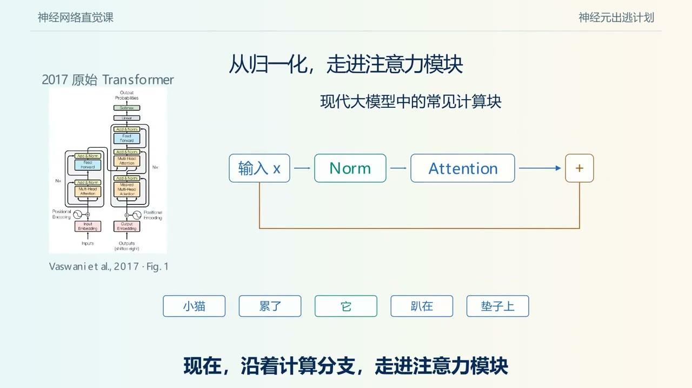

在常见因果自注意力中，“它”这个位置只能读取自身及此前位置，不能读取后面的“趴在”“垫子上”。视频的单头演示中，可见集合为“小猫、累了、它”。

“它”到底指代谁是语言理解问题；本篇先解释注意力如何形成一次读取，不能仅凭一个头的最大权重就断言模型已经完成真实的指代消解。


## 二、同一个输入，三种投影分别承担什么？


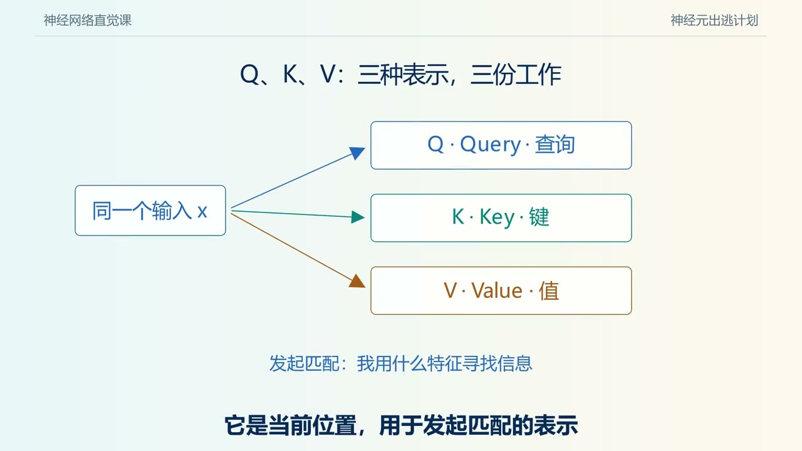

| 表示 | 常见名称 | 在这次计算中的作用 |
| --- | --- | --- |
| Q | Query，查询 | 当前读取位置用什么特征发起匹配 |
| K | Key，键 | 每个被读取位置用什么特征接受匹配 |
| V | Value，值 | 被读取位置提供怎样的向量内容 |

这些名称是计算角色，不是三个独立的词义标签。Q、K 可以通过不同投影强调不同的匹配特征；V 则无需与匹配空间使用完全相同的表示。

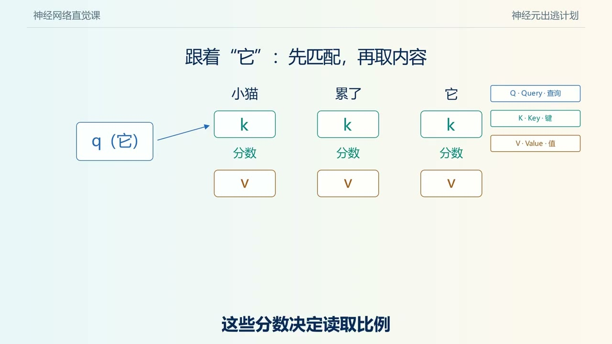

“Q 和 K 决定读取比例，V 提供汇总内容”概括的是这个注意力算子。真实网络中，三者都由当前隐藏状态及学习参数产生，位置机制、掩码、缩放也会影响读取比例。

## 三、矩阵形状：每个位置共享同一组投影参数

采用行向量及序列矩阵约定：

$$
X\in\mathbb R^{T\times d},\quad
Q=XW_Q,\quad K=XW_K,\quad V=XW_V,
$$

$$
W_Q,W_K\in\mathbb R^{d\times d_k},\qquad W_V\in\mathbb R^{d\times d_v}.
$$

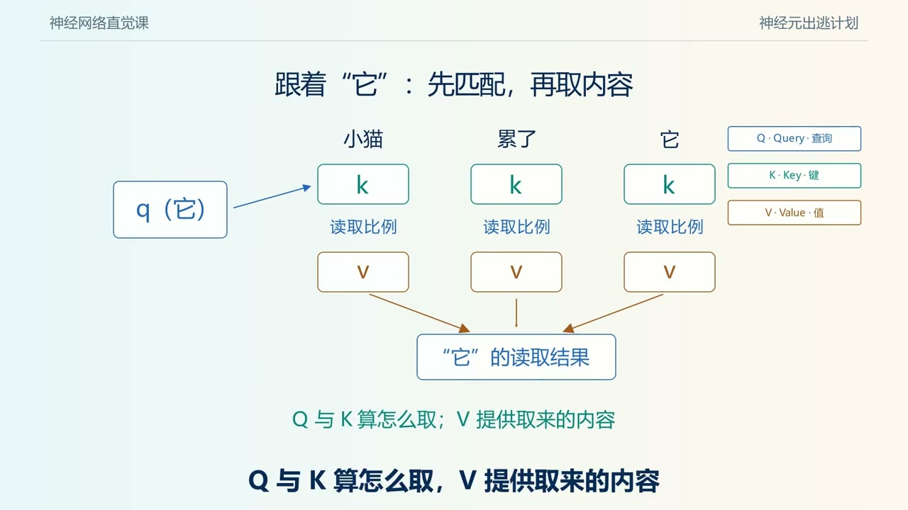

同一个头中，各位置使用同一套 $W_Q,W_K,W_V$。不是给每个词单独训练一套矩阵。投影常省略偏置，是否带偏置以实际模型为准。

输入 $X$ 不必是原始 Embedding：在更深层，它通常是经过上下文处理及相应归一化的隐藏状态。原始 Transformer 的加法位置编码及 RoPE 的位置处理也要按各自结构纳入。

### 3.1 当前 Query 的投影手算

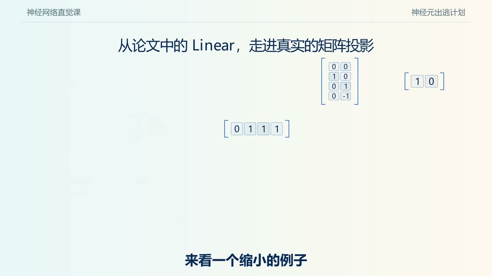

沿视频演示，取“它”的输入 $x=[0,1,1,1]$，以及：

$$
W_Q=\begin{bmatrix}0&0\\1&0\\0&1\\0&-1\end{bmatrix}.
$$

则 $q=xW_Q=[1,0]$，因为第一分量是 $0+1+0+0=1$，第二分量是 $0+0+1-1=0$。这里的数值用于教学，不把某个维度解释为固定的人类语义属性。

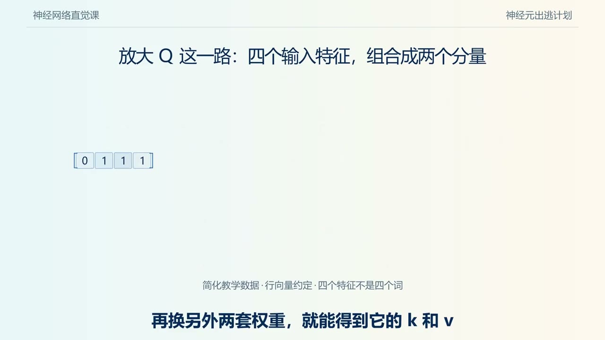

## 四、QK 点积：先得到未归一化分数

以当前 $q=[1,0]$，视频给出的可见 Key 为：

$$
K=\begin{bmatrix}2&1\\1&2\\0&1\end{bmatrix}.
$$

三行依次对应“小猫、累了、它”。于是：

$$
qK^T=[2,1,0].
$$

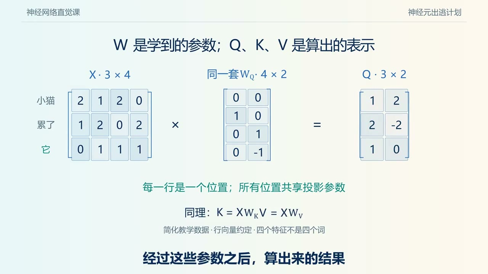

点积同时受方向和长度影响。它不是天然等于余弦相似度，也不是“有多少概率指向小猫”。在 softmax 之前，这些分数可以为负，也不要求和为 1。

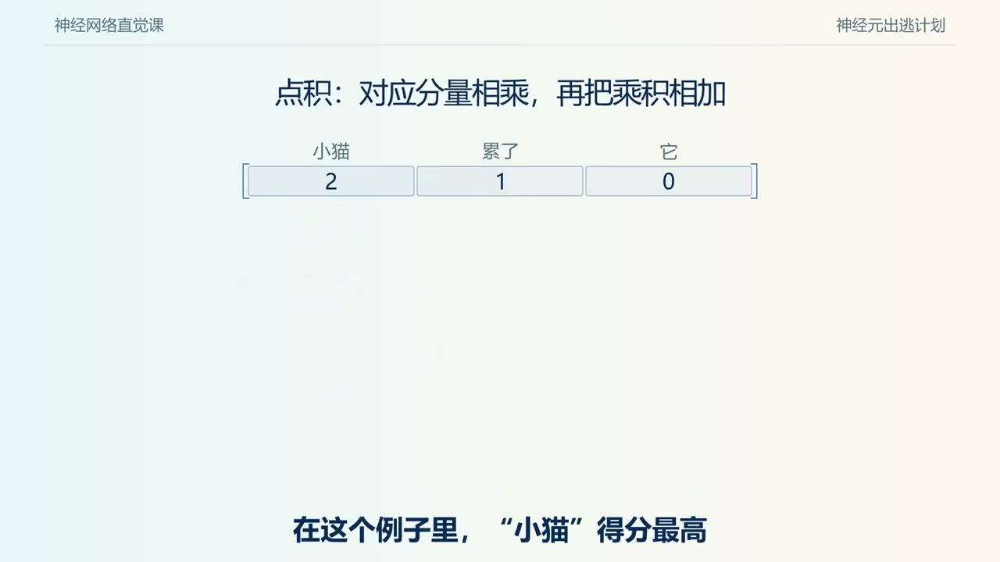

## 五、为什么除以平方根，再用 softmax？

对 Key 维度 $d_k=2$，Scaled Dot-Product Attention 使用：

$$
s=\frac{qK^T}{\sqrt2}=[1.414214,0.707107,0],
\qquad\alpha=\operatorname{softmax}(s).
$$

得到：

$$
\alpha\approx[0.575975,0.283995,0.140029].
$$

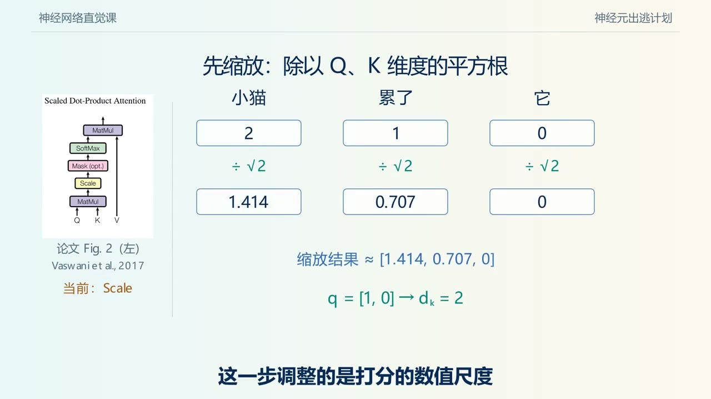

缩放的常见动机是：在分量独立、均值为零、方差为 1 等简化条件下，$q^Tk$ 的方差随 $d_k$ 增长，除以 $\sqrt{d_k}$ 有助于控制初始分数尺度。真实训练后的 Q / K 不必满足这些独立分布假设，缩放也不保证注意力永不饱和。

softmax 在每个 Query 的可见 Key 方向归一化。常用稳定实现先减去该行最大值，再取指数。若有未来位置，要在 softmax 前将其分数屏蔽为负无穷；不能算完后简单置零而不重新归一化。

## 六、V 的加权求和：比例作用于整行向量

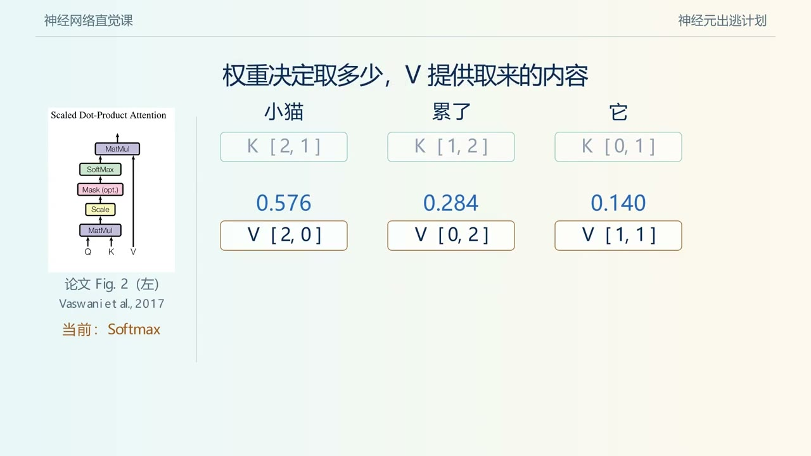

沿视频，三行 Value 为：

$$
V=\begin{bmatrix}2&0\\0&2\\1&1\end{bmatrix}.
$$

计算结果：

$$
\begin{aligned}
o&=\alpha V\\
&=0.575975[2,0]+0.283995[0,2]+0.140029[1,1]\\
&\approx[1.291980,0.708020].
\end{aligned}
$$

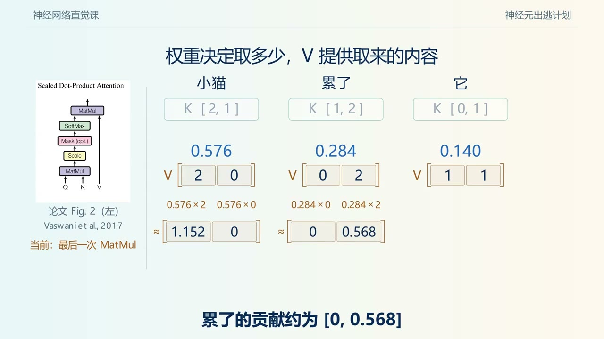

每个权重乘对应位置的整个 V 向量。不是分别从不同位置挑一个最大特征，也不是必须复制权重最大位置的 V。后续通常还会经过多头拼接、输出投影和残差等处理，不能将这里的 $o$ 当作最终词表概率或下一个文字。

## 七、只改 V 与只改 K，有什么不同？

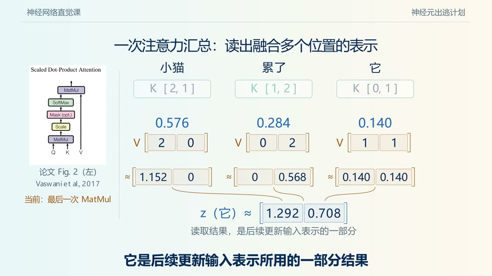

为了隔离计算角色，本文做两个受控例子。它们不是对原始输入的完整修改实验。

### 7.1 固定 Q、K，仅改变“小猫”的 V

把 $[2,0]$ 改成 $[4,1]$，其余不变，$\alpha$ 保持原值。输出变化是：

$$
\Delta o=\alpha_{\text{小猫}}([4,1]-[2,0])
\approx[1.151951,0.575975].
$$

所以输出变成约 $[2.443931,1.283995]$。比例不变，读到的内容变了。

### 7.2 固定 Q、V，仅改变“小猫”的 K

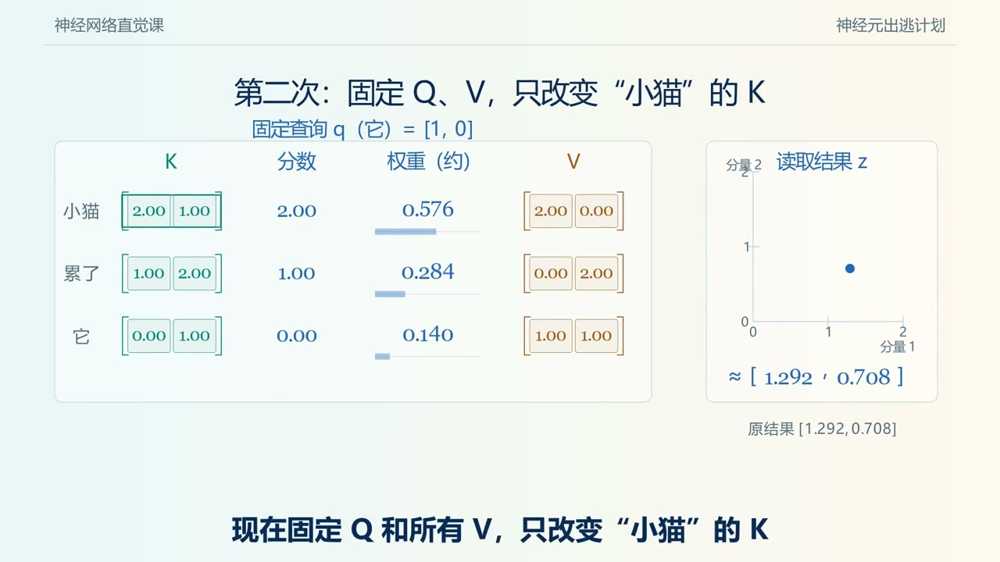

把其 Key 从 $[2,1]$ 改成 $[0,0]$，分数由 $[2,1,0]$ 变为 $[0,1,0]$，仍除以 $\sqrt2$ 再归一化：

$$
\alpha'\approx[0.248255,0.503490,0.248255],
\qquad o'\approx[0.744765,1.255235].
$$

K 的变化会通过 softmax 分母影响整行权重，而不只是对应位置的一个权重。V 保持不变，混合比例变化，输出仍会变化。

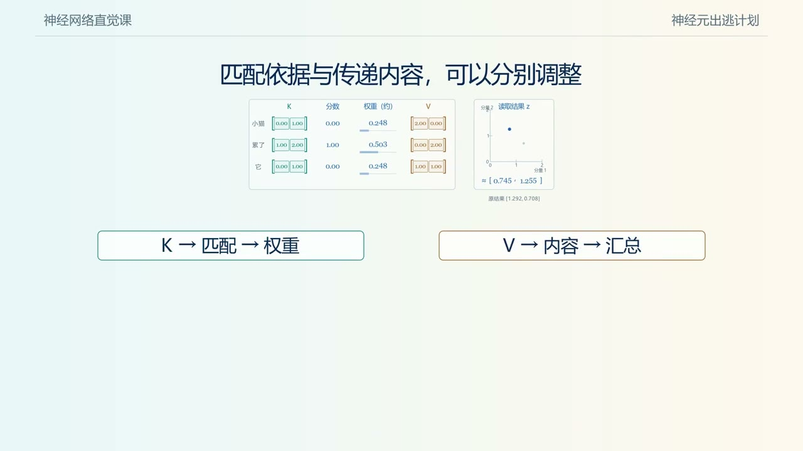

真实改变 $x$ 时，Q、K、V 通常都会改变；因此不能把上面人为固定两路的演示直接当作实际网络干预的全部效果。

## 八、Q 与 K 分开，为何允许有方向的匹配？

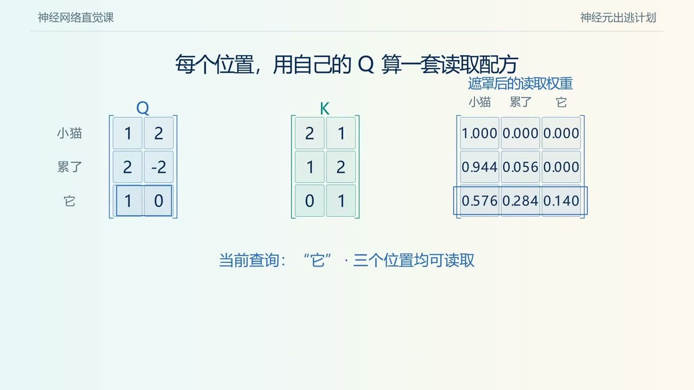

行向量下，位置 $i$ 到 $j$ 的原始分数：

$$
q_i k_j^T=x_iW_QW_K^Tx_j^T.
$$

$W_QW_K^T$ 一般不必对称，所以两个方向分数可以不同。例如 $q_{\text{它}}=[1,0],k_{\text{小猫}}=[2,1]$，得分为 2；若 $q_{\text{小猫}}=[1,3],k_{\text{它}}=[0,1]$，反向原始得分为 3。

即使原始点积分数碰巧对称，softmax 分母和各位置可见集合也可能不同，归一化后的权重仍不一定对称。因果注意力中，某个反向读取甚至会直接被掩码屏蔽。

## 九、把所有 Query 一起计算

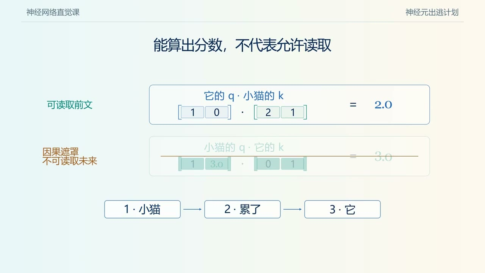

对整个单头序列：

$$
A=\operatorname{softmax}_{\mathrm{row}}
\left(\frac{QK^T}{\sqrt{d_k}}+M\right),\qquad O=AV.
$$

$QK^T$ 形状为 $T\times T$，行是发起读取的 Query 位置，列是被读取的 Key 位置；$V$ 为 $T\times d_v$，输出 $O$ 为 $T\times d_v$。因果掩码 $M_{ij}=0$ 当 $j\le i$，否则为负无穷。

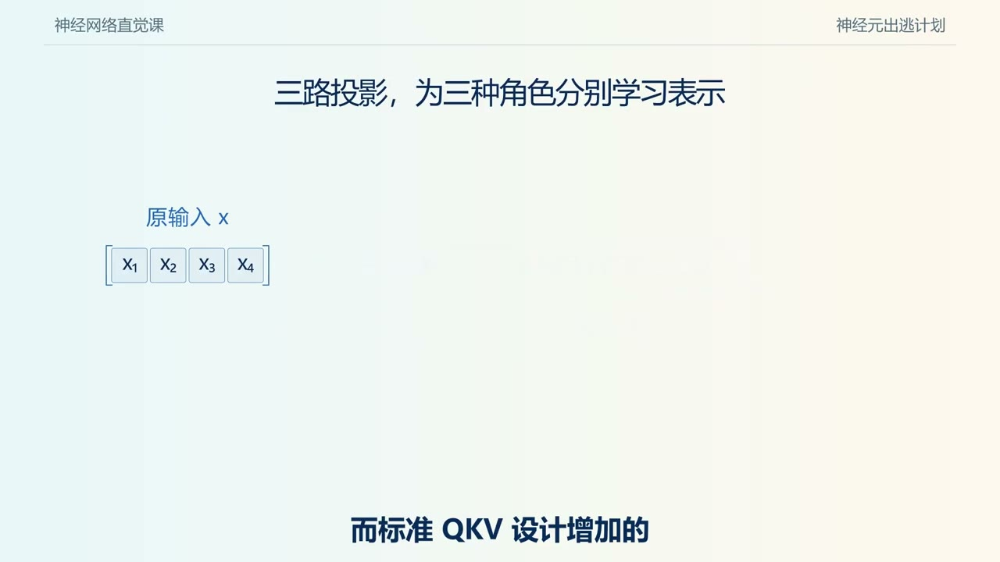

多头注意力为不同头使用不同的投影表示，再将各头输出组合。MQA / GQA 可以共享部分 KV 头，但 Query 仍可保持多头，详见 [KV 缓存与共享专题](../05-KVCache进阶与MLA/05-KVCache_MQA_GQA_MLA_从显存公式到低秩吸收.md)。

## 十、位置编码与 KV Cache 怎样接到这里？

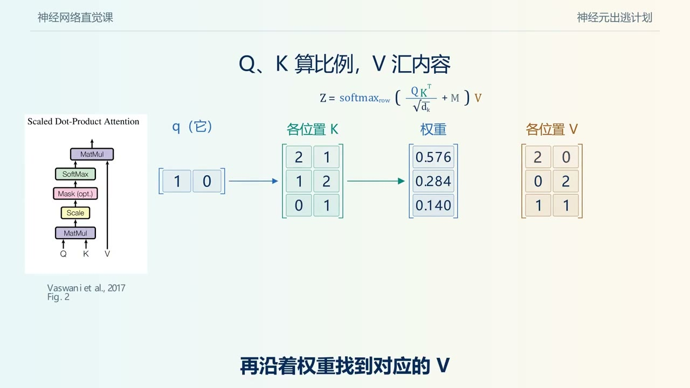

位置机制将序列位置引入输入或 Q / K 匹配中。屏幕上把词画成从左到右，并不自动给无位置的注意力提供数值坐标。因果掩码本身提供可见顺序结构，但也不等同于完整的显式位置编码。

历史 K、V 可在标准因果增量推理中复用；新位置拿自己的 Q 与历史 Key 匹配，再读历史 Value，因此长期缓存通常不需要旧 Q。关于前提和跨层过程，见 [KV Cache 基础](../03-KVCache基础/03-KVCache基础_从因果不变性到Prefill与Decode.md)。

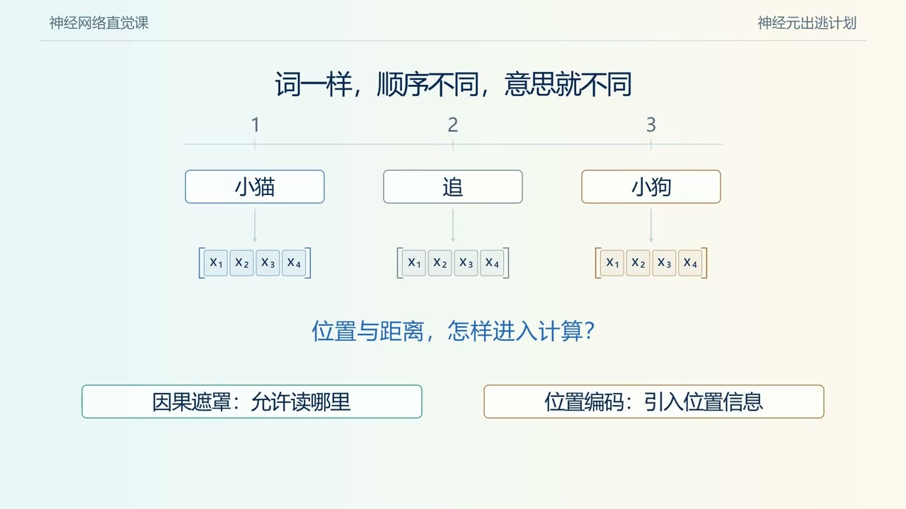

## 十一、注意力权重能解释什么，不能单独证明什么？

权重展示本算子如何混合 V，但并不是单独的因果解释或指代置信度。输出还受 V 的具体数值、后续投影、残差和其他头影响；高权重不自动表示这个词对最终答案最重要。

可参考 Sarthak Jain、Byron C. Wallace 的 [Attention is not Explanation](https://arxiv.org/abs/1902.10186)（2019-02-26 首次公开）。该文提供特定任务上的实验提醒，不将其扩展为“注意力无法用于任何分析”的绝对结论。

后续阅读 [多头注意力：从独立投影到拼接融合](../02-多头注意力/02-多头注意力_从独立投影到拼接融合.md)，把本篇单头读取扩展为并行多头计算。

## 十二、复算与原始资料

[qkv_math.py](qkv_math.py) 用标准库核对视频数值、Q 投影、K / V 受控变化、方向差异及整段因果矩阵计算的一致性，不加载真实模型权重。

```bash
python3 qkv_math.py
```

原始基础：[Attention Is All You Need](https://arxiv.org/abs/1706.03762)，2017-06-12 首次公开，作者 Ashish Vaswani、Noam Shazeer、Niki Parmar、Jakob Uszkoreit、Llion Jones、Aidan N. Gomez、Łukasz Kaiser、Illia Polosukhin。可对照 Scaled Dot-Product Attention 与 Multi-Head Attention 部分。

22 张截图覆盖 00:00—10:30，每 30 秒一帧，版权归原作者或相应权利人所有；图注和文件名标明时间。手算及受控变化明确区分视频教学数据与本文补充，均不作为真实模型行为测量。
