# 多头注意力：从独立投影到拼接融合

> **整理日期：** 2026-11-09  
> **视频来源：** 神经元出逃计划，《LLM 多头注意力，到底“多”在哪里？》，2026-09-30 发布，约 10 分 59 秒。  
> **原视频：** [抖音视频](https://www.douyin.com/video/7691304349850455306)  
> **内容：** 22 张原视频截图，以“取”这个位置为例，解释独立投影、两头手算、拼接、输出融合和张量形状；补充参数预算及复算代码。视频中的关注关系与数字用于教学，不作为真实模型测量结果。

**目录位置：** `技术拆解-注意力机制/02-多头注意力/`。先读 [QKV 基础](../01-QKV基础/01-QKV_从三种投影到注意力读取.md)，后读 [注意力演进](../06-Attention技术演进/06-Attention_技术演进_Transformer至Qwen3.8与DeepSeekV4.1.md) 或 [MQA / GQA / MLA](../05-KVCache进阶与MLA/05-KVCache_MQA_GQA_MLA_从显存公式到低秩吸收.md)。

多头注意力不是把同一套 Q、K、V 原样计算多次，而是从同一输入经不同的可学习投影，分别形成匹配与内容表示。各头独立归一化、独立汇总，再拼接并通过输出投影组合。

## 一、一个“取”字，可以关联多处信息


视频使用“小猫把红球放进盒子，后来又把它取出来”作为例子。“取”可能需要联系取什么、从哪里取、谁在执行动作等信息。

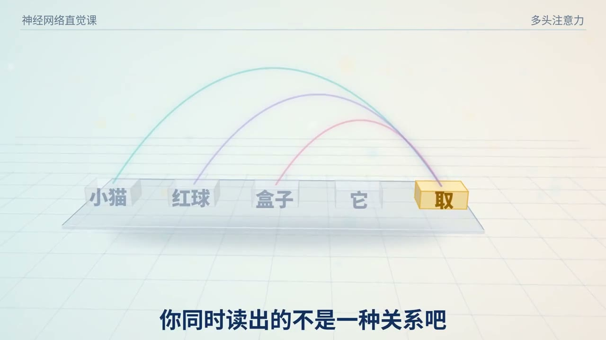

一个头已经能够给多个位置非零权重，因此不能说“一个头只能看一个词”。多头提供的是多套可学习的匹配与内容通道，而不是单纯增加能看见的位置数量。

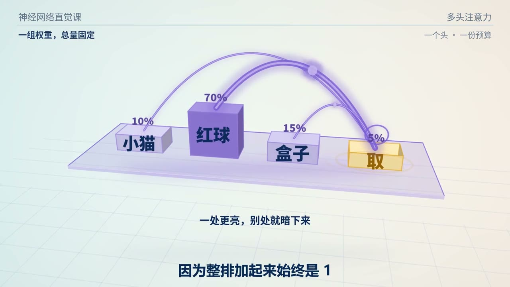

词块是示意位置，真实 Token 边界由分词器决定；各头也不预先被指定为“物品头”“地点头”或“动作发起者头”。

## 二、头与头的区别，从投影矩阵开始

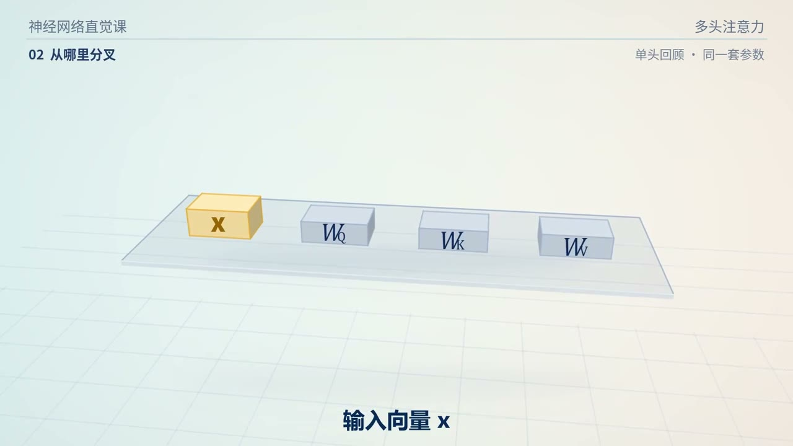

令行向量序列为 $X\in\mathbb R^{T\times d}$。第 $h$ 个头使用：

$$
Q_h=XW_h^Q,\qquad K_h=XW_h^K,\qquad V_h=XW_h^V,
$$

$$
W_h^Q,W_h^K\in\mathbb R^{d\times d_k},\qquad
W_h^V\in\mathbb R^{d\times d_v}.
$$

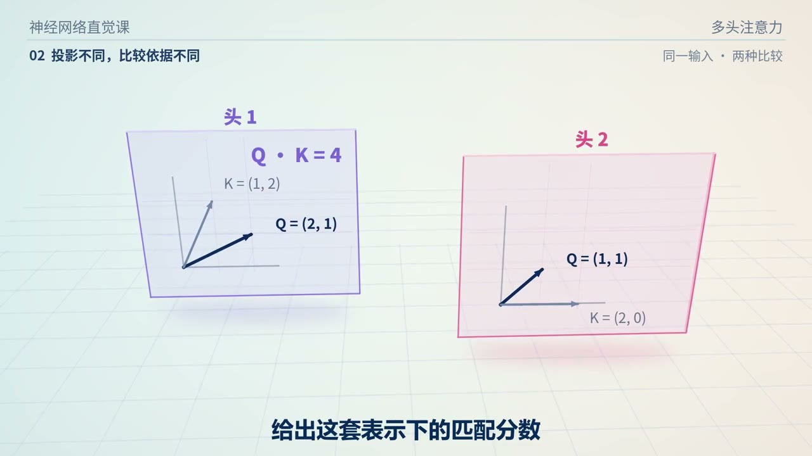

每个头看见同一层的输入 $X$，但可学到不同的线性组合。第一个头的输入不是原始向量前一段、第二个头的输入也不是原始向量后一段；每头的投影通常都可使用输入的全部 $d$ 个特征。

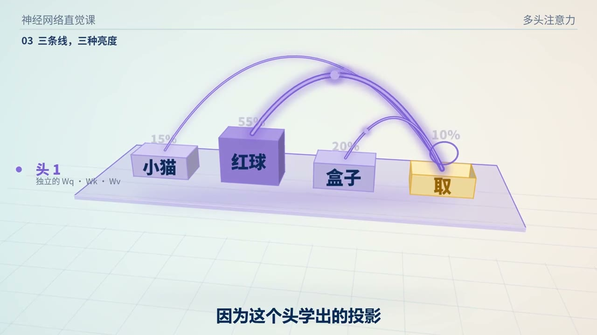

## 三、每头各算自己的 softmax

$$
A_h=\operatorname{softmax}_{\mathrm{row}}
\left(\frac{Q_hK_h^T}{\sqrt{d_k}}+M\right),\qquad O_h=A_hV_h.
$$

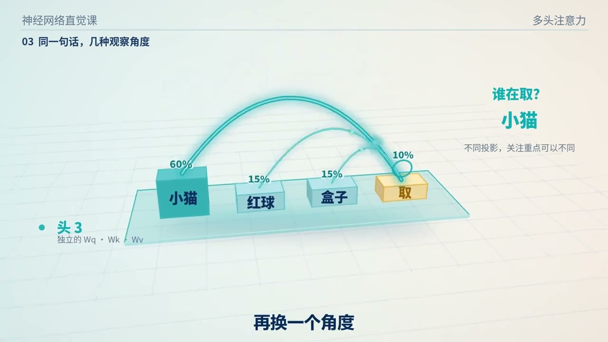

每个 Query 在每个头内，对可见 Key 位置单独归一化。不是把所有头的分数堆在一起，只做一次跨头 softmax。

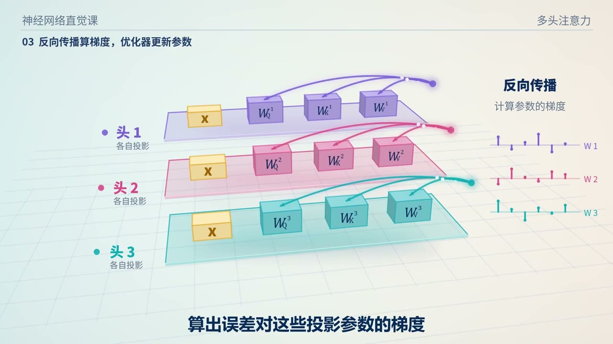

头之间既可能学习不同模式，也可能产生冗余。多头设计给出表达能力的机会，不保证每个头都承担独一无二的功能。

## 四、一次大投影再拆头，与逐头投影怎样等价？

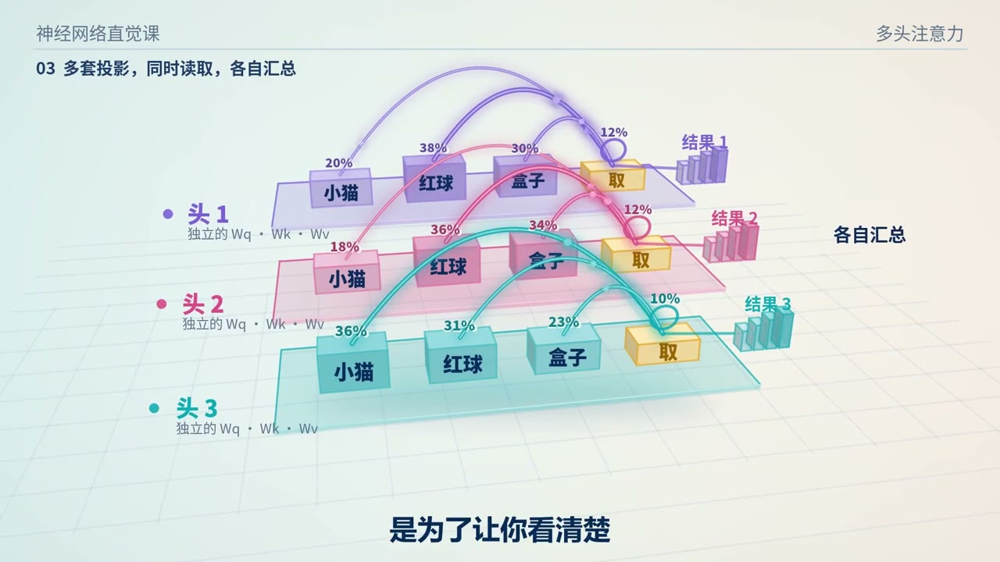

将各头 Query 矩阵按列拼接：

$$
W_Q=[W_1^Q\mid W_2^Q\mid\cdots\mid W_H^Q],
$$

则：

$$
XW_Q=[XW_1^Q\mid\cdots\mid XW_H^Q].
$$

因此可以一次算大矩阵乘法，再把**投影结果**按头重排；K、V 同理。还可以将 QKV 投影融合实现，但计算角色仍可区分。

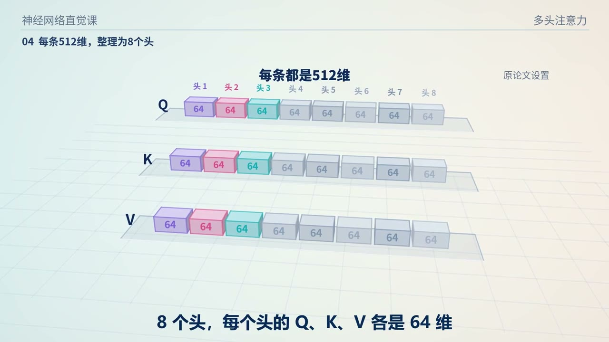

所谓“拆头”，一般是 reshape / transpose 组织张量，不是把相同参数复制 H 次。实现布局可以不同，需保持特征顺序与权重一致。

## 五、视频两头手算：先只看一个 Query

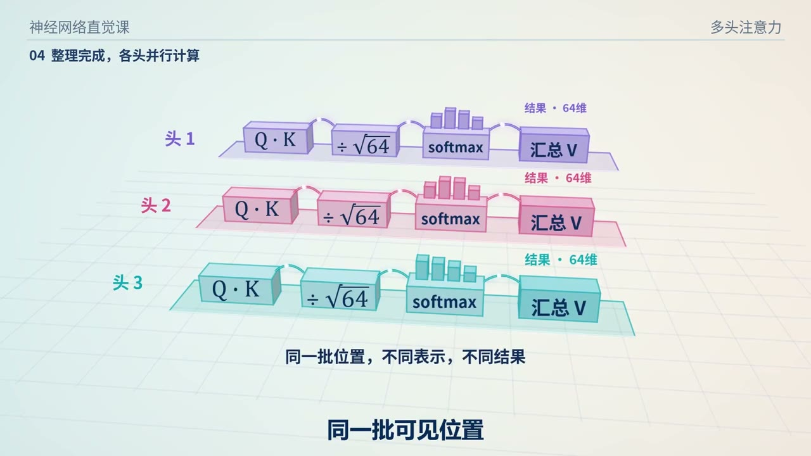

可见位置依次为“红球、盒子、取”。沿视频算例，下面把给定分数视为**进入 softmax 的最终分数**，即缩放等操作已经反映在这些数字中，不再额外除一次平方根。

### 5.1 头 1：分数为 [2,1,0]

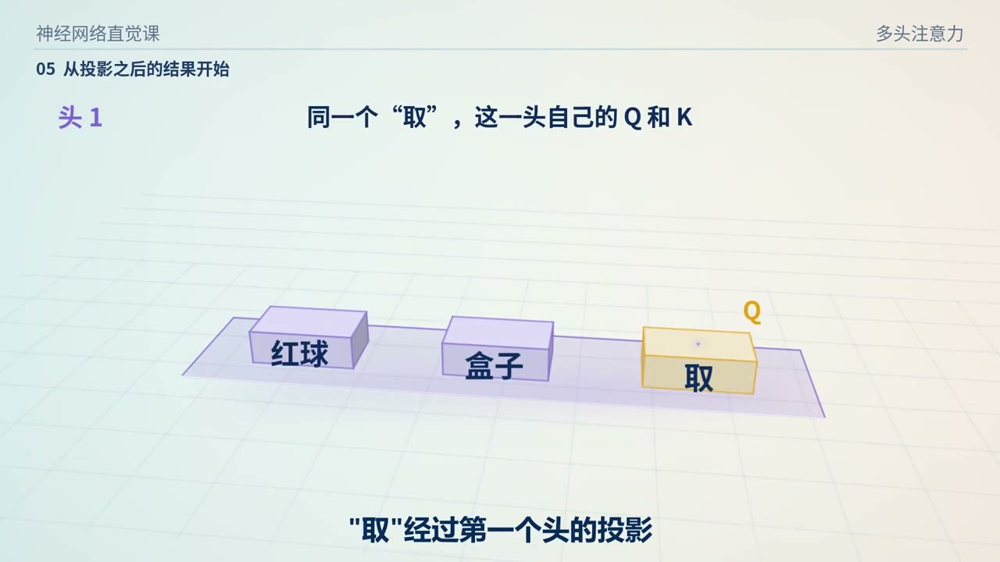

设：

$$
a=\frac{e^2}{e^2+e+1}\approx0.665241,\quad
b=\frac{e}{e^2+e+1}\approx0.244728,\quad
c=\frac1{e^2+e+1}\approx0.090031.
$$

第一头权重为 $[a,b,c]$，Value 为：

$$
V_1=\begin{bmatrix}2&0\\0&1\\0&0\end{bmatrix}.
$$

所以 $o_1=[2a,b]\approx[1.330482,0.244728]$。

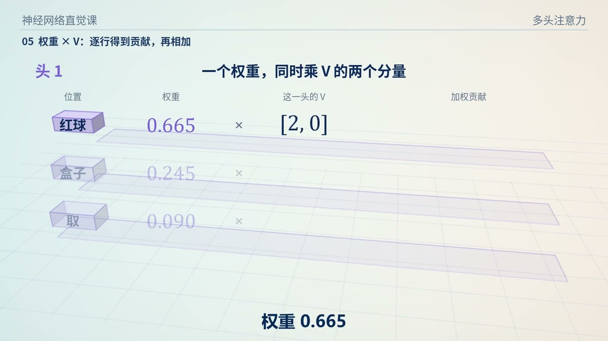

### 5.2 头 2：另一组分数与另一组 Value

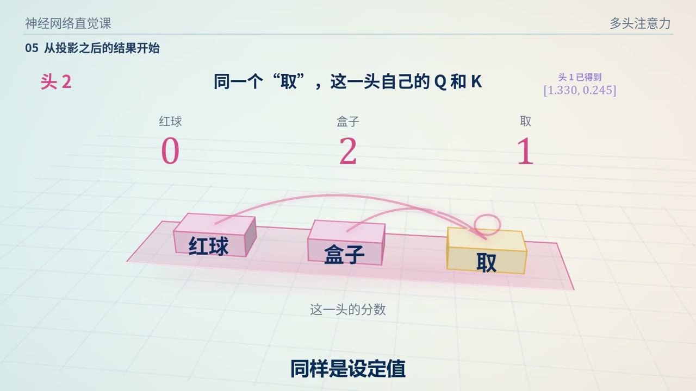

分数为 $[0,2,1]$，softmax 是 $[c,a,b]$，不是复用第一头权重。取：

$$
V_2=\begin{bmatrix}0&0\\0&2\\1&0\end{bmatrix},
\qquad o_2=[b,2a]\approx[0.244728,1.330482].
$$

同一 Query 位置在不同投影空间里形成了两种读取结果。若只复制完全相同的投影参数，输入、掩码和确定性计算也一致时，就不会凭空获得不同读取。

## 六、先拼接，不是直接平均或相加

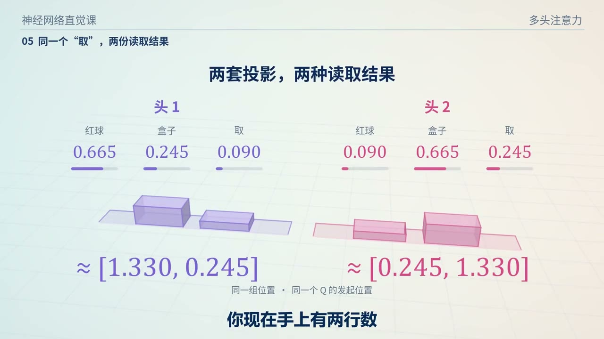

$$
o_{\mathrm{cat}}=\operatorname{Concat}(o_1,o_2)
=[2a,b,b,2a]\in\mathbb R^4.
$$

直接相加会得到二维向量，丢失哪部分来自哪个头的独立通道。标准 MHA 先保留拼接后的通道，再通过可学习输出矩阵选择如何组合。

### 6.1 输出投影 W_O：融合回残差流

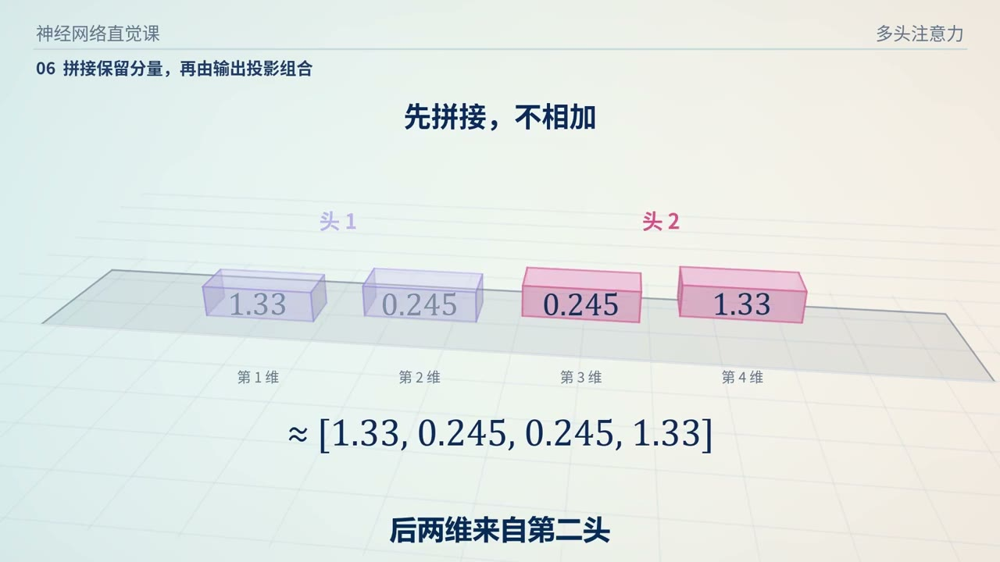

一般形式：

$$
\operatorname{MHA}(X)=\operatorname{Concat}(O_1,\ldots,O_H)W_O,
\qquad W_O\in\mathbb R^{Hd_v\times d}.
$$

本文补充一个四维教学输出矩阵：

$$
W_O=\begin{bmatrix}
1&0&1&0\\0&1&0&1\\1&0&-1&0\\0&1&0&-1
\end{bmatrix}.
$$

于是：

$$
y=[2a+b,b+2a,2a-b,b-2a]
\approx[1.575210,1.575210,1.085753,-1.085753].
$$

这组 $W_O$ 是本文自建例子，不冒充视频里的真实权重。输出投影可混合头的通道，不要求每个输出分量只来自某一个头。

也可将 $W_O$ 按行分成各头对应块 $W_{O,h}$，得到：

$$
[O_1\mid\cdots\mid O_H]W_O=\sum_hO_hW_{O,h}.
$$

因此实现上可以采取等价的分块求和；关键是保留正确的头内变换，不是无条件先把各头原始输出相加。

## 七、批量、位置与头，是不同的轴

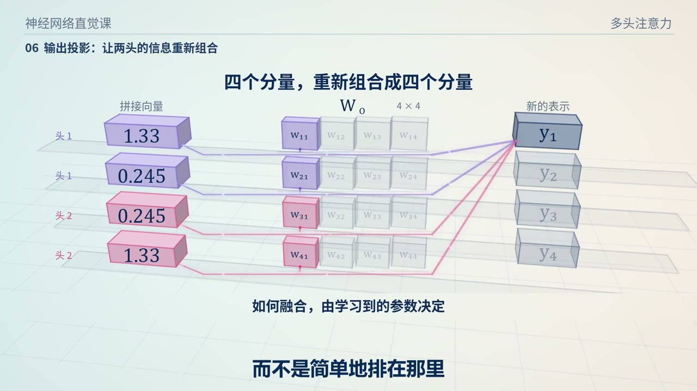

常见组织方式为：

| 阶段 | 形状，示例约定 |
| --- | --- |
| 输入 | $[B,T,d]$ |
| Q 投影 | $[B,T,Hd_k]$ |
| 拆头并转轴 | $[B,H,T,d_k]$ |
| 注意力分数 | $[B,H,T,T]$ |
| 每头输出 | $[B,H,T,d_v]$ |
| 拼接 | $[B,T,Hd_v]$ |
| 输出投影 | $[B,T,d]$ |

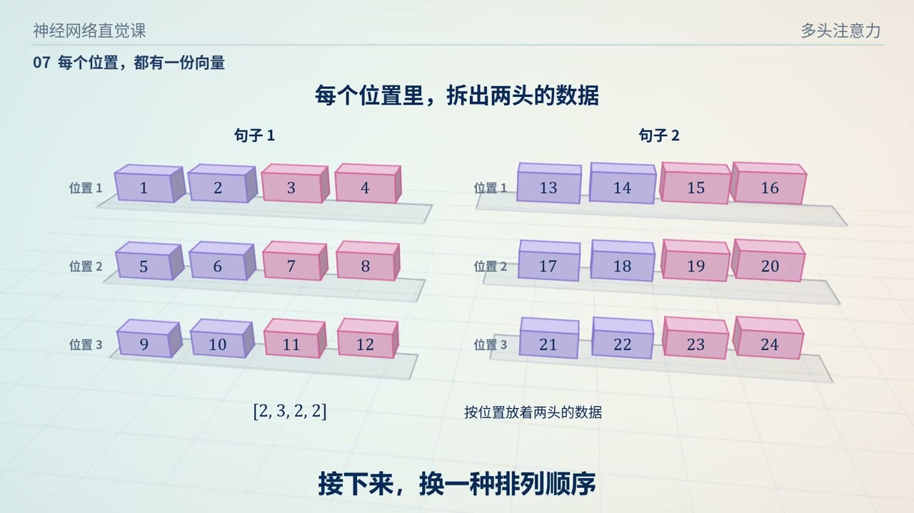

每个 batch 样本独立进行注意力，不会因为一起做矩阵运算就读取其他样本的内容。因果掩码一般可以在头轴与 batch 轴广播，Padding 等约束还需相应叠加。

## 八、更多头，是不是参数与计算就按倍数增加？

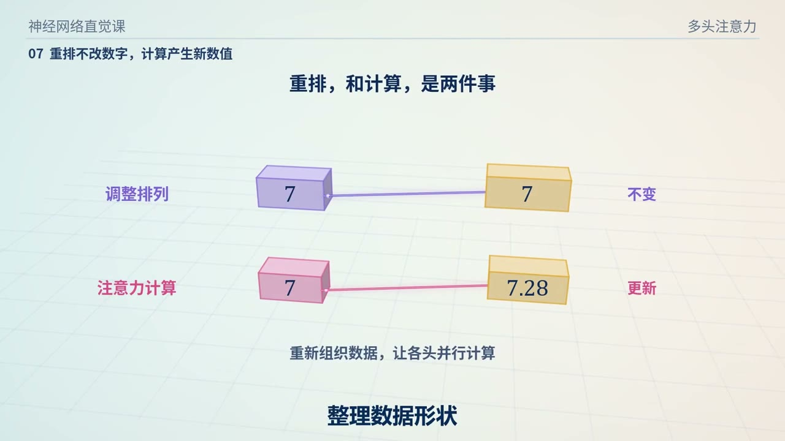

在经典 MHA 配置中，固定 $d$，取 $d_k=d_v=d/H$：Q、K、V 总投影各约 $d^2$ 参数，输出投影也约 $d^2$，忽略偏置共 $4d^2$。

例如 $d=512$：8 头每头 64 维，或 2 头每头 256 维，基础投影参数预算均为 $4\times512^2=1{,}048{,}576$。不是把完整 512 维头重复八遍。若固定每头宽度不变再增加头数，结论就会改变。

在 $Hd_k=Hd_v=d$ 的相同条件下，QK 与 AV 主项各约为 $O(BT^2d)$。但若显式物化分数矩阵，元素数是 $BHT^2$，头数影响中间存储；实际内核、并行布局和效率也会变化。高效注意力实现还可能不完整保存这张矩阵。

这些预算不能直接推广到 MQA、GQA、不同 Q / V 宽度或部分旋转等变体，要按实际形状计算。

## 九、能看见不同权重，不等于证明固定语义职责

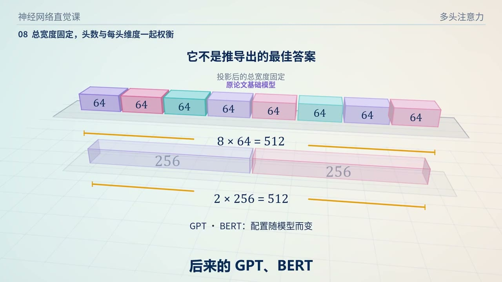

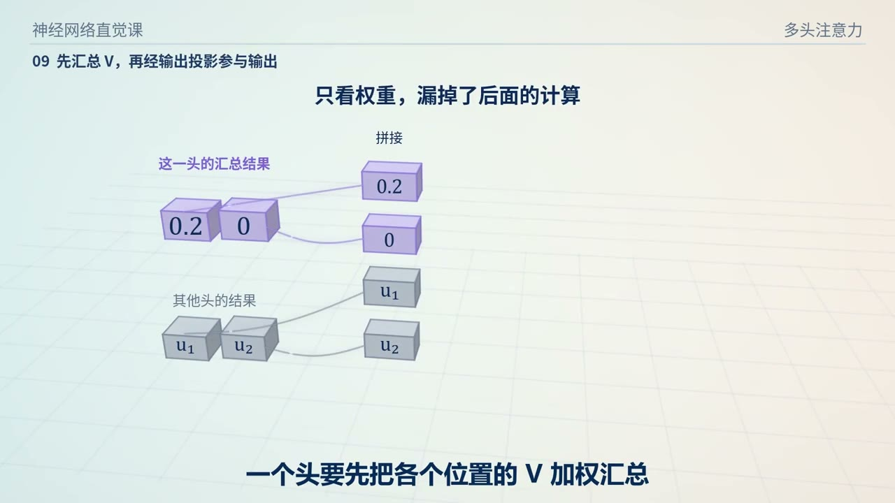

“看物品”“看地点”等标签帮助讲解，但真实头可能响应多种模式，也可能与其他头冗余。最终贡献还取决于 V、输出投影、残差与后续层，不能只看一张热力图。

研究 [Are Sixteen Heads Really Better than One?](https://arxiv.org/abs/1905.10650) 在特定模型和任务中发现不少头可被剪除而不显著损害表现，提示头数与效果不是简单线性关系。这不表示所有模型都可任意删头或多头没有价值。

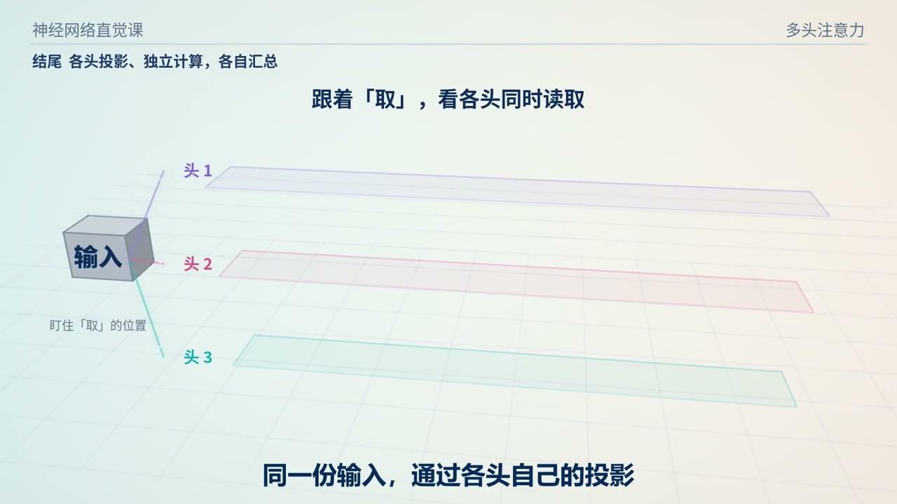

## 十、复算代码、论文与截图

[mha_math.py](mha_math.py) 使用标准库核对两头输出、拼接融合、分块输出等价、大投影拆头等价及参数预算，不进行真实模型质量或速度评测。

```bash
python3 mha_math.py
```

| 首次公开 | 作者与原始资料 | 对应问题 |
| --- | --- | --- |
| 2017-06-12 | Ashish Vaswani、Noam Shazeer、Niki Parmar、Jakob Uszkoreit、Llion Jones、Aidan N. Gomez、Łukasz Kaiser、Illia Polosukhin，[Attention Is All You Need](https://arxiv.org/abs/1706.03762) | 多头公式、投影形状与输出融合 |
| 2019-05-25 | Paul Michel、Omer Levy、Graham Neubig，[Are Sixteen Heads Really Better than One?](https://arxiv.org/abs/1905.10650) | 注意力头冗余及剪枝实证，结论限于研究条件 |

22 张截图覆盖 00:00—10:30，每 30 秒一帧，版权归原作者或相应权利人所有。图注及文件名标注时间；语义标签与数值演示不作为真实模型抽取结果，输出矩阵例子由本文补充。
