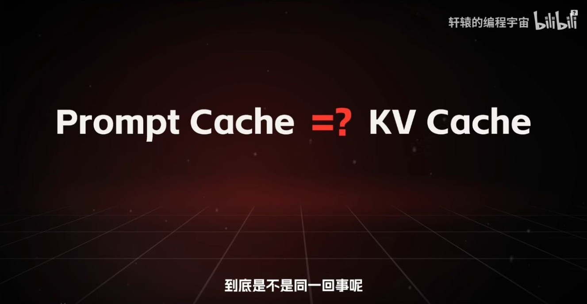
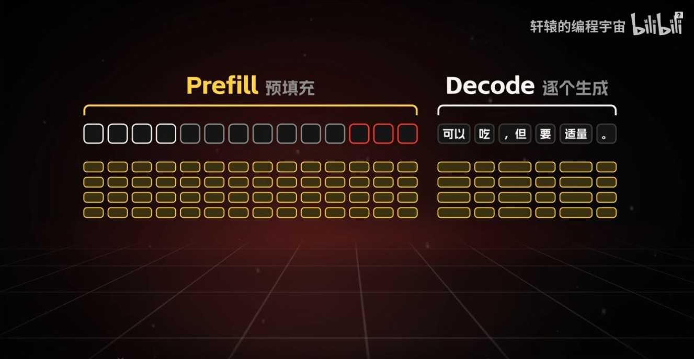
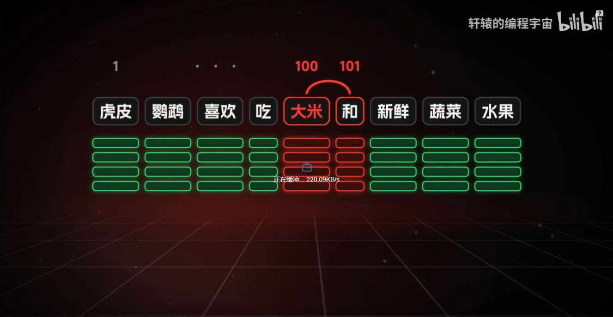
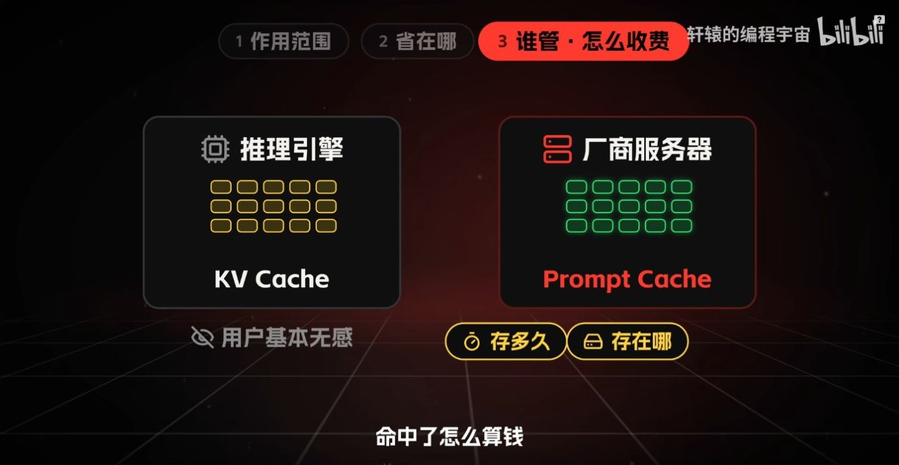
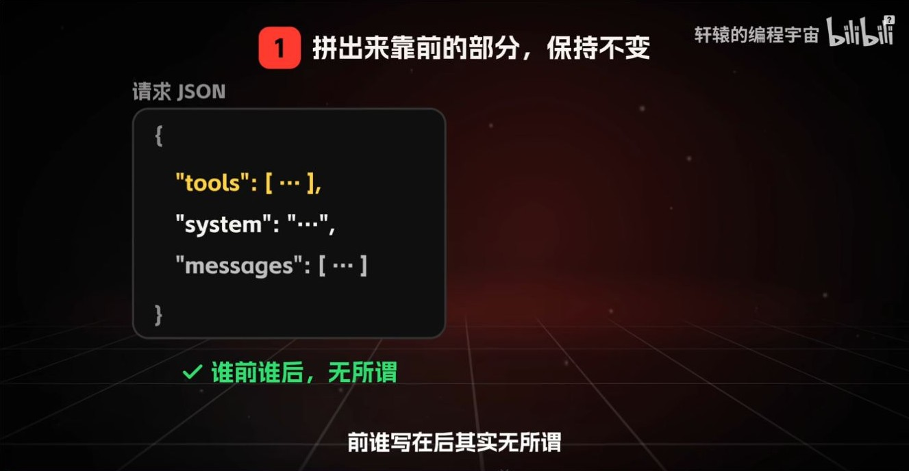
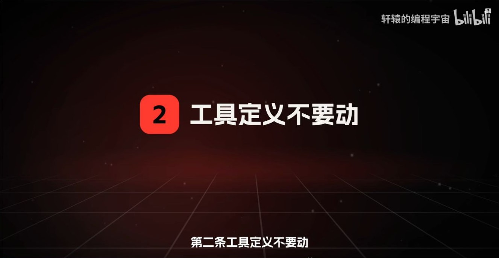
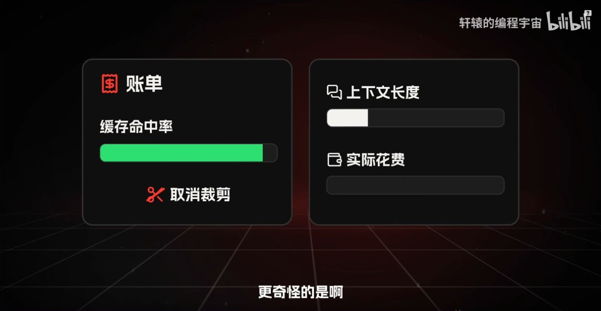
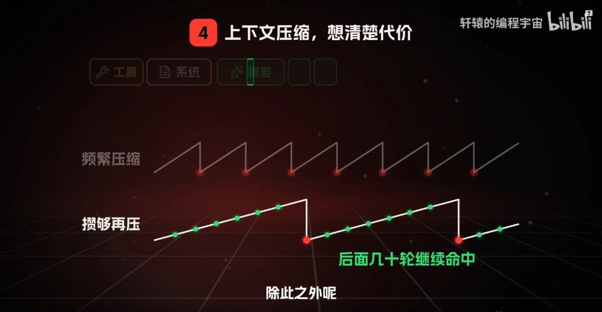
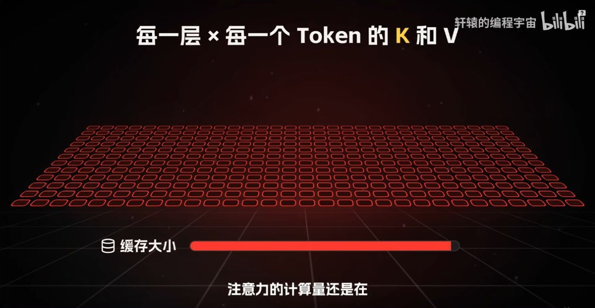

# KV Cache 番外：Prompt Cache 与跨请求前缀复用

轩辕的编程宇宙，2026 年 10 月 8 日发布，时长 09:44。建议在 [KV Cache 基础](03-KVCache基础_从因果不变性到Prefill与Decode.md) 后读。截图和时间戳均来自原视频。 [B 站原视频](https://www.bilibili.com/video/BV1CjH962EVb/)

## 00:55–02:10｜能不能把这次的 KV 留到下一次？

**KV Cache** 是推理过程中保存的历史 K/V。一次请求内，Prefill 构建提示词的逐层缓存，Decode 追加新位置的 K/V。**Prompt Cache** 在这期视频里指服务端跨请求复用前缀 KV 的能力，常称为 prefix caching。第二次请求如果有已缓存的相同前缀，就能从该前缀的缓存继续处理后面的输入。 [vLLM 自动前缀缓存](https://docs.vllm.ai/en/latest/features/automatic_prefix_caching/)

## 02:50｜命中取决于共同前缀

假设两次输入在第 100 个 token 首次分叉，前 99 个位置的上下文相同。第 100 个位置起，即使后面出现相同文本，计算它们的因果历史也已经不同。实际引擎可能按完整 token 块复用。例如每块 16 个 token 时，前 99 个相同 token 最多提供 6 个完整块，也就是 96 个可命中位置。模型、输入模板及其他影响缓存内容或隔离策略的条件也要匹配。 [vLLM 前缀缓存设计](https://docs.vllm.ai/en/stable/design/prefix_caching/)

## 04:10｜一次请求内的状态与跨请求的服务策略

| 关注点 | 请求内 KV Cache | 跨请求 Prompt Cache |
| --- | --- | --- |
| 复用时机 | 同一次生成中的后续解码步 | 之后发来的请求命中共享前缀 |
| 省掉的工作 | 重算历史位置的 K/V 和前向状态 | 重复执行已命中前缀的 Prefill |
| 工程条件 | 活跃序列需要可用的缓存状态 | 前缀匹配、缓存块仍可用且符合隔离规则 |

视频用「推理引擎」和「厂商服务器」帮助区分使用场景。引擎也能直接实现跨请求前缀复用，例如 vLLM 的 KV Cache 管理器会查询共享缓存块。缓存保留多久、命中如何计费，要以实际部署或 API 的规则为准。 [vLLM 前缀缓存设计](https://docs.vllm.ai/en/stable/design/prefix_caching/)

## 05:25–06:05｜稳定实际送进模型的前缀

模型看到的是服务端套用聊天模板后生成的 token 序列。把固定系统指令、稳定的工具定义和可复用资料放在可控的前缀里，把时间戳、本轮输入等变量放后面。JSON 外层字段怎样排序，是否影响命中，要看序列化和模板怎样处理它们。

工具集合、定义或排列若改变了较早位置的输入 token，就可能提前打断前缀匹配。持续对话里，向末尾追加消息通常更容易保留已有前缀。删除、改写中间消息或重新生成摘要时，要考虑首次分叉的位置。

## 07:29–08:09｜命中率、账单和上下文长度要一起看

命中只省重复的前缀预填充。命中的 token 仍占据请求上下文，后续新位置仍可能读取它们。即使服务对命中输入打折，也要同时看输入总量、命中量、未命中量和输出量。举例，若普通输入每 token 计 1 单位、命中输入计 0.1 单位，20,000 个输入 token 即便全部命中仍计 2,000 单位，高于 1,000 个 token 全部未命中的 1,000 单位。这只是说明账单口径的假设费率。 [vLLM 自动前缀缓存的收益范围](https://docs.vllm.ai/en/latest/features/automatic_prefix_caching/)

压缩上下文会缩短后续请求，也可能使被改写位置之后的缓存无法命中。若相邻请求共享大量历史，可以保留稳定前缀，把需要变动的信息放到后部，在接近窗口预算或历史干扰任务时再压缩。衡量效果可同时记录命中 token 数、首次响应延迟和单轮成本。

## 09:24｜命中之后，模型仍要读取上下文

Prompt Cache 优化的是**跨请求重复 Prefill**。它和 MQA、GQA、MLA、DSA、CSA 可以组合使用，后者改变的是每个位置如何存储、每次查询读取多少内容。 [百万上下文的注意力成本](../06-Attention技术演进/06-视频补充_百万上下文与注意力演进.md)
