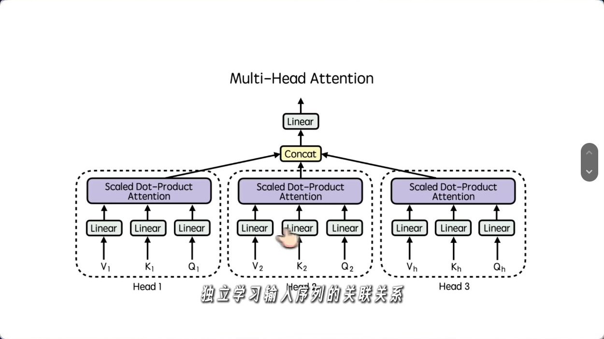
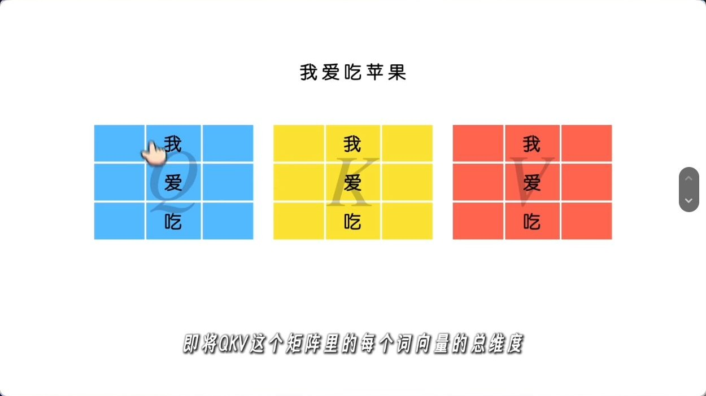
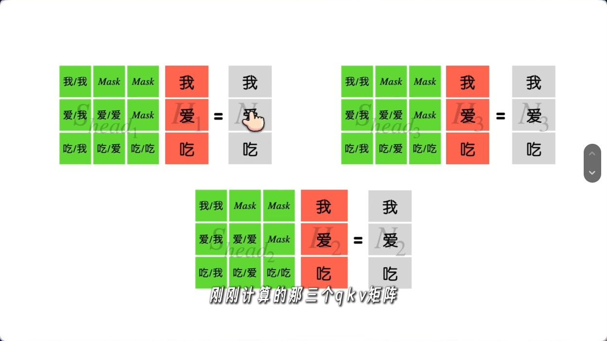
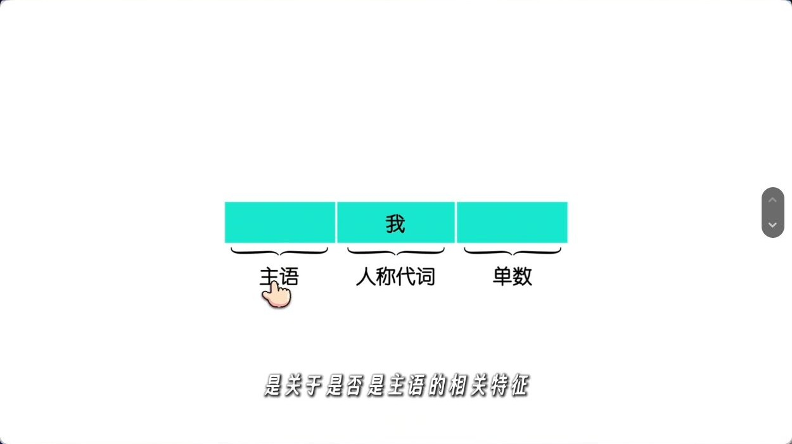
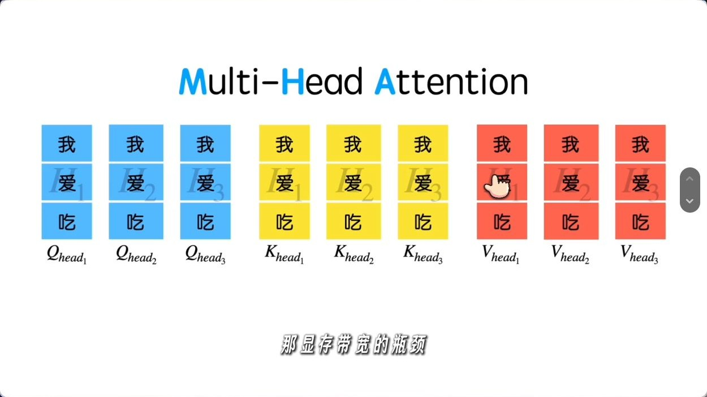
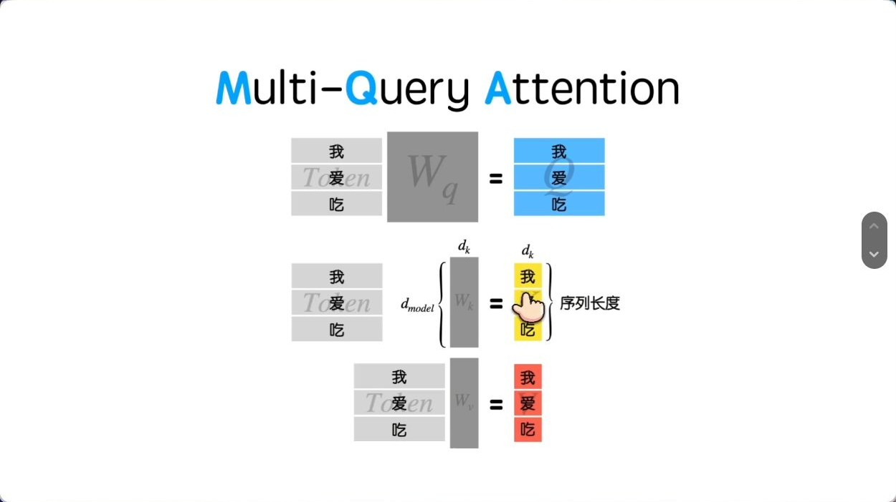
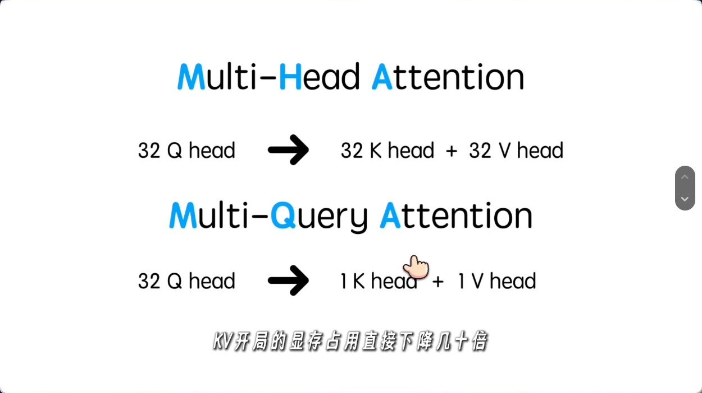
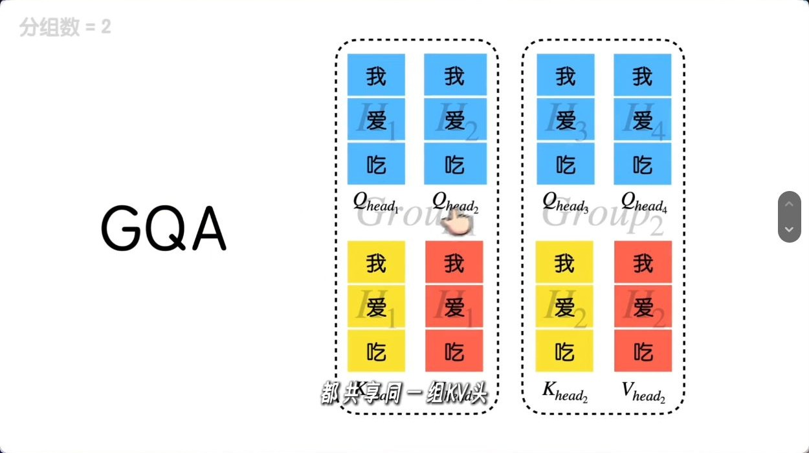

# MHA、MQA 与 GQA：从多头计算到 KV 共享

视频来自算法魔法师，2026 年 3 月 18 日发布，时长 8 分 17 秒。本文沿用视频的讲解顺序，并补充张量形状、KV Cache 的计算和原始论文。配图截自播放器画面，时间标记精确到秒。 [抖音原视频](https://www.douyin.com/video/7618534128576662835)

| 视频时间 | 主题 |
| --- | --- |
| 00:03 | 引言 |
| 00:24 | MHA 与各头的计算 |
| 03:13 | MQA 与推理时的显存带宽 |
| 06:26 | GQA 与组内共享 |
| 07:37 | 总结 |

## 一、MHA：每个查询头有自己的一对 K/V 头

对一层输入 $X\in\mathbb{R}^{T\times d_{\text{model}}}$，第 $i$ 个头从同一份输入分别投影出 $Q_i=XW_i^Q$、$K_i=XW_i^K$ 和 $V_i=XW_i^V$。$T$ 是序列长度，$d_h$ 是每个头的维度。假设 Q、K 和 V 的头维度相同，三个投影结果的形状都是 $T\times d_h$。

**图 1（00:40）** 每个头独立计算注意力。各头的结果沿特征维拼接，再通过输出投影 $W^O$ 混合。 [Transformer 论文 §3.2](https://arxiv.org/abs/1706.03762)

在实现里，通常先用一个大矩阵完成同类型的投影，再把输出特征轴重排为多个头。以 Q 为例，$XW^Q$ 的形状从 $[T,H_qd_h]$ 重排成 $[T,H_q,d_h]$。这里分头的是**投影结果**，每个头的投影都可以利用 $X$ 的全部输入维度。

**图 2（01:16）** 画面以颜色区分 Q、K、V。矩阵的行是 token 位置，头的划分沿投影后的特征轴进行。

每个头按下面的式子计算。$Q_iK_i^\top$ 给出查询位置与键位置之间的匹配分数，softmax 沿键位置归一化，再用权重对 $V_i$ 求加权和。自回归模型用因果掩码 $M$ 屏蔽未来位置。

$$
O_i=\operatorname{softmax}\left(\frac{Q_iK_i^\top}{\sqrt{d_h}}+M\right)V_i
$$

**图 3（01:55）** 视频展示了各头自己的注意力矩阵。对于第 $t$ 个查询位置，只允许读取位置 $1$ 到 $t$。

**图 4（02:33）** 「主语」「人称代词」「单数」是解释多头分工的类比。模型训练时由各头的投影权重学习特征，头的功能可以重叠，也可能随上下文变化。

## 二、MQA：所有查询头共用一对 K/V 头

自回归解码时，历史 token 的 K、V 会被缓存。生成一个新 token 时，每层计算它自己的 Q、K、V，把新 K、V 追加到缓存，再让新 Q 读取可见历史中的 K、V。上下文越长，每一步读取的缓存就越大，显存带宽可能成为瓶颈。 [MQA 论文 §2–3](https://arxiv.org/abs/1911.02150)

**图 5（04:16）** MHA 为每个头存储单独的历史 K、V。Q 用于当前计算，常规 KV Cache 缓存的是 K 和 V。

MQA 保留多个查询头，把 K、V 的投影各收窄到一个头。所有查询头读取相同的 K、V，但各自的 Q 仍能产生不同的注意力权重。

**图 6（05:30）** 单个 K 头和单个 V 头覆盖整个历史序列。共享发生在**头维度**，每个历史 token 仍有自己的 K、V 向量。

**图 7（06:05）** 同样有 32 个 Q 头，MHA 缓存 32 个 K 头和 32 个 V 头，MQA 各缓存 1 个。头维度和精度相同的情况下，后者的 KV Cache 张量体积是前者的 $1/32$。

## 三、GQA：每组查询头共用一对 K/V 头

GQA 把 $H_q$ 个查询头分成 $H_{kv}$ 组，每组共享一对 K/V 头。视频用 4 个查询头、2 个组来示意。第一组的两个查询头共用第一对 K/V，第二组共用第二对 K/V。 [GQA 论文 §2](https://arxiv.org/abs/2305.13245)

**图 8（06:50）** 组内共享 K/V，各查询头仍独立产生注意力权重。令 $g=H_q/H_{kv}$，从 0 编号的查询头 $i$ 使用第 $\lfloor i/g\rfloor$ 个 K/V 头。MHA 对应 $H_{kv}=H_q$，MQA 对应 $H_{kv}=1$。

原论文报告，在其实验设置中，GQA 能达到接近 MHA 的质量和接近 MQA 的速度。实际效果取决于分组数、训练方式和推理实现。 [GQA 论文 §3](https://arxiv.org/abs/2305.13245)

## 四、算一遍 KV Cache

假设标准稠密因果注意力，所有层采用相同的 KV 头数，K 和 V 采用相同的头维度 $d_h$，且每个缓存元素占 $s$ 字节。对 $L$ 层、批大小 $B$、每条序列缓存 $T$ 个 token，有效 K/V 张量总量为

$$
\text{KV bytes}=2\times L\times B\times T\times H_{kv}\times d_h\times s
$$

取 $L=32$、$B=1$、$T=8192$、$H_q=32$、$d_h=128$，KV 使用 BF16（$s=2$）。下表只计算有效 K/V 数据，实际显存还包括模型权重、临时张量和缓存管理开销。

| 机制 | Q 头数 | KV 头数 | 每个 KV 头服务的 Q 头数 | KV Cache |
| --- | ---: | ---: | ---: | ---: |
| MHA | 32 | 32 | 1 | 4 GiB |
| GQA | 32 | 8 | 4 | 1 GiB |
| MQA | 32 | 1 | 32 | 128 MiB |

三种结构在这个例子里都有 32 个 Q 头，且每个 Q 头都对全部可见历史位置计算匹配分数。**KV 体积下降的比例可以直接由头数算出，解码加速比例要看内核能否有效复用共享的 K/V，以及推理是否受显存带宽限制。**
