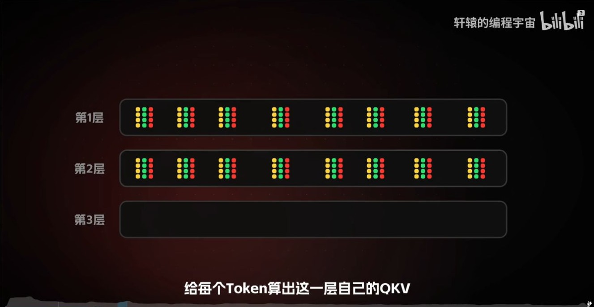
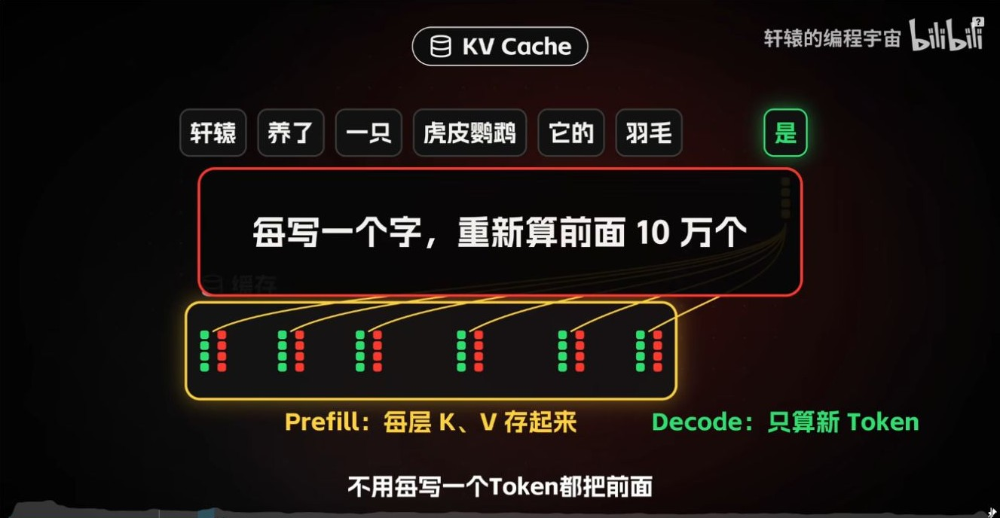
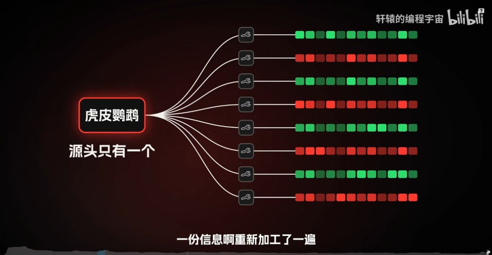
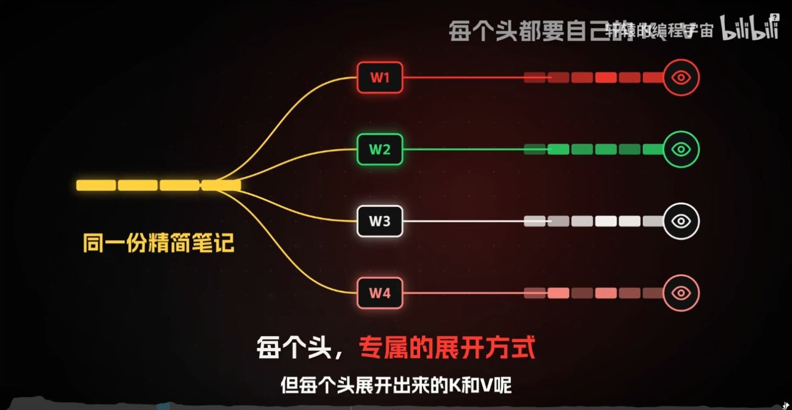
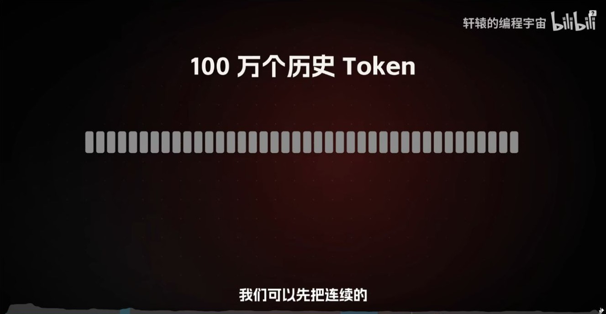
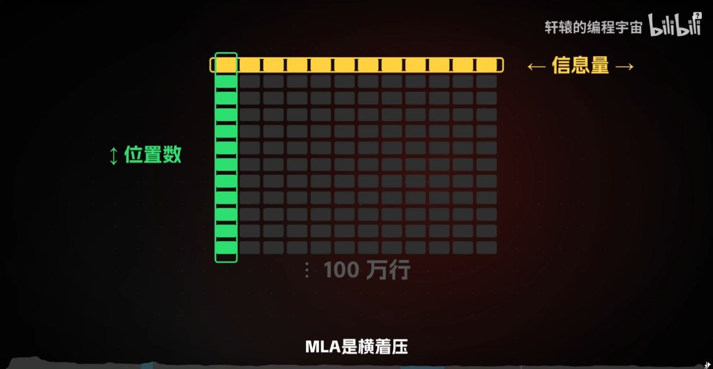
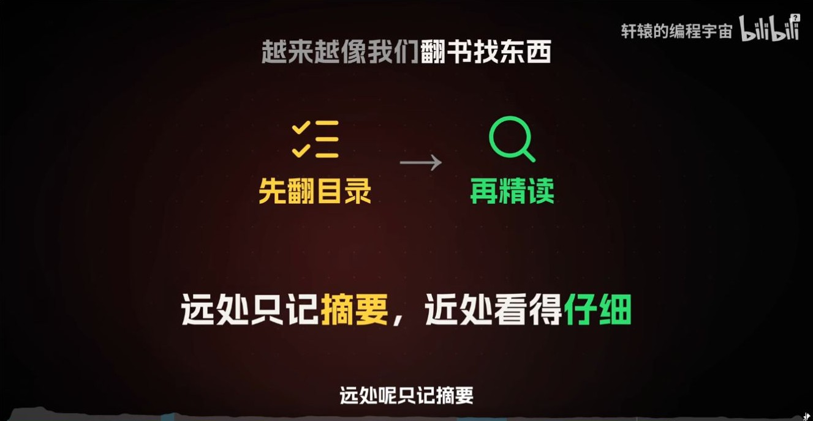
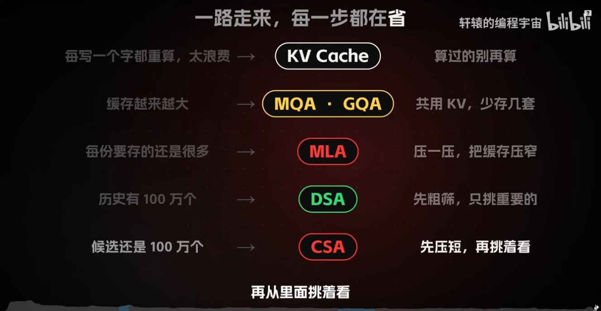

# 百万上下文的注意力成本：从 MHA、MQA、GQA 到 MLA、DSA 与 CSA

轩辕的编程宇宙，2026 年 10 月 26 日发布，时长 17:20。下文沿视频的论述顺序展开，时间戳对应原视频截图。 [B 站原视频](https://www.bilibili.com/video/BV1ukno6YEsF/)

## 02:39 起｜逐层缓存 K/V，省掉历史位置的重复计算

因果注意力让历史位置的表示只依赖它自己和更早的 token。因此追加新 token 后，之前计算的各层 K/V 可以继续使用。Prefill 批量处理提示词、建立缓存，Decode 每步为新位置计算 Q/K/V，并用新 Q 读取所需的历史缓存。

KV Cache 省掉历史位置的重复前向计算。随着序列增长，缓存仍会增大，稠密注意力在每个解码步仍要读取全部可见的 K/V。后面的机制分别处理存储容量、显存带宽和匹配计算量。 [KV Cache 基础](../03-KVCache基础/03-KVCache基础_从因果不变性到Prefill与Decode.md)

## 05:40 附近｜MHA、MQA、GQA 改变缓存的头数

MHA 为每个 Q 头配一对 K/V 头。MQA 让所有 Q 头共享一对 K/V，GQA 让一组 Q 头共享一对 K/V。三个方案仍保留各自的 Q 头，各头独立计算注意力权重。固定层数、头维度和缓存精度时，有效缓存字节数与 KV 头数成正比。 [MHA、MQA 与 GQA 专题](../04-MHA-MQA-GQA/04-MHA-MQA-GQA_从多头计算到KV共享.md)

## 07:40–08:40｜MLA 压缩每个位置的表示

MLA 为每个 token 保留一份低维的联合 KV 潜向量 $c_t^{KV}$。概念上，每个头可以用自己的投影从这份表示得到对应的 K/V。解码实现还可通过矩阵吸收，把相关线性变换移到查询侧和输出侧，避免把全部历史潜向量显式展开成逐头 K/V。DeepSeek-V2 的设计还缓存独立的 RoPE 键分量。 [DeepSeek-V2 报告 §2.1.1](https://arxiv.org/abs/2405.04434)

## 11:50｜DSA 先粗筛，再对 Top-K 历史位置计算注意力

DeepSeek-V3.2 在 MLA 上引入 DSA。Lightning Indexer 对当前查询可见的历史位置计算较便宜的相关性分数，再让主注意力读取 Top-K 对应的 KV。若有 $T$ 个可见位置、选择 $k$ 个，主注意力读取的位置数从 $T$ 变成至多 $k$。索引器自身仍要打分并做选择，未被这一次查询选中的条目还可能服务后续查询。 [DeepSeek-V3.2 报告 §2](https://modelscope.cn/models/deepseek-ai/DeepSeek-V3.2/resolve/master/assets/paper.pdf)

## 12:44–14:34｜CSA 先压缩历史位置，再对压缩条目做检索

MLA 压的是矩阵的特征维，CSA 还压序列维。用 $T$ 行表示 $T$ 个位置，压缩率为 $m$ 时，压缩池大致只需 $T/m$ 个条目。CSA 的索引器在压缩池里挑选 Top-K，近期 token 由局部滑动窗口保留更细的表示。

补充对照 DeepSeek-V4 的另一种层。HCA 沿序列使用更高压缩率，再对可见的压缩条目做稠密注意力。以 $T=1,000,000$、$m=4$ 为例，压缩池约有 250,000 个条目。若再选 512 项，则这一次主注意力的全局分支只读取至多 512 个压缩条目，另有局部窗口和索引开销。这个算例只说明各步骤改变的数量。 [DeepSeek-V4 官方模型卡](https://fe-static.deepseek.com/chat/transparency/deepseek-V4-model-card-EN.pdf)

## 15:30｜把存储量和每次读取量分开算

| 机制 | 主要变化 | 观察哪个量 |
| --- | --- | --- |
| KV Cache | 重用历史位置已有的 K/V | 每步重算多少历史位置 |
| MQA / GQA | 多个 Q 头共用 K/V 头 | 每位置缓存多少 KV 头 |
| MLA | 缓存联合潜向量 | 每位置缓存多少元素 |
| DSA | 索引器为每个查询选择历史位置 | 主注意力每次读取多少位置 |
| CSA | 把历史位置压成条目，再做稀疏选择 | 缓存条目数、索引候选数、主注意力读取数 |

上下文窗口上限描述模型和服务能处理的序列长度。窗口内的信息能否被准确找回，还要看任务、信息位置和模型实际表现。继续看同目录的 [Attention 技术演进](06-Attention_技术演进_Transformer至Qwen3.8与DeepSeekV4.1.md)，可对照 V4.1-Flash 如何进一步跨层复用 KV 与索引。
