# KV Cache、MQA、GQA 与 MLA：从显存公式到低秩吸收

> **整理日期：** 2026-11-09  
> **视频来源：** 神经元出逃计划，《爆显存元凶 KV Cache：MQA / GQA / MLA 三种省法》，2026-10-14 发布，约 12 分 51 秒。  
> **原视频：** [抖音视频](https://www.douyin.com/video/7696470231320939819)  
> **整理方式：** 沿视频顺序，结合 28 张原始截图、缓存计算、注意力公式与 MLA 推导。本文明确区分视频演示、独立教学假设与原论文结论。

自回归解码需要反复读取历史 Token 的 Key 和 Value。把它们保留下来可避免重复计算历史表示，但缓存会随历史长度、并发请求数和层数增长。MQA、GQA 通过共享 KV 头减小缓存；MLA 则学习一个紧凑的联合 KV 潜变量，并利用线性变换的结合律在紧凑空间中计算。

可先读 [Transformer 全流程](../../技术前要-深度学习基础/Transformer全流程/Transformer_从输入到自回归生成.md)，再对照 [Attention 技术演进](../Attention_技术演进_Transformer至Qwen3.8与DeepSeekV4.1.md)。

## 一、先审视视频开场：显存数字需要哪些条件？

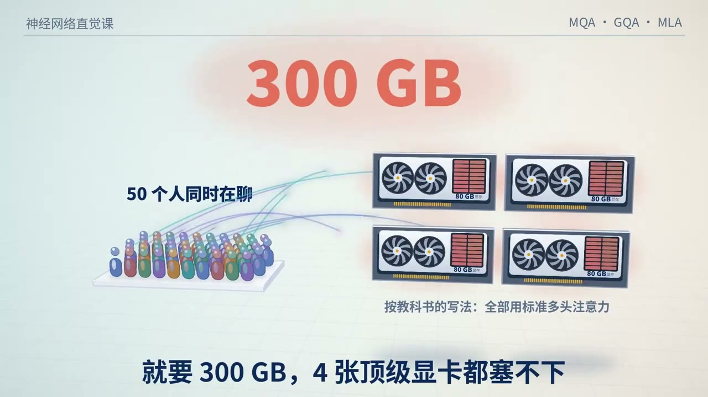

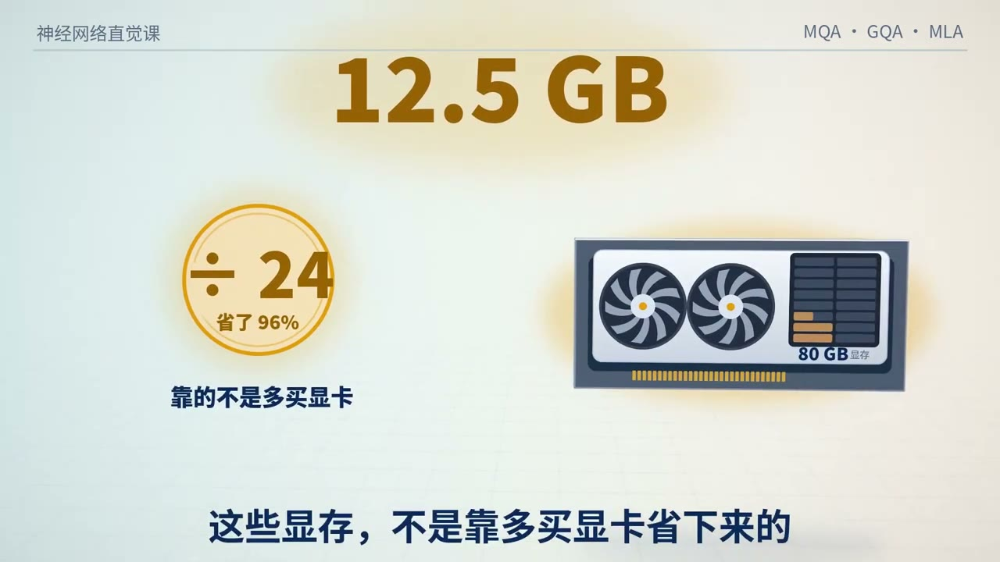

视频以约 300 GB 与 12.5 GB 的对比引入主题。这类数字应结合层数、KV 头数、头维度、缓存精度、每个请求的实际 Token 数和并发数解释。它们不能直接当作任意模型的总显存需求。

还应区分三种量：

- **模型权重：** 由参数规模、权重精度、分片和量化格式决定。
- **KV Cache：** 由缓存结构、实际保留的 Token 数和缓存精度决定。
- **运行开销：** 中间激活、工作区、图捕获、通信缓冲、分配器预留等。

视频提及具体模型名称及配置。本文将其截图保留为视频内容，不把截图作为这些版本架构的独立核验；定量例子均另行列出参数，原理部分以 MQA、GQA 和 DeepSeek-V2 原论文为依据。

## 二、为什么缓存 K、V，通常不缓存历史 Q？

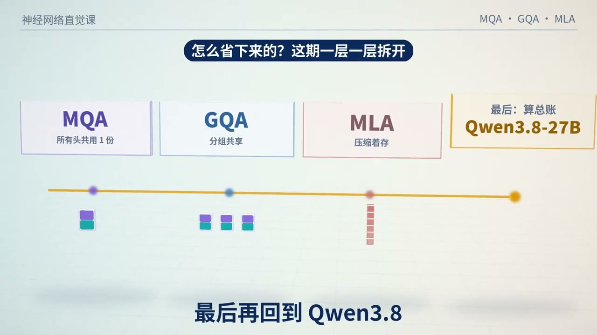

对当前层的隐藏向量 $x_t$：

$$
q_{t,h}=W_h^Qx_t,\qquad k_{t,h}=W_h^Kx_t,\qquad v_{t,h}=W_h^Vx_t.
$$

在因果自注意力中，第 $t$ 个位置对历史位置 $j\le t$ 计算：

$$
\alpha_{t,j,h}=\operatorname{softmax}_{j\le t}
\left(\frac{q_{t,h}^Tk_{j,h}}{\sqrt{d_k}}\right),
\qquad o_{t,h}=\sum_{j\le t}\alpha_{t,j,h}v_{j,h}.
$$

生成新位置时，需要当前 $q_t$ 与全部保留的历史 $k_j$、$v_j$。历史位置的 $q_j$ 通常不参与新位置的这次注意力，因此无需长期保留在标准 KV Cache 中。

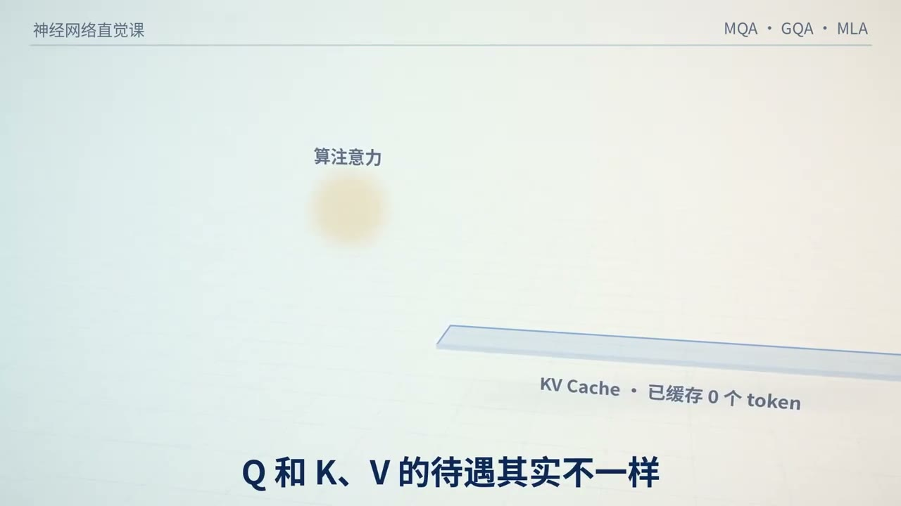

“Q 用一次”是标准增量解码的简化说法。Prefill、分块解码或推测解码可以一次处理多个 Query，但这不改变历史 KV 需要复用的核心关系。

### 2.1 Prefill 与 Decode

**Prefill** 处理输入提示词，计算各层对应位置的 KV，并写入缓存。**Decode** 为新位置计算新的 Q、K、V，将新 KV 追加到各层缓存，再读取可见历史完成注意力。

KV Cache 不意味着“后面只需计算最后一个输出层”，也不意味着注意力不再访问历史。新 Token 仍要经过相应的 Transformer 层。

## 三、缓存公式：把每一个乘数写出来

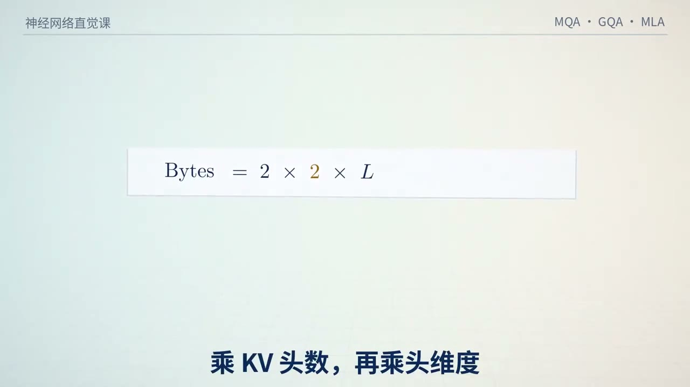

设所有层结构相同，各请求保留的长度均为 $T$：

$$
M_{\mathrm{KV}}=B T L H_{\mathrm{KV}}(d_k+d_v)s.
$$

当 $d_k=d_v=d_h$：

$$
\boxed{M_{\mathrm{KV}}=2BTLH_{\mathrm{KV}}d_hs}.
$$

| 符号 | 含义 |
| --- | --- |
| $B$ | 独立保留 KV 的请求或序列数 |
| $T$ | 每个请求实际保留的 Token 数，含提示词和已生成部分 |
| $L$ | 使用这种缓存结构的层数 |
| $H_{\mathrm{KV}}$ | 每层实际保存的 KV 头数 |
| $d_k,d_v$ | 每个 KV 头的 Key、Value 维度 |
| $s$ | 每个缓存元素的存储字节数 |

最前面的 2 来自 K、V 两份，不是 BF16 的 2 字节。视频的每 Token 公式省略 $BT$，把 BF16 的 $s=2$ 代入后，才出现 `2 × 2 × L × H_KV × d_h`。

长度不等时，用 $\sum_b T_b$ 替换 $BT$。分层结构不等时，应进一步对每层单独求和；滑动窗口、跨层共享、混合架构和前缀共享也会改变实际占用。按块分配还可能保留未填满的空间。

### 3.1 复算视频中 80 层、64 头、128 维的基线

固定 $L=80,H_Q=H_{KV}=64,d_h=128,s=2$，则每个 Token、跨全部层：

$$
m_{\mathrm{MHA}}=2\times80\times64\times128\times2
=2{,}621{,}440\ \text{bytes}=2.5\ \text{MiB}.
$$

若 50 个请求各保留 2500 Token，总计 125000 Token：

$$
M=327{,}680{,}000{,}000\ \text{bytes}
=327.68\ \text{GB}\approx305.18\ \text{GiB}.
$$

这是本文给定条件的独立复算，用于说明“几百 GB”如何出现，不表示已经从开场画面确认其全部实验配置。

**单位约定：** GB、MB、KB 分别按 $10^9$、$10^6$、$10^3$ 字节计算；GiB、MiB、KiB 按 $2^{30}$、$2^{20}$、$2^{10}$。视频部分画面用 MB / KB 标注近似二进制数值，本文计算统一写明单位。

## 四、MHA：每个 Query 头配一套 KV

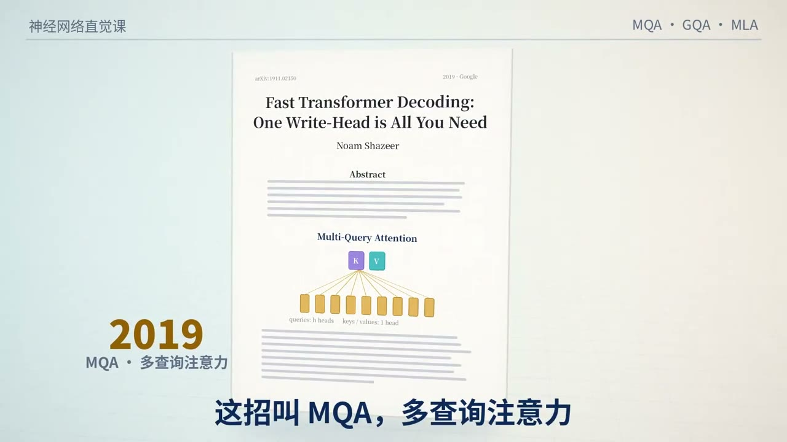

MHA 中 $H_{KV}=H_Q$。不同头通过各自的 Q、K、V 投影计算注意力，再拼接并输出投影。64 个 Query 头，通常对应 64 套 K、V 表示。

不能因为多头 Q 也占内存，就认为 Q 与 KV 的增长方式相同。标准逐 Token Decode 中，当前 Q 的长度是 1，历史 KV 的长度是 $T$，长期缓存主要由后者随上下文累积。

## 五、MQA：保留多个 Q，所有头共享一套 KV

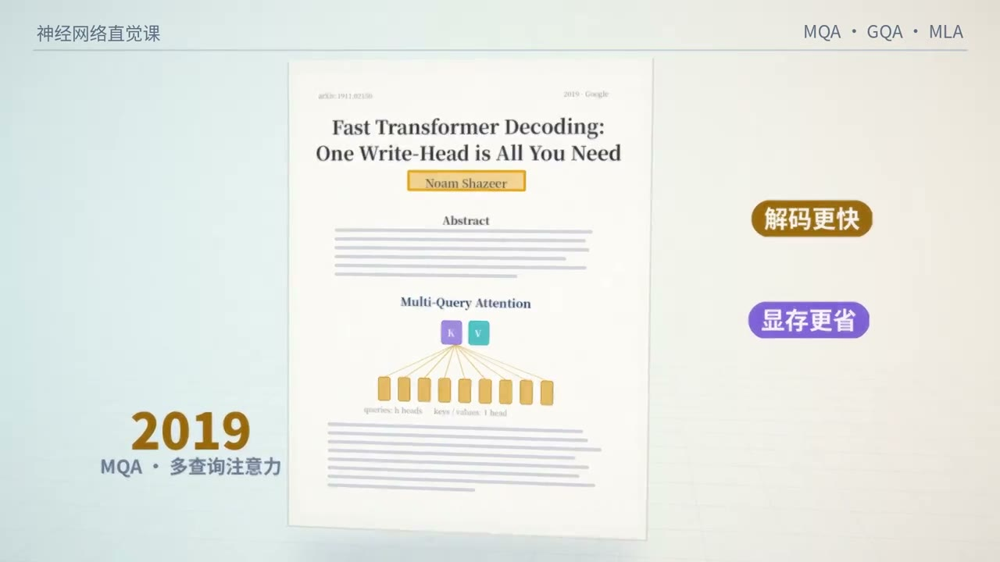

MQA 取 $H_{KV}=1$：

$$
k_j=W^Kx_j,\quad v_j=W^Vx_j,\qquad
 o_{t,h}=\sum_j\operatorname{softmax}_j
 \left(\frac{q_{t,h}^Tk_j}{\sqrt{d_k}}\right)v_j.
$$

不同头仍有不同的 $q_{t,h}$，所以仍能形成不同注意力分布。共享 K、V 不意味着所有头的输出必然相同。

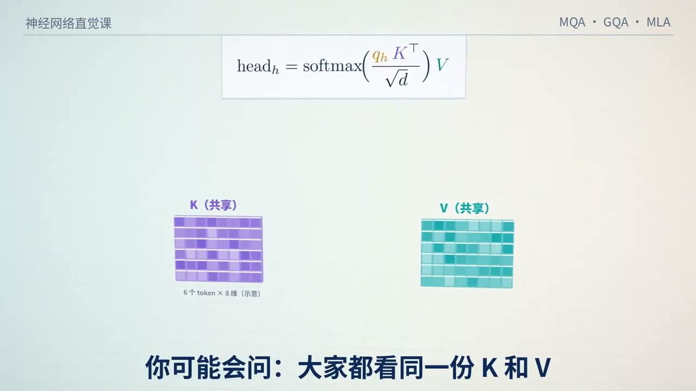

沿第三节基线，把 KV 头数从 64 改成 1，每 Token 缓存变为：

$$
m_{\mathrm{MQA}}=40{,}960\ \text{bytes}=40\ \text{KiB},
\qquad \frac{m_{\mathrm{MQA}}}{m_{\mathrm{MHA}}}=\frac1{64}.
$$

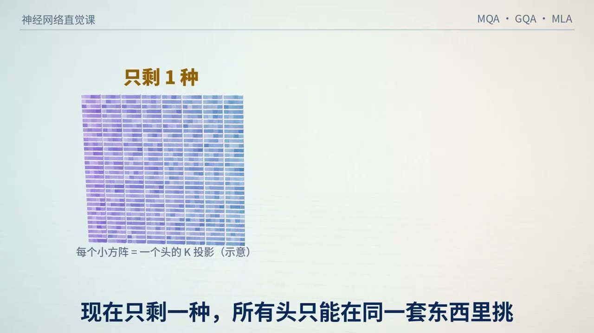

MQA 减少 KV 投影和缓存，但共享约束会改变可表达的函数族。质量与训练方法、模型规模、任务相关，不能把“下降多少”写成固定常数。也不能对任意现有 MHA 检查点直接删头而假设能力保持不变。

## 六、GQA：多个 Query 头组成一组，共享组内 KV

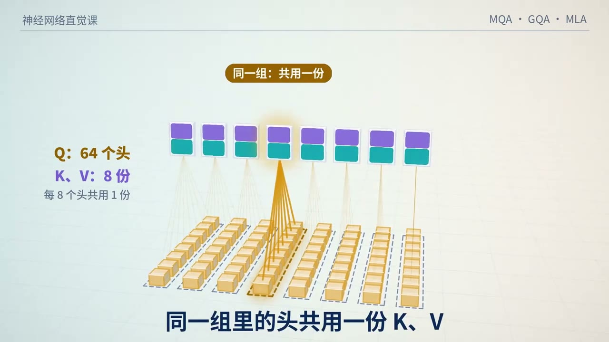

设 $H_Q=64,H_{KV}=8$，每组 8 个 Query 头共享一套 KV。采用连续分组时，零起始头号 $h$ 的组号可写为：

$$
g(h)=\left\lfloor\frac{h}{H_Q/H_{KV}}\right\rfloor,
\qquad
 o_{t,h}=\sum_j\operatorname{softmax}_j
 \left(\frac{q_{t,h}^Tk_{j,g(h)}}{\sqrt{d_k}}\right)v_{j,g(h)}.
$$

当 $H_{KV}=H_Q$，回到 MHA；当 $H_{KV}=1$，回到 MQA。实际实现的分组与分片布局需看模型和内核。

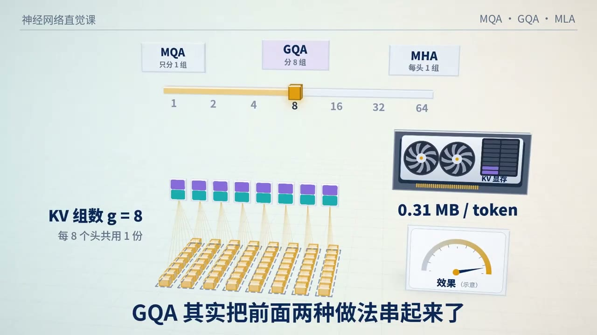

注意术语：本篇用“8 组”表示 8 个 KV 头，不是每组 8 个 KV 头。

### 6.1 与基线对比

| 方法 | Query 头数 | KV 头数 | 每 Token、全部 80 层的缓存 | 相对 MHA |
| --- | --- | --- | --- | --- |
| MHA | 64 | 64 | 2.5 MiB | 1 |
| GQA | 64 | 8 | 320 KiB = 0.3125 MiB | 1/8 |
| MQA | 64 | 1 | 40 KiB | 1/64 |

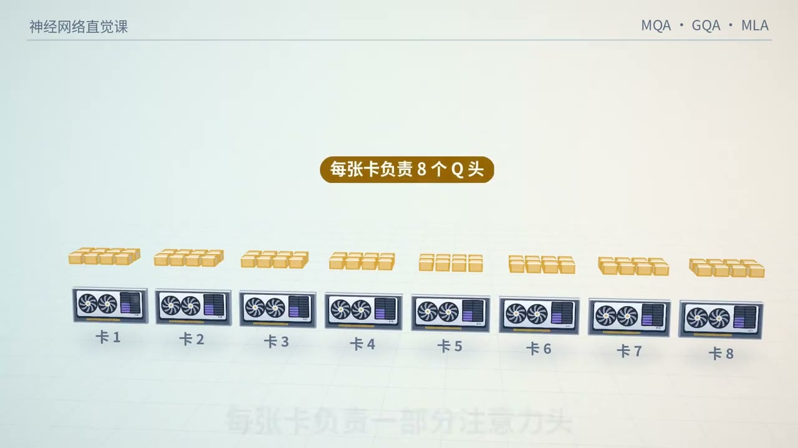

表格固定层数、头维度与精度，只比较结构变化。真实模型之间不一定能这样直接比较，尤其不能忽略不同的层数和头维度。

## 七、共享后还算 64 个头吗？

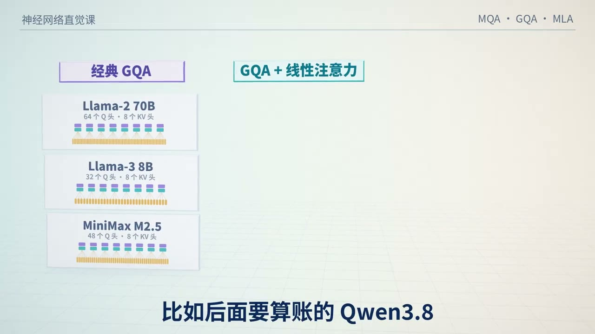

仍然有 64 个 Query 头，各自要形成注意力分布。GQA 没有把 Query 头数也变成 8。

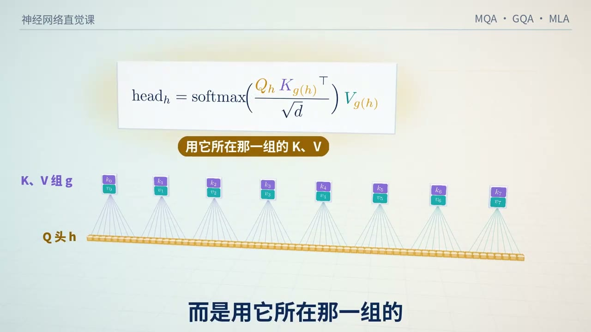

有些教学实现为了形状方便，用 `repeat_kv` 将 KV 扩展到与 Query 头数一致。它可能只是视图或逻辑广播，也可能被后续算子物化。**是否真的复制和占用额外显存，要看具体算子与内核。** 高效内核可直接复用组内 KV，不必把持久缓存写回成 64 份。

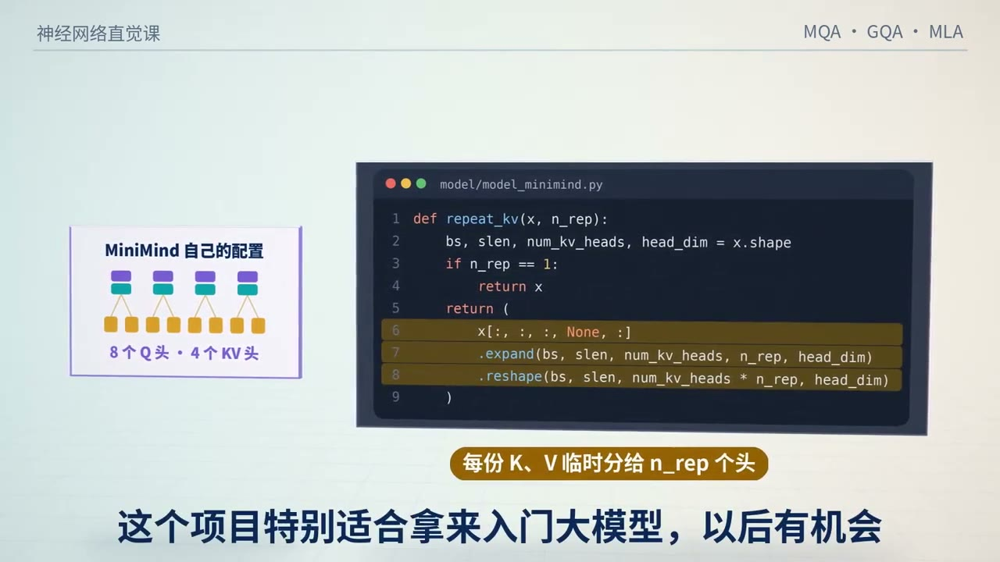

在相同 $H_Q,d_h,T$ 下，GQA 的 QK 分数和 AV 聚合主项仍随 $H_Q$ 而变，不能按 $H_{KV}/H_Q$ 比例声称全部注意力计算减少。KV 投影量、读取量和缓存容量可以下降；访存受限的 Decode 因此可能更快。性能收益依赖内核是否利用共享以及实际瓶颈。

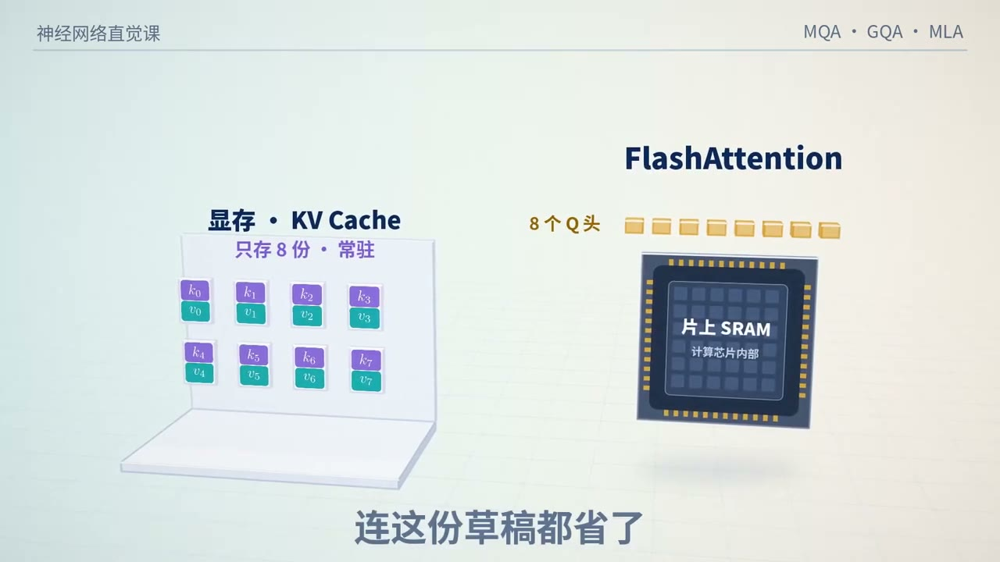

该画面是作者介绍实现项目的片段，本文未运行或评测该项目，不据此给出性能结论。

## 八、实际配置中的层数、头维度和精度

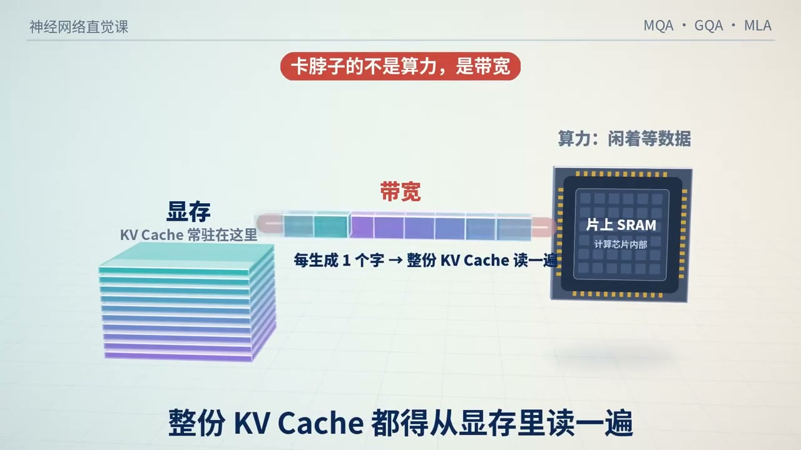

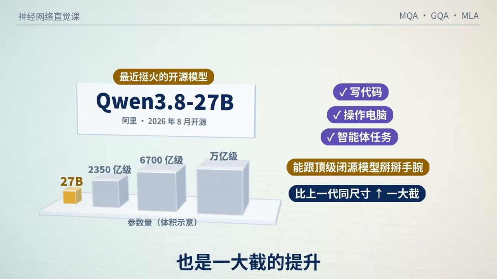

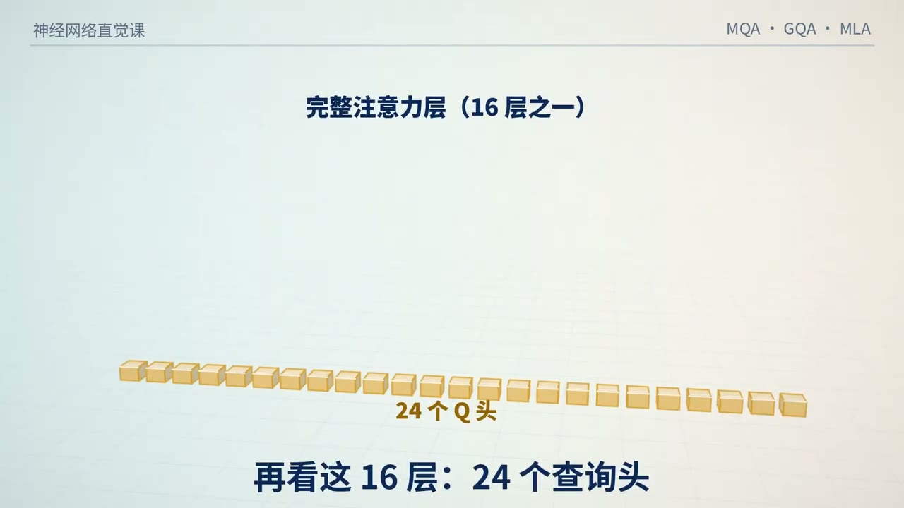

独立取 $L=64,H_{KV}=4,d_h=256,s=2$，可复算：

$$
m=2\times64\times4\times256\times2
=262{,}144\ \text{bytes}=256\ \text{KiB}.
$$

取另一组教学参数 $L=16,H_{KV}=4,d_h=256,s=2$，则为 $65{,}536$ 字节，即 64 KiB。两者仅层数不同，结果相差四倍。看到视频中某一步出现“16 层”或“64 KB”，应对照其演示对象，不能把中间教学配置自动认定为开场模型完整参数。

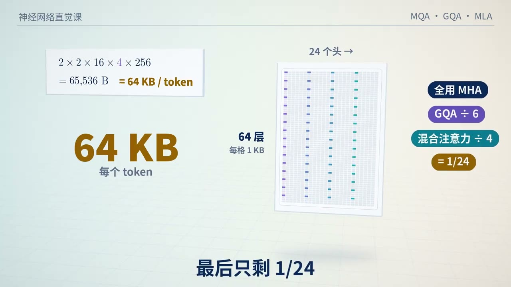

从每元素 2 字节改成 1 字节，在理想裸数据计算中减半。量化还可能需要 scale、元数据、对齐及转换开销，且权重量化和 KV 量化是不同设置。权重采用低精度，不代表 KV Cache 自动采用同样精度。

## 九、MLA：不是只剩一个普通 KV 头，而是缓存联合潜变量

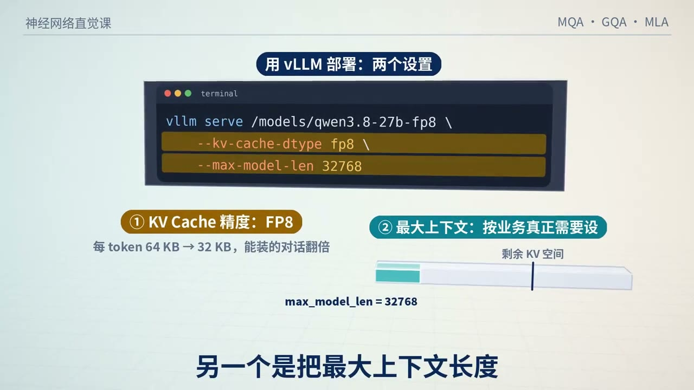

下面使用列向量，先忽略位置编码，解释 MLA 的内容分支。令输入 $x_j\in\mathbb R^d$，联合潜变量：

$$
c_j=W^{DKV}x_j\in\mathbb R^{d_c}.
$$

对第 $h$ 个头，Key、Value 可写为：

$$
k_{j,h}^{C}=U_h^Kc_j,\qquad v_{j,h}=U_h^Vc_j.
$$

这里 $U_h^K\in\mathbb R^{d_k\times d_c}$，$U_h^V\in\mathbb R^{d_v\times d_c}$，不同头可以使用不同的上投影。与直接保存所有头的完整 K、V 相比，可以只保存每个位置的 $c_j$，外加下面介绍的位置分支。

这不是把已训练的任意 K、V 做无损压缩，也不是部署时随手应用 PCA。低秩结构参与模型设计和训练，表示能力与紧凑程度之间存在取舍。

## 十、矩阵吸收：不展开全部历史 KV，怎样计算？

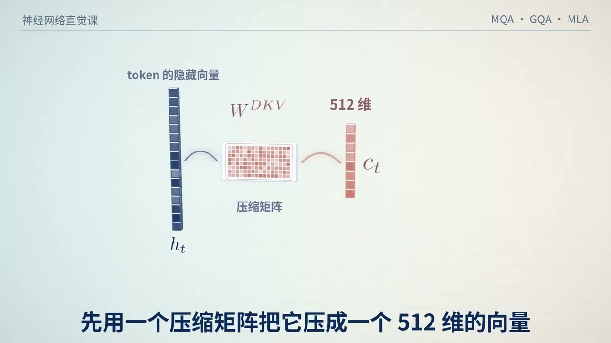

### 10.1 Key 投影吸收到当前 Query

忽略 RoPE 时，内容分数为：

$$
q_{t,h}^Tk_{j,h}^{C}
=q_{t,h}^TU_h^Kc_j
=\underbrace{((U_h^K)^Tq_{t,h})^T}_{\text{变换后的当前 Query}}c_j.
$$

令 $\widetilde q_{t,h}=(U_h^K)^Tq_{t,h}\in\mathbb R^{d_c}$，就能让当前 Query 直接与历史潜变量做点积。无需为每个历史位置持久展开完整的每头 Key。

### 10.2 Value 先在潜空间聚合，再做上投影

$$
o_{t,h}=\sum_j\alpha_{t,j,h}U_h^Vc_j
=U_h^V\left(\sum_j\alpha_{t,j,h}c_j\right).
$$

线性变换与加权求和可交换顺序。若输出投影按头分块为 $W_h^O$，还可写为：

$$
y_t=\sum_hW_h^OU_h^V\left(\sum_j\alpha_{t,j,h}c_j\right).
$$

可把 $W_h^OU_h^V$ 合并处理。这些等式对已定义的低秩模型成立，不表示它与一个任意全秩 MHA 模型函数相同。

### 10.3 两个历史位置的手算

取 $c_1=[1,2]^T,c_2=[3,0]^T$，$U^K=[2,1]$，$q=2$。完整 Key 为 $k_1=4,k_2=6$，点积分数是 $[8,12]$。

吸收后 $\widetilde q=(U^K)^Tq=[4,2]^T$，与潜变量点积同样得到 $[8,12]$，使用相同缩放与 softmax 时，权重相同。

为隔离 Value 聚合，另给定权重 $[0.25,0.75]$，取 $U^V=[1,-1]$：先展开 Value 得到 $[-1,3]$，加权输出 $-0.25+2.25=2$。先聚合潜变量得到 $[2.5,0.5]^T$，再投影也得到 $2.5-0.5=2$。这里给定的权重不声称是前面 $[8,12]$ 的 softmax。

## 十一、RoPE 为什么让直接吸收变复杂？

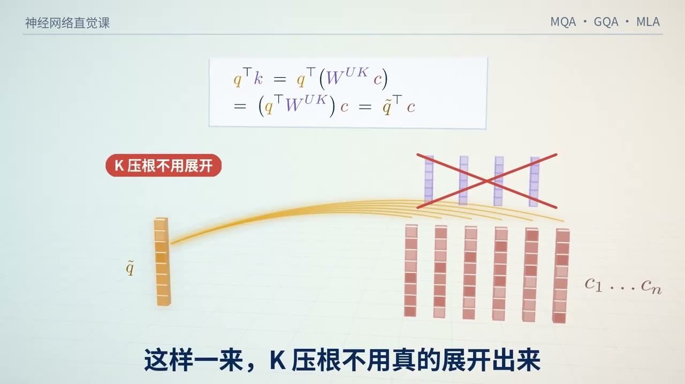

若在内容 Key 上直接加入位置旋转 $R_j$，分数含有：

$$
q_t^TR_t^TR_jU^Kc_j.
$$

$R_t^TR_j$ 依赖位置对 $(t,j)$，无法一般性地把整个历史侧变换作为与 $j$ 无关的固定矩阵预先吸收到当前 Query。矩阵相乘顺序也不能任意交换。

DeepSeek-V2 的 MLA 使用解耦的位置分支：

$$
k_j^R=\operatorname{RoPE}_j(W^{KR}x_j),
\qquad q_{t,h}^R=\operatorname{RoPE}_t(\text{当前 Query 的位置投影}).
$$

其分数分为内容点积与位置点积：

$$
s_{t,j,h}=
\frac{(\widetilde q_{t,h}^{C})^Tc_j+(q_{t,h}^{R})^Tk_j^R}
{\sqrt{d_k^{C}+d_R}}.
$$

因此紧凑缓存保留 $c_j$ 和共享的 $k_j^R$，而不是只缓存 $c_j$。更多位置编码背景见 [RoPE 专题](../../技术拆解-位置编码优化/RoPE_原理与Qwen_DeepSeek架构解读.md)。

## 十二、MLA 的缓存公式与论文数字

若每层潜变量宽度为 $d_c$，共享位置 Key 宽度为 $d_R$，二者精度相同：

$$
\boxed{M_{\mathrm{MLA}}=BTL(d_c+d_R)s}.
$$

这里没有机械地乘 2，因为联合潜变量同时服务 K 和 V；位置 Key 另算。若两部分精度不同，分别按各自字节数计算。

取 DeepSeek-V2 [官方配置](https://huggingface.co/deepseek-ai/DeepSeek-V2/blob/main/config.json)中的 $d_c=512,d_R=64$，每 Token、每层的缓存为 $576$ 个元素；取 $s=2$，为 1152 字节。作为同维教学对照，若 MHA 为 128 头、K/V 每头各 128 维，则：

$$
\frac{576}{2\times128\times128}=0.017578125\approx1.76\%.
$$

这个比例只对应本段指定结构的裸缓存元素数，不是所有 DeepSeek 模型之间的实测比值。

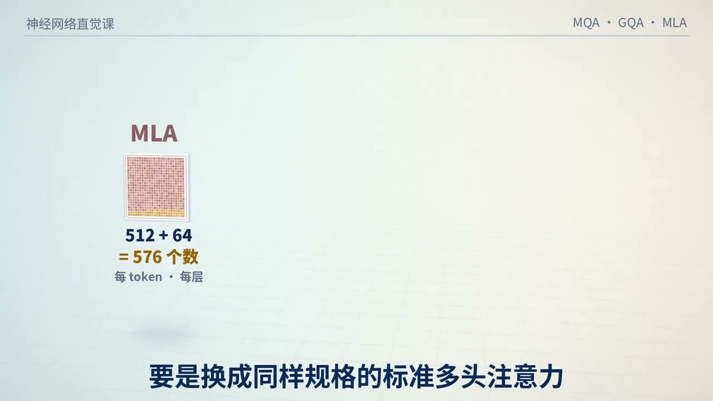

DeepSeek-V2 报告其相对 DeepSeek 67B 的 KV Cache 减少 93.3%。这是论文中特定模型对比，不能把它替换为上面的同头数教学比例，也不能解释为整机总显存降低 93.3%。具体实验背景见 [DeepSeek-V2 原论文](https://arxiv.org/abs/2405.04434)。

## 十三、把四种结构放在同一张表里

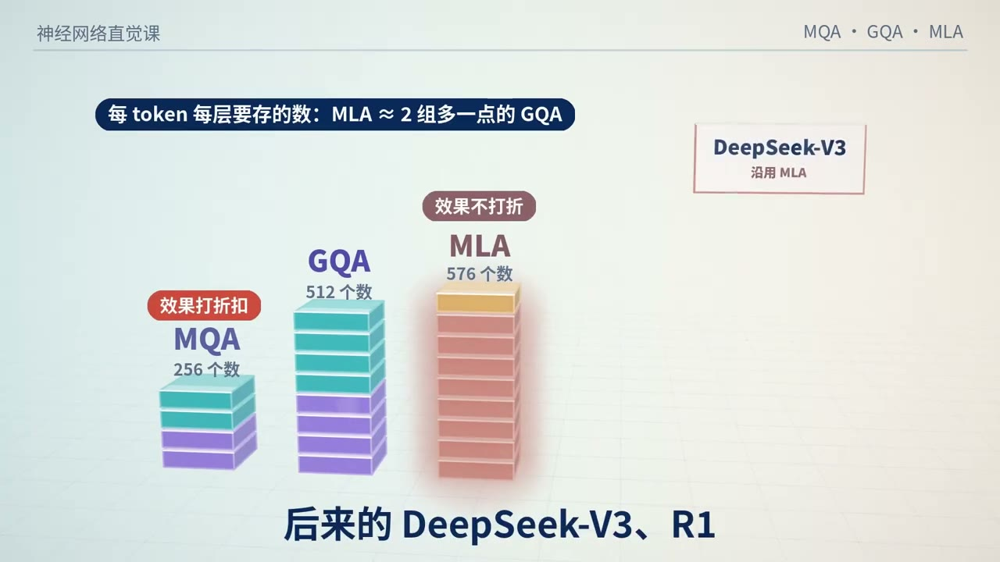

| 方法 | 保存什么 | Query 头数是否必然减少 | 关键代价与限制 |
| --- | --- | --- | --- |
| MHA | 每个头的历史 K、V | 否 | 缓存随头数增长 |
| MQA | 一套共享 K、V | 否 | KV 共享更强，质量取决于训练与任务 |
| GQA | 多组共享 K、V | 否 | 在共享程度与多样性之间折中 |
| MLA | 联合 KV 潜变量及位置分支 | 否 | 需要低秩结构、位置解耦与相应内核支持 |

这些方法都不能自动消除“全历史注意力需要访问历史”这一事实。对于固定宽度，标准逐 Token Decode 的历史扫描仍随 $T$ 增长。MLA 的潜空间维度也可能大于单个普通头维度，所以缓存更小不等于所有算术运算都更少。

## 十四、从缓存字节到实际部署

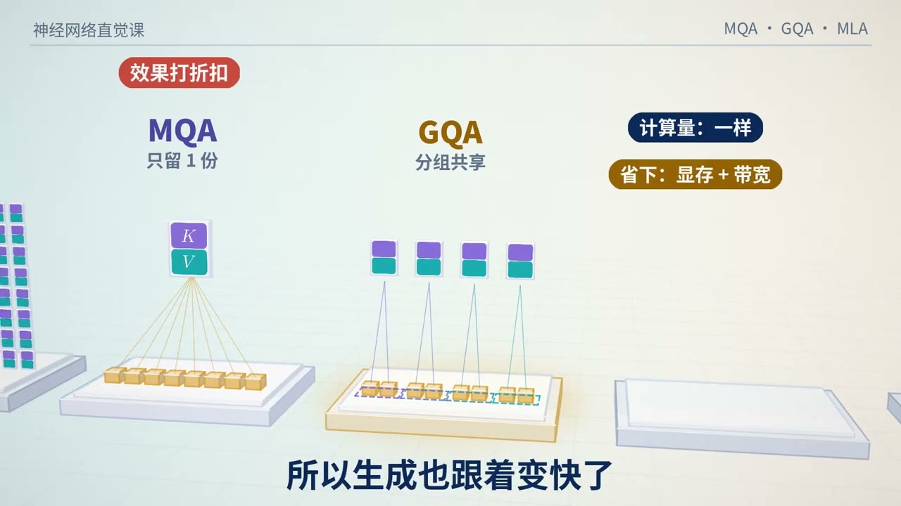

评估能容纳多少请求，应先从总显存中扣除权重和运行开销，再按每个请求的缓存需求估计。还需考虑 KV 分片与复制、块对齐、前缀共享、量化元数据及服务框架的预留策略。

同一请求生成越长，缓存通常越大；但在显存看板上，框架也可能启动时便预留缓存池，表现为已分配显存不随每次对话明显变化。这与逻辑 Token 使用量增长并不矛盾。

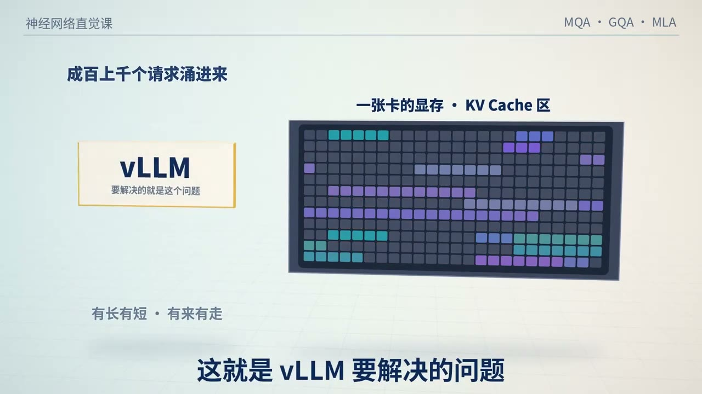

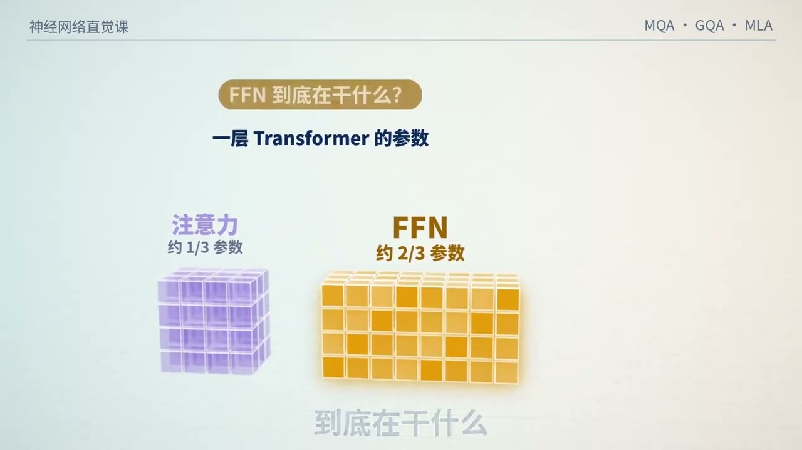

视频最后转向 FFN 参数。FFN 权重和 KV Cache 是不同开销来源，不能用 MoE 的“激活参数少”直接推断 KV Cache 小。本文到此结束，FFN / MoE 可继续读 [MoE 专题](../../技术拆解-FNN层/MoE_核心论文与技术演进.md)。

## 十五、可运行复算

配套 [kv_cache_math.py](kv_cache_math.py) 只使用 Python 标准库，核对第三节容量、MHA / GQA / MQA 比例及第十节线性吸收等式。它是数学复算，不是 GPU 性能基准，也不模拟实际推理框架的分配行为。

```bash
python3 kv_cache_math.py
```

## 十六、作者、论文与原始资料

| 首次公开 | 资料与作者 | 核心贡献 |
| --- | --- | --- |
| 2019-11-06 | Noam Shazeer，*Fast Transformer Decoding: One Write-Head is All You Need*，[论文](https://arxiv.org/abs/1911.02150) | 用共享 KV 的 MQA 减少增量解码访存与缓存 |
| 2023-05-22 | Joshua Ainslie、James Lee-Thorp、Michiel de Jong、Yury Zemlyanskiy、Federico Lebrón、Sumit Sanghai，*GQA: Training Generalized Multi-Query Transformer Models from Multi-Head Checkpoints*，[论文](https://arxiv.org/abs/2305.13245) | 分组共享 KV，并讨论从 MHA 检查点继续训练的方案 |
| 2024-05-07 | DeepSeek-AI 团队及论文共同作者，*DeepSeek-V2: A Strong, Economical, and Efficient Mixture-of-Experts Language Model*，[论文及完整作者列表](https://arxiv.org/abs/2405.04434) | MLA 的联合低秩 KV 压缩、矩阵吸收与解耦 RoPE |

## 十七、视频截图索引与来源说明

全部 28 张截图来自指定视频，时间点见图注和文件名。图片版权归原作者或相应权利人所有；补充推导、教学配置和代码不代表视频作者的逐字表述或性能承诺。

| 时间点 | 内容 |
| --- | --- |
| 00:10、00:20、00:40 | 缓存问题与基础背景 |
| 01:00、01:30、02:00 | 公式、Q / KV 和 MHA |
| 02:30、03:00、03:30 | MQA 共享与取舍 |
| 04:00、04:30、05:00 | GQA 分组 |
| 05:30、06:00、06:30、07:00 | 注意力计算、实现介绍及计算量 |
| 07:30、08:00、08:30、09:00 | 配置、容量与部署开销 |
| 09:30、10:00、10:30、11:00 | MLA、矩阵吸收、RoPE 与论文结果 |
| 11:30、12:00、12:30、12:45 | 回顾与后续主题 |

读完应能从配置计算 KV 裸数据大小，解释 Query 头与 KV 头的区别，说明共享为何不按比例削减全部注意力计算，并推导 MLA 内容分支的 Key / Value 吸收等式。
