# Transformer 全流程：从一句输入到逐 Token 生成

> **整理日期：** 2026-11-09  
> **定位：** 用一条完整的数据流，把 Embedding、位置编码、Attention、FFN、残差、归一化、词表预测和训练接起来。  
> **视频参考：** 阿栗学长《AI 原理拆解》第 6 集，标题开头《终于把 Transformer 串起来了！》。本文使用 35 张实际画面，文末列出时间点和来源。  
> **主要对象：** 原始 Encoder–Decoder Transformer；之后单独对照 Decoder-only。不要把视频左右两座网络原样套到所有大语言模型。  
> **符号约定：** 特征向量按行书写；$S$ 为源序列长度，$T$ 为目标侧输入长度，$d$ 为隐藏维度，$V_{\mathrm{vocab}}$ 为词表大小。Attention 的 $V$ 则表示 Value 矩阵，二者不要混淆。

理解单个模块之后，最重要的问题变成了：**每一步接到的是什么，计算以后交给下一步什么？**

本文沿用视频的改写任务：给出“小猫饿了，所以它吃了鱼。”，生成意思相近的“因为饿了，小猫吃了鱼。”。这是同语言的条件生成示例；Encoder–Decoder 也可以做翻译、摘要等任务，并不要求源语言和目标语言相同。

## 阅读导航

| 主线 | 章节 | 要弄清楚的事 |
| --- | --- | --- |
| 原句怎样进入模型 | 一至三 | 模型身份、Token、向量与位置 |
| 编码器怎样更新表示 | 四至八 | Q/K/V、多头、Add & Norm、FFN 与堆叠 |
| 解码器怎样生成 | 九至十二 | 因果遮罩、交叉注意力、词表输出与反馈循环 |
| 训练和推理有何不同 | 十三至十六 | 右移、损失、并行、KV cache |
| 与现代模型和代码衔接 | 十七至二十 | Decoder-only、形状检查、伪代码、资料与截图索引 |

## 一、先看整机：左右两座网络、两条信息流

### 1.1 编码器负责准备原句表示，解码器负责条件生成

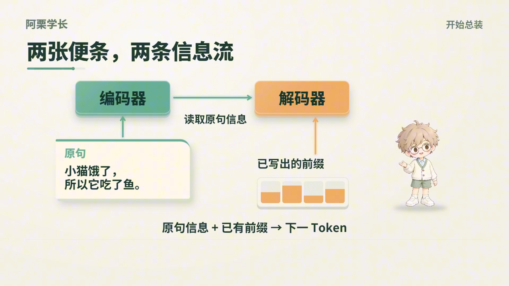

*视频约 01:00：左边接收已经给定的原句；右边接收已经写出的目标前缀。解码器同时使用这两种条件。*

| 部分 | 接收什么 | 产生什么 |
| --- | --- | --- |
| Encoder | 原句的 Token 向量与位置信息 | 一组具有上下文信息的源端隐藏表示 $H$ |
| Decoder | 目标前缀，以及 Encoder 输出 $H$ | 目标各位置的隐藏表示 $D$ |
| 输出头 | Decoder 隐藏表示 | 词表 logits 与下一个 Token 的分布 |
| 生成策略 | 分布与已有前缀 | 选定一个 Token，接回前缀继续生成 |

编码器通常保留一行对应一个源 Token 的输出，**不是把整句话固定压成一个向量**。Decoder 通过交叉注意力按需读取这些源端表示。

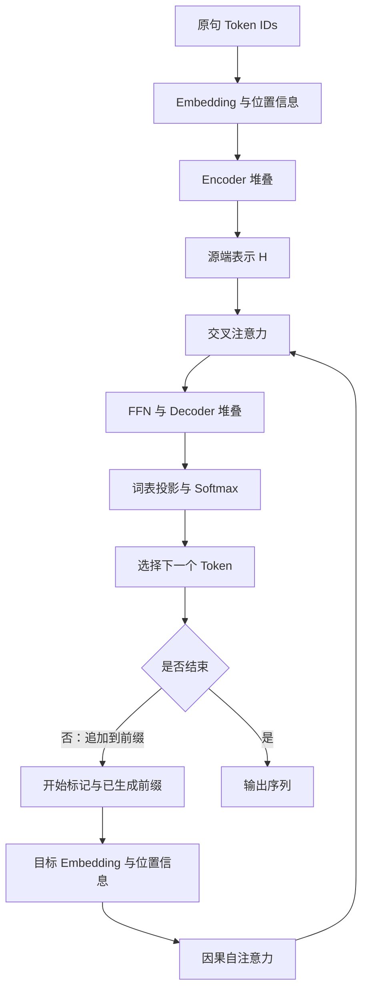

图为概念数据流，省略各子层的残差、归一化及 dropout；它们会在后文逐一放回。

### 1.2 原始论文与作者

**论文：** *Attention Is All You Need*；arXiv 首次提交于 **2017-06-12**，发表于 NeurIPS 2017。

**作者（原论文顺序）：** Ashish Vaswani、Noam Shazeer、Niki Parmar、Jakob Uszkoreit、Llion Jones、Aidan N. Gomez、Lukasz Kaiser、Illia Polosukhin。

论文以注意力为核心构建序列到序列模型，替代当时常见的循环或卷积主干。这里的“Attention Is All You Need”不表示模型真的只有 Attention：FFN、Embedding、位置编码、归一化等都在原始结构中。

来源：[论文与提交记录](https://arxiv.org/abs/1706.03762)、[正文 Figure 1 与 Section 3](https://arxiv.org/html/1706.03762v7)。已有专题：[Transformer 原论文详解](../../02-技术起源-Transformer/Attention_Is_All_You_Need.md)。

## 二、文字入口：Token、编号和 Embedding 查表

### 2.1 先固定教学切分，避免把 Token 等同于词


*视频约 01:25：一块表示一个教学 Token。实际边界由分词器决定，不能把动画切分当成所有模型的统一规则。*

本文沿用：

```text
源句：小猫饿了，所以它吃了鱼。
源 Token：[小猫, 饿了, ，, 所以, 它, 吃了, 鱼, 。]
源长度 S = 8
```

真实分词器可能使用子词、字符、字节或它们的组合。一个汉语词不一定对应一个 Token，一个 Token 也不一定恰好对应一个完整词。

Token ID 只是索引；编号大小本身不表示语义距离。ID 101 和 102 相邻，不意味着对应词更相似。

### 2.2 Embedding 是从参数表中取一行

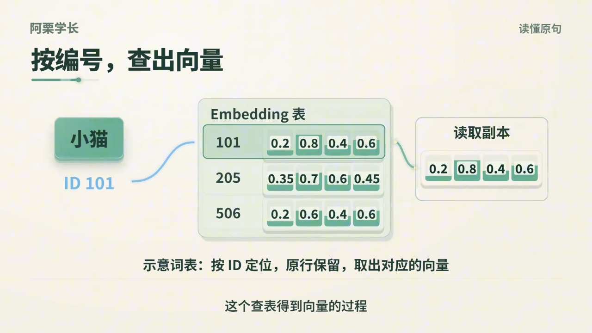

*视频约 01:40：ID 用来定位 Embedding 表的一行；查出的向量才是后续网络处理的数值表示。*

若词表大小为 $V_{\mathrm{vocab}}$，Embedding 表为：

$$
E\in\mathbb R^{V_{\mathrm{vocab}}\times d},
\qquad e_i=E[\mathrm{id}_i,:].
$$

查表等价于 one-hot 向量乘参数矩阵，但实现通常不需要显式构造巨大 one-hot。

动画中“小猫”的一行示意为 $[0.2,0.8,0.4,0.6]$。这些数字是教学参数，不是某个真实已训练模型的导出值；也不能把某个坐标永久指定为“猫的程度”。

### 2.3 静态词向量与上下文表示要区分

同一张 Embedding 表中，同一个 Token ID 查出的原始向量相同。但加入位置、经过 Attention 与 FFN 后，它在不同句子和位置上的隐藏表示可以不同。

因此，模型处理的不是一串永远不变的“词义标签”，而是逐层更新的数值表示。

## 三、位置信息：同一个 Token，出现在不同位置

### 3.1 原始 Transformer 在入口相加

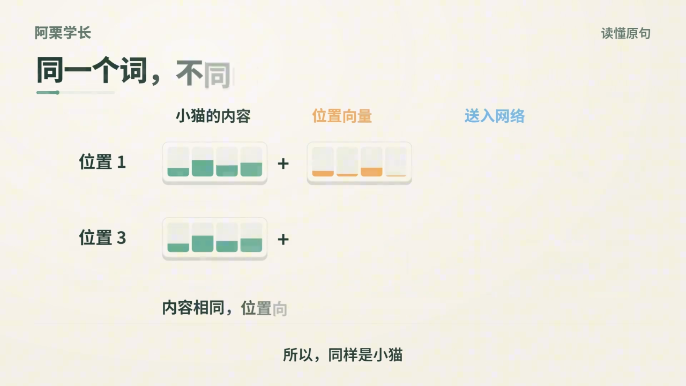

*视频约 02:20：同一个内容向量配上不同的位置向量，得到不同的入口表示。图中加法按对应特征坐标进行。*

原始正弦位置编码可写为：

$$
\operatorname{PE}(p,2i)=\sin\left(\frac{p}{10000^{2i/d}}\right),
\qquad
\operatorname{PE}(p,2i+1)=\cos\left(\frac{p}{10000^{2i/d}}\right).
$$

入口简写为 $e_p+\operatorname{PE}(p)$；原论文还将词嵌入乘以 $\sqrt d$：

$$
X_0[p,:]=\sqrt d\,E[\mathrm{id}_p,:]+\operatorname{PE}(p).
$$

动画为说明“内容加位置”而省略某些尺度细节，不应把简图当作完整实现。

### 3.2 四维手算

取 $d=4$，位置从 0 开始，则：

$$
\operatorname{PE}(0)=[0,1,0,1].
$$

对示意向量 $e=[0.2,0.8,0.4,0.6]$：

$$
e+\operatorname{PE}(0)=[0.2,1.8,0.4,1.6].
$$

若按原始 $\sqrt d=2$ 缩放，则为：

$$
2e+\operatorname{PE}(0)=[0.4,2.6,0.8,2.2].
$$

在位置 1：

$$
\operatorname{PE}(1)
=[\sin1,\cos1,\sin0.01,\cos0.01]
\approx[0.8415,0.5403,0.0100,1.0000].
$$

最后一项为四舍五入显示，不是精确等于 1。

### 3.3 现代位置方案未必在入口直接相加

RoPE 主要在注意力中的 Q/K 上施加旋转，不能把所有模型的位置处理都写成“Token 向量加一个位置向量”。本文主线采用原始结构；其他方案见 [位置编码专题](../../04-技术拆解-位置编码优化/Transformer_位置编码论文与技术演进.md)。

## 四、Encoder 自注意力：每个位置怎样读上下文？

### 4.1 用“它”理解更新表示的目的


*视频约 02:40：示例中的“它”与“小猫”的联系来自上下文。动画用代词指代建立直觉，不表示单个 Attention 头就完整解决了语言理解。*

Encoder 同时接收整段源句，通常允许各有效源位置彼此读取。当前 Token 的表示可以通过其他位置的信息得到更新。

“某位置对另一个位置权重大”只是计算关系，不能自动当作完整的因果解释，更不能由一次热力图就断言网络只使用了那一个词。

### 4.2 Q、K、V 从同一组输入投影而来

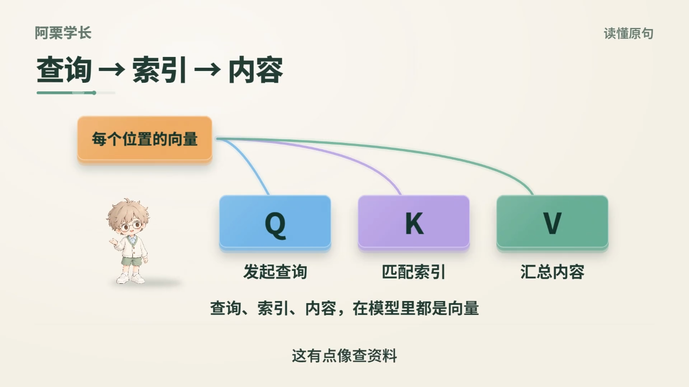

*视频约 03:10：Q/K/V 都是向量。“查询、索引、内容”是角色比喻，不是模型内部三段自然语言。*

对一个头，输入 $X\in\mathbb R^{S\times d}$：

$$
Q=XW_Q,\qquad K=XW_K,\qquad V=XW_V,
$$

$$
W_Q,W_K\in\mathbb R^{d\times d_k},\qquad
W_V\in\mathbb R^{d\times d_v}.
$$

Q 参与“当前位置要怎样匹配”，K 参与“各位置怎样被匹配”，V 提供被加权汇总的数值。三组矩阵通常独立训练。

### 4.3 点积分数与 $\sqrt{d_k}$ 缩放

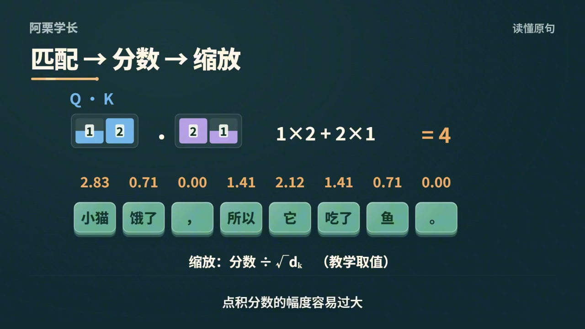

*视频约 03:40：示意 $q=[1,2]$、$k=[2,1]$，点积为 4；当 $d_k=2$ 时，缩放后约为 2.8284。*

对位置 $i$ 读取位置 $j$：

$$
s_{ij}=\frac{q_i k_j^T}{\sqrt{d_k}}.
$$

在分量独立、尺度合适等简化假设下，点积的方差会随维度增加；缩放用于控制 logits 的典型尺度。它不保证任意训练状态下 logits 都保持单位方差。

### 4.4 Softmax 决定比例，V 提供被读回的内容

$$
\alpha_{ij}=\frac{e^{s_{ij}}}{\sum_r e^{s_{ir}}},
\qquad c_i=\sum_j\alpha_{ij}v_j.
$$

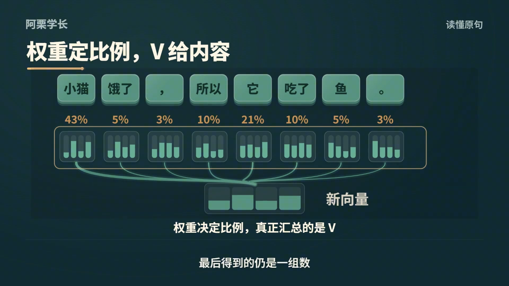

*视频约 04:10：权重是一组读取比例，真正汇总的是各位置的 Value 向量。图中的百分比为教学示意与近似显示。*

在没有 dropout、且这一行至少存在一个有效 Key 的标准 softmax 情况下，权重非负、行和为 1。Attention dropout 可能让训练中实际参与乘法的权重不再严格行和为 1，应区分数学定义和训练实现。

## 五、把一次 Attention 完整算出来

以下为独立的三位置教学算例，用小数值展示全过程，不是根据截图倒推实际模型权重。

### 5.1 明确 Q、K、V

取一个查询和三组 Key / Value：

$$
q=[1,0],\qquad
K=\begin{bmatrix}2&0\\0&1\\1&1\end{bmatrix},\qquad
V=\begin{bmatrix}1&0\\0&2\\3&1\end{bmatrix}.
$$

缩放分数为：

$$
s=\frac{qK^T}{\sqrt2}
=\left[\frac2{\sqrt2},0,\frac1{\sqrt2}\right]
\approx[1.4142,0,0.7071].
$$

### 5.2 计算权重，再加权求和

$$
\alpha=\operatorname{softmax}(s)
\approx[0.5760,0.1400,0.2840].
$$

于是：

$$
c=\alpha V
\approx0.5760[1,0]+0.1400[0,2]+0.2840[3,1]
\approx[1.4280,0.5641].
$$

这一步得到的是二维向量，不是词表中的一个词。后面还要经历输出投影、后续子层和最终词表头。

### 5.3 固定 Q/K，只改 V，会发生什么？

若第三个 Value 从 $[3,1]$ 改为 $[0,0]$，而 Q、K 保持不变，则权重不变，但读回结果变为：

$$
c'\approx[0.5760,0.2801].
$$

这说明“读哪里”和“读回什么”是不同角色。这里是人为固定变量的算例；真实网络中改变输入往往会同时改变 Q/K/V，不能直接照搬“权重不变”的结论。

## 六、多头注意力：不同投影并行读取，再拼接投影

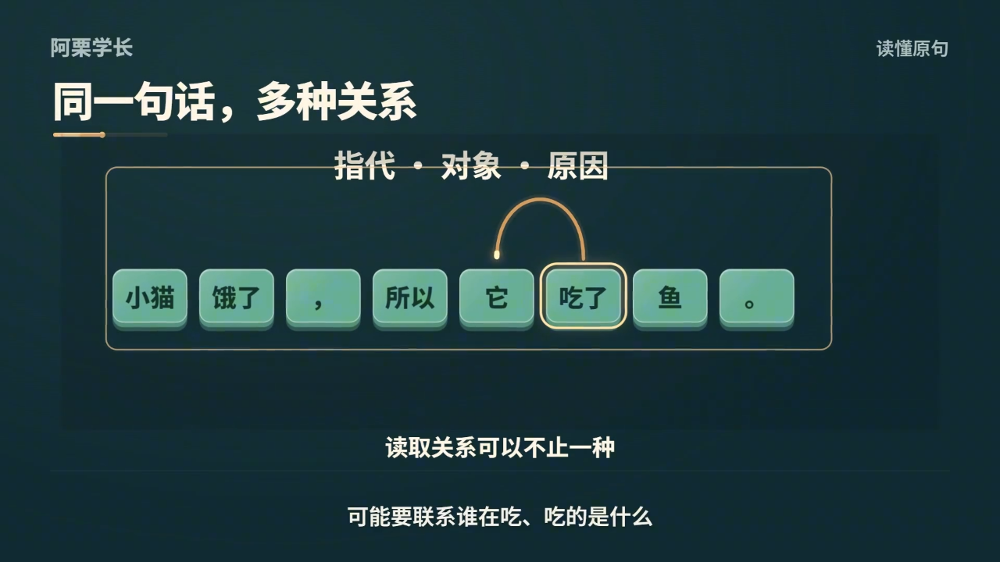

*视频约 04:40：用指代、原因等关系说明多种读取方式。实际头的功能需要分析，不会天然被分配成一个固定语法标签。*

对头 $r$：

$$
\operatorname{head}_r=
\operatorname{Attention}(XW_Q^{(r)},XW_K^{(r)},XW_V^{(r)}).
$$

汇总为：

$$
\operatorname{MHA}(X)
=\operatorname{Concat}(\operatorname{head}_1,\ldots,\operatorname{head}_h)W_O.
$$

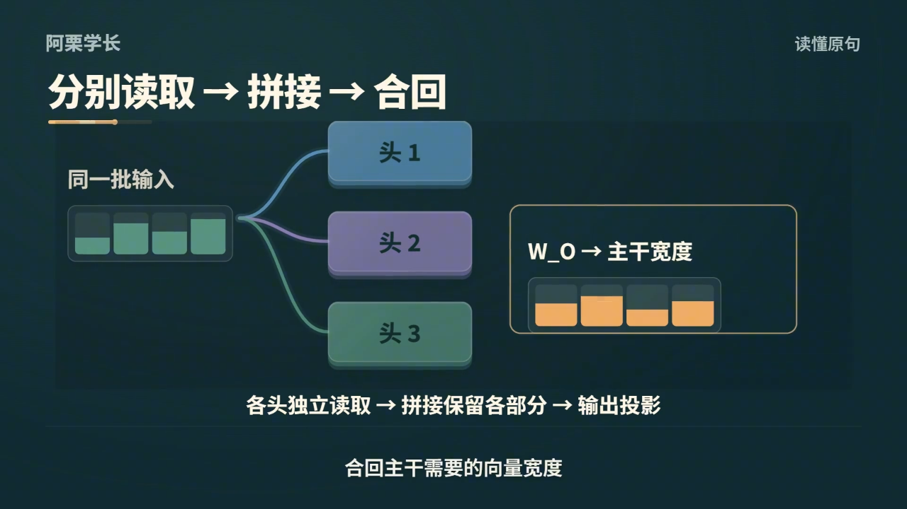

*视频约 05:10：各头输出先拼接，再由 $W_O$ 做一次可学习投影，不是直接对所有头求平均。*

常见设置取 $hd_v=d$，所以拼接后宽度为 $d$，$W_O\in\mathbb R^{d\times d}$。也可以设计其他宽度，只要投影后的形状符合子层接口。

原始基础配置为 $d=512,h=8,d_k=d_v=64$。多个头共享同一输入，但各自投影参数不同；在实现上，各头的线性投影经常融合进大矩阵再 reshape，不必写成多个 Python 循环。

## 七、Add & Norm：更新加回来，再调整表示

### 7.1 残差：本轮输入加上分支更新

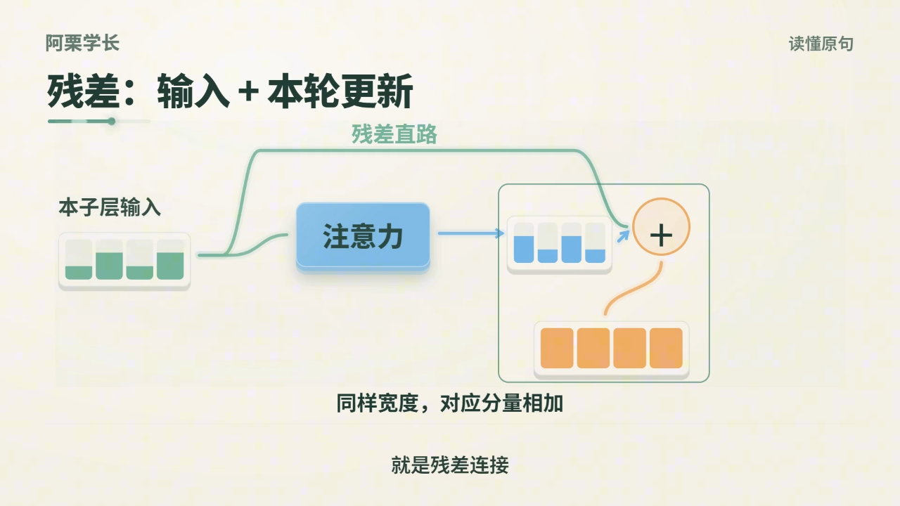

*视频约 05:40：输入直接走旁路，注意力分支提供更新。两路需要有相同的隐藏维度。*

若注意力输出经过投影回到 $d$，则：

$$
U=X+\operatorname{MHA}(X).
$$

原论文训练时还对分支输出使用 dropout。相加不等于拼接；也不是自动跳过分支计算。

### 7.2 LayerNorm：每个位置内部求统计量

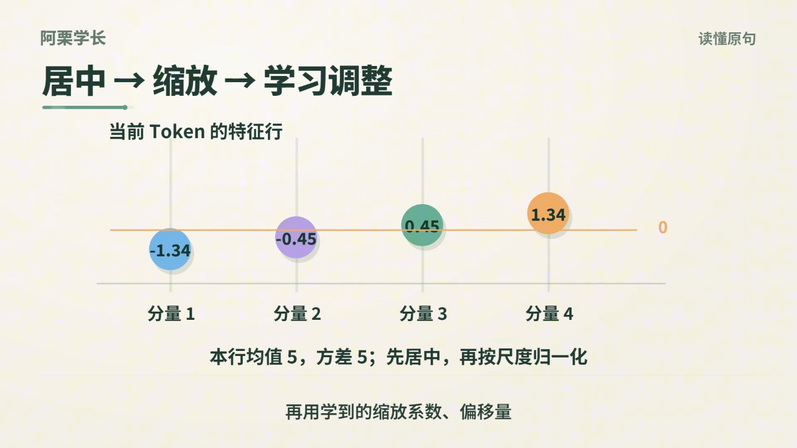

*视频约 06:20：示意一行特征 $[2,4,6,8]$，先减均值，再按标准差缩放，最后可做逐维可学习仿射。*

对该行：

$$
\mu=5,\qquad v=\frac{9+1+1+9}{4}=5.
$$

忽略 $\epsilon$、取缩放为 1、偏移为 0：

$$
\operatorname{LN}([2,4,6,8])
\approx[-1.3416,-0.4472,0.4472,1.3416].
$$

常见 Transformer LN 沿每个 Token 的最后一维计算，不会把整句话所有位置都混成一组统计量。学习后的逐维缩放与偏移，也意味着完整输出未必严格零均值、单位方差。

### 7.3 视频主线采用原始 Post-LN

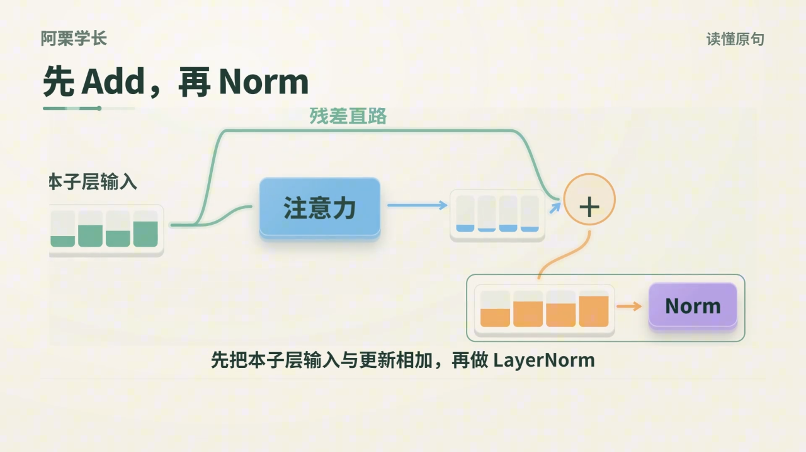

*视频约 06:40：画面中的 Norm 在残差相加之后，属于 Post-LN 排列。*

原始编码器子层可写为：

$$
U=\operatorname{LN}\left(X+
\operatorname{Dropout}(\operatorname{MHA}(X))\right).
$$

一些现代模型采用 Pre-Norm：$X+F(N(X))$。两种位置不同；如果参考 Harvard 的 Annotated Transformer 代码，还要留意其中采用的归一化排列，不应把所有教学实现的细节视为完全一致。

拓展：[残差连接专题](../../06-技术拆解-残差链接/残差连接_从ResNet到Transformer.md)、[归一化专题](../../07-技术拆解-归一化/归一化_从LayerNorm到RMSNorm.md)。

## 八、FFN 与 Encoder 堆叠：逐位置加工，再交给下一层

### 8.1 Attention 之后还有一个两层网络

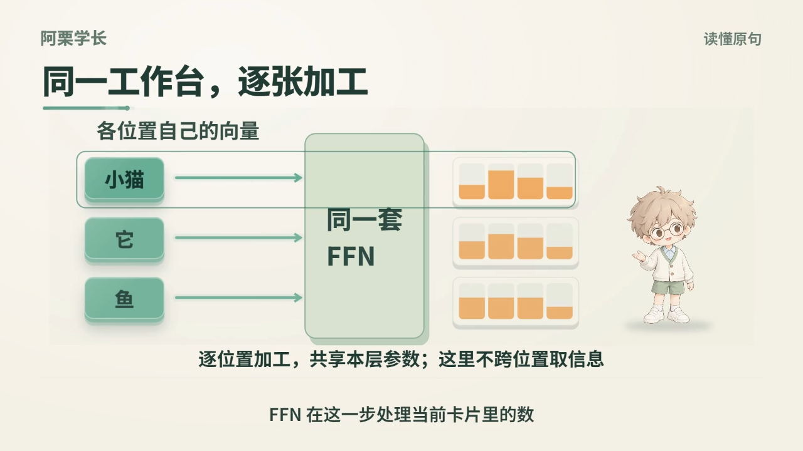

*视频约 07:10：参数共享，但各位置输入不同，所以输出不同。FFN 本身在这一子层不跨位置汇总信息。*

原始 FFN 为：

$$
\operatorname{FFN}(u)
=\operatorname{ReLU}(uW_1+b_1)W_2+b_2.
$$

形状为 $d\to m\to d$。各位置可以并行执行同一网络；前后矩阵在特征维度上混合信息，ReLU 使两次仿射操作不能直接合并为一次。

### 8.2 FFN 外面也有独立的 Add & Norm

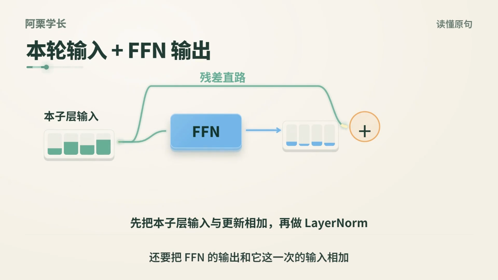

*视频约 07:50：相加的是 FFN 子层输入与 FFN 更新，不是把所有子层都加回最初的 Embedding。*

原始编码器一层完整写为：

$$
U_l=\operatorname{LN}_{l,1}
\left(X_l+\operatorname{Dropout}(\operatorname{MHA}_l(X_l))\right),
$$

$$
X_{l+1}=\operatorname{LN}_{l,2}
\left(U_l+\operatorname{Dropout}(\operatorname{FFN}_l(U_l))\right).
$$

Attention 用于跨位置交互，FFN 进一步加工各位置的特征。不能简单把它们固定解释成“前者只管语法，后者只存知识”。

### 8.3 同样结构堆六次，通常不共享层参数

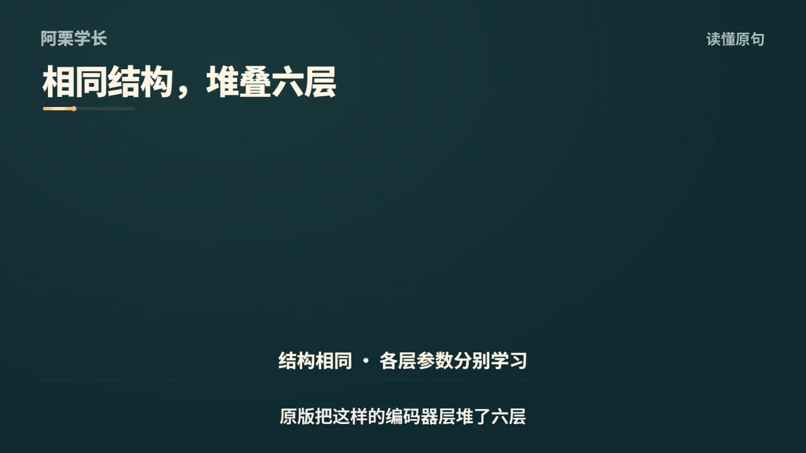

*视频约 08:10：原始基础 Transformer 的 Encoder 堆叠六层。“同样结构”不意味着六层共用同一组权重。*

逐层得到：

$$
X_0\to X_1\to\cdots\to X_{N_e}=H,
\qquad H\in\mathbb R^{S\times d}.
$$

最终 $H$ 仍是 $S$ 行向量，供解码器读取。Encoder 通常在一次生成任务开始时算好，不必在每生成一个目标 Token 时重新编码原句。

激活与现代门控 FFN 的详细推导见 [激活函数：从非线性到 SwiGLU](../激活函数/激活函数_从非线性到SwiGLU.md)。

## 九、Decoder 入口与因果遮罩：只能使用已有目标前缀

### 9.1 从起点开始，随后接入自己已经生成的内容


*视频约 08:40：原句信息已准备好，目标侧从一个起始条件开始。生成一个 Token 后，再进入下一轮。*

教学中用“开始”表示起始标记，常写作 $\langle\mathrm{BOS}\rangle$。真实模型的 decoder start token、BOS、EOS 配置可能不同，不能把画面上的中文字当成固定词表 ID。

目标侧同样要做 Embedding 与位置处理。第 $t$ 步的条件分布为：

$$
p(y_t\mid y_{<t},x).
$$

这里 $x$ 表示整段源句，$y_{<t}$ 表示之前的目标 Token。

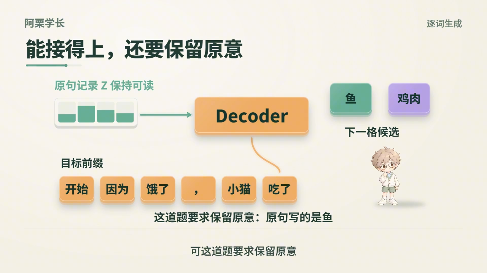

*视频约 09:10：Decoder 一方面看目标前缀，另一方面利用源端信息。能续写和符合原句含义，是这项条件生成任务同时提出的要求。*

### 9.2 Mask 必须作用在 Softmax 之前

在目标自注意力中，对输入位置 $i$：

$$
M_{ij}=\begin{cases}
0,&j\leq i,\\
-\infty,&j>i,
\end{cases}
$$

$$
A=\operatorname{softmax}\left(\frac{QK^T}{\sqrt{d_k}}+M\right),
\qquad O=AV.
$$

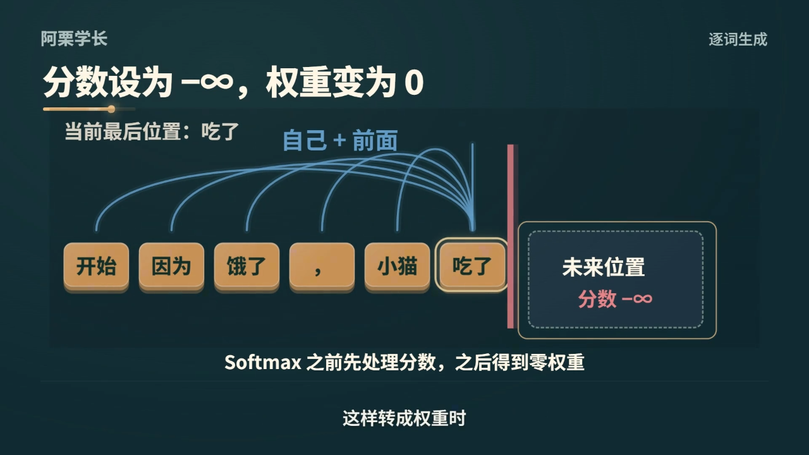

*视频约 10:00：先在 logits 上遮挡未来，再归一化。未来权重为零，剩余可见位置的权重重新分配。*

对三个位置，允许读取的结构是：

| Query / Key | 位置 1 | 位置 2 | 位置 3 |
| --- | --- | --- | --- |
| 位置 1 | 可读 | 不可读 | 不可读 |
| 位置 2 | 可读 | 可读 | 不可读 |
| 位置 3 | 可读 | 可读 | 可读 |

当前位置通常可以读自己，因为它的输入是已经给定的前缀 Token，而预测标签是下一个 Token。是否存在标签泄漏，需要和后文的右移一起看。

### 9.3 为什么不能 Softmax 后简单清零？

假设原始读取比例为 $[0.2,0.3,0.5]$，最后一个位置不可读。若只是清零，得到 $[0.2,0.3,0]$，行和只有 0.5；在 logits 上遮挡并重新做 Softmax，则得到 $[0.4,0.6,0]$。

这两个加权结果不同。因此，因果 Mask 不只是把未来输出擦掉，而是改变当前可用 Key 集合上的归一化。

### 9.4 推理时没有未来 Token，训练时未来 Token 却可能已在张量里

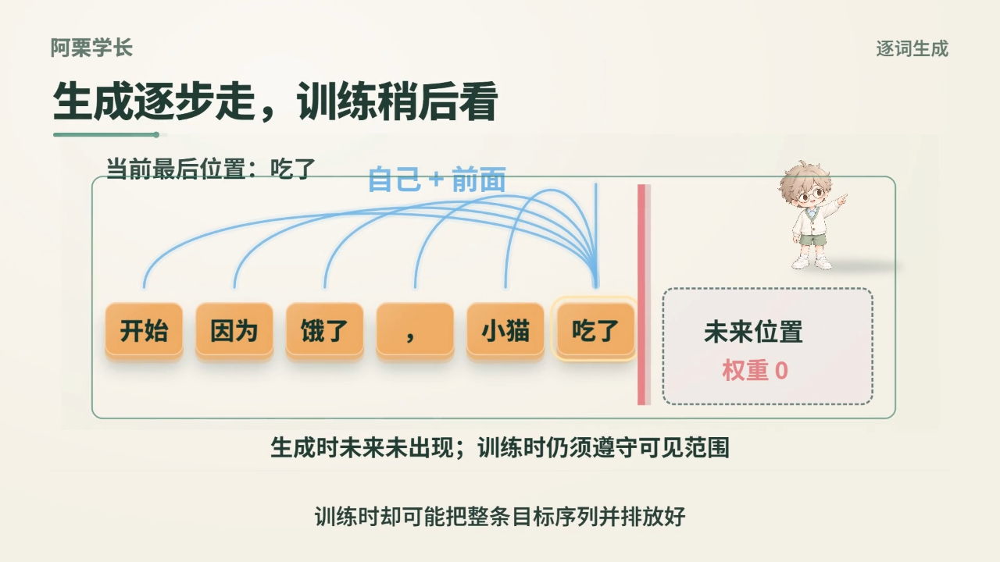

*视频约 10:10：推理时未来尚未生成；训练时整条正确目标可能已知，但必须阻止当前位置读取未来答案。*

因果遮罩约束的是**信息依赖**，不是阻止 GPU 同时执行多个位置的算子。训练中的并行与自回归条件分解并不冲突，后文会展开。

## 十、交叉注意力：目标侧发 Q，源端提供 K/V

### 10.1 三种 Attention 的来源对照

| 子层 | Q 来源 | K/V 来源 | 通常可读范围 |
| --- | --- | --- | --- |
| Encoder self-attention | 当前 Encoder 层输入 | 同一输入 | 全部有效源位置 |
| Decoder masked self-attention | 当前 Decoder 层输入 | 同一输入 | 当前位置与更早目标位置 |
| Decoder cross-attention | 目标侧当前子层状态 | Encoder 最终输出 $H$ | 全部有效源位置 |

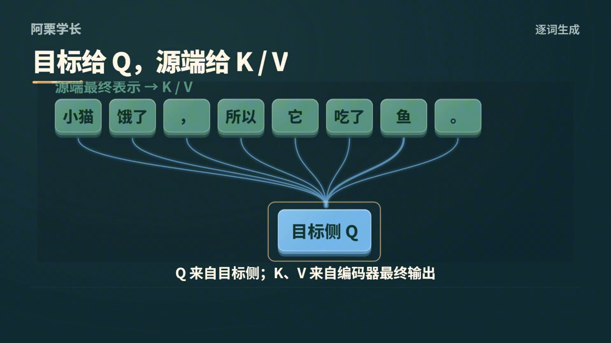

*视频约 10:40：Q 来自正在加工的目标表示，K/V 来自编码器输出。“来源不同”是 cross-attention 的关键。*

设目标侧状态 $U\in\mathbb R^{T\times d}$，源端表示 $H\in\mathbb R^{S\times d}$：

$$
Q_c=UW_Q^c,\qquad K_c=HW_K^c,\qquad V_c=HW_V^c,
$$

$$
C=\operatorname{softmax}\left(\frac{Q_cK_c^T}{\sqrt{d_k}}+M_{\mathrm{src}}\right)V_c.
$$

读取权重的形状为 $T\times S$，不是必须为方阵。源句和目标句的长度可以不同。

### 10.2 源句可读，不等于偷看未来目标

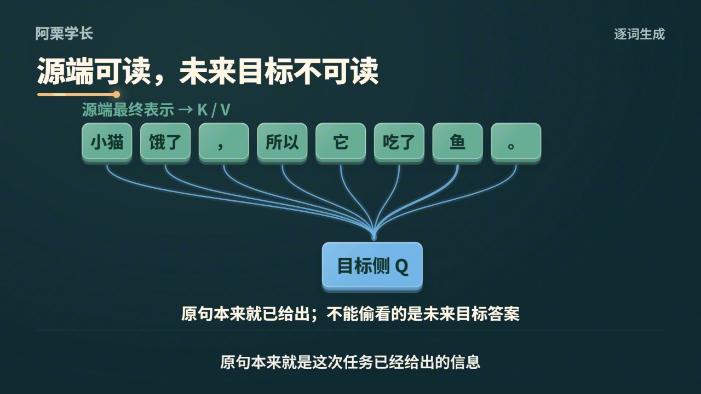

*视频约 10:55：源句里出现“鱼”，Decoder 可以读取它，因为这是任务已给出的条件。不能读取的是未来目标位置的标准答案。*

对翻译、摘要、改写等任务，完整源句通常是已知输入；交叉注意力不需要按目标位置给源句套上相同的三角遮罩，但需要正确屏蔽源端 padding。

若某个应用要求流式处理、源句也只到达一部分，则可读范围需要另行设计，不能套用“完整原句已知”的假设。

### 10.3 读回上下文向量，不是把源词直接贴到输出框

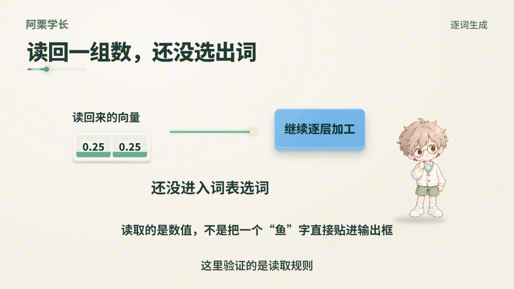

*视频约 11:20：图中的二维向量仍需继续加工。这里没有执行“把原句中的鱼复制成下一个词”的操作。*

Attention 的加权向量要经过后续残差、归一化、FFN、更多层与输出头，才形成词表分布。原始 Transformer 的 cross-attention 本身不是显式指针或复制算子。

### 10.4 Decoder 比 Encoder 多一个子层

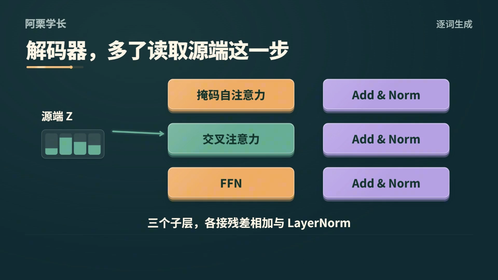

*视频约 11:40：因果自注意力、交叉注意力、FFN 各自配有 Add & Norm。*

原始 Post-LN Decoder 第 $l$ 层，省略 dropout，可写为：

$$
U_l=\operatorname{LN}_{l,1}
\left(D_l+\operatorname{MaskedMHA}_l(D_l)\right),
$$

$$
C_l=\operatorname{LN}_{l,2}
\left(U_l+\operatorname{CrossMHA}_l(U_l,H)\right),
$$

$$
D_{l+1}=\operatorname{LN}_{l,3}
\left(C_l+\operatorname{FFN}_l(C_l)\right).
$$

不同 Decoder 层通常使用各自的投影参数，但读取的源端基础表示都是 Encoder 最终输出 $H$。

## 十一、词表输出头：隐藏向量怎样变成下一个 Token？

### 11.1 先得到每个词表候选的 logit

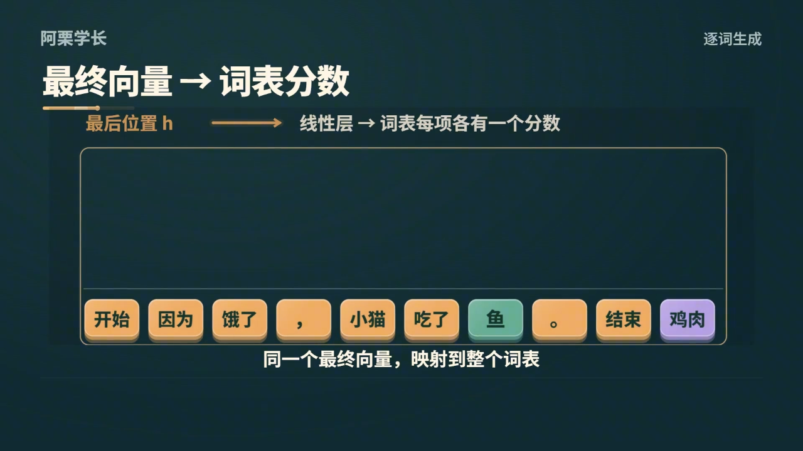

*视频约 12:10：隐藏向量不是词表本身；输出层为每个候选 Token 计算一个分数。*

对最后一层某个目标位置 $d_t\in\mathbb R^{1\times d}$：

$$
z_t=d_tW_{\mathrm{vocab}}+b_{\mathrm{vocab}},
\qquad W_{\mathrm{vocab}}\in\mathbb R^{d\times V_{\mathrm{vocab}}},
$$

$$
p_t=\operatorname{softmax}(z_t).
$$

原始结构讨论了权重共享。若输出头与目标 Embedding 绑定，通常对应 $W_{\mathrm{vocab}}=E_{\mathrm{tgt}}^T$；是否绑定、是否包含 bias，需要按模型核对。

### 11.2 两次都叫 Softmax，但归一化的对象不同

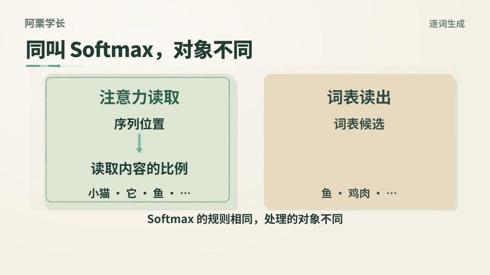

*视频约 12:25：注意力 Softmax 面向序列位置，输出 Softmax 面向词表候选。它们使用同一种归一化形式，却不代表相同语义。*

| 所在位置 | 输入分数 | 归一化轴 | 结果用于什么 |
| --- | --- | --- | --- |
| Self / Cross-Attention | Q 与各 K 的匹配分数 | Key 所在的序列位置 | 加权汇总 V |
| 输出头 | 各候选 Token 的 logits | 词表 | 计算损失或选择 Token |

对“鱼”位置关注较高，不等于词表中“鱼”的生成概率就等于该注意力权重。

### 11.3 复算视频的十词表例子

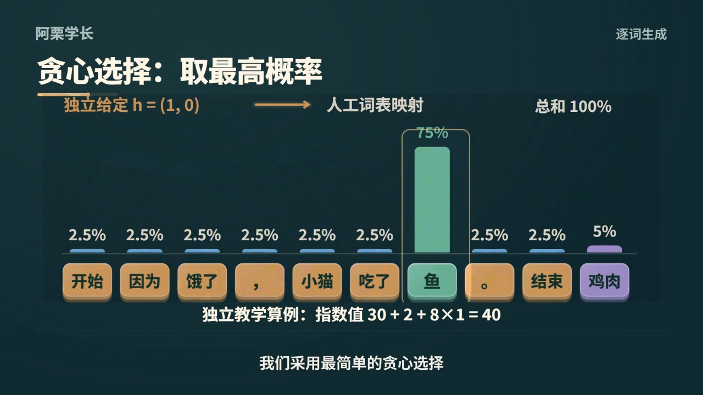

*视频约 12:40：画面明确把它标为独立教学算例，不是把前面每一步的小向量未经说明地串成一个真实模型。*

候选顺序为：

```text
[开始, 因为, 饿了, ，, 小猫, 吃了, 鱼, 。, 结束, 鸡肉]
```

给“鱼”的 logit 取 $\ln30$，“鸡肉”取 $\ln2$，其余八个取 0，则指数值总和为：

$$
30+2+8\times1=40.
$$

归一化后：

$$
p(\text{鱼})=\frac{30}{40}=0.75,
\quad p(\text{鸡肉})=\frac2{40}=0.05,
\quad p(\text{其他每项})=\frac1{40}=0.025.
$$

这些概率合计为 1。若给定 $d_t=[1,0]$，可以人为选择输出矩阵的第一行为以上十个 logits、第二行为零，从而实现这个映射；它并不表明真实隐藏坐标天然具有这样的词义。

## 十二、生成循环：预测、选择、追加，再预测

### 12.1 一次前向产生分布，生成策略再选一个 Token

采用最简单的贪心方式：

$$
\hat y_t=\operatorname*{argmax}_{v}p(y_t=v\mid \hat y_{<t},x).
$$

本例会选择“鱼”。选择动作通常属于解码策略；训练时不会把这个 argmax 当作普通可微运算一路求导。

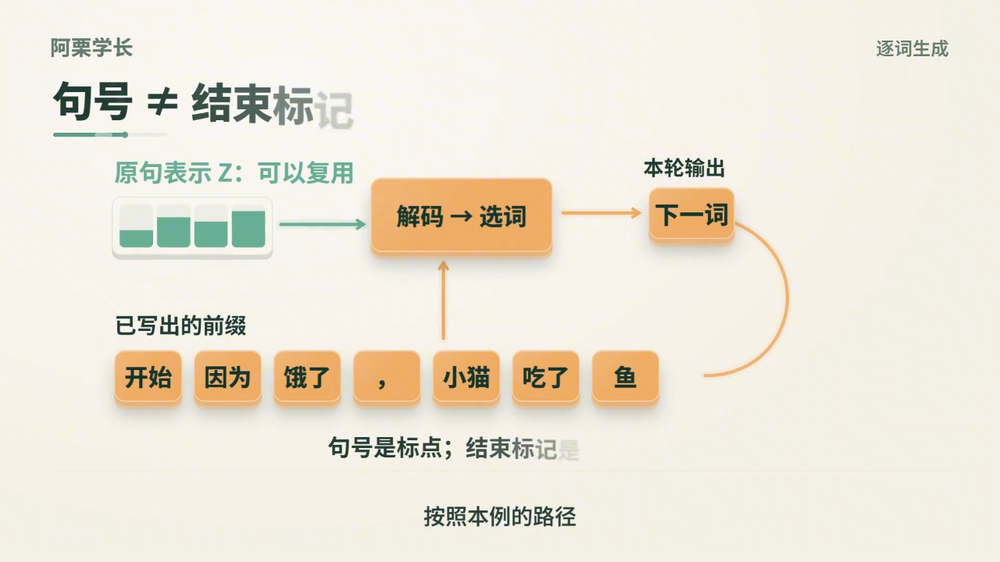

*视频约 13:10：句号是普通内容 Token；结束标记表示生成终止条件。生成句号以后，未必立刻结束。*

一个简化生成过程是：

| 轮次 | 输入的已生成前缀（省略起始标记） | 本轮选出 |
| --- | --- | --- |
| 1 | 空 | 因为 |
| 2 | 因为 | 饿了 |
| 3 | 因为 饿了 | ， |
| 4 | 因为 饿了 ， | 小猫 |
| 5 | 因为 饿了 ， 小猫 | 吃了 |
| 6 | 因为 饿了 ， 小猫 吃了 | 鱼 |
| 7 | 因为 饿了 ， 小猫 吃了 鱼 | 。 |
| 8 | 因为 饿了 ， 小猫 吃了 鱼 。 | 结束 |

这张表是教学路径，不声称一个任意初始化或实际模型一定选择这些 Token。

### 12.2 接回的是 Token，不是重新训练一次网络

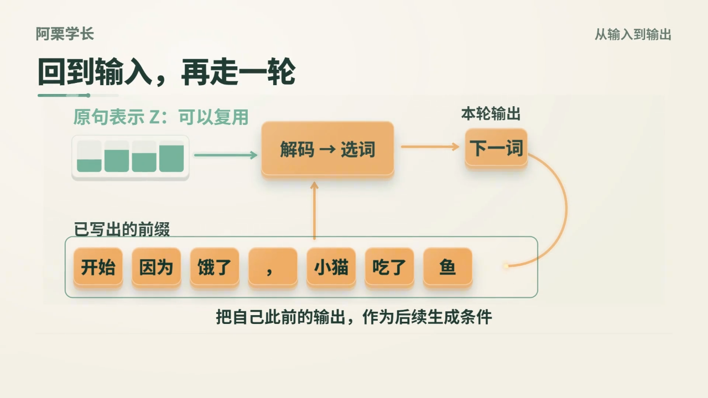

*视频约 15:30：输出被追加为下一轮条件。生成过程中通常保持模型参数固定，变化的是前缀、位置与缓存。*

选定 ID 后，下一步使用该 ID 的目标 Embedding；不是把完整概率向量原样当成下一个离散 Token，也不是每一步都用新输出更新权重。

停止条件还可能包含最大生成长度、停止字符串或服务端规则，不能假设所有模型都只靠一个特定 EOS。

### 12.3 贪心不是全局最优搜索

假设第一步 $p(A)=0.6,p(B)=0.4$；第二步接在 A 后的最佳条件概率为 0.5，接在 B 后为 0.99。在相同两步长度下：

$$
p(A,\cdot)=0.6\times0.5=0.3,
\qquad p(B,\cdot)=0.4\times0.99=0.396.
$$

逐步选最高概率可能错过更高联合概率的完整序列。Beam search 保留多条候选，采样则可引入多样性；它们也各有代价和偏好，不能等同于“更正确”。

温度采样常使用 $\operatorname{softmax}(z/\tau)$，$\tau>0$。Top-k、Top-p 等策略还会筛选候选并重新归一化。具体行为应查实际生成配置，见 [Transformers 生成接口](https://huggingface.co/docs/transformers/en/main_classes/text_generation)。

## 十三、训练时的目标右移：同一位置读前缀、预测下一项

### 13.1 改写任务需要源句和目标句成对出现

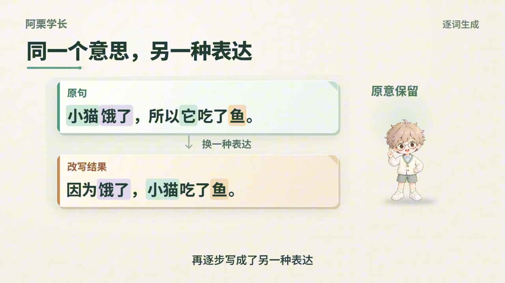

*视频约 13:40：原句作为条件，改写句作为监督目标。这与让网络直接复制原句不是同一项任务。*

目标 Token 序列为：

```text
[因为, 饿了, ，, 小猫, 吃了, 鱼, 。, 结束]
```

训练时向目标侧输入右移后的序列：

```text
Decoder 输入：[开始, 因为, 饿了, ，, 小猫, 吃了, 鱼, 。]
预测标签：    [因为, 饿了, ，, 小猫, 吃了, 鱼, 。, 结束]
```

### 13.2 “输入吃了，预测鱼”对应的是哪一行？

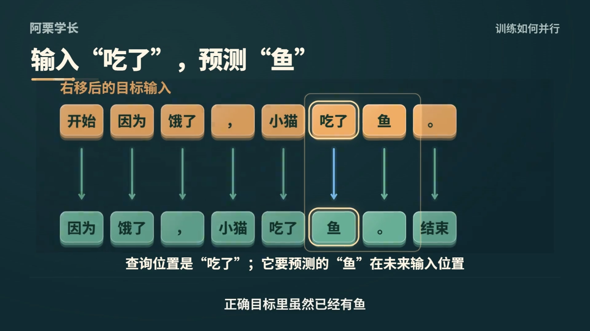

*视频约 14:10：输入“吃了”的位置，标签为“鱼”；“鱼”虽然出现在完整训练张量更右侧，但当前不能读取那个未来位置。*

| 目标输入位置（从 1 计数） | 该位置输入 | 可见目标前缀 | 该位置标签 |
| --- | --- | --- | --- |
| 1 | 开始 | 开始 | 因为 |
| 2 | 因为 | 开始 因为 | 饿了 |
| 3 | 饿了 | 开始 因为 饿了 | ， |
| 4 | ， | 开始 因为 饿了 ， | 小猫 |
| 5 | 小猫 | 开始 因为 饿了 ， 小猫 | 吃了 |
| 6 | 吃了 | 开始 因为 饿了 ， 小猫 吃了 | 鱼 |
| 7 | 鱼 | 开始 因为 饿了 ， 小猫 吃了 鱼 | 。 |
| 8 | 。 | 开始 因为 饿了 ， 小猫 吃了 鱼 。 | 结束 |

### 13.3 右移和因果遮罩必须配套

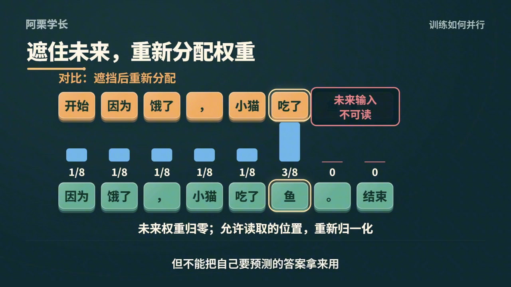

*视频约 14:30：未来目标位置被遮住。前缀虽然来自标准答案，当前预测仍只能使用允许的前缀部分。*

如果右移却不遮挡，第 6 个输入位置可能读取右侧已经出现的“鱼”，从而偷看答案。

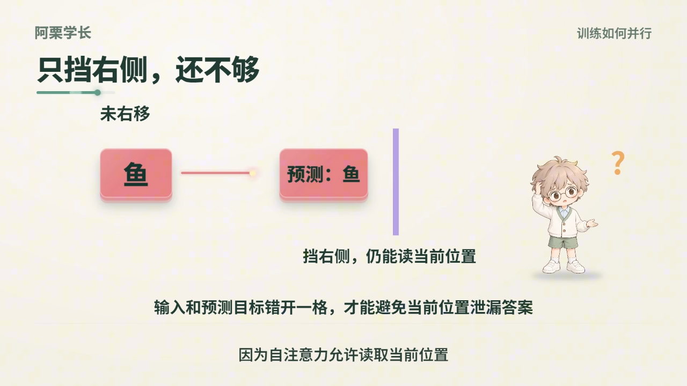

*视频约 14:40：若输入与标签没有错开，允许读取自己就可能直接读到当前答案。*

反过来，若有三角遮罩却把同一个 Token 作为当前位置输入与标签，网络也可能走复制捷径。右移解决输入标签对齐，Mask 解决可读范围；二者不是互相替代的措施。

某些训练接口由模型内部完成标签移位，调用方不应再额外移一次。使用具体框架时需查看输入与 label 约定，不能机械套用一段伪代码。

**延伸解读。** 拿「我 爱 猫」做一次对照。训练时，「我」位置的目标是「爱」，「爱」位置的目标是「猫」，两行 logits 可以在同一次前向得到。生成时如果第一步采样成「喜欢」，第二步就要在「我 喜欢」上计算。训练里已知的后续输入让两个位置可以并行，生成里第二步的输入要等第一步采样。

## 十四、损失与更新：监督的是正确 Token 的条件概率

### 14.1 自回归分解

给定源句 $x$，完整目标条件概率为：

$$
p(y\mid x)=\prod_{t=1}^{T}p(y_t\mid y_{<t},x).
$$

最大似然训练通常最小化负对数似然：

$$
\mathcal L=-\sum_{t=1}^{T}\log p(y_t^{*}\mid y_{<t}^{*},x).
$$

星号表示训练集提供的正确目标。实际还会按有效 Token 数或其他规则归约；含 padding 的位置通常不计入监督。

### 14.2 一个位置的交叉熵手算

在第十一节的教学分布中，如果正确标签是“鱼”：

$$
\mathcal L_t=-\log0.75\approx0.287682.
$$

若两个位置的正确标签概率分别为 0.75 和 0.5，平均负对数似然为：

$$
\overline{\mathcal L}
=\frac{-\log0.75-\log0.5}{2}
\approx0.490415.
$$

该平均损失对应的 perplexity 为 $e^{\overline{\mathcal L}}\approx1.6330$。这是两项教学概率的计算结果，不是实际模型评测成绩。

### 14.3 梯度回到哪里？

对标准 one-hot 交叉熵，输出 logits 的梯度为：

$$
\frac{\partial\mathcal L_t}{\partial z_{t,v}}
=p_{t,v}-\mathbf1[v=y_t^{*}].
$$

“鱼”位置为 $0.75-1=-0.25$，其余候选为各自概率。梯度依次回到词表头、Decoder 子层、交叉注意力、Encoder、Embedding 等可训练路径。

这不是单独奖励一张注意力热力图，也不需要人为给每层指定“这一层应该找主语”的标签。模型通过最终任务损失共同调整参数。

原始论文还采用 label smoothing；上述是为手算使用的标准 one-hot 版本，不能将它与原论文全部训练细节画等号。

## 十五、训练可以并行，为什么生成通常逐步进行？

### 15.1 Teacher forcing 提供了每个位置需要的正确前缀

训练时，所有目标 Token 已由数据集给定。通过右移和因果 Mask，可以在一次前向里计算：

$$
p(y_1^*\mid x),\quad
p(y_2^*\mid y_1^*,x),\quad\ldots,\quad
p(y_T^*\mid y_{<T}^*,x).
$$

不同位置用的是各自可见的前缀；不是同一行先预测第一个、把结果填回去，才继续训练第二个。

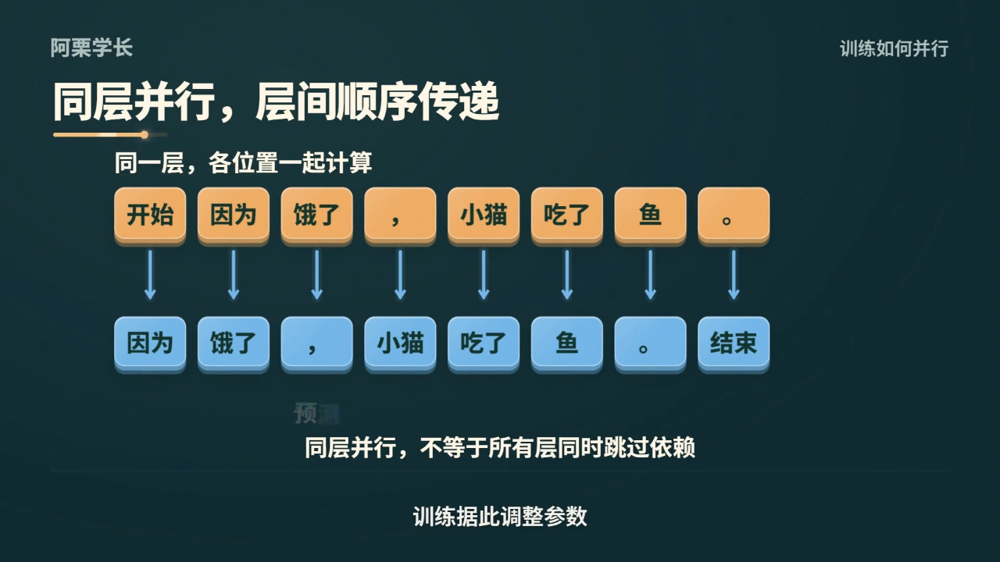

*视频约 14:55：一个子层中的多个位置可以一起计算，但上一层结果仍是下一层的输入。位置并行不等于所有层、所有阶段都同时完成。*

### 15.2 推理时，下一轮前缀尚未确定

标准自回归推理中，生成第 $t+1$ 个 Token 前，通常要先确定第 $t$ 个 Token。它可能来自贪心、采样或搜索，不能提前用未知的真实答案代替。

所以，训练中的位置并行并不能直接变成“单次前向生成任意长度句子”。推测解码等加速方法可以一次提出多个候选，再验证或接受一部分，但不改变这里的基本条件依赖。

### 15.3 两种前缀来源造成训练与推理差别

| 阶段 | 前缀从哪里来 | 会发生什么 |
| --- | --- | --- |
| 常见 teacher-forcing 训练 | 数据集的正确目标前缀 | 每个位置在标准前缀条件下接受监督 |
| 自回归推理 | 模型自己已选出的前缀 | 早期选择会改变后续条件，偏差可能累积 |

不能从训练损失较低就推断任何解码策略都生成同样好的结果。生成质量还取决于条件、数据、策略与评估方式。

## 十六、KV cache：接回输入，不等于每次重算整个前缀

### 16.1 视频画的是概念循环，实际实现可以复用中间结果

最直接的实现是把整段前缀重复送进 Decoder，再取最后位置的词表输出。这种方式容易理解，但会重复处理已经算过的目标位置。

在固定参数、正确位置与因果遮罩的确定性推理中，更晚 Token 不会改变过去位置的因果隐藏表示。因此，每层可保存过去位置的 Key / Value：

$$
K_{\mathrm{cache}}\leftarrow
\operatorname{Concat}(K_{\mathrm{past}},k_t),
\qquad
V_{\mathrm{cache}}\leftarrow
\operatorname{Concat}(V_{\mathrm{past}},v_t).
$$

新位置只需用自己的 Query 读取已有 K/V 和当前 K/V。缓存不是保存一句自然语言总结，也不通常保存每一步的完整注意力权重矩阵。

### 16.2 Encoder–Decoder 中可以复用什么？

| 对象 | 能否在同一次固定源句生成中复用？ | 注意事项 |
| --- | --- | --- |
| Encoder 最终输出 $H$ | 通常可以 | 源句与模型参数不变 |
| Cross-attention 的源端 K/V | 通常可以预先计算 | 各 Decoder 层有自己的投影，不能无条件跨层共享 |
| Decoder 过去位置的 self-attention K/V | 通常可以 | 按层维护，位置和 Mask 必须一致 |
| 当前新位置的 Query | 每步重新计算 | 取决于当前输入及前面子层的结果 |
| 每步的词表分布 | 不能拿旧分布代替新分布 | 条件和当前位置发生变化 |

如果源句、前缀内容、位置配置或模型权重改变，旧缓存不一定仍有效。双向 Encoder 在源句追加 Token 后，过去表示也可能改变，不能照搬因果 Decoder 的复用理由。

### 16.3 减少重算，但不使全注意力变成常数成本

只比较单层目标 self-attention 的分数与 V 汇总项，固定头数与特征宽度：

| 实现 | 第 $t$ 步的注意力项 | 生成到 $T$ 的累计量级 |
| --- | --- | --- |
| 每步重算整个前缀 | 约 $O(t^2d)$ | 约 $O(T^3d)$ |
| 只处理新 Query，复用旧 K/V | 约 $O(td)$ | 约 $O(T^2d)$ |

这里不包含线性投影、FFN、词表头、源端计算、访存和调度开销，不能把复杂度比值直接当作端到端加速倍数。KV cache 仍需随历史长度增长存储，当前 Query 也仍需读取历史 K/V。

### 16.4 一个缓存容量算例

对常规未压缩缓存，近似字节数为：

$$
M_{\mathrm{KV}}\approx
2LBTH_{\mathrm{KV}}d_h\,b,
$$

其中 2 表示 K、V 两份，$L$ 为层数，$B$ 为 batch，$T$ 为已缓存长度，$H_{\mathrm{KV}}$ 为 K/V 头数，$d_h$ 为每头维度，$b$ 为每个数的字节数。

例如假设 $L=32,B=1,T=4096,H_{\mathrm{KV}}=32,d_h=128,b=2$，则：

$$
M_{\mathrm{KV}}=2{,}147{,}483{,}648\text{ bytes}=2\text{ GiB}.
$$

这是人为指定配置的容量计算，不对应某个未核实的模型版本；也没有包含权重、临时激活、分配器开销和 cross-attention 缓存。GQA、压缩或其他缓存设计会改变公式中的参数或存储结构。

实现背景：[Transformers 官方 KV cache 说明](https://huggingface.co/docs/transformers/en/cache_explanation)。本文主线不依赖某个具体 Cache 类的当前 API。

## 十七、视频中的两座网络，与 Decoder-only 有何不同？

### 17.1 先区分三种经典组合

| 结构 | 主要组成 | 常见信息依赖 |
| --- | --- | --- |
| Encoder-only | 双向 Encoder | 在给定输入内汇总双向上下文，常用于理解或掩码预测等任务 |
| Encoder–Decoder | Encoder 加带交叉注意力的 Decoder | 目标前缀通过 cross-attention 读取源端表示 |
| Decoder-only | 通常仅堆叠因果自注意力与 FFN 等 | 提示和续写形成同一条因果序列 |

这张表描述典型结构，不是每一种混合模型、前缀模型或多模态模型的完整分类。

### 17.2 Decoder-only 不是直接保留原始 Decoder 的所有方框

很多 Decoder-only 语言模型没有独立 Encoder，也没有原始 Encoder–Decoder 式的 cross-attention 子层。提示文本、指令和生成结果被组织进一条序列，靠因果 self-attention 读取前缀。

例如：

```text
提示：把“小猫饿了，所以它吃了鱼。”改写一下。
输出前缀：因为饿了，小猫吃了
下一步：预测“鱼”等候选的概率
```

它仍在做下一个 Token 预测，但条件组织方式不同。不能把提示文本自动画成视频左侧的一座独立 Encoder。

### 17.3 Prompt prefill 与后续 decode

对常见因果模型，prefill 一次处理已经给定的提示，建立相应 K/V；decode 随后逐步处理新增 Token。虽然完整提示一开始已知，各提示位置的表示仍遵守模型自身的因果依赖，不能因此把它们当成双向 Encoder 表示。

后续模型还可能把 Post-LN 改为 Pre-Norm、把 ReLU FFN 改为 SwiGLU、换用 RoPE 或不同注意力形式。这些是独立的模块选择；理解整体流程后，再对照具体模型配置。

资料：[Causal language modeling](https://huggingface.co/docs/transformers/en/tasks/language_modeling)、[Encoder–Decoder 模型接口](https://huggingface.co/docs/transformers/en/model_doc/encoder-decoder)。

## 十八、把形状串起来：每个模块交出什么张量？

### 18.1 单样本、单头的主线

| 阶段 | 输入形状 | 输出形状 | 关键变化 |
| --- | --- | --- | --- |
| 源 Embedding 与位置 | Token IDs：$S$ | $S\times d$ | 离散索引变为隐藏向量 |
| Encoder Q/K/V | $S\times d$ | Q/K：$S\times d_k$；V：$S\times d_v$ | 投影到读取空间 |
| Encoder 分数 | Q、K | $S\times S$ | 每个源 Query 对每个源 Key |
| Encoder 单头读取 | 权重、V | $S\times d_v$ | 加权汇总 |
| 多头拼接与输出 | $S\times hd_v$ | $S\times d$ | 回到残差接口宽度 |
| Encoder 最终输出 | $S\times d$ | $H:S\times d$ | 保留源位置轴 |
| 目标 Embedding | Token IDs：$T$ | $T\times d$ | 目标前缀表示 |
| Decoder self-attention 分数 | 目标 Q/K | $T\times T$ | 三角可见范围 |
| Cross-attention 分数 | 目标 Q、源 K | $T\times S$ | 目标位置读取源位置 |
| Decoder 最终输出 | $T\times d$ | $T\times d$ | 仍不是词表分数 |
| 词表头 | $T\times d$ | $T\times V_{\mathrm{vocab}}$ | 各位置对应全词表 |

Batch 与头数加入后，注意力分数通常形如 $[B,h,Q_{\mathrm{len}},K_{\mathrm{len}}]$。Softmax 沿最后的 Key 轴计算，不能误沿 Query 轴归一化。

### 18.2 原始基础配置的数量感

原始基础结构常用 $N_e=N_d=6,d=512,h=8,m=2048$。这些是该配置的参数，不是 Transformer 的必要定义。

普通 FFN 两个大矩阵共有：

$$
512\times2048+2048\times512=2{,}097{,}152
$$

个参数；若计入两组偏置，再加 $2048+512=2560$。这个算例说明 FFN 的参数规模，但不能由此直接推出 Attention 在长序列下的计算和显存不重要。

### 18.3 三种 Mask 要分清

| Mask 或忽略规则 | 解决什么问题 | 不应与什么混为一谈 |
| --- | --- | --- |
| 目标 causal mask | 当前预测不读未来目标位置 | 不是删除未来 label |
| 源 / 目标 padding mask | 不把补齐位置当有效内容读取 | 不自动等于因果结构 |
| Loss ignore mask | 某些位置不贡献监督损失 | 不一定阻止它们参与前向注意力 |

不同 API 对布尔 Mask 中 `True` 的语义可能不同；本文统一使用加性分数 0 / $-\infty$ 解释，落地时必须核对接口。可参考 [PyTorch Transformer](https://docs.pytorch.org/docs/stable/generated/torch.nn.Transformer.html)。

## 十九、伪代码、自检与常见错误

### 19.1 一段可运行的单头注意力算例

以下只依赖 NumPy，用来对应第五节与第九节，不是完整 Transformer。

```python
import numpy as np


def attention(Q, K, V, additive_mask=None):
    scores = Q @ K.T / np.sqrt(Q.shape[-1])
    if additive_mask is not None:
        scores = scores + additive_mask
    if not np.isfinite(scores).any(axis=-1).all():
        raise ValueError("Each query needs at least one finite score")
    scores = scores - scores.max(axis=-1, keepdims=True)
    weights = np.exp(scores)
    weights = weights / weights.sum(axis=-1, keepdims=True)
    return weights @ V, weights


Q = np.array([[1.0, 0.0]])
K = np.array([[2.0, 0.0], [0.0, 1.0], [1.0, 1.0]])
V = np.array([[1.0, 0.0], [0.0, 2.0], [3.0, 1.0]])
context, weights = attention(Q, K, V)
print(weights.round(4))  # [[0.5760, 0.1400, 0.2840]]
print(context.round(4))  # [[1.4280, 0.5641]]
```

代码假设 Q/K/V 本身是有限数值，Mask 只有 0 与负无穷。减去最大值是 softmax 的数值稳定处理，不改变归一化结果。如果一个 Query 的所有 Key 都被遮住，直接对全负无穷做 softmax 会产生无效结果，需要在数据或接口层处理。

### 19.2 训练路径伪代码

```python
# 伪代码：这里选择由调用方显式完成目标右移
# target 包含正确内容和 EOS，不包含 BOS
decoder_input = [BOS] + target[:-1]
labels = target

memory = encoder(source_ids, source_padding_mask)
hidden = decoder(
    decoder_input,
    memory=memory,
    causal_mask=True,
    source_padding_mask=source_padding_mask,
)
logits = vocab_head(hidden)
loss = token_cross_entropy(logits, labels, ignore=PAD)
loss.backward()
optimizer.step()
```

这里省略 batch、优化器梯度清理、dropout、精度和设备等实现细节。实际模型接口若自动移位，就不要重复移位。

### 19.3 最直观的贪心生成伪代码

```python
# 伪代码：不使用 cache，强调数据流；每轮重算整个前缀
# 假设已切换到推理模式并关闭梯度
memory = encoder(source_ids, source_padding_mask)
prefix = [BOS]

for _ in range(max_new_tokens):
    hidden = decoder(prefix, memory=memory, causal_mask=True)
    last_logits = vocab_head(hidden[-1])
    next_id = argmax(last_logits)
    if next_id == EOS:
        break
    prefix.append(next_id)

result = detokenize(prefix[1:])
```

贪心时可直接对 logits 取 argmax，因为 softmax 不改变大小顺序；计算概率、损失或采样时才需要相应归一化。加入 cache 后通常只送入尚未处理的新 Token，并维护位置与完整可见范围；不能一边完整重送前缀、一边无条件向旧缓存追加，否则可能重复缓存。

### 19.4 看到异常结果，优先核对这些接口

| 现象 | 首先排查 |
| --- | --- |
| 训练极好，生成很差 | 目标移位、未来泄漏、训练 / 推理前缀差异 |
| 总是复制当前位置 | 输入和 label 是否错误地完全对齐 |
| 长度不同时 cross-attention 报错 | 把 $T\times S$ 错当成 $T\times T$ |
| 添加 padding 后输出显著异常 | padding mask、有效长度和 loss ignore 规则 |
| 开 cache 后结果错误 | 重复 Token、位置偏移、缓存与 Mask 长度不一致 |
| Softmax 出 NaN | 全部 Key 被遮挡、数值溢出或上游已出现非有限值 |
| 每轮都重复编码原句 | 编码结果是否在固定源句下可以复用 |
| 每一层都被解释为同一组参数 | 是否误把同构堆叠当作权重共享 |

### 19.5 回到整机，检查自己能否走完一遍

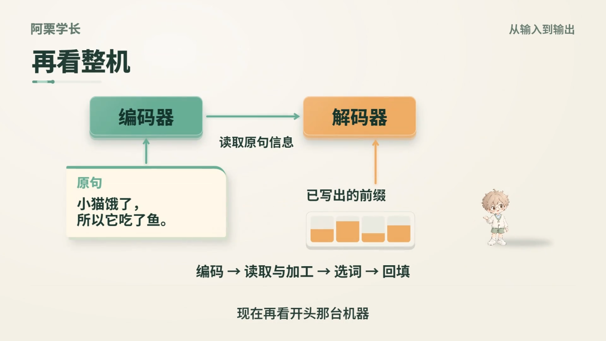

*视频约 15:10：现在应能说清原句表示怎样送往 Decoder，已写前缀怎样进入目标侧，以及最后怎样走到词表预测。*

可以用以下问题自检：

1. 为什么 Encoder 输出通常是多行向量，而不是一个词或一个句向量？
2. 为什么 Decoder cross-attention 的 Q 和 K/V 可以来自不同长度的序列？
3. 为什么源句中的“鱼”可以读取，未来目标位置的“鱼”却必须遮挡？
4. 为什么 Attention 权重和词表概率不能当成同一组数？
5. 为什么目标右移后仍需要 causal mask？
6. 为什么训练可以并行计算多个位置，普通自回归生成仍依赖逐步确定 Token？
7. 为什么 KV cache 能减少重算，却仍要占用随历史增长的空间？
8. 把视频换成 Decoder-only 时，应该去掉或重新组织哪些方框？

## 二十、视频来源、35 张截图与原始资料

### 20.1 视频身份与引用方式

**作者：** 阿栗学长。  
**系列：**《AI 原理拆解》第 6 集。  
**标题开头：**《终于把 Transformer 串起来了！》  
**页面显示发布时间：** 2026-09-25 08:55。  
**时长：** 约 15:38。  
**用户提供链接：** [作者页中的指定视频](https://www.douyin.com/user/MS4wLjABAAAAUv81cxXz9kyT3Cwtq3euTsjxBv3QGK3oyf-DyYWszAPTq8TOPzmdzGk45fREttCD?from_tab_name=main&modal_id=7689238930876550450)。  
**直接入口：** [抖音视频 7689238930876550450](https://www.douyin.com/video/7689238930876550450)。

图片为该视频的实际画面，保留作者标识与字幕，未标成论文原图。视频画面及其素材的权利归相关作者或权利人所有。时间按播放器定位，动画阶段可能有帧级差异；截图中的近似数值、教学分词和模块比喻，都不直接代表真实模型权重或真实分词结果。

### 20.2 截图索引

| 图号 | 时间（约） | 内容 | 图片 |
| --- | --- | --- | --- |
| F-01 | 01:00 | 两座网络与两条信息流 | [frame-060s](assets/frame-060s.png) |
| F-02 | 01:25 | Token 切分 | [frame-085s](assets/frame-085s.png) |
| F-03 | 01:40 | Embedding 查表 | [frame-100s](assets/frame-100s.png) |
| F-04 | 02:20 | 内容与位置相加 | [frame-140s](assets/frame-140s.png) |
| F-05 | 02:40 | 代词与上下文 | [frame-160s](assets/frame-160s.png) |
| F-06 | 03:10 | Q/K/V 的角色 | [frame-190s](assets/frame-190s.png) |
| F-07 | 03:40 | 点积与缩放 | [frame-220s](assets/frame-220s.png) |
| F-08 | 04:10 | 按比例汇总 V | [frame-250s](assets/frame-250s.png) |
| F-09 | 04:40 | 多种读取联系 | [frame-280s](assets/frame-280s.png) |
| F-10 | 05:10 | 多头拼接与输出投影 | [frame-310s](assets/frame-310s.png) |
| F-11 | 05:40 | 残差相加 | [frame-340s](assets/frame-340s.png) |
| F-12 | 06:20 | LayerNorm 手算 | [frame-380s](assets/frame-380s.png) |
| F-13 | 06:40 | Post-LN | [frame-400s](assets/frame-400s.png) |
| F-14 | 07:10 | 逐 Token FFN | [frame-430s](assets/frame-430s.png) |
| F-15 | 07:50 | FFN 外的残差 | [frame-470s](assets/frame-470s.png) |
| F-16 | 08:10 | Encoder 堆叠 | [frame-490s](assets/frame-490s.png) |
| F-17 | 08:40 | 开始解码 | [frame-520s](assets/frame-520s.png) |
| F-18 | 09:10 | 前缀与原句两种条件 | [frame-550s](assets/frame-550s.png) |
| F-19 | 10:00 | 未来分数设为负无穷 | [frame-600s](assets/frame-600s.png) |
| F-20 | 10:10 | 生成与训练区别 | [frame-610s](assets/frame-610s.png) |
| F-21 | 10:40 | 目标 Q、源端 K/V | [frame-640s](assets/frame-640s.png) |
| F-22 | 10:55 | 原句可读、未来目标不可读 | [frame-655s](assets/frame-655s.png) |
| F-23 | 11:20 | 读回的是向量 | [frame-680s](assets/frame-680s.png) |
| F-24 | 11:40 | Decoder 三子层 | [frame-700s](assets/frame-700s.png) |
| F-25 | 12:10 | 隐藏向量到词表分数 | [frame-730s](assets/frame-730s.png) |
| F-26 | 12:25 | 两种 Softmax | [frame-745s](assets/frame-745s.png) |
| F-27 | 12:40 | 教学词表分布与贪心 | [frame-760s](assets/frame-760s.png) |
| F-28 | 13:10 | 标点与结束标记 | [frame-790s](assets/frame-790s.png) |
| F-29 | 15:30 | 输出接回下一轮 | [frame-930s](assets/frame-930s.png) |
| F-30 | 13:40 | 同义改写任务 | [frame-820s](assets/frame-820s.png) |
| F-31 | 14:10 | 目标右移对齐 | [frame-850s](assets/frame-850s.png) |
| F-32 | 14:30 | 遮挡未来并重新归一化 | [frame-870s](assets/frame-870s.png) |
| F-33 | 14:40 | 只遮挡右侧不够 | [frame-880s](assets/frame-880s.png) |
| F-34 | 14:55 | 同层位置并行 | [frame-895s](assets/frame-895s.png) |
| F-35 | 15:10 | 整体结构回顾 | [frame-910s](assets/frame-910s.png) |

### 20.3 原始论文、实现资料和关联专题

1. Vaswani 等. **Attention Is All You Need.** NeurIPS 2017. [arXiv 与版本记录](https://arxiv.org/abs/1706.03762) · [正文](https://arxiv.org/html/1706.03762v7)。重点：Figure 1、Section 3.1–3.5、5.4。
2. Harvard NLP. **The Annotated Transformer.** [逐行实现与解释](https://nlp.seas.harvard.edu/annotated-transformer/)。重点：Encoder / Decoder、Mask、训练 Batch、贪心解码；注意具体代码的归一化顺序与原始图示可能不同。
3. Hugging Face Transformers. **Encoder Decoder Models.** [官方文档](https://huggingface.co/docs/transformers/en/model_doc/encoder-decoder)。核对模型接口、目标输入和缓存约定。
4. Hugging Face Transformers. **Generation.** [官方文档](https://huggingface.co/docs/transformers/en/main_classes/text_generation)。核对贪心、搜索、采样和终止条件。
5. Hugging Face Transformers. **How caching works.** [官方说明](https://huggingface.co/docs/transformers/en/cache_explanation)。理解按层复用 K/V；不能忽略位置与可见范围。
6. Hugging Face Transformers. **Causal language modeling.** [官方教程](https://huggingface.co/docs/transformers/en/tasks/language_modeling)。理解 Decoder-only 的条件生成与标签约定。
7. PyTorch. **Transformer.** [官方接口](https://docs.pytorch.org/docs/stable/generated/torch.nn.Transformer.html)。核对形状、Mask 语义和排列配置。

仓库内关联阅读：[激活函数](../激活函数/激活函数_从非线性到SwiGLU.md)、[原论文详解](../../02-技术起源-Transformer/Attention_Is_All_You_Need.md)、[注意力机制演进](../../05-技术拆解-注意力机制/06-Attention技术演进/06-Attention_技术演进_Transformer至Qwen3.8与DeepSeekV4.1.md)、[位置编码](../../04-技术拆解-位置编码优化/Transformer_位置编码论文与技术演进.md)。

本文的注意力小矩阵、概率、损失与缓存容量均用于教学复算，不是对某个当前模型的性能或内部权重测量。

## 补充画面索引

### 01:35 · 用 ID 101 查出小猫对应的一行向量

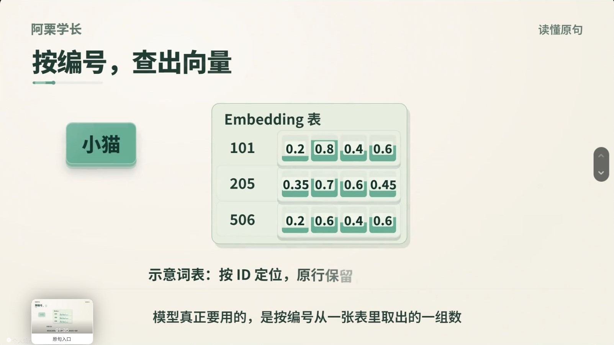

图中 101 只用于定位表的一行，接下来参与计算的是该行的四个分量。不同位置如果恰好是同一个 Token，初始查表结果可以相同，位置信息和上下文再区分它们。

### 06:45 · 沿残差直路先相加，再做归一化

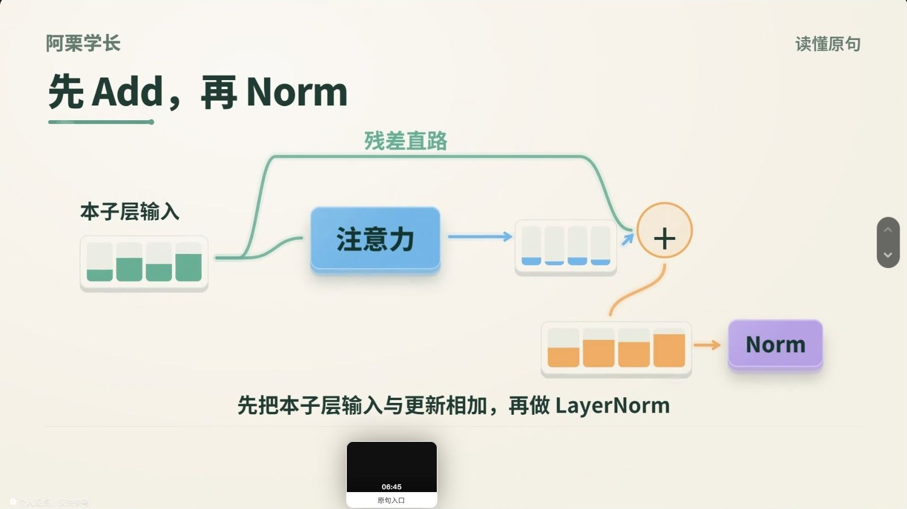

图中上方的输入绕过注意力，与注意力分支的更新在加号汇合。右侧 Norm 处理两者之和，对应原始 Transformer 的 Post-LN。分析实际模型时要再看它是否采用 Pre-Norm。

### 13:15 · 普通句号和结束 Token 触发不同处理

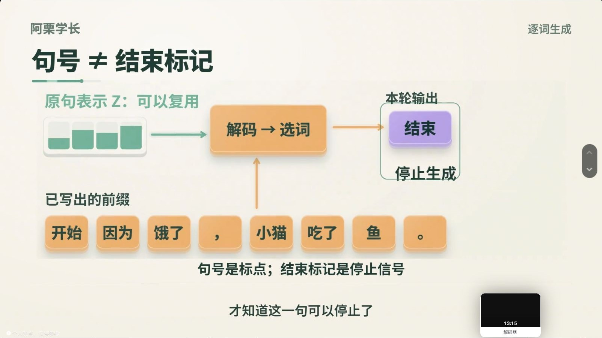

图里句号已出现在生成前缀内，仍可继续解码。采到配置的 EOS 时生成循环才据此结束。服务也可能因长度上限或停止条件退出，标点是否终止取决于配置。
