# 从机器学习到深度学习

视频由数据范儿_范老师发布于 2025 年 9 月 10 日，时长约 23 分钟。它从人工规则与数据学习的差别讲起，经由神经网络、反向传播和深层训练，最后接到 AlexNet 与 Transformer。 [B 站原视频](https://www.bilibili.com/video/BV1vZHmzvE6D/)

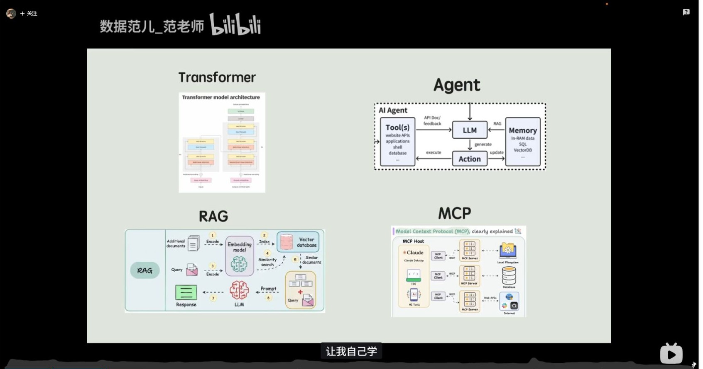

图 A（00:30）用四个近期常见术语引出本讲的前置问题。Transformer 是模型架构。RAG 把检索结果送入生成环节，Agent 组织模型与工具的调用过程，MCP 提供连接外部能力的协议。理解这些应用之前，视频先追问模型怎样通过训练获得预测能力。

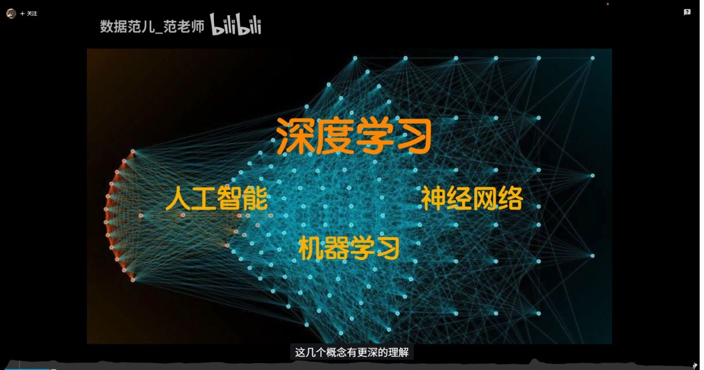

图 B（01:30）给出接下来要区分的四个概念。可以把它们读成不同层次的问题。人工智能是研究范围，机器学习描述从数据获得模型行为的方法，神经网络是一类参数化模型，深度学习侧重多层网络学习表示。图中的词语位置仅用于引出主题，概念关系见第二节的对照表。

## 一、从人工写规则到用数据拟合模型

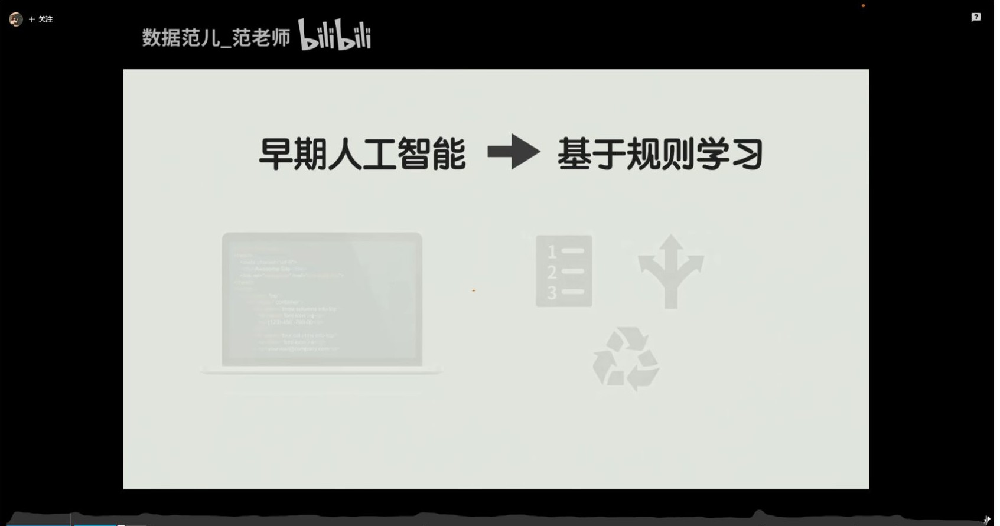

图 1（02:35）以基于规则的系统为起点。规则系统把判断条件写在程序里。机器学习先规定模型形式、输入、目标和损失，再用数据确定参数。例如房价模型可以把面积 $x_1$、房龄 $x_2$ 编码成两个特征，令 $\hat y=w_1x_1+w_2x_2+b$，用成交价来衡量预测误差并更新 $w_1,w_2,b$。线性模型有多个输入，仍只做一次仿射变换。

### 规则系统的瓶颈在于覆盖变化

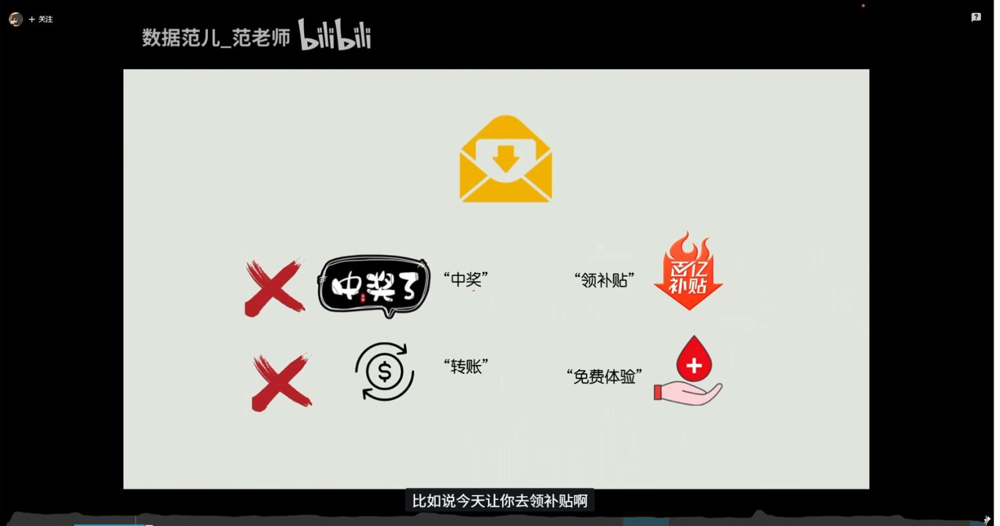

图 1a（03:15）展示了视频的垃圾邮件例子。如果程序只拦截带「中奖」或「转账」的邮件，发件人改用「领补贴」或「免费体检」就可能绕过关键词。每出现一种新说法，维护者都要判断是否加规则。词表扩得太宽，正常通知也可能被误拦。

视频接着把垃圾邮件和正常邮件作为样本交给模型。训练可以让模型根据样本调整多种信号的权重，例如措辞、链接和发件特征。这样把逐条维护判断条件的工作，部分转移到了收集样本、选取输入信号和评估误判上。遇到新一轮话术变化，模型也需要用新样本检验。

**延伸解读。** 想象你同时收到两封带「领补贴」的邮件。一封来自公司的通知邮箱，另一封来自陌生地址，还催你立刻点链接。关键词规则给两封邮件同样的判断。模型若能同时看到发件地址、链接和措辞，就有机会给出不同分数。反过来，如果训练数据里恰好所有公司通知都来自同一个地址，模型也可能把这个巧合学成捷径。换一批发件人测试，才能看出它依赖了什么。

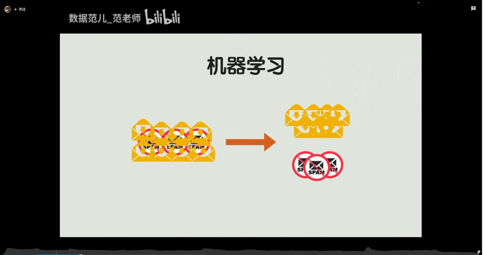

图 1b（03:40）中的两组邮件对应有标签的训练数据。每封邮件提供一组可计算的输入特征及「垃圾／正常」目标。训练用预测与标签的差距调整参数。部署时，模型读取新邮件的输入特征，按学到的权重给出分类分数。分类阈值可以在验证集上调整，分别观察漏拦和误拦。

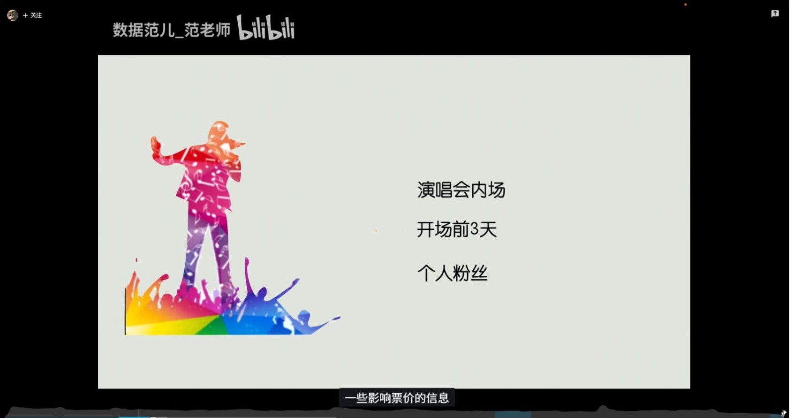

图 1c（04:18）把同样的框架用到票价预测。可将座位区域和距离开场的天数编码为特征，用历史成交价作为训练目标。邮件的目标是类别，票价的目标是连续数值，所以前者对应分类，后者对应回归。若要预测未来成交，评估时应保证输入字段在预测当时就已可知，并用后续交易检验误差。

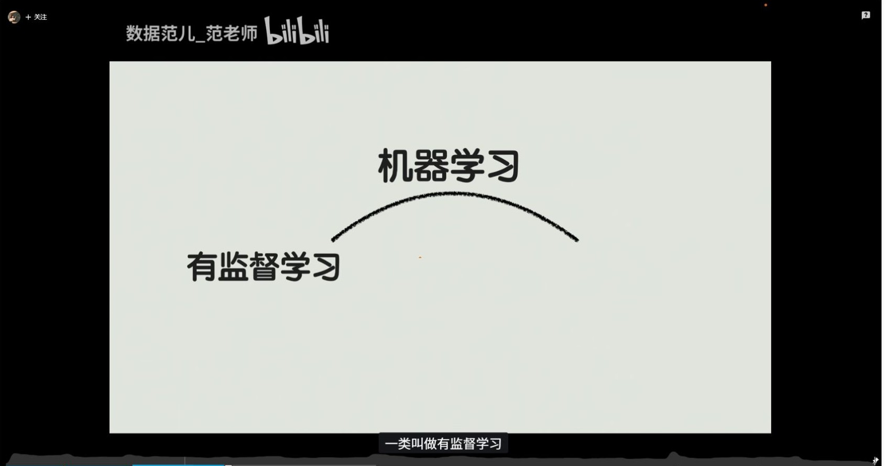

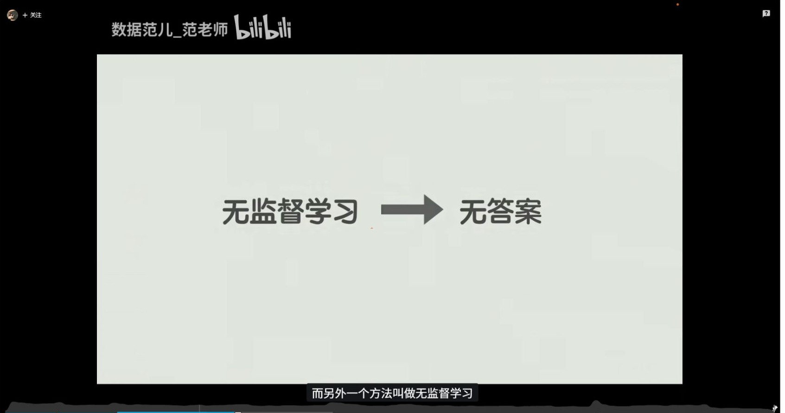

图 2–3（05:50、06:55）对照训练信号的来源。有监督学习使用样本的目标值，例如房价或类别。无监督学习可从无人工标签的数据中寻找结构，例如聚类。语言模型的自监督预训练则从文本内部构造目标。输入「我 爱 猫」时，模型可分别用「我」预测「爱」，用「我 爱」预测「猫」。目标来自数据本身，训练仍可逐位置计算预测分布和目标 token 之间的交叉熵。 [Transformer 全流程](../Transformer全流程/Transformer_从输入到自回归生成.md)

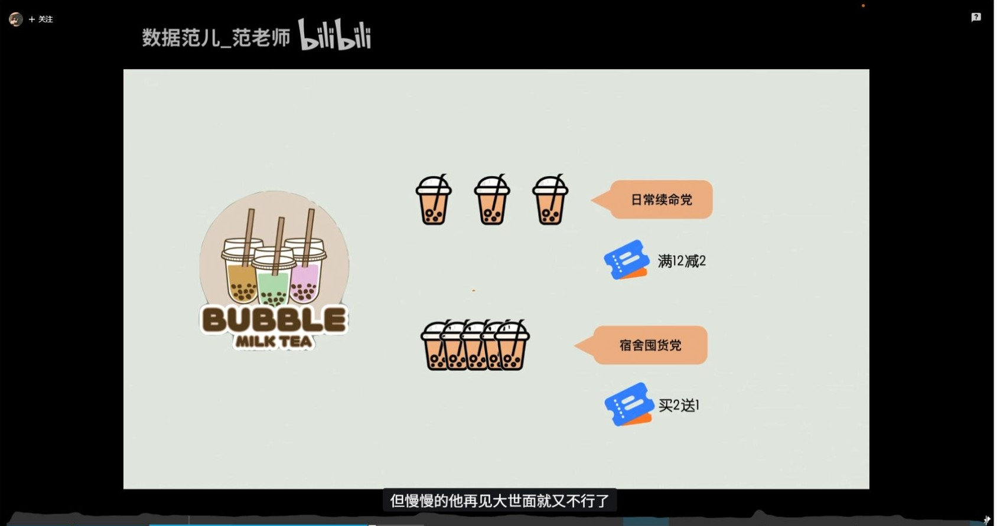

图 3a（08:34）把聚类用于奶茶消费。可以给每个顾客记录购买频率、平均杯数和最近购买时间，把行为相近的人归到同一组。商家再根据各组行为决定优惠方案。群组由相似性得到，「日常消费」等名称由人解释。优惠能否提升复购，则要通过后续对照检验。

## 二、深度学习把特征表示也纳入训练

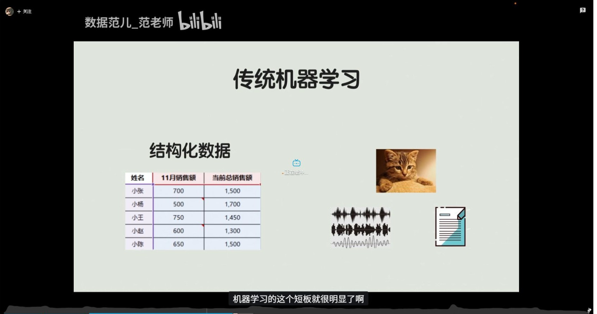

### 传统机器学习的瓶颈在于人工提取特征

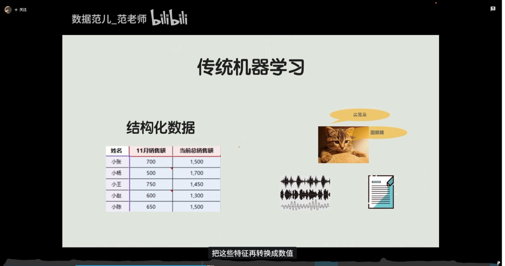

图 4a（09:32）接着解释表格和图像输入的差别。表格中的消费金额已经是数值字段。面对猫的照片，一种传统流程是先决定提取哪些可测特征，再把它们转为数值供分类器使用。音频和文本也需要各自的特征表示，换任务时往往要重做这一步。

以图像分类为例，如果特征只保留颜色直方图，两张颜色比例相同、轮廓不同的照片就可能得到同一个向量。分类器收到相同的输入，再怎么调权重也无法区分这两张图。这是人工特征遗漏任务信息的一种具体后果。

**延伸解读。** 拿四个像素做个小实验。左边两格白、右边两格黑，是一道竖边。上面两格白、下面两格黑，是一道横边。两张图的黑白比例都是一半。如果交给分类器的只有这个比例，竖边和横边就变成了同一条数据。把像素排列保留下来，网络才有机会学出对方向敏感的特征。这个例子也解释了为什么输入表示会决定下游模型能利用哪些线索。

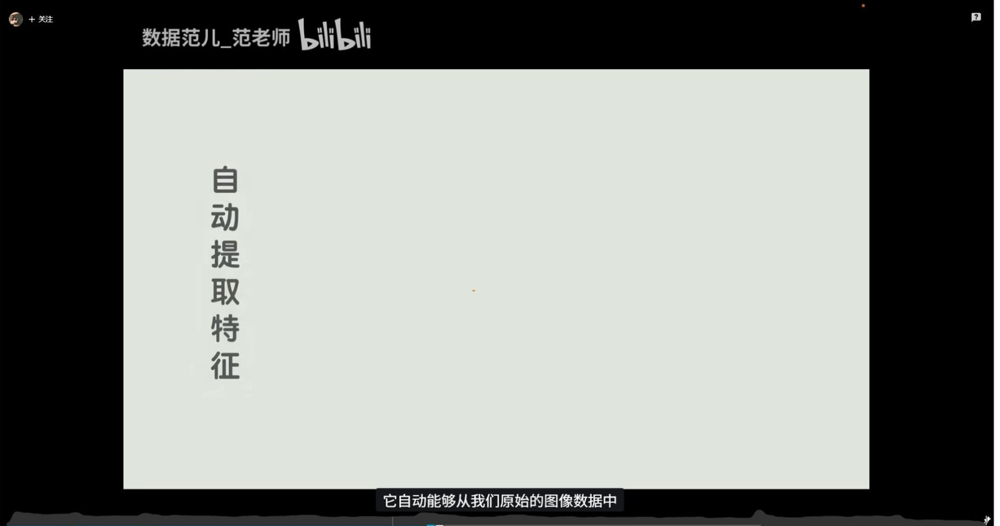

图 4b（10:10）标记从固定人工特征转向学习特征的节点。用图像分类表示这项变化，前端网络把像素变成中间向量，末端再用该向量预测类别。分类损失的梯度传回前端，前端的参数也随训练调整。可学习的特征是否稳定，仍可用不同背景和光照下的测试样本检验。

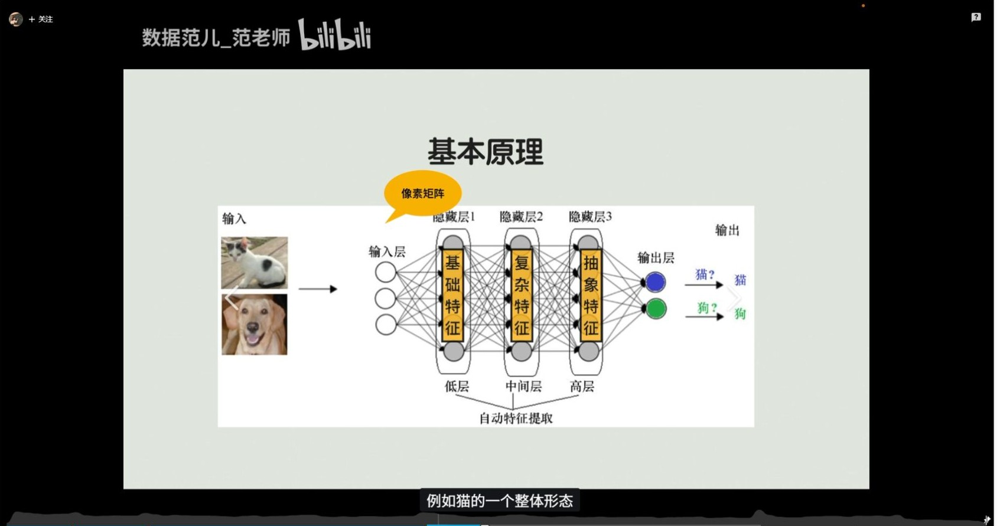

图 4–5（09:05、11:15）把两种工作流放在一起。传统流程可以先人工定义特征，再把特征交给分类器。深度网络可以从输入学出多层中间表示，并通过同一个任务目标更新这些层。CNN 仍由人设计卷积结构，Transformer 也需要预先选择分词和架构。学习发生在参数和由参数生成的特征表示上。

| 概念 | 在这条学习路线中的位置 |
| --- | --- |
| 人工智能 | 涵盖规则系统、搜索、机器学习等多种方法 |
| 机器学习 | 利用数据或交互反馈确定模型行为 |
| 神经网络 | 由带参数的计算层组成的一类模型 |
| 深度学习 | 使用多层网络学习中间表示及任务映射 |

## 三、用 XOR 手算隐藏层为什么有用

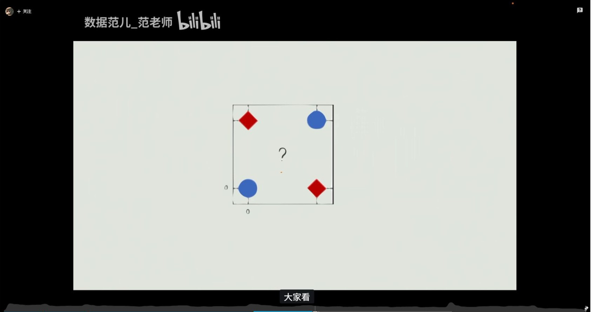

图 6（12:20）中，两类点各占一个对角线。令 $(0,0),(1,1)$ 的标签为 0，$(0,1),(1,0)$ 的标签为 1。若线性分类器把分数 $w_1x_1+w_2x_2+b>0$ 判为 1，那么后两点要求 $w_1+b>0$、$w_2+b>0$，相加得 $w_1+w_2+2b>0$。前两点却要求 $b\le0$、$w_1+w_2+b\le0$，相加得 $w_1+w_2+2b\le0$。一个线性边界无法同时满足这些条件。

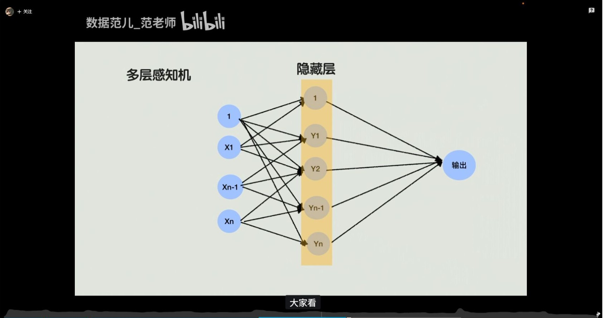

图 7（13:25）引入隐藏层。用两个 ReLU 单元可构造这个教学解。

$$
h_1=\max(0,x_1-x_2),\qquad h_2=\max(0,x_2-x_1),\qquad \hat y=h_1+h_2.
$$

| 输入 | $h_1$ | $h_2$ | 输出 |
| --- | ---: | ---: | ---: |
| $(0,0)$ | 0 | 0 | 0 |
| $(0,1)$ | 0 | 1 | 1 |
| $(1,0)$ | 1 | 0 | 1 |
| $(1,1)$ | 0 | 0 | 0 |

隐藏单元把输入变换成可以用简单加法分类的新坐标。若各层只使用仿射变换，多层复合仍是一个仿射变换。这里引入非线性的作用也适用于 Transformer 的 FFN。 [激活函数专题](../激活函数/激活函数_从非线性到SwiGLU.md)

## 四、一次反向传播怎样改动权重

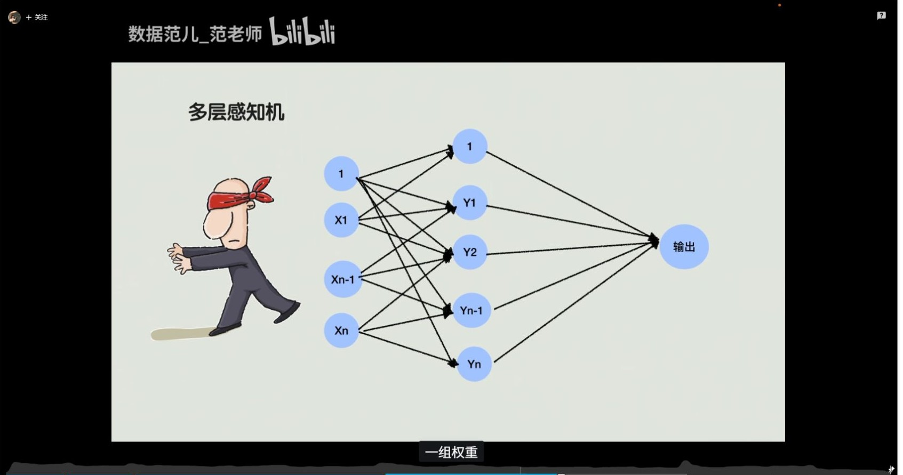

图 7a（14:30）问的是有了多层结构之后，如何找到一组可用权重。上一节的 XOR 解是手工指定的，训练要从一组初始参数出发。每轮先计算预测和损失，再求损失对各条连接权重的梯度。梯度提供当前点附近的变化方向，优化器决定一步走多远。

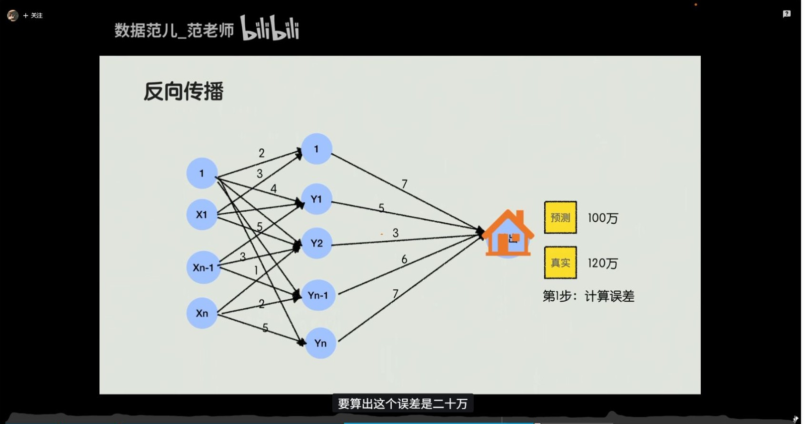

图 8（15:35）以预测价和实际价之间的差距说明训练目标。取单个样本 $x=2,y=6$，教学模型为 $h=\operatorname{ReLU}(wx)$、$\hat y=vh$。初始权重 $w=1,v=2$，采用损失 $\mathcal L=(\hat y-y)^2/2$。前向得到 $h=2$、$\hat y=4$、$\mathcal L=2$。

$$
\frac{\partial\mathcal L}{\partial v}=(4-6)\cdot2=-4,\qquad
\frac{\partial\mathcal L}{\partial w}=(4-6)\cdot2\cdot1\cdot2=-8.
$$

第二个乘积依次经过损失、输出层、ReLU 和输入。学习率取 $0.05$，同时使用更新前的梯度，得到 $v'=2.2,w'=1.4$。同一样本重算得到 $\hat y'=6.16$、损失 $0.0128$。反向传播负责算梯度，梯度下降负责决定权重更新的方向和步长。单个样本的损失下降只检验这一步的数值。 [Rumelhart、Hinton 与 Williams，1986](https://doi.org/10.1038/323533a0)

**延伸解读。** 上面这一步把预测从 4 拉到 6.16，略过了目标 6，但误差仍然缩小。把学习率从 0.05 改成 0.25，沿同样的梯度更新会得到 $w'=3,v'=3$，预测直接跳到 18，损失升到 72。两次拿到的是同一个梯度，结果差在步长。这正是视频里「找到往哪走」和实际训练中「决定走多远」之间的区别。

## 五、网络变深后，梯度为什么难传

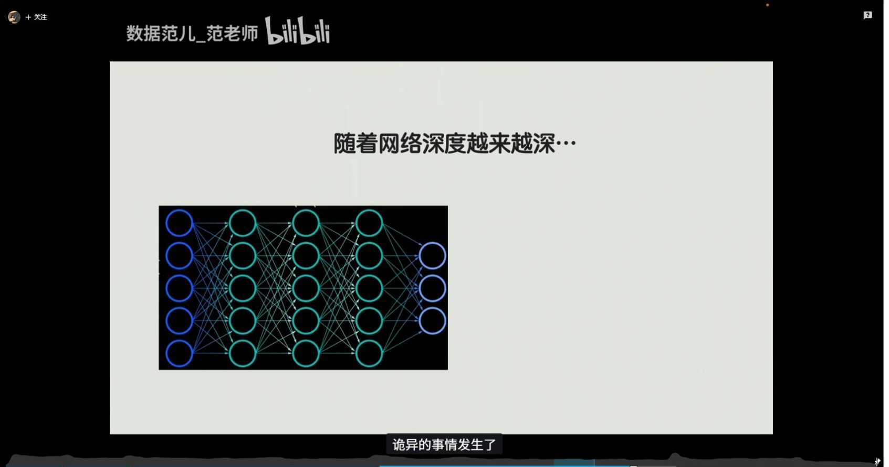

图 8a（16:40）显示多层隐藏表示依次传递。前向时，每层读入上一层的输出。反向时，末端损失要沿这些依赖回传到前层。层数增加后，前层梯度要经过更多局部导数，下一张图用梯度变小和变大的数列说明两种可能结果。

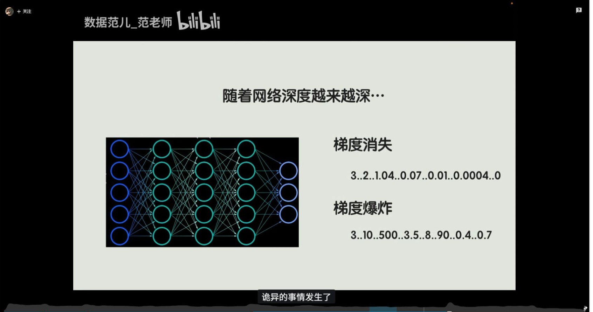

图 9（17:45）的数列用于说明梯度幅度的变化。对标量深层复合，链式法则会累乘各层局部导数。如果十层都贡献 $0.5$，总因子为 $0.5^{10}\approx0.00098$。如果都贡献 2，则为 $2^{10}=1024$。真实网络要跟踪 Jacobian 在不同方向上的乘积，梯度传播还受初始化、激活、归一化和残差路径影响。

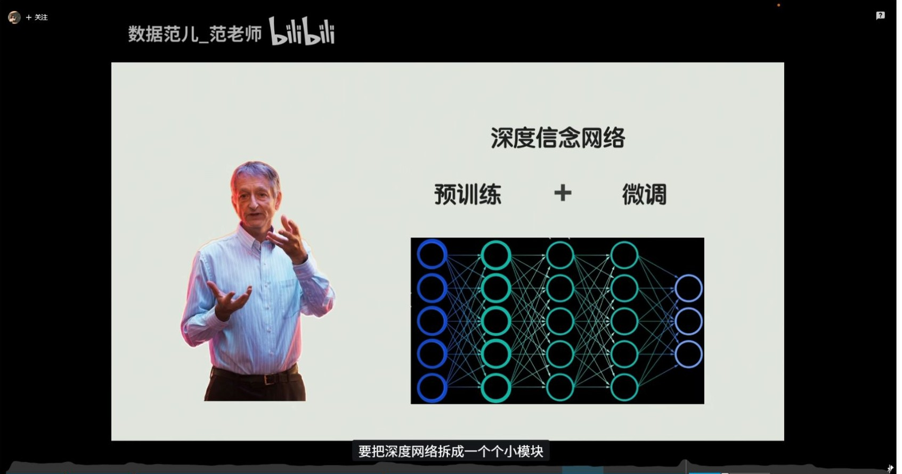

图 10（18:50）介绍 2006 年深度信念网络的一条历史路线。先逐层无监督学习，再对组合后的模型微调，可以让后续优化从已经形成一定表示的参数出发。这里的逐层预训练与现代语言模型在大规模文本上用自监督目标联合训练整网，属于不同训练流程。 [Hinton、Osindero 与 Teh，2006](https://doi.org/10.1162/neco.2006.18.7.1527) · [梯度消失与爆炸专题](../梯度消失与爆炸/梯度消失与爆炸_从链式法则到残差连接.md)

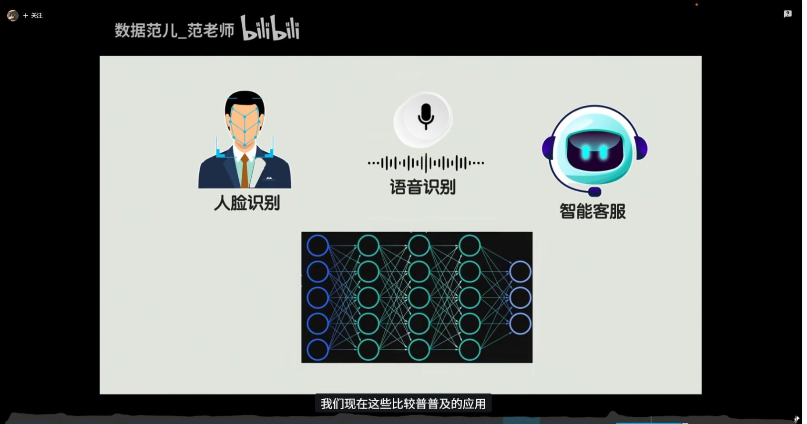

图 10a（19:55）用三个应用说明多层表示可以服务不同任务。人脸识别需要对图像建立表示，语音识别要把音频变成可预测的序列，客服系统还要根据输入产生回答或执行服务流程。应用图标说明了任务范围，具体效果要分别用识别或服务指标衡量。

## 六、从 AlexNet 的实验到 Transformer 的序列计算

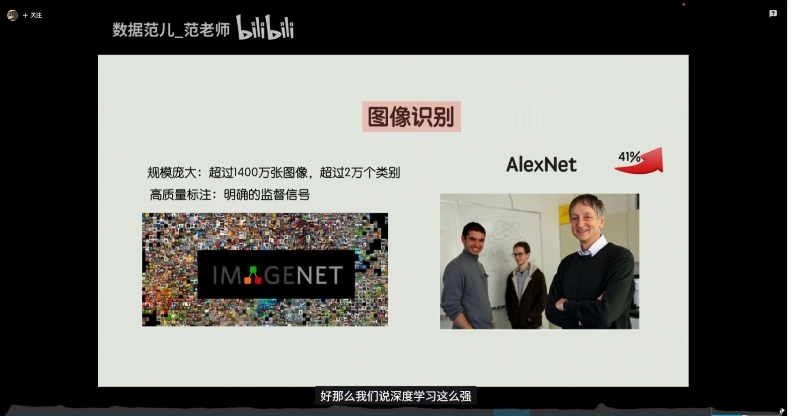

图 11（22:05）展示的是一个视觉任务的里程碑。Krizhevsky、Sutskever 与 Hinton 的 2012 年论文报告，在 ILSVRC-2012 竞赛的测试集上，其提交的模型组合 Top-5 错误率为 15.3%，第二名为 26.2%。Top-5 错误表示正确类别没有进入模型排名前五。这一结果应与竞赛、测试集、指标和模型组合一起阅读。 [AlexNet 原论文](https://papers.nips.cc/paper_files/paper/2012/hash/c399862d3b9d6b76c8436e924a68c45b-Abstract.html)

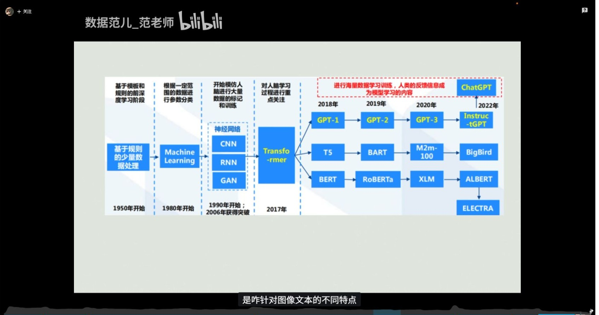

图 12（22:40）的时间线用于串起主题。AlexNet 用卷积学习图像的局部空间表示。Transformer 用注意力在序列位置之间传递信息，并用逐位置 FFN 更新表示。用本项目的术语，可以把语言模型训练接回第四节的循环。

| 本文概念 | Transformer 中对应的计算 |
| --- | --- |
| 输入表示 | Token ID 经 Embedding 映射为向量 |
| 学习中间特征 | 注意力混合位置间信息，FFN 更新每个位置的表示 |
| 训练目标 | 从文本构造下一个 token，按 logits 计算交叉熵 |
| 学习参数 | 反向传播求梯度，优化器更新参数 |
| 生成 | 计算下一 token 的分布并采样，再把新 token 加入上下文 |

下一篇可以沿同一个例子追踪序列怎样进入模型，以及训练的目标右移怎样对应推理时的逐步生成。 [Transformer 全流程](../Transformer全流程/Transformer_从输入到自回归生成.md) · [最小 Decoder-only 生成示例](../Transformer全流程/decoder_demo.py)

## 七、截图索引

| 图号 | 视频时间 | 画面 |
| --- | --- | --- |
| A–B | 00:30、01:30 | 开场术语与概念范围 |
| 1 | 02:35 | 规则系统 |
| 1a | 03:15 | 垃圾邮件改换措辞，避开预设关键词 |
| 1b–1c | 03:40、04:18 | 邮件分类与演唱会票价回归 |
| 2–3 | 05:50、06:55 | 有监督与无监督学习 |
| 3a | 08:34 | 奶茶消费分群 |
| 4–5 | 09:05、11:15 | 输入数据与多层特征表示 |
| 4a | 09:32 | 从图像人工提取特征并转成数值 |
| 4b | 10:10 | 自动提取特征 |
| 6–7 | 12:20、13:25 | XOR 与多层感知机 |
| 7a | 14:30 | 寻找网络权重 |
| 8 | 15:35 | 反向传播 |
| 8a | 16:40 | 增加隐藏层 |
| 9–10 | 17:45、18:50 | 梯度传播、逐层预训练与微调 |
| 10a | 19:55 | 深度学习的应用示意 |
| 11–12 | 22:05、22:40 | ImageNet、AlexNet 与语言模型时间线 |

截图保留原视频作者标识。XOR、梯度下降和梯度连乘的数值均为本文构造的教学算例。
