# Token 与 Embedding：从 strawberry 计数到向量查表

> **整理日期：** 2026-11-09  
> **视频来源：** 神经元出逃计划，《大模型为什么数不清 strawberry 里的 r？从分词到 Embedding 一次性讲清楚》，2026-10-30 发布，约 9 分钟。  
> **原视频：** [抖音视频](https://www.douyin.com/video/7702464487491702059)  
> **内容：** 27 张视频截图，串联字符、BPE、Token ID、Embedding、向量训练和字母计数；另补充查表、梯度及容量手算。截图中的模型版本、编号及检索数值作为作者演示记录，不作为本文独立复现结果。

**目录位置：** 归入 `03-技术拆解-分词与向量化/Embedding/`。若想逐轮复算 BPE，先读 [BPE 分词：从相邻合并到 Embedding](../BPE分词/BPE分词_从相邻合并到Embedding.md)；本篇重点解释编号怎样变成可训练向量，以及这与字符任务的关系。

文本进入模型的常见路径是：

```text
原始字符串 → 预处理与分词 → Token ID → Embedding 查表 → 上下文计算
```

这条路径改变了字符信息呈现给模型的粒度，但不等于字符信息必然丢失，更不等于模型在所有字母计数任务上必然失败。

## 一、strawberry 中有几个 r？


`strawberry` 的字符依次为：

```text
位置：1 2 3 4 5 6 7 8 9 10
字符：s t r a w b e r r y
```

因此小写 `r` 有 3 个，位于第 3、8、9 个字符。

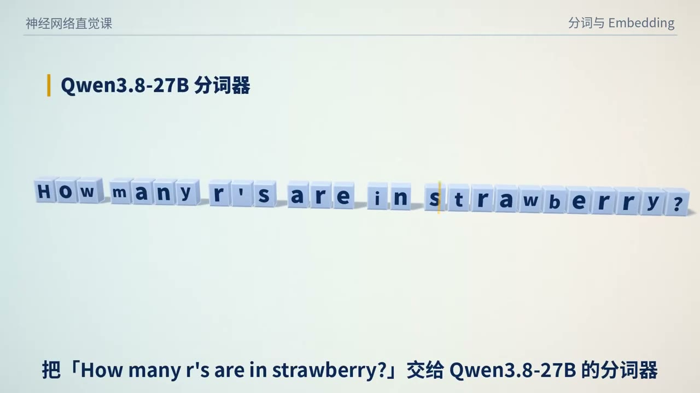

视频展示某个分词器将完整词映射到一个 ID。若一个词以整体 Token 进入模型，模型接收到的序列位置不再逐一对应其中每个字母。需要将 Token 与拼写信息联系起来，再进行字符级操作；这与直接在字符数组上执行循环不同。

**应如何理解标题？** 字符粒度和训练任务可能影响计数难度，但仅凭 Token 切分不能证明某模型一定数错。模型可以学到拼写规律，也可以输出程序或调用工具完成精确计数。是否出错还取决于模型、提示、推理过程和工具使用；本文不把历史案例当作对所有现有模型的能力测试。

## 二、先区分字符、字节、Token、ID 和向量

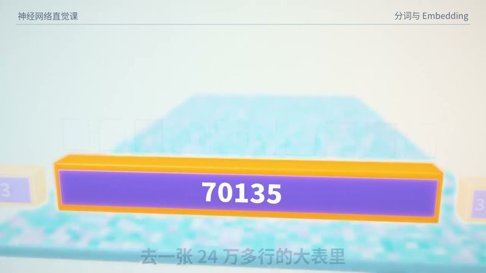

| 对象 | 它是什么 | 不应混淆成什么 |
| --- | --- | --- |
| 字符 / 码点 | Unicode 文本层面的单位 | 不总与用户感知的一个字符或一个 Token 对应 |
| 字节 | 文本编码后的存储单位 | 一个汉字通常不止一个 UTF-8 字节 |
| Token | 分词器定义的离散片段 | 不必是完整词，也不必是单个字母 |
| Token ID | 对应词表条目的整数索引 | 不是语义坐标或字母计数 |
| Embedding | 由 ID 选取的可训练向量 | 不是 Token 的原始拼写字符串 |
| 隐藏状态 | 模型结合位置及上下文计算得到的表示 | 不等于固定的输入查表行 |

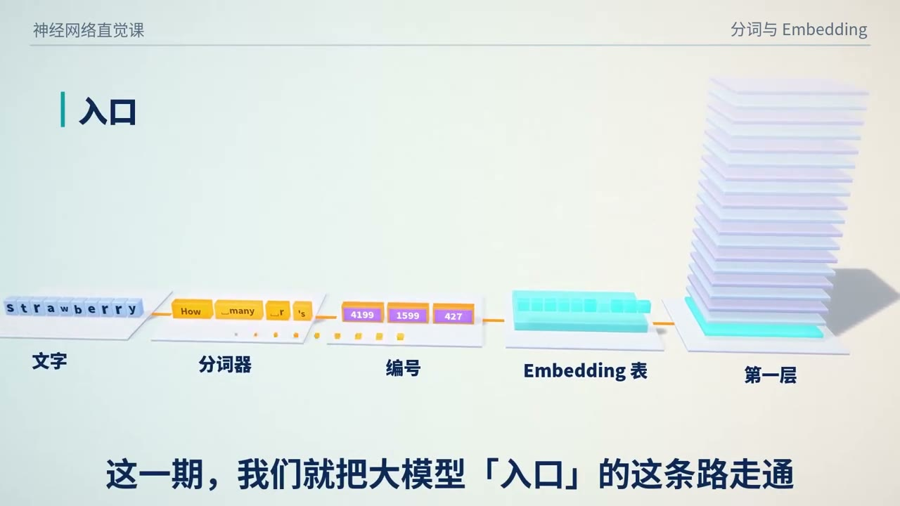

“只认向量，不认字”适合作为入口的比喻。更准确的说法是：神经网络接收数值表示，而如何利用其中的字符或语义信息，取决于表示与后续训练。

**延伸解读。** 把词表里两个 ID 对调，同时对调 Embedding 表对应的两行，再对调输出头对应的候选及解码映射。同一句话的中间向量和最终文本都可以保持一致。ID 是查表地址。拿两个 ID 相减，得到的数字反映编号方案，词义关系要看训练后的向量及上下文。

## 三、为什么不全部按字符或字节切？

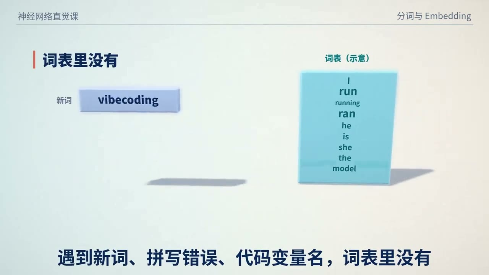

细粒度切分覆盖灵活，但同一文本可能形成更长序列。UTF-8 中很多常见汉字占三个字节，部分扩展区汉字占四个；英文 ASCII 字母通常一个字节。不能把所有语言都按同一个字节 / 字符比例计算。

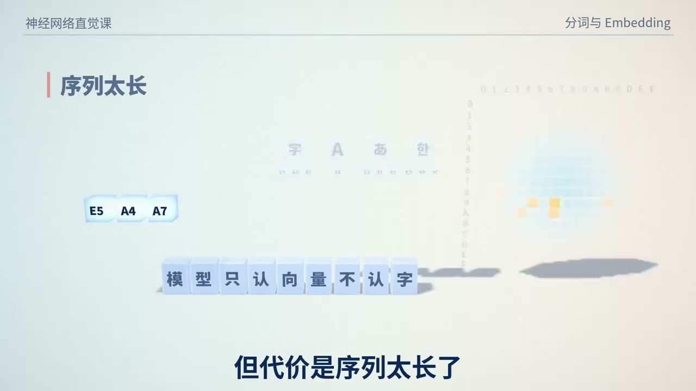

标准全注意力的 QK 分数和 AV 聚合含有随序列长度 $T$ 二次增长的工作。固定隐藏维度时，如果 Token 序列长度恰好变为原来的 3 倍，这一部分理论运算量约变为 9 倍；FFN 等逐位置工作约随长度线性增长。

这不是端到端耗时或峰值显存必然增加 9 倍的结论。高效注意力内核可以避免完整物化注意力矩阵，模型结构也可能采用其他机制。

## 四、BPE：按统计反复合并相邻片段

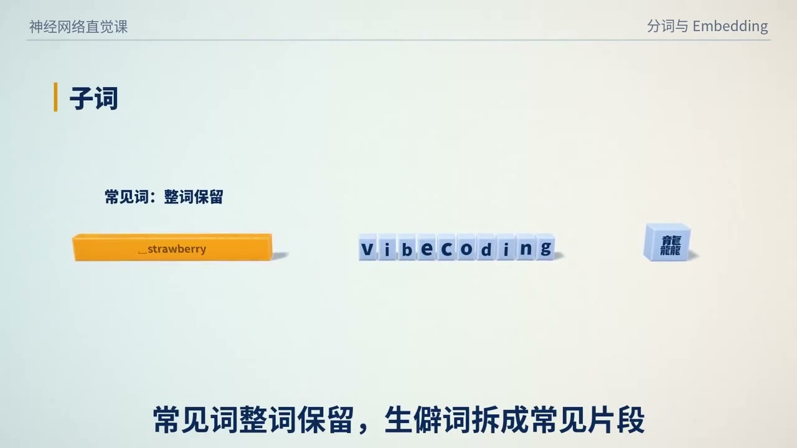

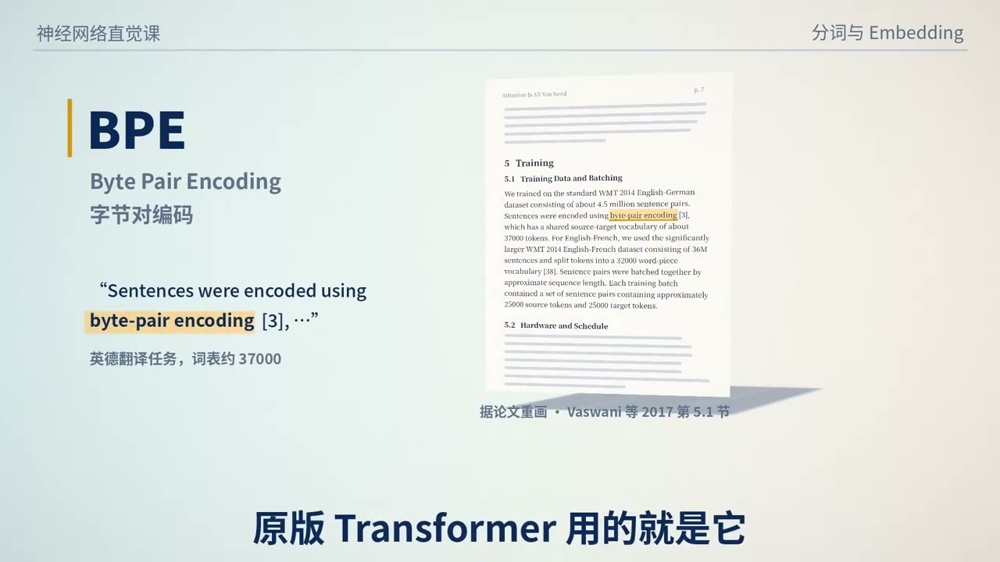

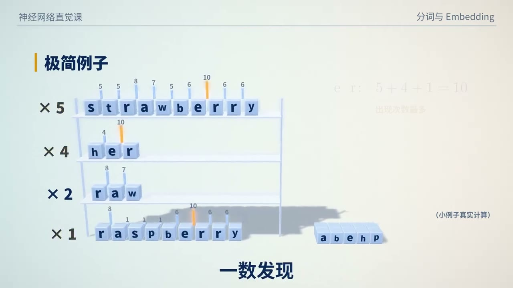

视频用 `strawberry`、`her` 等词的出现频次演示：从小单位出发，统计当前相邻对，合并高频对，再统计。学习的是一套有顺序的规则，不是逐词判断“哪个字符串语义完整”。

已有专题给出了完整三轮手算与代码，详见 [BPE 的统计与合并](../BPE分词/BPE分词_从相邻合并到Embedding.md)。使用时通常冻结规则，按已学到的合并优先级编码，不会每来一句话就重新统计整个词表。

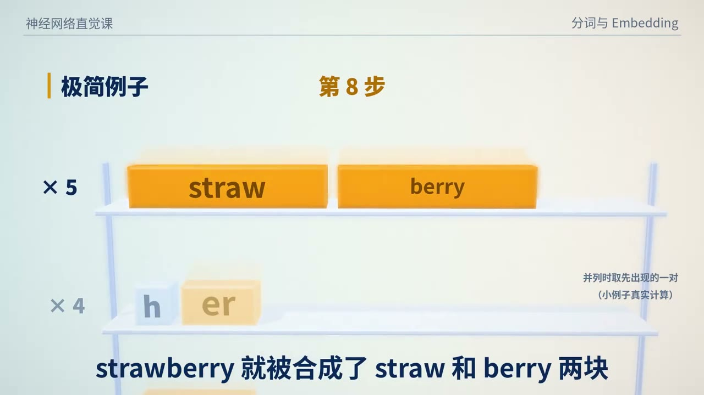

### 4.1 预分词还决定哪些边界不能跨

在完整工程流程中，规范化、预分词、特殊 Token、BPE 和解码器各有职责。字母与数字是否分段、数字是否逐位拆分、空格是否附着在 Token 前面，都取决于配置。

不能把某个分词器的“数字逐位切分”推广成所有模型的规则。更换空格、大小写、语言或上下文，也可能改变 Token 边界。可参照 [Hugging Face Tokenizers 的组件说明](https://huggingface.co/docs/tokenizers/main/en/components)。

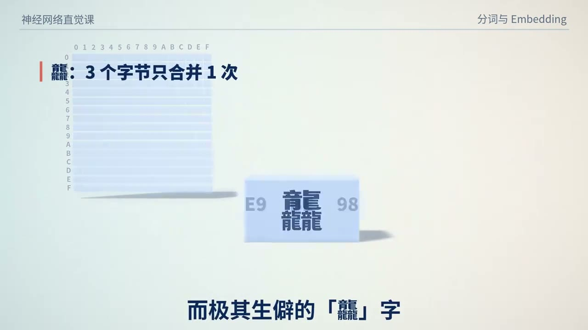

如果保留全部基础字节并使用相应字节级实现，就能把没有整体 Token 的新组合退回更小片段。字符级 BPE 若初始字符表缺少某字符，则不自动具有同样覆盖性。

## 五、同一个词为什么有时一块、有时多块？

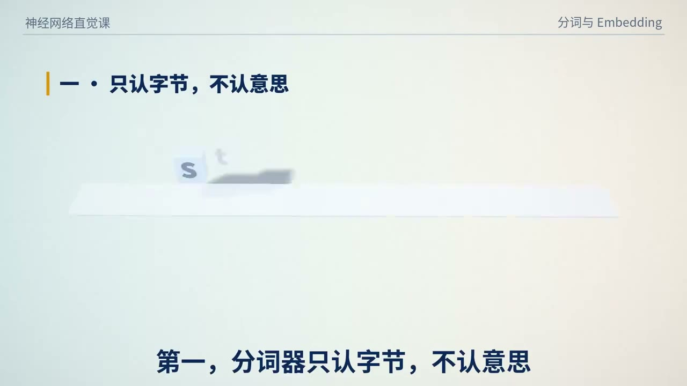

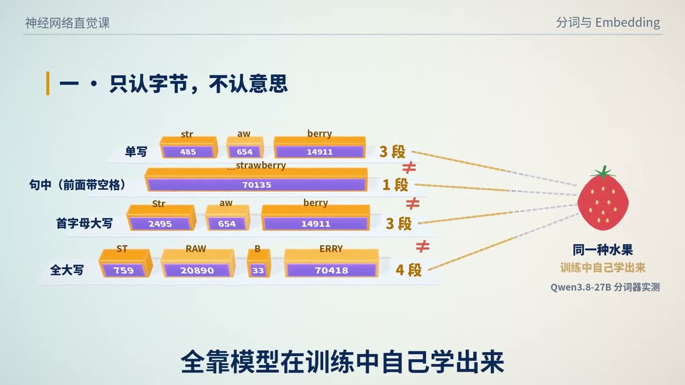

输入前面的空格、词周围的标点、预分词规则及词表都会影响编码。例如 `strawberry`、` strawberry`、`straw berry` 并不是相同字节序列。最后一种甚至改变了原始输入，不能只把它看作“同一个字符串的无损展示”。

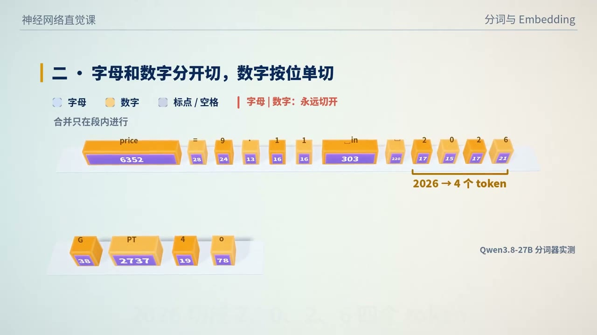

常见片段更大，有时可以缩短序列；词表增大，也会增加输入 Embedding 和可能的输出映射成本。大词表本身不能保证更强的理解能力或更可靠的字符操作。

## 六、编号相邻，不表示语义相近

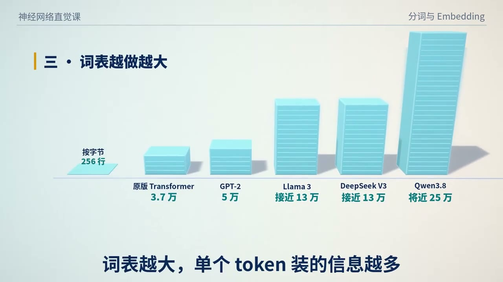

Token ID 70135 与 70136 的差是 1，不代表对应词语的含义相近。视频编号属于它展示的词表，不是所有分词器的通用编号。

在匹配的模型系统中，可以把 Token ID 整体重编号，并同步排列 Embedding 行及相应输出映射，就保持同样的函数关系。这说明整数的大小顺序并不是语义的来源。

真正输入网络的是对应行的向量，而不是把“70135”这个标量当作含义坐标。

## 七、Embedding：一张 V 行、d 列的可训练表

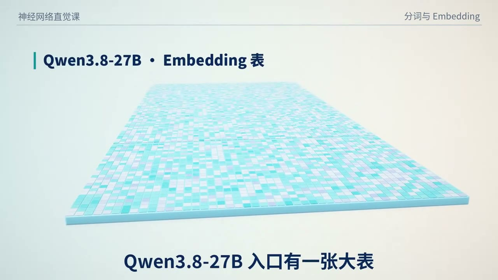

设词表可索引行数为 $V$，向量宽度为 $d$：

$$
E\in\mathbb R^{V\times d},\qquad x_t=E[\mathrm{id}_t,:].
$$

例如定义一张 **本文自建的教学表**：

$$
E=\begin{bmatrix}
0.1&0.2&-0.1\\
-0.2&0.3&0.0\\
0.4&-0.2&0.6\\
0.0&0.5&0.2
\end{bmatrix}.
$$

ID 序列 `[2,0,2]` 对应：

$$
X=\begin{bmatrix}
0.4&-0.2&0.6\\
0.1&0.2&-0.1\\
0.4&-0.2&0.6
\end{bmatrix}.
$$

同一个 ID 查到相同的行。若用 one-hot 矩阵 $S\in\mathbb R^{T\times V}$ 选行，则 $X=SE$；工程上通常直接索引，不必构造大而稀疏的 one-hot 矩阵。

### 7.1 视频容量数字怎么复算？

按视频画面给出的示例行数 248320、宽度 5120，独立计算：

$$
248320\times5120=1{,}271{,}398{,}400\ \text{个参数}.
$$

每参数 2 字节时，权重本体为 $2{,}542{,}796{,}800$ 字节，约 2.543 GB 或 2.368 GiB。这里仅复算截图中的形状，不表示已核验视频模型的检查点或完整词表配置。

这不包含梯度、优化器状态、分片及运行开销。输出映射若与输入表共享权重，不应重复计一份独立参数；是否共享需要查具体模型。

## 八、“同一行”与“不同语境”并不矛盾

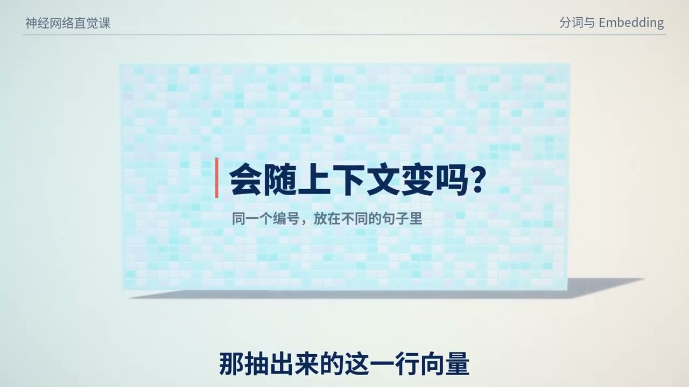

固定检查点在标准输入查表时，相同 ID 对应相同基础向量。但不同位置可以有不同的位置信息，后续通过注意力及其他模块与上下文交互，得到不同隐藏状态。

例如“我吃苹果”和“苹果发布手机”中的同一个 Token，即使初始输入行相同，深层表示也可以不同。“固定输入向量”不等于“词义永远固定”。

视频中“编号永远对应固定的一行”应理解为固定词表和标准查表的行索引关系；表中具体数值在训练或微调时仍可改变。冻结参数、继承检查点或特殊输入设计也会影响更新方式。

## 九、表里的数字是谁学出来的？

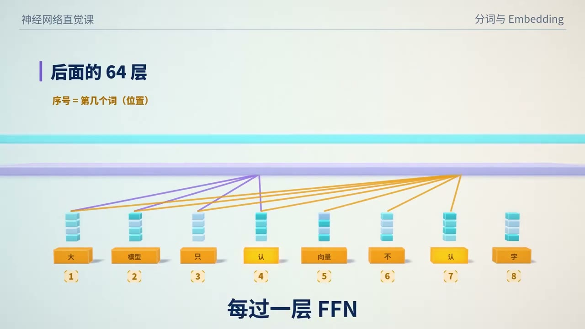

在常见语言模型训练中，损失沿计算图反传到输入 Embedding。若使用自回归交叉熵：

$$
L=-\sum_t\log p_\theta(u_{t+1}\mid u_{\le t}),
$$

模型会调整相关参数，使目标序列的预测更合适。Embedding 参与其中，并不是由词典人工为每个词填写“语义分数”。

### 9.1 同一 Token 多次出现，输入查表梯度会累加

设 $g_t=\partial L/\partial x_t$，则输入查表路径对第 $i$ 行的梯度是：

$$
\frac{\partial L}{\partial E_{i,:}}
=\sum_{t:\mathrm{id}_t=i}g_t.
$$

沿第七节序列 `[2,0,2]`，令三处输入梯度分别为：

$$
g_1=[1,0,-1],\quad g_2=[-0.5,1,0.5],\quad g_3=[0.5,2,0].
$$

则第 2 行累加梯度为 $[1.5,2,-1]$；第 0 行梯度为 $[-0.5,1,0.5]$。用学习率 0.1 的 SGD，第 2 行从 $[0.4,-0.2,0.6]$ 更新为：

$$
[0.4,-0.2,0.6]-0.1[1.5,2,-1]=[0.25,-0.4,0.7].
$$

这是输入查表路径的梯度。若输入表还与输出层共享权重，同一张表可能从输出损失收到额外梯度；未在输入中出现的行，也不一定完全没有梯度。权重衰减等优化设置还可能改变实际更新。

## 十、相似度、近邻和向量加减能说明什么？

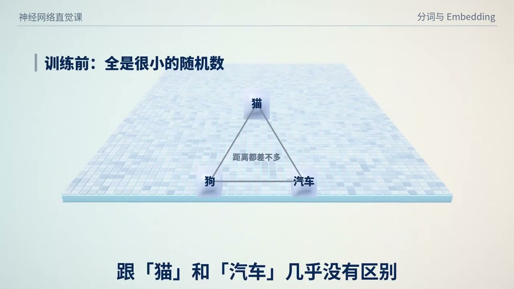

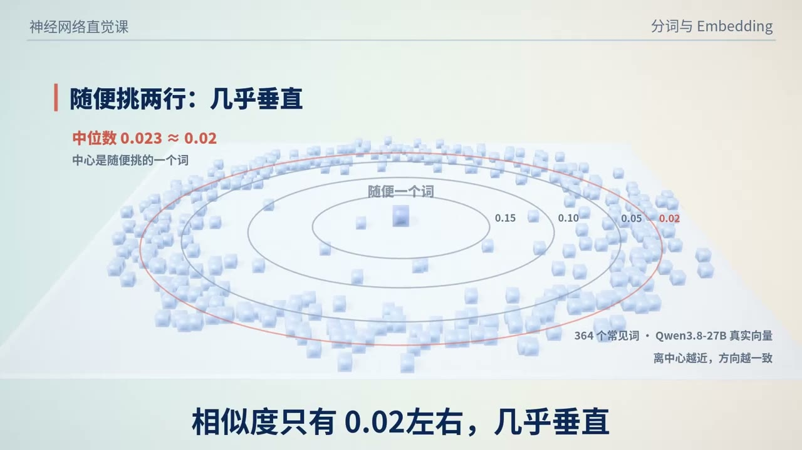

余弦相似度是：

$$
\operatorname{cos}(a,b)=\frac{a^Tb}{\|a\|_2\|b\|_2}.
$$

在非零向量下，它衡量方向相近程度，不是相同含义的概率。使用哪一层、是否归一化、候选词表、语言和 Token 边界都会影响近邻结果。

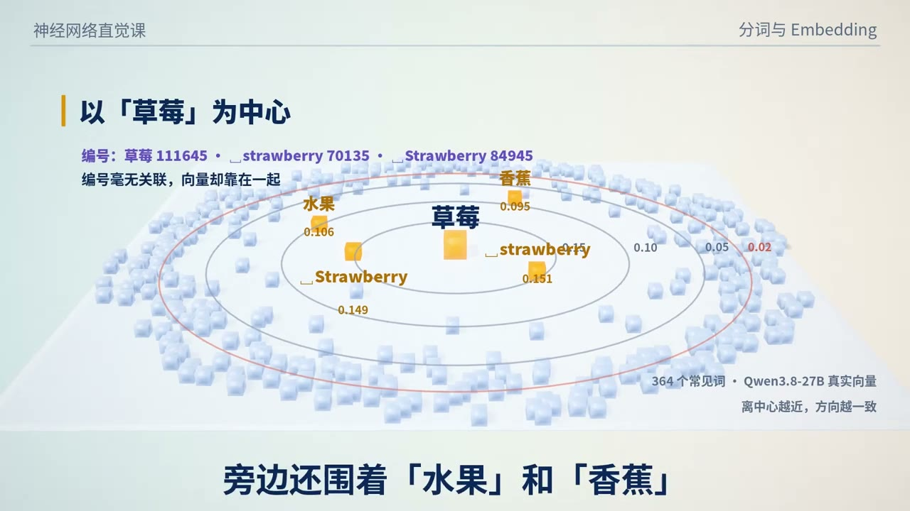

视频展示“巴黎 − 法国 + 日本”一类查询。词向量空间有时呈现可用于类比的结构，但这不是对所有词和所有检查点都成立的语义代数。对比时还要说明是否排除了查询词、使用什么距离和哪一份权重。

二维或三维投影也会失真；屏幕上点挨得近，不自动证明原始高维向量同样接近。本文未下载视频模型权重，未复现其近邻排名或投影。

## 十一、整体 Token 会把内部字母“抹掉”吗？

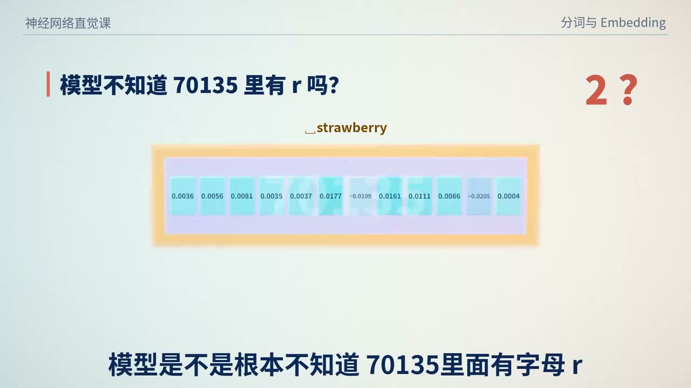

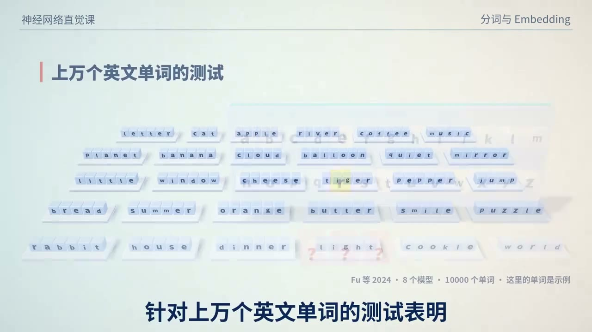

需要区分三个层面：

1. **可逆编码：** 若分词器及预处理保留原文本信息，Token ID 序列可经解码还原字符串。整体 Token 本身并不等于编码层面丢掉拼写。
2. **表示学习：** Embedding 和后续网络可以学到拼写相关信息，但不存在自动附带的“第几个字母是什么”接口。
3. **任务执行：** 即使含有拼写信息，模型仍需执行稳定的展开、定位、计数及回答过程。预测下一个 Token 的训练并不自动保证每次都执行精确算法。

如果没有预处理损失，`['strawberry']`、`['straw','berry']`、逐字符序列都可表示同一字符串；模型实际获得哪一种表示，则由对应分词器决定。

## 十二、拆开字母和使用代码，各改善哪一部分？

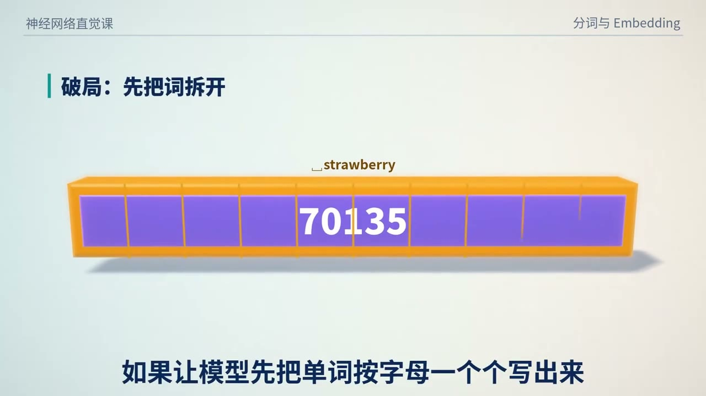

把字符串写成 `s t r a w b e r r y`，可能让字符操作更直观，但同时改变了输入文本；是否形成逐字母 Token 仍需实际检查分词结果，模型也可能在计数环节出错。

精确计数可直接在原始字符串上运行算法：

```python
word = "strawberry"
positions = [i for i, ch in enumerate(word, start=1) if ch == "r"]
print(len(positions), positions)  # 3 [3, 8, 9]
```

这里统计小写 ASCII `r`。大小写不敏感、Unicode 等价形式或组合字符任务，需要先明确字符及规范化规则。不能用“Token 数”替代“字母数”。

## 十三、把模型入口重新串起来

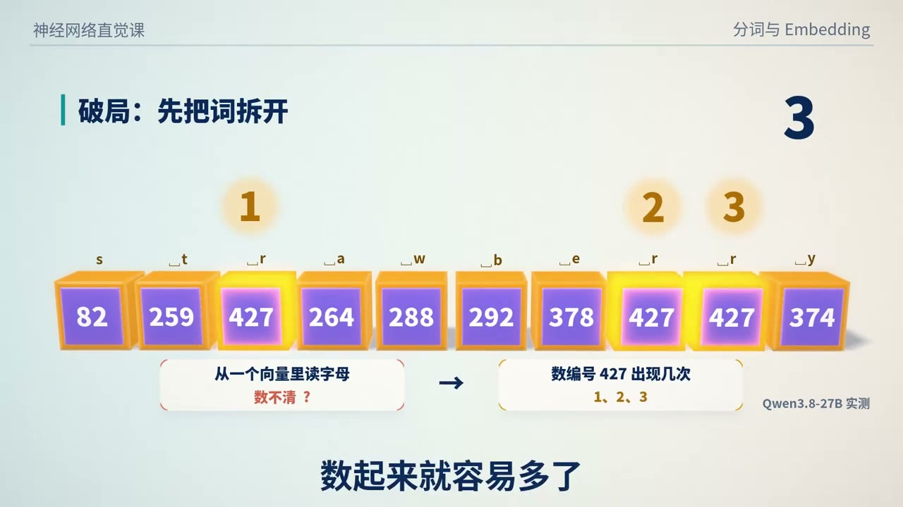

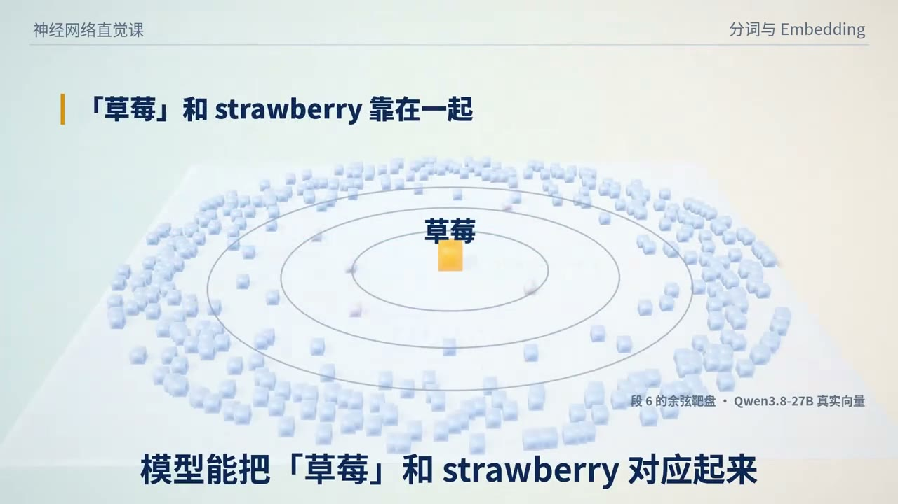

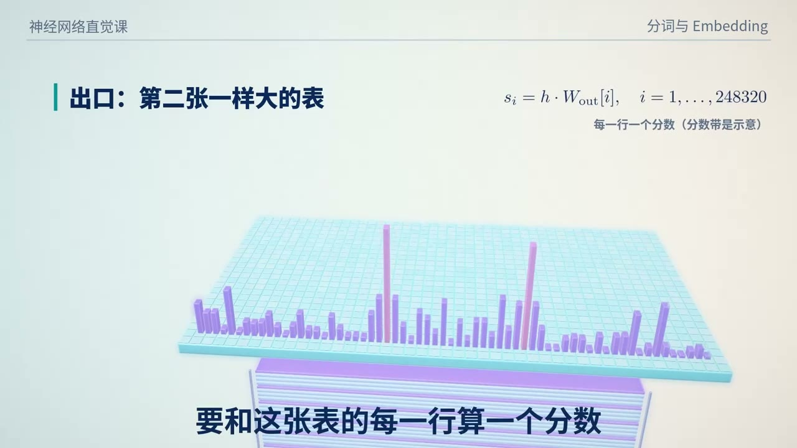

一个关于 strawberry 的提问，既包含任务说明，也包含目标字符串。整个输入按实际 Tokenizer 编码，ID 经 Embedding 查表进入网络，后续层结合上下文产生表示，再由输出映射预测回答 Token。

输入 Embedding 解决“从离散符号到连续向量”；输出层解决“从隐藏状态到词表上的分数”。两者可以共享权重，但在计算链中的方向和用途不同。

输出方向继续阅读 [输出层与采样：从 Logits 到 Temperature、Top-k 与 Top-p](../../09-技术拆解-输出/输出层与采样_从Logits到Temperature与TopP.md)，对照输入查表与输出打分的区别。

可继续阅读 [Transformer 全流程](../../01-技术前要-深度学习基础/Transformer全流程/Transformer_从输入到自回归生成.md)，了解后续注意力、FFN 与自回归生成。

## 十四、配套数值核对

[embedding_math.py](embedding_math.py) 仅用 Python 标准库核对字符位置、相同文本的不同示意切分、直接查表与 one-hot 选择等价、重复 ID 的梯度累加及容量计算。

```bash
python3 embedding_math.py
```

脚本使用自建教学词表和向量，不把示意切分、ID、向量当作任何真实模型的结果，也不测试模型的字母计数能力。

## 十五、原始资料、作者与截图索引

| 时间 | 原始资料与作者 | 对应内容 |
| --- | --- | --- |
| 2013-01-16 | Tomas Mikolov、Kai Chen、Greg Corrado、Jeffrey Dean，*Efficient Estimation of Word Representations in Vector Space*，[论文](https://arxiv.org/abs/1301.3781) | 分布式词表示的代表研究；不作为 Embedding 的唯一发明来源 |
| 2016 | Rico Sennrich、Barry Haddow、Alexandra Birch，*Neural Machine Translation of Rare Words with Subword Units*，[ACL 论文](https://aclanthology.org/P16-1162/) | BPE 子词表示 |
| 2016-07-15 | Piotr Bojanowski、Edouard Grave、Armand Joulin、Tomas Mikolov，*Enriching Word Vectors with Subword Information*，[论文](https://arxiv.org/abs/1607.04606) | 显式引入字符 n-gram 信息的另一种表示方式，不能直接等同于标准 LLM 输入查表 |
| 2017-06-12 | Ashish Vaswani 等八位共同作者，*Attention Is All You Need*，[完整作者及论文](https://arxiv.org/abs/1706.03762) | 输入表示、上下文计算与输出预测的基础 |

| 时间点 | 视频内容 |
| --- | --- |
| 00:00—01:00，每 20 秒一帧 | strawberry、分词与模型入口 |
| 01:20—03:20，每 20 秒一帧 | 字节粒度、计算成本、BPE 与基础覆盖 |
| 03:40—04:40，每 20 秒一帧 | 切分边界、词表与编号 |
| 05:00—06:40，每 20 秒一帧 | Embedding 表、训练、近邻与类比 |
| 07:00—08:40，每 20 秒一帧 | 字符信息、字母展开与入口总结 |

27 张图片来自指定视频，版权归原作者或相应权利人所有。视频中的具体模型数值仅作为演示记录；独立手算、训练梯度说明及适用边界由本文补充。

## 补充画面索引

### 01:10 · run、running、ran 放到同一条文本上

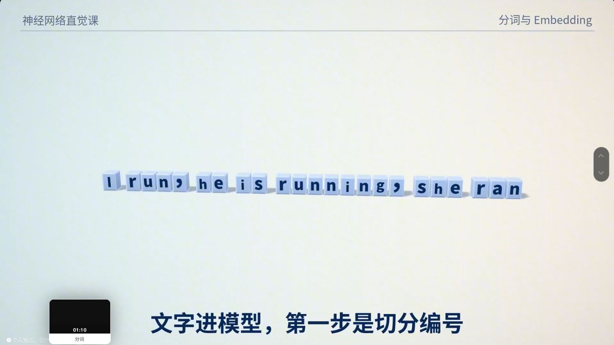

相近词义的拼写可以不同。分词阶段先按词表和字节模式切分，后续表示才参与模型对语法和语义的建模。图上的字母格说明输入素材，不足以推断实际 Token 边界。

### 03:50 · 对比独写和带前置空格的 strawberry

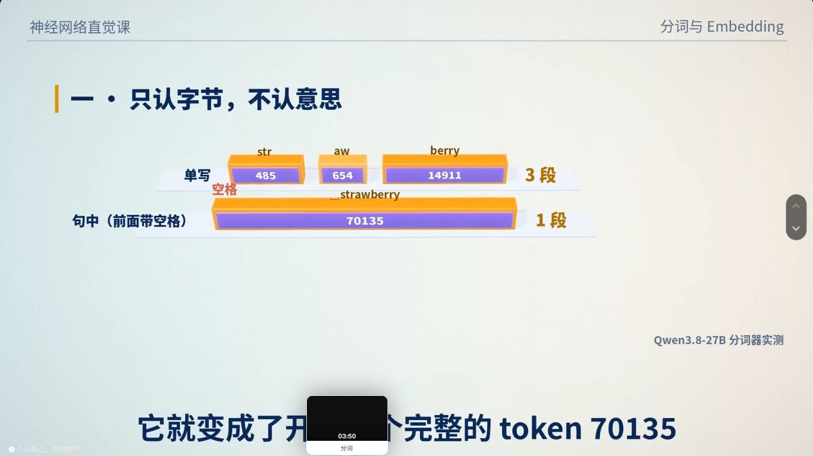

图中的分词器把独写形式切成三个片段，带空格形式用一个 ID 表示。空格是实际输入的一部分。复现时应把空格和模型的分词器版本一起记录。

### 06:50 · 在有限候选中查看向量算术结果

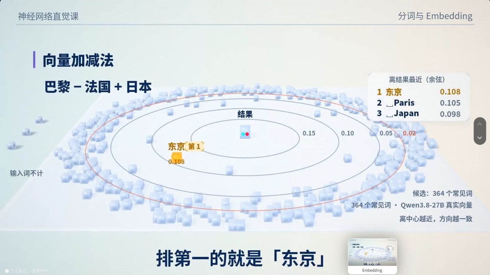

图中对「巴黎 − 法国 + 日本」的结果做候选排序，东京居前。排名受候选集合、向量选取和相似度算法影响。把候选列表换掉再比较，可检验这次近邻结果有多稳定。
