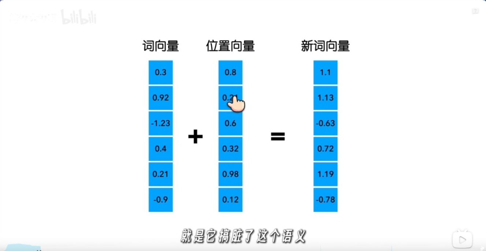
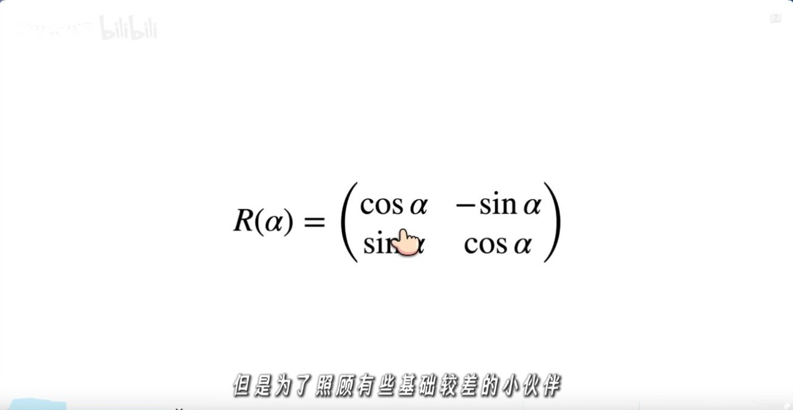
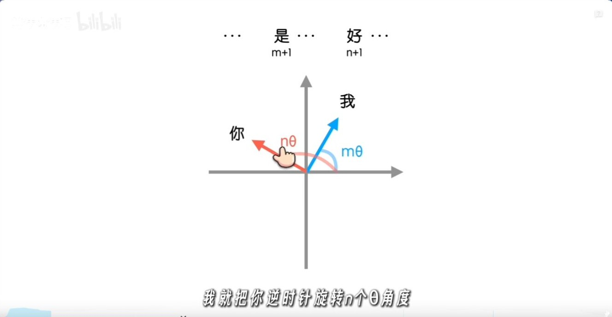
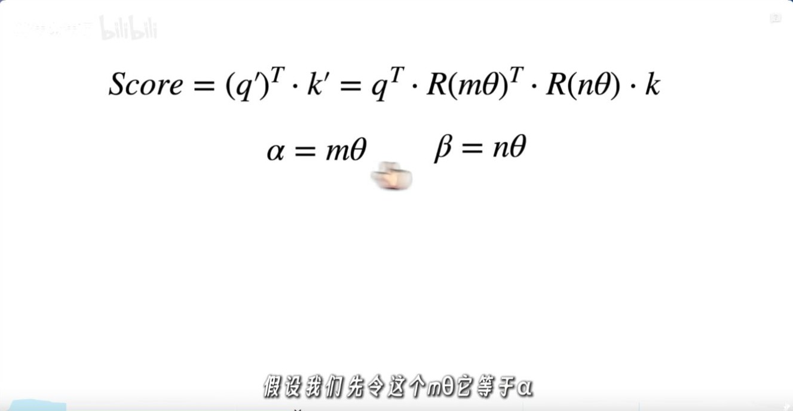
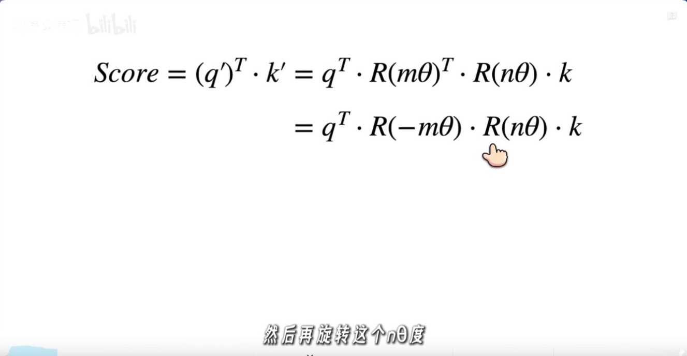
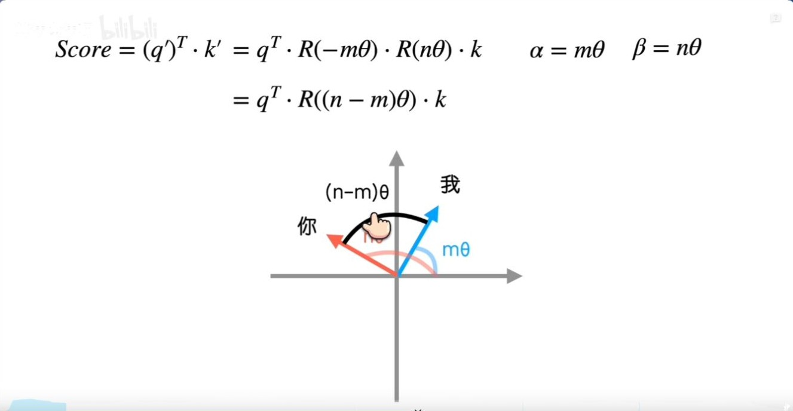
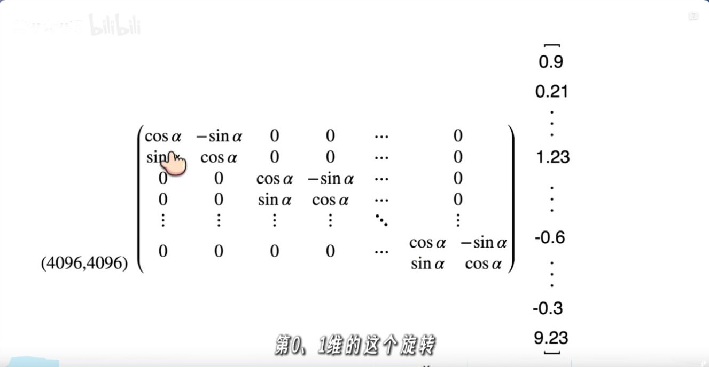
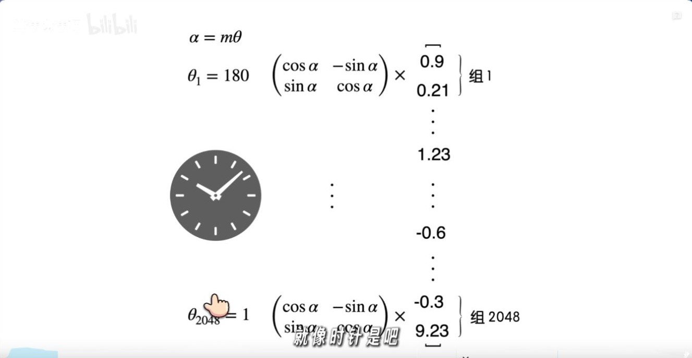
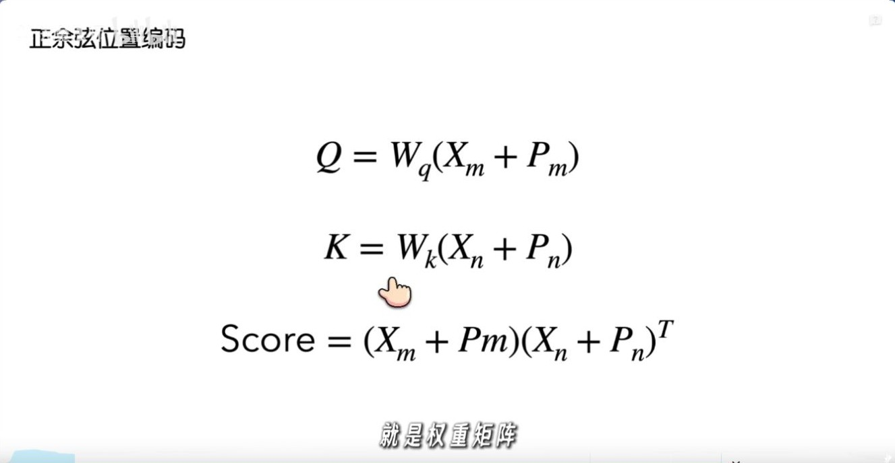
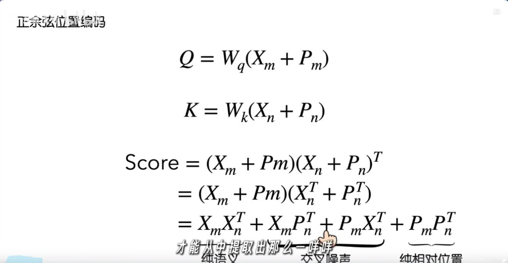

# RoPE：从旋转矩阵推导相对位置

RoPE 在每个二维子空间旋转 Q 和 K。对给定的内容向量，两个绝对位置对应的旋转在点积中合成为相对角度。下文从旋转矩阵推到这个结论，再追踪它在解码缓存里的用法。

算法魔法师，2026 年 1 月 16 日发布，时长 09:47。本文跟随视频推导二维旋转、Q/K 点积及高维分组，并补齐最后一段加法位置编码对照中的投影矩阵。 [B 站原视频](https://www.bilibili.com/video/BV1FjrCBdESo/)

## 一、加法位置编码与旋转位置编码

*图 1（00:38） 词向量和位置向量逐维相加。*

原版 Transformer 将位置向量加进输入。RoPE 在注意力层内先计算 Q 和 K，再按各自位置旋转它们。旋转让两个位置的**差值**进入注意力点积。 [RoFormer 论文 §3](https://arxiv.org/abs/2104.09864)

## 二、二维旋转矩阵

*图 2（02:07） 视频写出标准二维旋转矩阵。*

对列向量使用逆时针旋转矩阵

$$
R(\alpha)=\begin{bmatrix}\cos\alpha&-\sin\alpha\\\sin\alpha&\cos\alpha\end{bmatrix}.
$$

令查询位置为 $m$、键位置为 $n$，同一对通道使用频率 $\theta$。内容投影得到 $q,k$ 后，旋转结果分别是 $q'=R(m\theta)q$ 和 $k'=R(n\theta)k$。

*图 3（02:51） 两个二维向量分别旋转 $m\theta$ 与 $n\theta$。*

## 三、相对位置如何进入 Q/K 点积

*图 4（03:37） 将两个旋转写入点积。*

旋转矩阵的转置等于反向旋转，即 $R(a)^\top=R(-a)$。同一平面上的旋转可合并为 $R(a)R(b)=R(a+b)$。因此

$$
(q')^\top k'
=q^\top R(m\theta)^\top R(n\theta)k
=q^\top R(-m\theta)R(n\theta)k
=q^\top R((n-m)\theta)k.
$$

**补图（04:23）。** 这一行是相对位置推导的中间步骤。用 $R(\alpha)^\top=R(-\alpha)$ 把左侧 Q 的旋转折到 K 一侧，两个连续旋转便可合并。检查符号时，若 $m=n$，两项应该正好相消。

*图 5（05:09） 视频将最终公式和两向量的角度差放在一起。*

固定内容向量时，把 $m,n$ 同时平移同样的步数，旋转后的点积保持一致。取 $q=k=[1,0]^\top$、$\theta=\pi/2$，位置对 $(2,3)$ 和 $(5,6)$ 的点积都是 $\cos(\pi/2)=0$。位置差相同的两个真实 token 仍可因内容不同得到不同分数。

**延伸解读。** 把查询与键的绝对位置从 $(2,5)$ 一起挪到 $(20,23)$。保持进入旋转前的两个内容向量一致时，两个点积相同。实际把一段话插进更长的前缀，深层内容向量也可能因可见上下文改变。这个实验隔离的是旋转位置项，适合用于核对实现。

## 四、高维通道的分组旋转

*图 6（05:54） 用块对角矩阵展示高维向量的分组旋转。*

*图 7（06:38） 视频用转速不同的时钟类比各组频率。*

把需要旋转的通道两两配对，每对使用自己的 $\theta_i$，计算 $R(p\theta_i)$。截图用 4096 维向量帮助理解分块。实际实现通常在每个注意力头的旋转子空间中对 Q/K 做配对，并直接用逐元素乘加完成旋转。常见实现有相邻配对和前后半区配对两种布局，须与权重所用布局一致。 [RoFormer 论文 §3.2–3.3](https://arxiv.org/abs/2104.09864)

## 五、加法位置编码的交叉项

**补图（08:08）。** 图上先把位置向量加到输入，再用各自的投影生成查询和键。下方点积为简化示意，完整展开时要保留 $W_Q^\top W_K$。保留它才能区分原始位置向量的内积性质和模型学到的实际打分。

*图 8（08:52） 视频用四项展开讨论内容与位置的交叉项。*

沿用列向量约定，设 $x_p$ 为位置 $p$ 的词向量，$P_p$ 为位置向量。保留投影时，令 $A=W_Q^\top W_K$，则点积为

$$
(x_m+P_m)^\top A(x_n+P_n)
=x_m^\top A x_n+x_m^\top A P_n+P_m^\top A x_n+P_m^\top A P_n.
$$

中间两项分别让词内容与另一位置的位置向量交互。即使未经投影的正弦位置向量之间的点积可写成位置差的函数，完整表达式一般也没有 RoPE 的 $q^\top R((n-m)\theta)k$ 形式。反过来，RoPE 的相对位置性质描述的是这一层的旋转点积，模型在超出训练长度时的表现仍需验证。 [正弦位置编码的 B 站推导](../正弦位置编码/正弦位置编码_B站推导_为什么不用序列编号.md)

## 六、手算一遍 Q/K 各自旋转

取 $q=(1,2)^\top$、$k=(2,1)^\top$、$\theta=\pi/2$，查询和键的位置分别为 $m=1,n=2$。先按实现顺序旋转，再做点积。

| 步骤 | 算式 | 结果 |
| --- | --- | --- |
| 旋转查询 | $R(\pi/2)q$ | $(-2,1)^\top$ |
| 旋转键 | $R(\pi)k$ | $(-2,-1)^\top$ |
| 点积 | $(-2)(-2)+1(-1)$ | $3$ |
| 用相对角复算 | $q^\top R(\pi/2)k=(1,2)(-1,2)^\top$ | $3$ |

若交换位移方向且保持内容向量不变，相对角变成 $-\pi/2$，分数为 $-3$。这说明点积可以区分有方向的位移。自回归模型还会另外施加因果掩码，决定哪些位置可见。

## 七、从论文公式到推理缓存

在常见的逐头实现中，Q、K 先按头整理成 $[B,H,T,d_h]$，RoPE 广播到头维并作用于末尾的通道轴。旋转子空间为 $d_r$ 时，需要 $d_r/2$ 对 $\cos$、$\sin$。若模型采用部分旋转，其余通道按原值进入点积。V 在标准 RoPE 注意力中沿原路径参与加权求和。

设当前位置为 $n$。若缓存中保存的是 $R(j\theta)k_j$，解码只需为新 Q/K 计算当前位置的旋转。缓存读取时不能再次按 $j$ 旋转已有键，否则会把位置角重复计入。对于会随上下文长度变更频率的实现，应检查旧缓存与新查询是否使用一致的频率方案。 [RoFormer 论文 §3](https://arxiv.org/abs/2104.09864)

| 阅读位置 | 核对问题 |
| --- | --- |
| RoFormer §3.1–3.2 | 为什么要求内积显式依赖相对位置，二维推导如何推广到块对角矩阵 |
| RoFormer §3.4 | 多频率下的远距离讨论有哪些前提，怎样与具体内容向量区分 |
| [YaRN 专题](../YaRN/YaRN_B站解读_从RoPE分频缩放到注意力温度.md) | 怎样改变频率尺度，以及扩窗后如何评估 |

**复盘。** 为什么同样的相对距离仍能得到不同分数？为什么缓存中的 K 是否已经旋转会影响解码结果？

## 八、原视频截图索引

截图来自文首所列视频，时间点以播放器为准。正文中的手算是教学构造，实验结果另附论文或官方文档出处。

| 图号 | 视频时间 | 对应画面 |
| --- | --- | --- |
| 1 | 00:38 | 词向量和位置向量逐维相加 |
| 2 | 02:07 | 视频写出标准二维旋转矩阵 |
| 3 | 02:51 | 两个二维向量分别旋转 $m\theta$ 与 $n\theta$ |
| 4 | 03:37 | 将两个旋转写入点积 |
| 5 | 05:09 | 视频将最终公式和两向量的角度差放在一起 |
| 6 | 05:54 | 用块对角矩阵展示高维向量的分组旋转 |
| 7 | 06:38 | 视频用转速不同的时钟类比各组频率 |
| 8 | 08:52 | 视频用四项展开讨论内容与位置的交叉项 |

### 补充画面索引

| 视频时间 | 画面 |
| --- | --- |
| 04:23 | 视频把查询旋转矩阵的转置写成反向旋转 |
| 08:08 | 加法位置编码先与输入相加，再分别投影成 Q 和 K |
