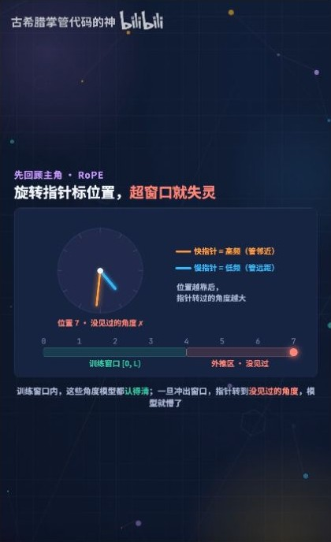
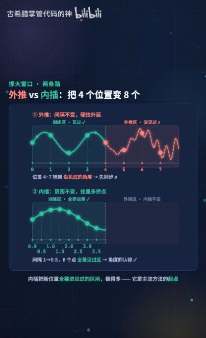
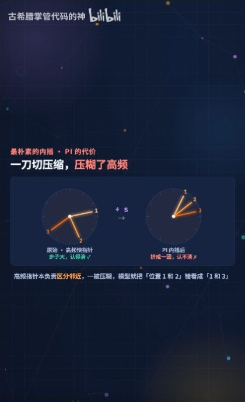
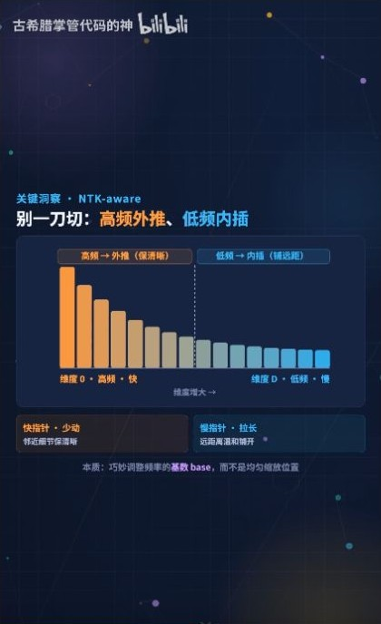
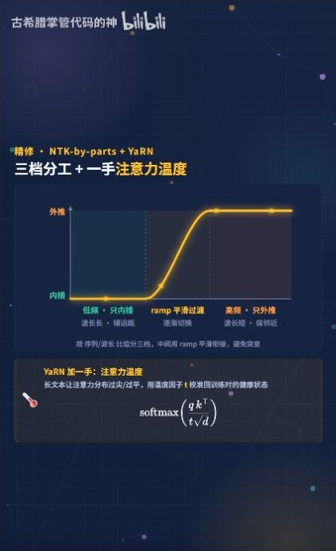

# YaRN 长度外推：RoPE 分频缩放与注意力温度

YaRN 对 RoPE 的不同频段使用不同的频率缩放，并调整注意力 logits 的尺度。这两个操作分别改变旋转角和 softmax 的输入幅度。

古希腊掌管代码的神，2026 年 7 月 13 日发布，时长 03:42。按视频顺序整理，并以 YaRN 论文补充频率分段和实验口径。 [B 站原视频](https://www.bilibili.com/video/BV1RNN36TEva/) · [YaRN 论文](https://arxiv.org/html/2309.00071)

**补图（00:11）。** 视频用 4K 到 128K 提出扩窗问题。先把这两个数理解为位置范围，再追问原模型是否经过额外训练、能否从长输入中检索信息，以及推理资源需要多少。

## 一、RoPE 怎样表达位置差

*图 1（00:29） 视频用旋转指针说明训练窗口之外的相位。*

RoPE 在第 $i$ 对通道上，将位置 $p$ 转换成角度 $p\theta_i$。Q 在位置 $m$、K 在位置 $n$ 时，点积里的旋转项由 $(n-m)\theta_i$ 决定。长度扩展会让模型遇到训练时较少见或从未见过的相对距离，以及相应的多频率相位组合。 [RoPE 的二维推导](../RoPE基础/RoPE_B站推导_从旋转矩阵到相对位置.md)

## 二、直接外推与统一内插

*图 2（01:02） 视频对比直接使用更大位置与将位置映回训练范围。*

设原窗口为 $L$，目标窗口为 $L'=sL$。直接外推保留 $\theta_i$，因此相邻位置的角度差保持原样，但更长距离可能产生训练范围之外的相位组合。位置内插把 $p$ 改为 $p/s$，等价于把每个频率改为 $\theta_i/s$，把更长的序列映回原有的位置尺度。代价是相邻位置在所有频段的角度差都缩小为原来的 $1/s$。 [YaRN 论文附录 A.1](https://arxiv.org/html/2309.00071#A1.SS1)

*图 3（01:37） 视频用夹角说明统一内插压缩了局部角度差。*

## 三、按频率混合内插与外推

*图 4（01:53） 视频展示高频保留、低频内插的分工。*

YaRN 采用 NTK-by-parts。第 $i$ 组的波长是 $\lambda_i=2\pi/\theta_i$，在原窗口内转过约 $r_i=L/\lambda_i$ 圈。低频分量原来转得少，对它做内插可以控制长距离的相位范围。高频分量保留原频率，使短距离的角度变化仍接近预训练时的尺度。中间频段平滑过渡。

$$
\theta_i'=(1-\gamma_i)\frac{\theta_i}{s}+\gamma_i\theta_i,
\qquad
\gamma_i=\operatorname{clip}\!\left(\frac{r_i-\alpha}{\beta-\alpha},0,1\right).
$$

当 $r_i\le\alpha$ 时完全内插，当 $r_i\ge\beta$ 时保留原频率。以 $s=32$ 为例，低频相邻角差缩为原来的 $1/32$，高频相邻角差保持原值。 [YaRN 论文 §3.2](https://arxiv.org/html/2309.00071#S3.SS2)

## 四、注意力温度改变分数尺度

*图 5（02:28） 视频展示频率过渡与注意力温度公式。*

若注意力权重写成 $\operatorname{softmax}(QK^\top/(t\sqrt{d_h}))$，降低温度 $t$ 会放大 logits 之间的差异。在给定 logits 下，softmax 会更集中。对整个参与点积的 Q 和 K 各乘 $a=\sqrt{1/t}$，等价于把 logits 乘 $a^2$。论文给出的经验缩放为 $a\approx1+0.1\ln s$，当 $s=32$ 时 $a\approx1.347$，对应 logits 约乘 $1.813$。频率调整改变相位，温度调整改变 softmax 前的分数尺度。 [YaRN 论文 §3.3 与附录 A.3](https://arxiv.org/html/2309.00071#S3.SS3)

**延伸解读。** 假设两个候选的注意力分数一开始都是 2。无论把它们一起放大多少倍，softmax 仍各给一半权重。温度缩放只能放大已有差距。要让两个候选从平局变成一高一低，需要内容项或旋转后的相位先改变分数。

## 五、4K 到 128K 的实验设置

*图 6（03:02） 视频用 4K 到 128K 概括长度扩展。*

$128\text{K}/4\text{K}=32$ 是目标窗口与原窗口的长度之比。论文中扩展至 128K 的 Llama 2 模型使用了 64K 长度的样本进行额外微调，随后在 128K 做检索测试。论文另有未微调模型的动态缩放实验。实际能力取决于模型与训练方案，长输入仍会增加注意力工作量和 KV Cache 占用。评估时可分别查看长文困惑度、跨位置检索和任务表现。 [YaRN 论文 §4 与附录 B.5](https://arxiv.org/html/2309.00071#S4)

**补图（03:20）。** 视频把几步操作重新串起来。分频改变各对通道的角度变化，注意力温度调整分数的幅度。两者作用的对象不同。可以固定一对 Q/K 做两次实验，先只改角度，再只改温度，看哪一步会改变候选分数的相对顺序。

## 六、把频率分段算成一张可核对的表

用论文讨论的阈值 $\alpha=1,\beta=32$ 和扩窗比例 $s=32$。下表用原窗口内的旋转圈数 $r_i$ 描述三组教学频率，最后一列就是相邻位置角度差相对于原模型的比例。

| 原窗口旋转圈数 $r_i$ | 混合权重 $\gamma_i$ | 新旧频率比 $\theta_i'/\theta_i$ |
| ---: | ---: | ---: |
| 0.5 | 0 | 0.03125 |
| 16.5 | 0.5 | 0.515625 |
| 40 | 1 | 1 |

例如原来转 16.5 圈的通道，用 $0.5/32+0.5$ 得到新旧频率比 $0.515625$。在扩大 32 倍的窗口里，该分量转过的总圈数也随窗口变化。YaRN 将不同频段保留原局部角度与控制长距离相位的需求分开处理。 [YaRN §3.2](https://arxiv.org/html/2309.00071#S3.SS2)

把两个 logits 取成 $[0,1]$。原来第二项的 softmax 权重约为 $0.731$。使用上文 $s=32$ 的温度缩放后，logits 变成约 $[0,1.813]$，第二项权重约为 $0.860$。这是在固定内容分数上的温度示例，真实模型里的频率变化也会改变分数本身。

## 七、把扩窗设置、微调长度与评估结果对齐

| 论文位置 | 阅读重点 |
| --- | --- |
| §3.1–3.2 | NTK-aware 与 NTK-by-parts 使用不同的频率映射，视频用高低频直觉把两段串联 |
| §3.3、附录 A.3 | 注意力缩放系数来自困惑度实验拟合 |
| §4.1、附录 B.5 | 微调样本长度、配置窗口和 Passkey 检索测试长度分别记录 |
| 附录 B.7 | 未微调的动态缩放另有实验条件 |

论文表 9 中，128K YaRN 的 7B 和 13B 行都列出 64K 训练序列长度、128K 检索上下文，Passkey 平均准确率均为 99.4%。表下注释明确这个平均值覆盖测试过的、在该上下文长度以内的序列。实验说明可在对应任务中跨出微调序列长度，长文问答和多条证据推理还需要各自的评估。 [YaRN 附录 B.5](https://arxiv.org/html/2309.00071#A2.SS5)

**复盘。** 4K、64K 和 128K 分别是什么长度？缩放注意力 logits 和缩放旋转频率分别改变了哪一步？

## 八、原视频截图索引

截图来自文首所列视频，时间点以播放器为准。正文中的手算是教学构造，实验结果另附论文或官方文档出处。

| 图号 | 视频时间 | 对应画面 |
| --- | --- | --- |
| 1 | 00:29 | 视频用旋转指针说明训练窗口之外的相位 |
| 2 | 01:02 | 视频对比直接使用更大位置与将位置映回训练范围 |
| 3 | 01:37 | 视频用夹角说明统一内插压缩了局部角度差 |
| 4 | 01:53 | 视频展示高频保留、低频内插的分工 |
| 5 | 02:28 | 视频展示频率过渡与注意力温度公式 |
| 6 | 03:02 | 视频用 4K 到 128K 概括长度扩展 |

### 补充画面索引

| 视频时间 | 画面 |
| --- | --- |
| 00:11 | 开场提出如何把原有上下文窗口扩到更长 |
| 03:20 | 片尾把外推、内插、分频和温度放在一张图 |
