# 正弦位置编码：为什么不用 1、2、3？

正弦位置编码用多组频率表示序列位置。对固定偏移，每组正余弦坐标都可以用同一个二维矩阵从旧位置移到新位置。

算法魔法师，2025 年 11 月 13 日发布，时长 12:32。本文按视频中的问题、公式、位移推导和数值例子展开。 [B 站原视频](https://www.bilibili.com/video/BV1aLCsBhE7i/)

## 一、序列编号怎样进入模型

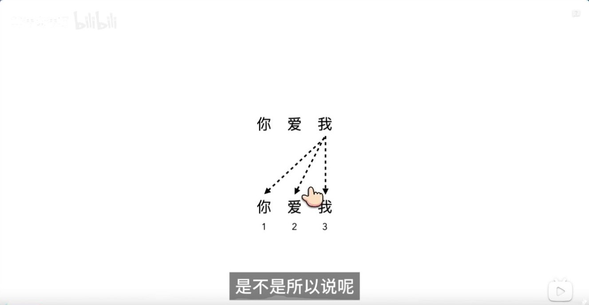

*图 1（00:45） 视频用调换词序的短句引出位置信息。*

Self-attention 的内容打分使用 Q 与 K，位置编号需要通过模型结构或显式编码进入计算。因果掩码提供了「只能看前面」的约束，原版 Transformer 仍为每个位置构造与词向量等宽的位置向量，在进入堆叠层前逐维相加。

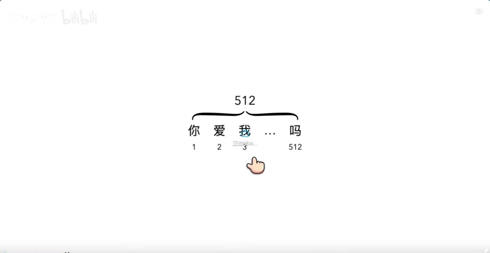

*图 2（01:33） 视频用 1 到 512 的位置编号提出问题。*

整数编号本身有顺序，也能做差。直接把原始下标加到输入表示里，其幅度会随序列长度增长。正余弦方案提供有界的等宽向量，并把同一个位置放在多种频率下表示。 [Transformer 论文 §3.5](https://arxiv.org/abs/1706.03762)

## 二、正余弦成对构成位置坐标

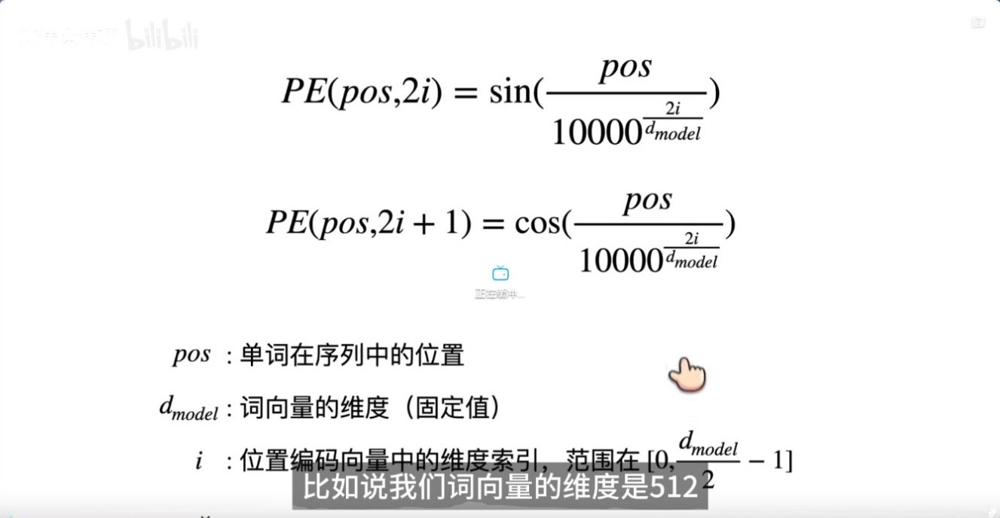

*图 3（02:26） 正弦与余弦位置编码公式。*

设模型维度为 $d$，位置为 $p$，第 $i$ 对坐标的角频率为 $\omega_i=10000^{-2i/d}$。则

$$
P_{p,2i}=\sin(p\omega_i),\qquad P_{p,2i+1}=\cos(p\omega_i).
$$

$i$ 编号的是坐标对，$p$ 编号的是 token 位置。每对坐标的幅度有界，且平方和为 1。

## 三、把固定偏移写成矩阵

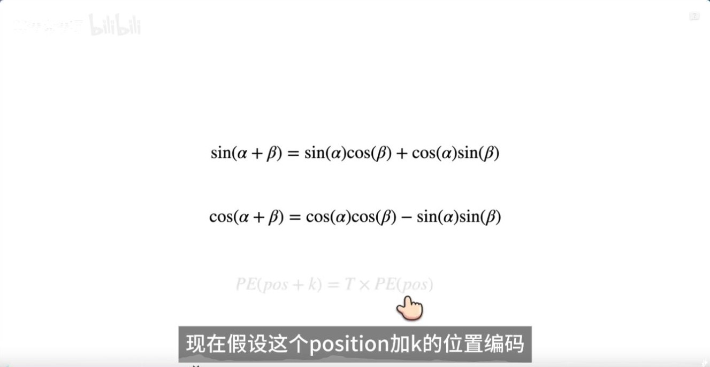

*图 4（03:21） 视频写出两条三角函数加法公式。*

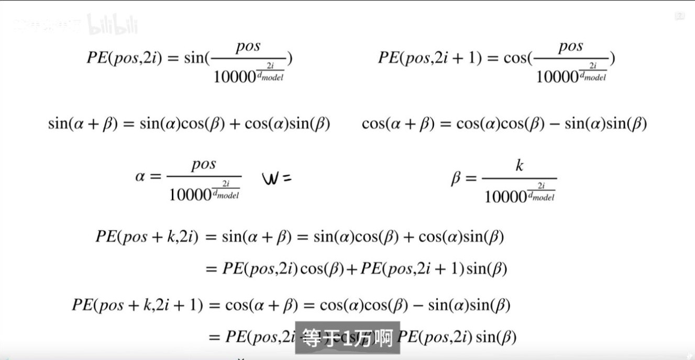

*图 5（04:16） 视频将绝对位置与偏移代入加法公式。*

取 $\alpha=p\omega_i$、$\beta=k\omega_i$。位置从 $p$ 移到 $p+k$ 时，对第 $i$ 对坐标有

$$
\begin{bmatrix}\sin(\alpha+\beta)\\\cos(\alpha+\beta)\end{bmatrix}
=
\begin{bmatrix}\cos\beta & \sin\beta\\-\sin\beta & \cos\beta\end{bmatrix}
\begin{bmatrix}\sin\alpha\\\cos\alpha\end{bmatrix}.
$$

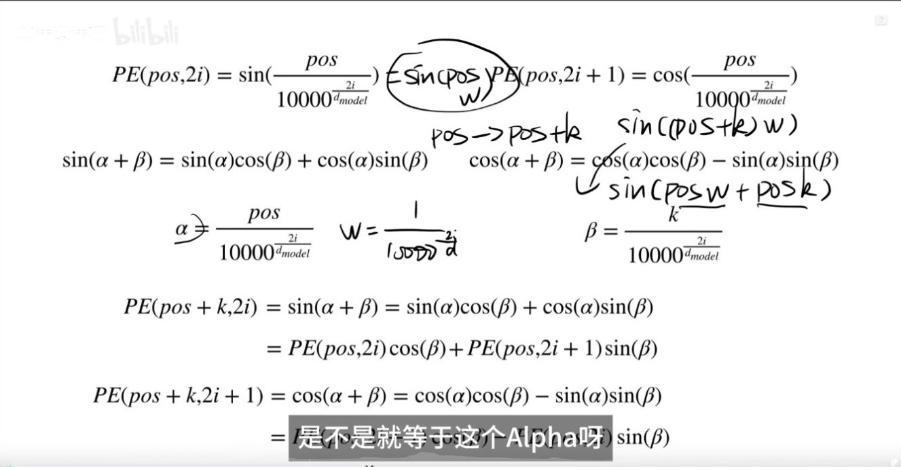

**补图（05:05）。** 把频率写成 $\omega_i$ 后，移动 $k$ 个位置时每对通道的额外角度就是 $k\omega_i$。原位置 $p$ 决定从圆上的哪里起步，$k\omega_i$ 决定这一步转多少。后面的矩阵只需要第二项。

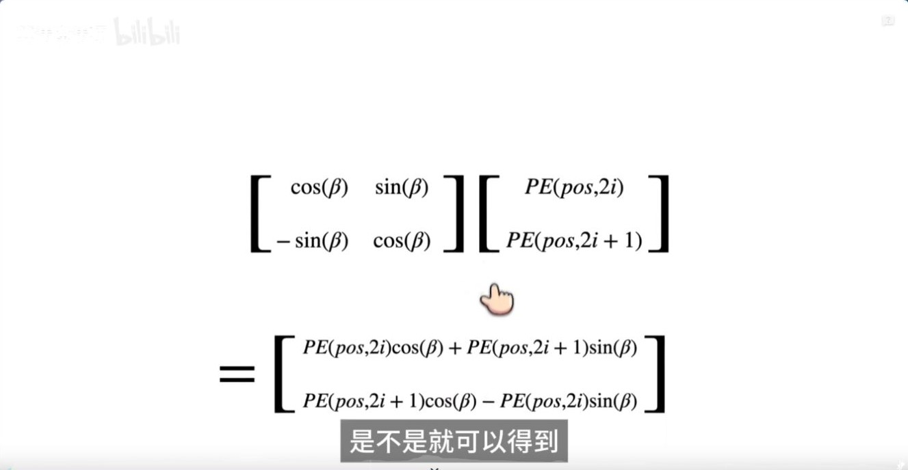

*图 6（05:59） 将一对坐标的位移写成矩阵乘法。*

把各频率的二维矩阵沿对角线拼起来，就有 $P_{p+k}=A_kP_p$。对于固定的 $k$，矩阵 $A_k$ 与起点 $p$ 无关。这是编码本身的精确恒等式。以 $p=0$、$k=1$、$\omega_0=1$ 为例，乘以位移矩阵会把 $[0,1]^\top$ 变成 $[\sin 1,\cos 1]^\top$。 [Transformer 论文 §3.5](https://arxiv.org/abs/1706.03762)

**延伸解读。** 如果已经构造了前进一格的矩阵 $A_1$，前进三格可以连续做三次，也可以一次乘 $A_3$，两种结果相同。沿同一条位置轴，$A_1^3=A_3$。换成一张任意训练得到的位置查表时，要重新检验是否存在同一个矩阵能把每一行都映射到下一行。

## 四、多频率怎样表示不同距离

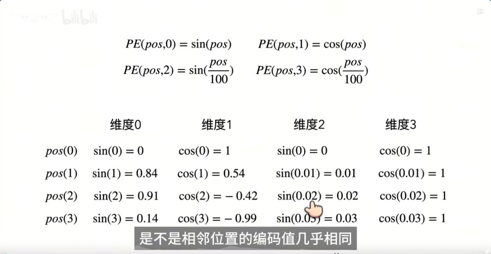

*图 7（08:39） 视频以四维编码对比两种频率。*

$d=4$ 时，两个频率是 $1$ 和 $0.01$。相邻位置相差一步时，第一对坐标的相位变化为 1 弧度，第二对只有 0.01 弧度。前者对短距离变化更敏感，后者转得更慢。单个频率会周期重复，整组编码同时提供多种尺度。

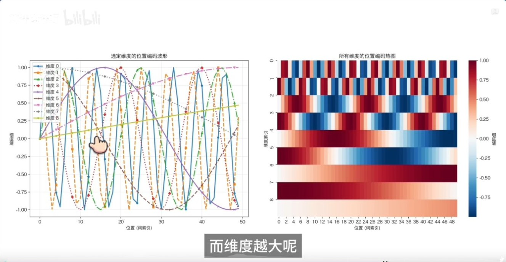

*图 8（09:38） 多频率曲线与位置编码热图。*

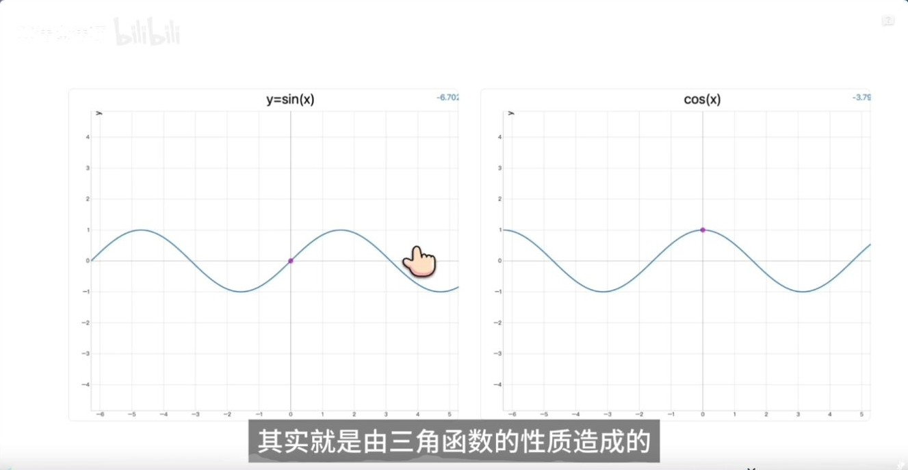

**补图（10:30）。** 单看正弦可能有歧义，例如 $\sin 0=\sin\pi=0$。此时余弦分别是 1 和 −1，两维合看才能区分这两个相位。即使成对，单一频率经过整圈仍会重复，多频率让编码在不同尺度提供位置线索。

## 五、位置公式与外推表现

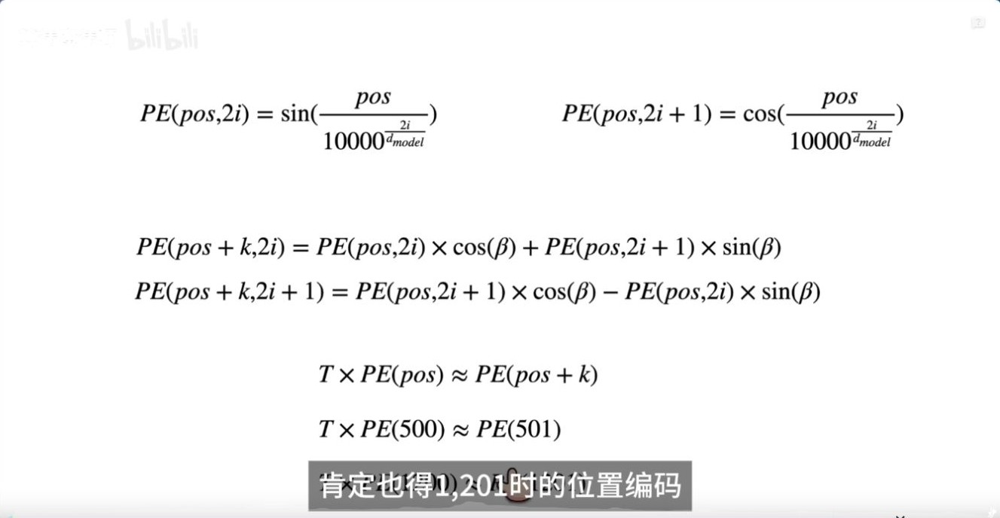

*图 9（11:26） 视频讨论用同一规则计算更远位置的编码。*

任意整数位置都可以代入公式。模型能否在训练长度以外稳定找回信息，还取决于训练分布、注意力行为和部署支持的上下文长度。把位置向量加到词向量后，注意力点积也包含内容与位置之间的交叉项。下一篇可看 RoPE 如何把相对位移直接写进旋转后的 Q/K 点积。 [RoPE 的 B 站推导](../RoPE基础/RoPE_B站推导_从旋转矩阵到相对位置.md)

## 六、把四维编码、位移与相似度放在一起算

令 $d=4$，两个频率为 $1$ 和 $0.01$，角度按弧度计算。

| 位置 | $\sin p$ | $\cos p$ | $\sin(0.01p)$ | $\cos(0.01p)$ |
| --- | ---: | ---: | ---: | ---: |
| 0 | 0 | 1 | 0 | 1 |
| 1 | 0.84147 | 0.54030 | 0.01000 | 0.99995 |
| 2 | 0.90930 | −0.41615 | 0.02000 | 0.99980 |

两对坐标的位移矩阵分别转过 $1$ 和 $0.01$ 弧度。从第 0 行出发，应用一次块对角矩阵得到第 1 行，再应用一次得到第 2 行。每对坐标始终保持单位范数，但变化速度相差 100 倍。

未经投影的位置向量内积有一条直接的恒等式。

$$
P_m^\top P_n=\sum_i\left[\sin(m\omega_i)\sin(n\omega_i)+\cos(m\omega_i)\cos(n\omega_i)\right]
=\sum_i\cos((m-n)\omega_i).
$$

因此 $P_0^\top P_1$ 和 $P_1^\top P_2$ 都约为 $1.54025$。实际 Attention 使用的是 $W_Q(x_m+P_m)$ 和 $W_K(x_n+P_n)$。投影以及词向量参与后，完整分数同时包含内容项、位置项和两种交叉项。

## 七、读原始 Transformer 论文时核对三件事

| 原论文位置 | 需要核对的设计 |
| --- | --- |
| §3.4 | 词嵌入与输出投影的位置和维度 |
| §3.5 | 编码加在嵌入上，正余弦成对使用，位置移动可写成线性变换 |
| Table 3 (E) | 原论文在其翻译设置中比较了学习式和固定位置编码，结论的适用范围由该实验确定 |

这里的 $d$ 是模型维度。假设输入形状为 $[B,T,d]$，构造的固定位置表为 $[T,d]$，相加时沿 batch 广播。编码表可以为更大位置生成数值。训练之外的长文本能力还涉及掩码、注意力资源与训练分布。 [Attention Is All You Need](https://arxiv.org/abs/1706.03762)

**复盘。** 位置移动矩阵为什么可以独立于起点构造？把固定编码换成可学习的位置表，哪条数学性质需要重新判断？

## 八、原视频截图索引

截图来自文首所列视频，时间点以播放器为准。正文中的手算是教学构造，实验结果另附论文或官方文档出处。

| 图号 | 视频时间 | 对应画面 |
| --- | --- | --- |
| 1 | 00:45 | 视频用调换词序的短句引出位置信息 |
| 2 | 01:33 | 视频用 1 到 512 的位置编号提出问题 |
| 3 | 02:26 | 正弦与余弦位置编码公式 |
| 4 | 03:21 | 视频写出两条三角函数加法公式 |
| 5 | 04:16 | 视频将绝对位置与偏移代入加法公式 |
| 6 | 05:59 | 将一对坐标的位移写成矩阵乘法 |
| 7 | 08:39 | 视频以四维编码对比两种频率 |
| 8 | 09:38 | 多频率曲线与位置编码热图 |
| 9 | 11:26 | 视频讨论用同一规则计算更远位置的编码 |

### 补充画面索引

| 视频时间 | 画面 |
| --- | --- |
| 05:05 | 视频标注频率与位置偏移的乘积 |
| 10:30 | 视频用两条周期曲线解释正弦和余弦 |
