# 正弦位置编码：从序列编号到多频率坐标

> **整理日期：** 2026-11-09  
> **视频来源：** 神经元出逃计划，《大模型训练时，怎么知道词的顺序？》，2026-09-23 发布，约 11 分 36 秒。  
> **原视频：** [抖音视频](https://www.douyin.com/video/7688668591620656427)  
> **内容：** 24 张原视频截图，解释顺序、位置下标、逐维相加、正余弦频率和相对位移；另附手算与复算代码。补充推导不作为视频逐字转录。

**目录位置：** `04-技术拆解-位置编码优化/正弦位置编码/`。这是位置编码基础篇，后续阅读 [RoPE 基础](../RoPE基础/RoPE_从二维旋转到相对位置点积.md)；更广的路线见 [位置编码论文与技术演进](../Transformer_位置编码论文与技术演进.md)。

## 一、内容相同，交换顺序为何含义不同？


“我打了他”与“他打了我”可能含有相同的词，却有不同的角色关系。模型需要区分内容出现在哪个位置，才能在学习中利用顺序。

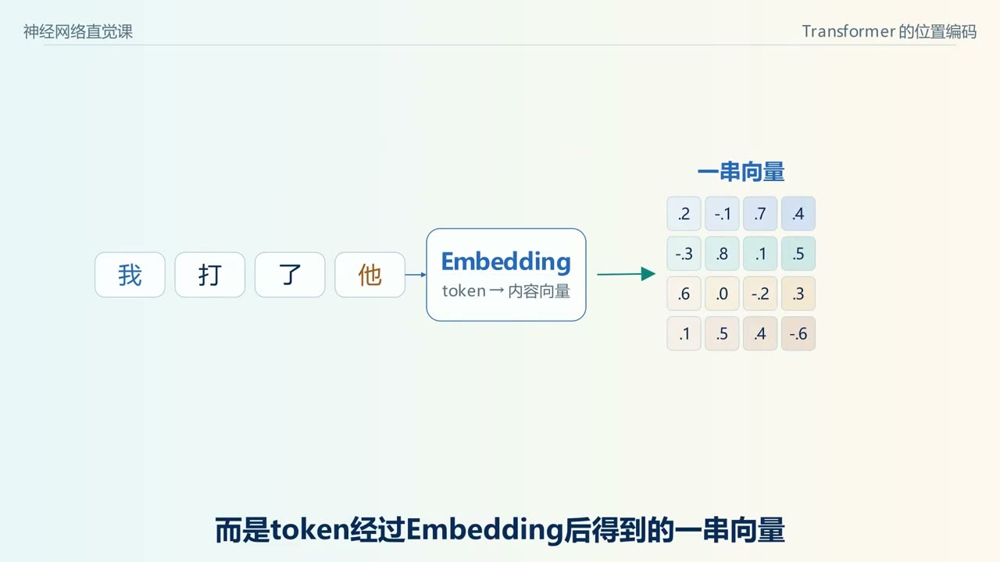

标准无位置、无掩码的自注意力并不自带显式的第几个位置坐标。若同时重新排列输入各行，Q、K、V 及输出也相应重排。

### 1.1 更准确地说：排列等变，而不是所有输出不变

令 $P$ 为排列矩阵：

$$
\operatorname{Attn}(PX)=P\operatorname{Attn}(X).
$$

它表示输出随输入位置一起移动。若再做不依赖排列的平均池化，池化结果才可能不变。不能把两者混成“注意力无论怎么换词，输出向量都完全相同”。


视频用平均分数帮助理解顺序信息，但实际注意力通常是内容相关的加权求和，并非简单平均。

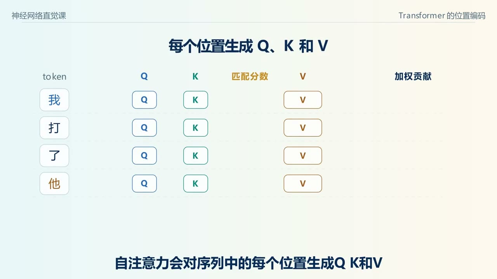

**适用条件：** 上述排列等变关系假设没有位置机制或不随输入同样置换的掩码。固定因果掩码会改变可见范围，本身引入顺序结构，因此不能把“无位置编码的因果模型”一概称为完全不含顺序信息。显式位置编码提供的是额外可利用的位置坐标。

## 二、位置通常指分词后序列下标

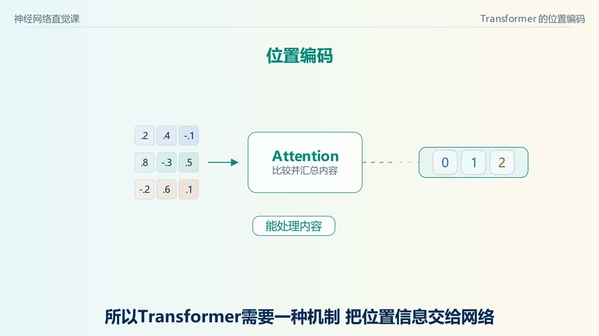

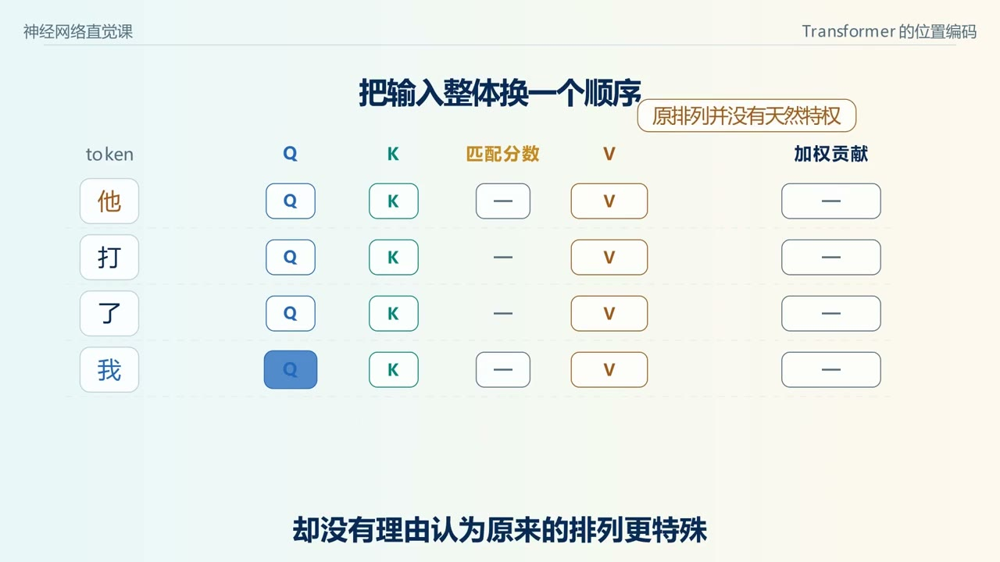

将输入编码为 Token 序列 $u_0,u_1,\ldots,u_{T-1}$，位置 $p$ 通常是序列中的下标，不是词义标签，也不必等于原文汉字或字母索引。


分词器若将一个词拆成多个 Token，它们占据多个序列位置。特殊 Token、Padding、拼接及位置 ID 配置也需要考虑。原始分词过程见 [BPE 专题](../../03-技术拆解-分词与向量化/BPE分词/BPE分词_从相邻合并到Embedding.md)。

## 三、原始方案：位置向量与内容向量逐维相加

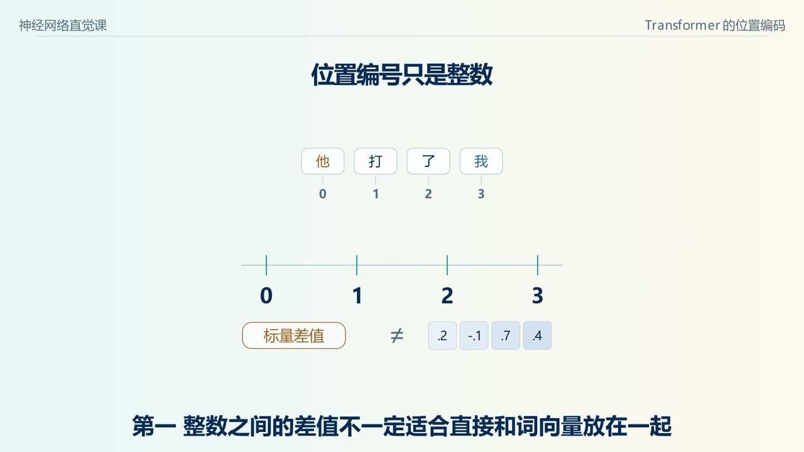

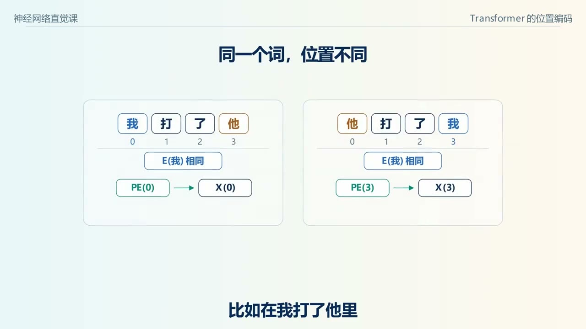

设内容 Embedding 为 $e_p\in\mathbb R^d$，位置向量为 $PE(p)\in\mathbb R^d$，基础形式为：

$$
x_p=e_p+PE(p).
$$

两者形状一致，结果仍是 $d$ 维，不是拼接成 $2d$ 维。原始 Transformer 还对输入 Embedding 使用 $\sqrt{d_{\mathrm{model}}}$ 缩放，并在相加后采用 Dropout；这里先隔离位置相加解释原理，不能将简式当作所有实现的完整输入层。

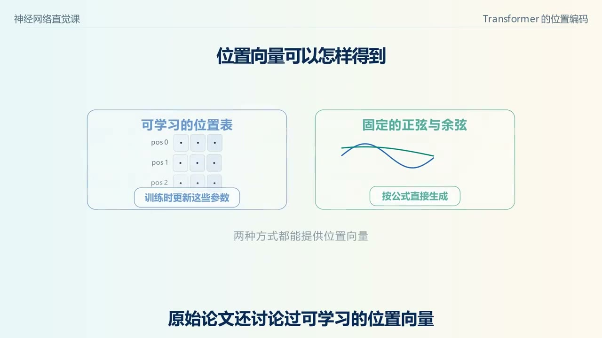

可学习位置表是另一种选择；固定正弦方案根据函数计算，不需要为每个位置单独训练一行。固定编码不等于模型无须训练，网络仍要学习怎样利用这些坐标。

## 四、公式：每一对维度使用一个频率

对偶数维度 $d$，令 $i=0,\ldots,d/2-1$，位置 $p$：

$$
\omega_i=10000^{-2i/d},
\qquad
PE(p)_{2i}=\sin(p\omega_i),
\qquad
PE(p)_{2i+1}=\cos(p\omega_i).
$$


这里使用零起始索引，所以第 0 维用 sin，第 1 维用 cos。角度使用弧度。不同维度对使用不同频率，同一对 sin / cos 共享同一个频率。

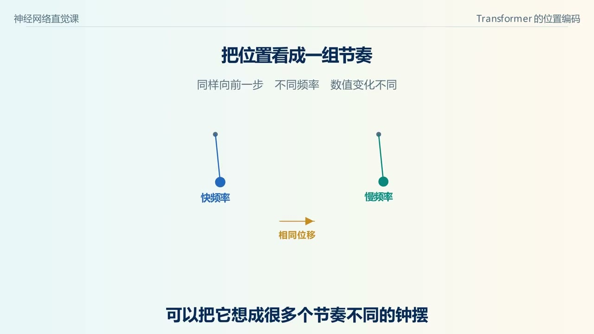

基数 10000 是原始配置选择，不是任何位置编码都必须使用的常数；修改基数会改变坐标尺度，不能把它当作对既有模型无影响的改动。

## 五、d=4 的逐项手算

$d=4$ 时，两组频率是 $\omega_0=1$、$\omega_1=0.01$：

$$
PE(p)=[\sin p,\cos p,\sin(0.01p),\cos(0.01p)].
$$

| 位置 | 第 0 维 | 第 1 维 | 第 2 维 | 第 3 维 |
| --- | --- | --- | --- | --- |
| 0 | 0 | 1 | 0 | 1 |
| 1 | 0.841471 | 0.540302 | 0.010000 | 0.999950 |
| 2 | 0.909297 | -0.416147 | 0.019999 | 0.999800 |

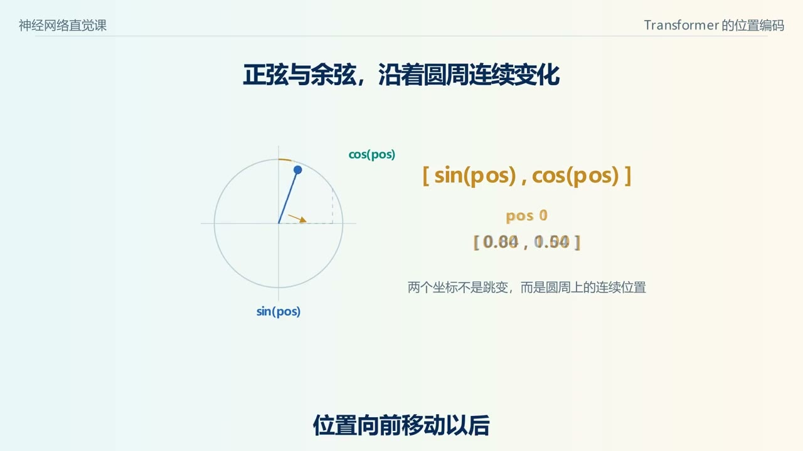

取本文教学内容向量 $e=[0.2,-0.1,0.5,0.3]$，在位置 1 相加，得到：

$$
x\approx[1.041471,0.440302,0.510000,1.299950].
$$

相同内容放在位置 2 时，内容向量不变、位置向量改变，因此输入向量也改变。但不能仅从一个相加结果、在不知道内容的情况下，总能唯一拆出内容和位置；模型学习的是联合使用这种表示。

### 5.1 范数是固定的

每对维度满足 $\sin^2+\cos^2=1$，所以：

$$
\|PE(p)\|_2^2=d/2.
$$

位置变大不会让该位置向量的范数线性增长。如何与内容尺度配合，还取决于输入缩放、初始化及网络中的归一化。

**延伸解读。** 设有两只指针，每前进一个位置分别转 $1$ 和 $0.01$ 弧度。前进一步时快针变化明显，慢针几乎没动。前进 100 步时，慢针也转过了 1 弧度。多频率把同一个位移投到不同变化尺度上，读图时可以把快慢两组曲线分别拿出来看。

## 六、快频率看细节，慢频率提供更缓的参考

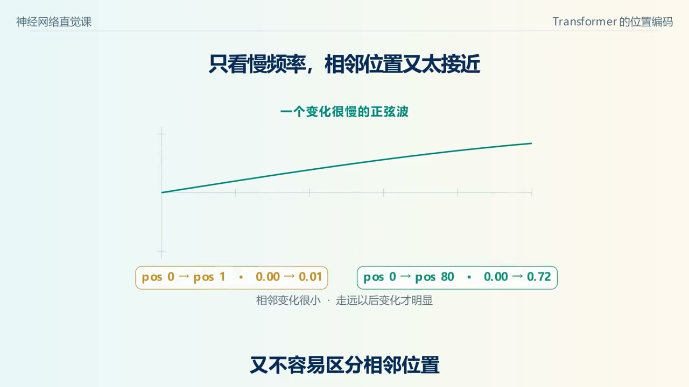


第 $i$ 对维度的波长为 $\lambda_i=2\pi/\omega_i$。快速变化的通道对短距离移动更敏感；慢通道在更长区间内变化更缓。多频率组合比单一周期提供更丰富的参考。

这是一种结构直觉，不代表每个维度必然学成“短期语法”或“长期语义”的独立功能。单一 sin 值可以重复，完整向量的区分能力也要结合位置范围和有限精度讨论，不能简单宣称对无限位置绝无碰撞。

## 七、固定偏移为什么能由线性变换表达？


对一组频率，定义列向量：

$$
u_i(p)=\begin{bmatrix}\sin(p\omega_i)\\\cos(p\omega_i)\end{bmatrix}.
$$

利用三角恒等式，对固定偏移 $\Delta$：

$$
u_i(p+\Delta)=
\begin{bmatrix}
\cos(\Delta\omega_i)&\sin(\Delta\omega_i)\\
-\sin(\Delta\omega_i)&\cos(\Delta\omega_i)
\end{bmatrix}u_i(p).
$$

变换矩阵只依赖偏移和频率，不依赖起点 $p$。这是编码结构提供的一项便利，不是模型已经自动学会所有距离关系的证明。

### 7.1 位置向量点积只与位移有关

$$
PE(p)^TPE(q)=\sum_i\cos((p-q)\omega_i).
$$

但真实输入是 $e_p+PE(p)$，Q / K 还要经过学习投影。点积展开包含内容—内容、内容—位置、位置—内容及位置—位置项；即使原始 $PE$ 点积有上述性质，也不能断言整个注意力分数只依赖相对距离。

## 八、能算出更远位置，为什么不等于有效长上下文？


公式可对训练时未出现的 $p$ 计算数值，但模型未必学会利用那些位置组合。长上下文还受到训练长度、数据分布、注意力模式和计算资源影响。

因此，“固定编码可外推计算”与“模型在更远位置保持任务能力”是两件事。位置编码不是上下文窗口质量的单独保证。

## 九、放回 Transformer 的完整入口


原始加法方案大致为：

```text
文本 → Token IDs → 内容 Embedding
                       + 位置向量
                       ↓
                 输入状态 X → Q / K / V 投影 → 注意力与 FFN
```

通常在进入堆叠层前注入一次，不等于每层都重复加一遍同一位置向量。具体模型可能有不同位置机制，应以架构实现为准。

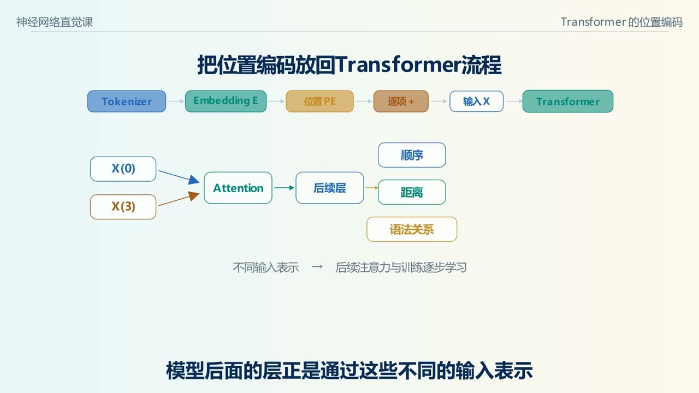


位置向量提供可供学习的位置参考，并不直接告诉模型“谁打了谁”。语法和语义关系还需由内容、上下文及训练共同形成。


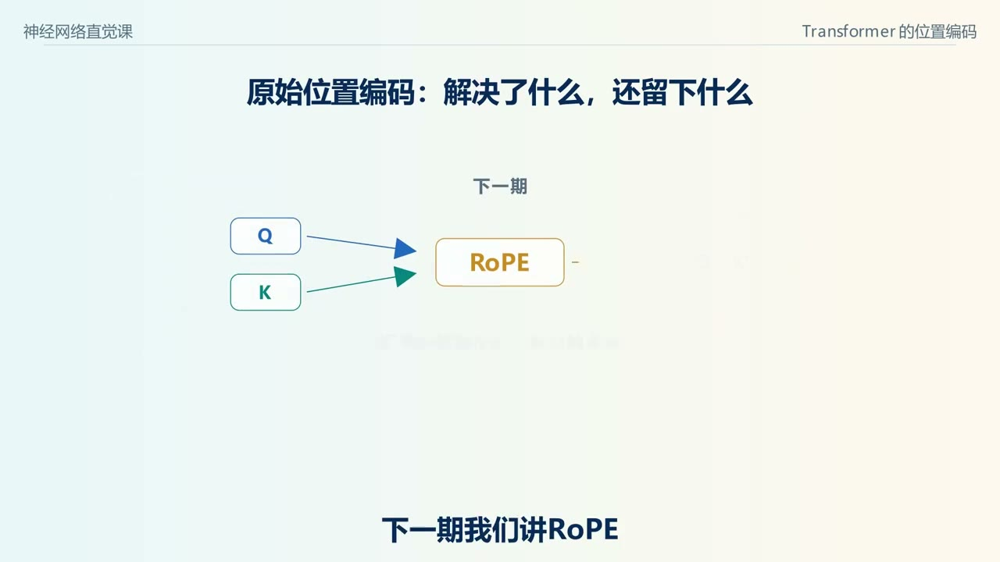

## 十、数值验证与原始资料

[positional_math.py](positional_math.py) 用标准库核对 d=4 坐标、逐维相加、范数、位移矩阵及位置向量点积恒等式。它不作为真实模型的长上下文评测。

```bash
python3 positional_math.py
```

原始资料：[Attention Is All You Need](https://arxiv.org/abs/1706.03762)，2017-06-12 首次公开；作者 Ashish Vaswani、Noam Shazeer、Niki Parmar、Jakob Uszkoreit、Llion Jones、Aidan N. Gomez、Łukasz Kaiser、Illia Polosukhin。可对照原文的位置编码部分及输入 Embedding 缩放设置。

24 张截图覆盖 00:00—11:30，每 30 秒一帧，版权归原作者或相应权利人所有；时间见图注及文件名。下一篇 [RoPE 基础](../RoPE基础/RoPE_从二维旋转到相对位置点积.md) 将位置作用直接放入 Q / K 的比较中。

## 补充画面索引

### 01:45 · 视频把主题分为编号、三角函数、注意力


先确定位置编号表示哪个 Token，再把单一编号转成多维坐标，最后追踪坐标怎样影响注意力的输入。把三步连起来，可以解释只画周期曲线为什么还没有讲到模型里的打分。

### 05:15 · 偶数维取正弦，奇数维取余弦

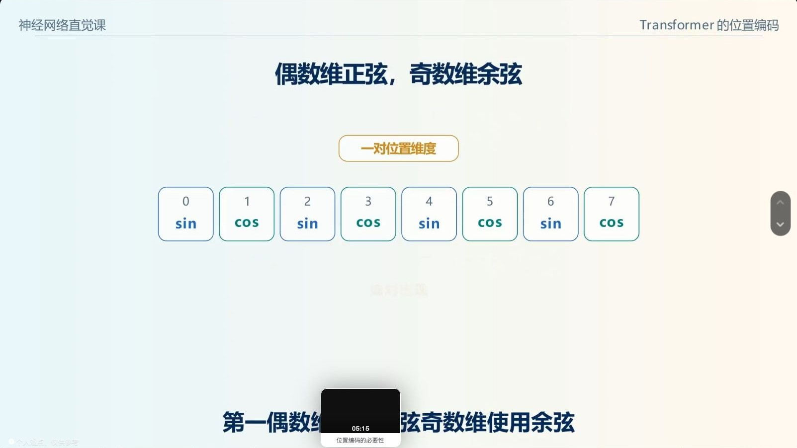

按从零开始的下标，相邻的 $(0,1)$、$(2,3)$ 各组成一对。每对内部使用同一个频率，换一对才换频率。这一配对使位置偏移能写成同一二维平面内的变换。

### 08:45 · 把位置编码接回原始 Transformer 输入


Tokenizer 决定序列位置，Embedding 查得内容向量，再逐维加上同宽的位置向量。进入注意力前，两类信息已经在同一隐藏状态里，后续 Q/K 投影可以同时利用它们。
