# KV Cache 基础：从因果不变性到 Prefill 与 Decode

> **整理日期：** 2026-11-09  
> **视频来源：** 神经元出逃计划，《一个缓存，为什么能省掉大模型 99% 的重复计算？》，2026-10-10 发布，约 16 分 11 秒。  
> **原视频：** [抖音视频](https://www.douyin.com/video/7694995019916119315)  
> **内容：** 按视频顺序整理 29 张截图，讲解重复计算、因果不变性、Q / K / V 的复用、Prefill / Decode 和显存成本；另附手算与双层因果注意力的可运行数值验证。补充推导不是视频逐字转录。

**本篇位置：** 本文与 [MQA / GQA / MLA 专题](../05-KVCache进阶与MLA/05-KVCache_MQA_GQA_MLA_从显存公式到低秩吸收.md) 配套阅读。先读本篇理解“为什么能缓存”，再读 [MHA、MQA 与 GQA](../04-MHA-MQA-GQA/04-MHA-MQA-GQA_从多头计算到KV共享.md)，最后进入 MLA 专题。

KV Cache 保存每层、每个历史位置的 Key 和 Value，使增量解码不必重新处理全部历史位置。它利用的是固定前缀在因果网络中的计算不变性，代价是持续保存并反复读取历史数据。标题中的“99%”描述特定计数口径下的重复工作，不代表任何部署都能提速一百倍。

## 一、不加缓存，每生成一步都在重算什么？


视频用“小明 / 在图书馆 / 借了 / 科幻 / 小说”展示自回归生成。为了突出计算，以下沿用这些片段作为示意位置；实际 Token 边界取决于分词器。

最直接的无缓存实现，每一步把整个已知前缀送进模型：

```text
第 1 次：小明 / 在图书馆 / 借了              → 预测“科幻”
第 2 次：小明 / 在图书馆 / 借了 / 科幻       → 预测“小说”
第 3 次：小明 / 在图书馆 / 借了 / 科幻 / 小说 → 继续预测
```

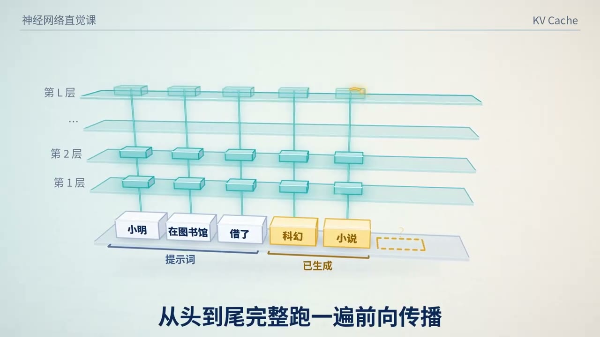

各层的历史位置会重复做投影、注意力、FFN 等计算。缓存要消除的是这部分重复，而不是省去新 Token 经过全部层的过程。

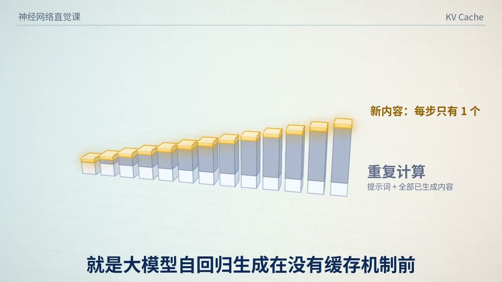

## 二、最后一个位置怎样预测下一个 Token？

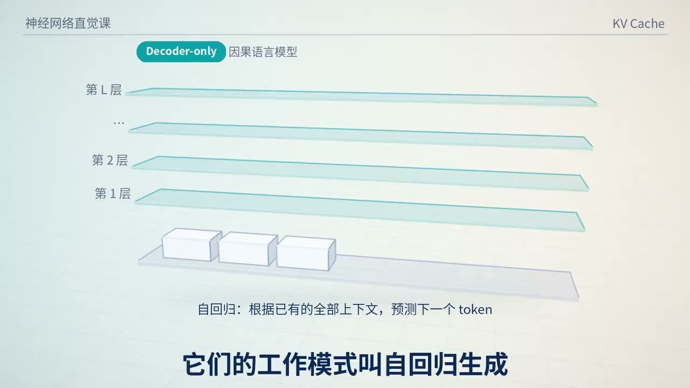

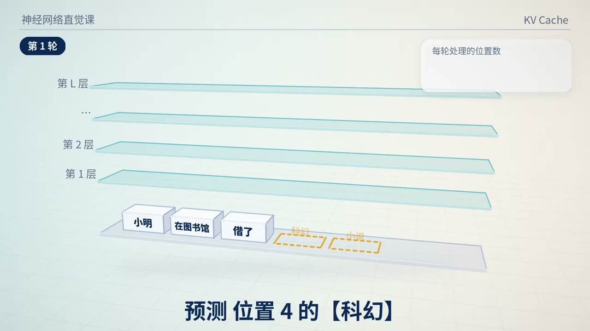

对于输入位置 $1,\ldots,P$，经过最后一层得到隐藏状态 $h_P$，通过输出映射得到 logits，再形成下一个 Token 的分布。

若采样得到 Token $u_{P+1}$，下一次处理的是这个 Token 在位置 $P+1$ 的输入表示。它逐层结合历史 KV，最终得到 $h_{P+1}$，用于预测 $u_{P+2}$。

注意顺序：Prefill 结束就能用最后提示词位置预测第一个生成 Token；这个新采样 Token 的 KV，要等它随后被输入模型时才写入缓存。因此有些实现中“已生成 Token 数”与“缓存中的生成 Token 数”会相差一步。

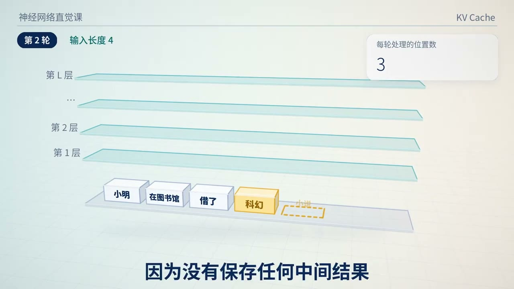

## 三、只输入新 Token，为什么不能完全丢掉历史？

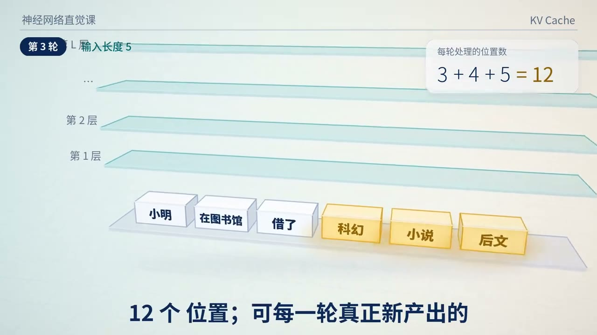

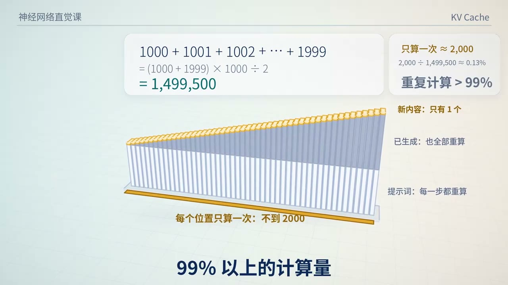

如果仅把新 Token 输入一个没有历史状态的 Transformer，它只能看到当前位置提供的信息。位置编码本身也不保存前面的文本内容。

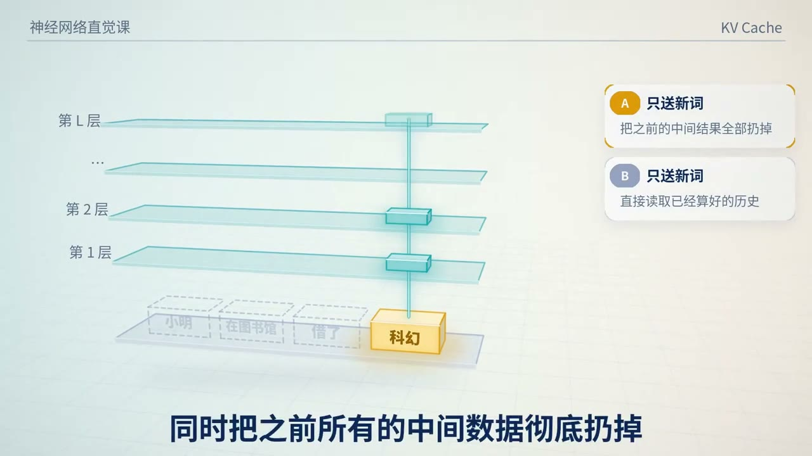

要避免重算，就必须保留足够的历史信息。标准全注意力解码所需的历史接口是每层的 K、V，而不是仅保留某个最终输出向量。

## 四、为什么历史表示不会被新 Token 改写？

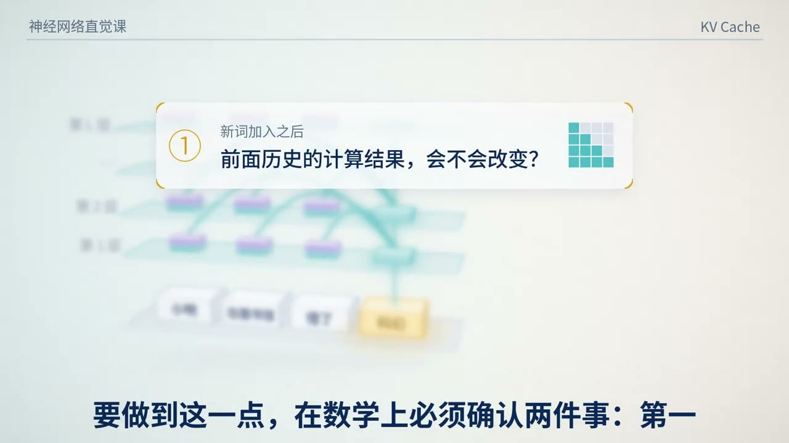

因果掩码保证位置 $i$ 只能关注 $j\le i$，因此追加新位置不会扩大旧位置的可见范围。

设第 $l$ 层历史状态为 $h_i^{(l)}$，因果层的计算可抽象为：

$$
h_i^{(l)}=F_l\left(h_i^{(l-1)},\{h_j^{(l-1)}:j\le i\}\right).
$$

### 4.1 按层归纳

1. **输入层：** 固定前缀的 Token、位置索引与预处理不变，则输入表示不变。
2. **归纳假设：** 第 $l-1$ 层所有旧位置状态保持不变。
3. **因果注意力：** 旧位置 $i$ 仍只使用 $j\le i$ 的旧状态；它们都没有变化，所以注意力输出不变。
4. **逐位置算子：** 常见 LayerNorm / RMSNorm、FFN 与残差连接在旧位置上的输入不变，输出也不变。
5. **结论：** 第 $l$ 层旧位置的表示及其 K、V 保持不变，直到最后一层。

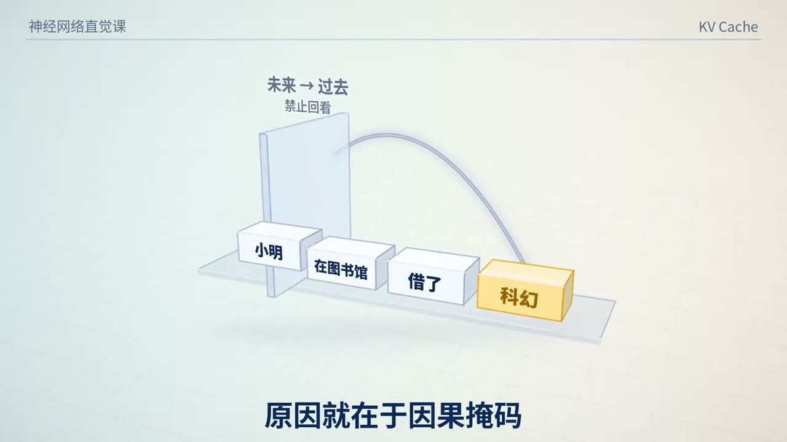

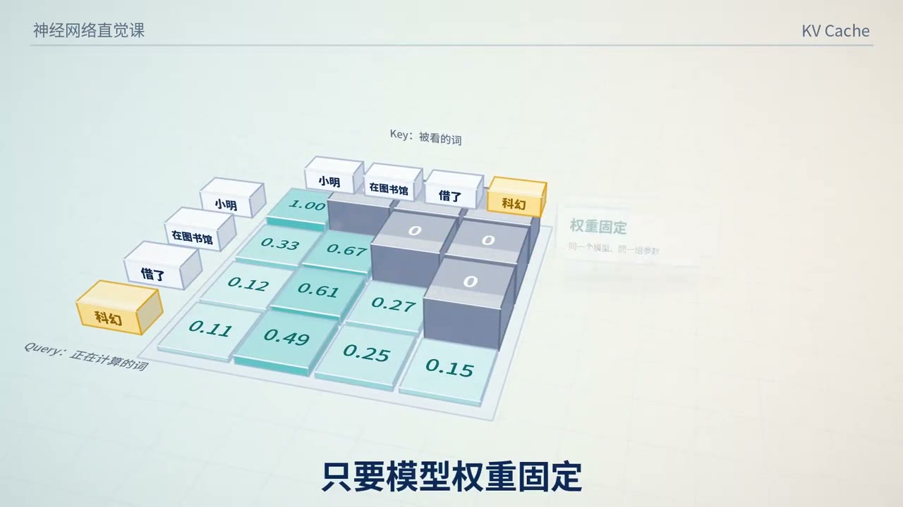

这个推导假定模型权重固定、推理行为确定，位置处理不因总长度改变，且没有读取未来或跨位置重算统计的算子。标准双向 Encoder 中旧位置能关注新位置，不能直接使用同样的“追加后不变”结论。

理论等价也不意味着不同 GPU 内核逐比特相同。浮点运算顺序变化可能带来细小误差。

## 五、为什么只存 K、V，而不存 Q？

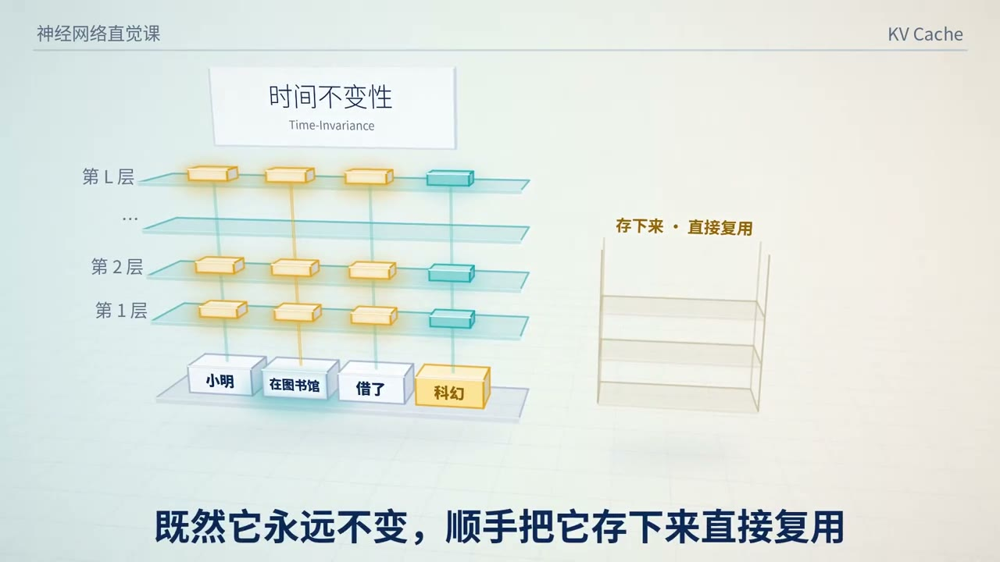

在某层对新位置 $t$ 计算：

$$
q_t=W_Qx_t,\quad k_t=W_Kx_t,\quad v_t=W_Vx_t,
$$

$$
o_t=\sum_{j\le t}\alpha_{t,j}v_j,\qquad
\alpha_{t,j}=\operatorname{softmax}_{j\le t}
\left(\frac{q_t^Tk_j}{\sqrt{d_k}}\right).
$$

其中 $x_t$ 是当前层注意力投影所用的输入，可能已经过归一化；不同模型的位置编码也要纳入相应 Q / K 处理。

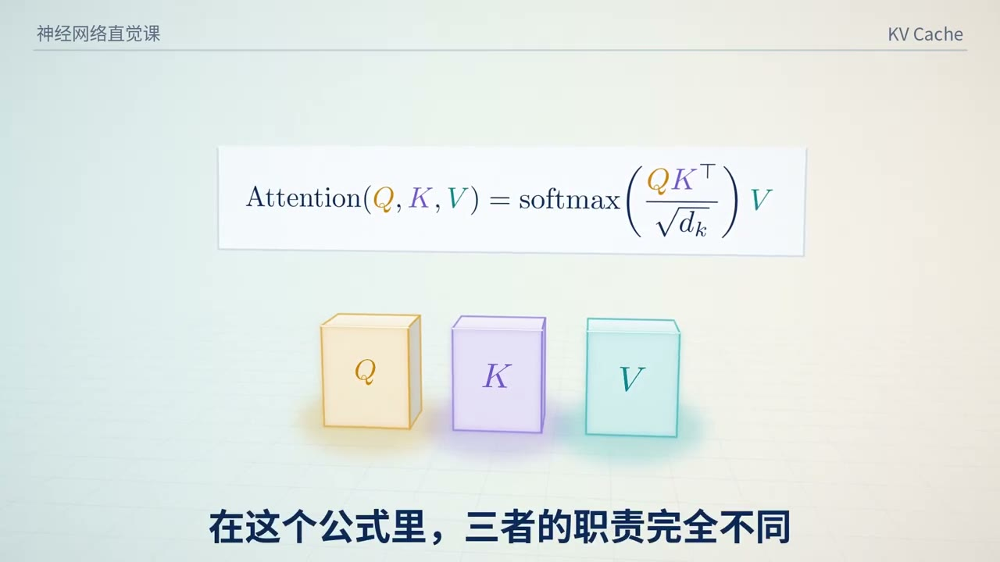

| 数据 | 新位置需要历史值吗？ | 标准 Decode 中的处理 |
| --- | --- | --- |
| 历史 $q_j$ | 不需要 | 不进入长期 KV 缓存 |
| 历史 $k_j$ | 需要，与当前 $q_t$ 匹配 | 持续保存 |
| 历史 $v_j$ | 需要，用于加权求和 | 持续保存 |
| 当前 $q_t$ | 需要 | 当前计算后即可释放或复用工作区 |
| 当前 $k_t,v_t$ | 需要 | 参与当前位置计算并写入缓存 |

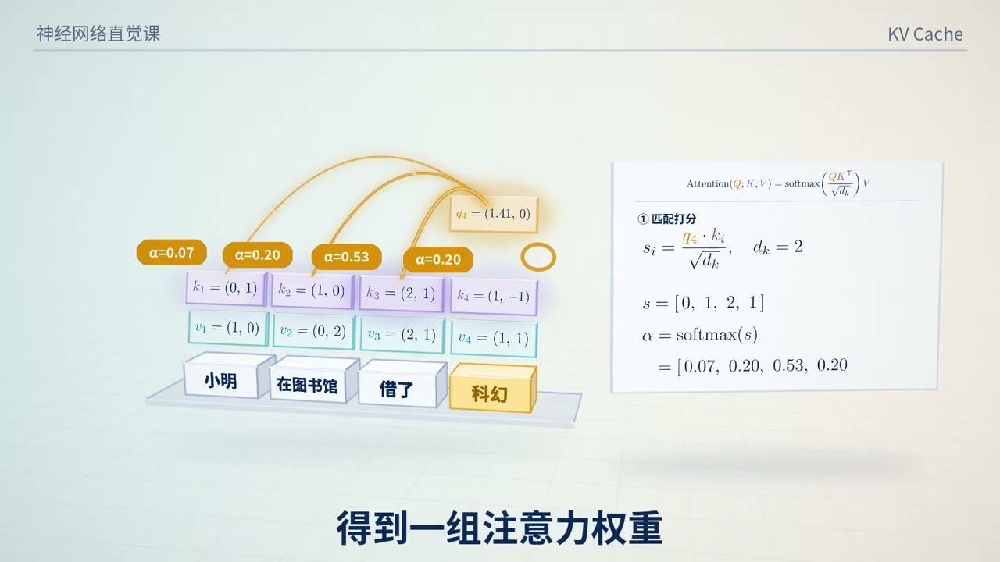

历史 Q 不是不能存，而是标准后续步骤不需要重新使用它。缓存 Q 只会额外占空间，通常不带来对应收益。分块处理可同时计算多个新 Q，但仍不要求持久保存所有旧 Q。

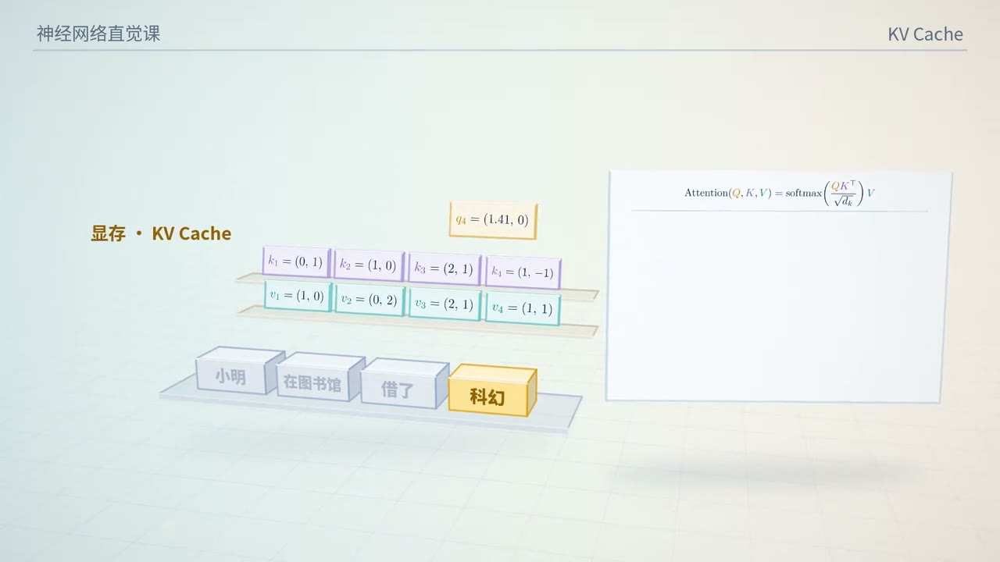

**延伸解读。** 设历史位置 A 的查询当时最关注自己。位置 B 到来时，可能需要重点读取 A，也可能需要读取 B 自己。这次打分由 B 的查询重新决定。保存 A 的旧注意力权重无法回答 B 的问题。保留 A 的 K/V 则让后续位置可以按各自的查询重新选择。

## 六、一次注意力手算：缓存保存的是历史内容，不是旧权重

以下为本文自建的单头例子，令 Key 维度为 1，所以缩放因子为 $\sqrt1=1$。某层当前 Query 为 $q_t=1$，包含当前位置在内的三组可见 KV 为：

| 位置 | Key | Value |
| --- | --- | --- |
| 1 | $0$ | $[1,0]$ |
| 2 | $\ln2$ | $[0,3]$ |
| 3，当前位置 | $\ln3$ | $[2,2]$ |

点积分数为 $[0,\ln2,\ln3]$，softmax 后：

$$
\alpha=[1/6,2/6,3/6].
$$

因此：

$$
o_t=\frac16[1,0]+\frac26[0,3]+\frac36[2,2]
=\left[\frac76,2\right].
$$

若下一步 Query 改成 2，即使前面三组 KV 不变，针对它们的 logits 也变成 $[0,2\ln2,2\ln3]$，其内部归一化权重为 $[1,4,9]/14$。真正下一步还要加入新位置的 KV，再一起归一化。

所以缓存复用的是历史 K、V；新 Query 的注意力权重仍需重新计算，不能直接沿用上一行 softmax 结果。

## 七、Prefill：批量处理提示词并建立逐层缓存

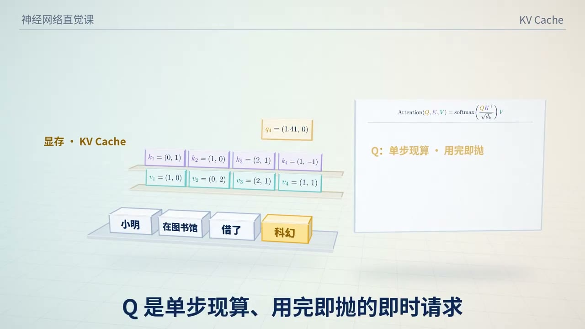

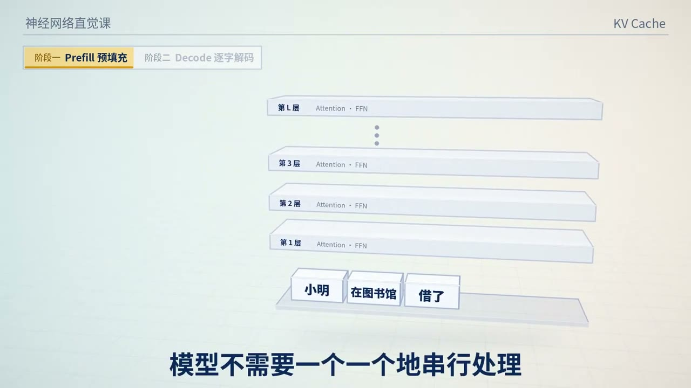

长度为 $P$ 的提示词可一次或分块输入。对标准批量 Prefill，每层同时处理多个位置，使用因果掩码；在完成本层计算时，保存对应的 K、V，随后进入下一层。

“Prefill 可并行”指已知输入位置可进行矩阵化计算，并不是允许位置看见未来，也不是让网络层之间失去依赖。分块 Prefill 还可能复用此前块的 KV。

## 八、Decode：只处理新位置，但仍要逐层读取历史

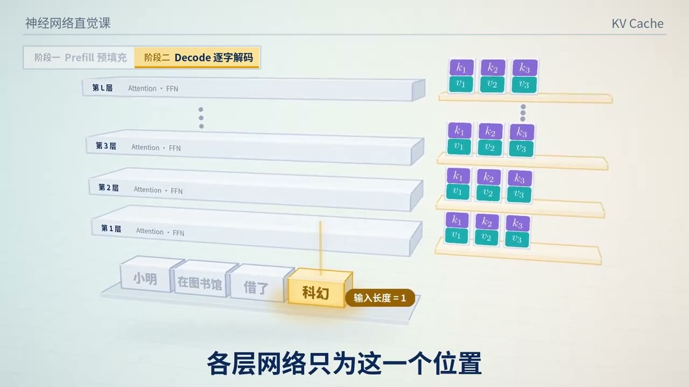

单 Token 增量步骤可以概括为：

```text
输入新 Token 及正确位置
  对每层：
    计算当前 Q、K、V
    将当前 K、V 追加到本层缓存
    当前 Q 读取本层可见 KV，计算注意力
    完成本层输出、残差、归一化及 FFN 等计算
  使用最后层输出预测下一个 Token
```

新位置的深层 KV，来自新位置逐层计算得到的状态。因此不能在输入层一次生成所有层的 KV，也不能只留最后一层缓存代替每层的历史信息。

### 8.1 掩码与位置索引的常见错误

若已有 $P$ 个缓存位置，一次追加 $C$ 个新位置，则局部新 Query 索引 $r\in[0,C-1]$ 对应绝对位置 $P+r$，应允许访问满足：

$$
j\le P+r
$$

的 Key。掩码一般需要覆盖 `C × (P+C)`，而不是只在新块内部构造 `C × C`。单 Token Decode 时，所有过去位置和当前自身都可见；位置索引也不能每步重置为零。

Padding、滑动窗口和其他注意力规则还要叠加各自限制。实际框架的注意力掩码方向和布尔约定可能不同，不能仅按矩阵形状猜测。

## 九、“省掉 99%”具体算的是什么？

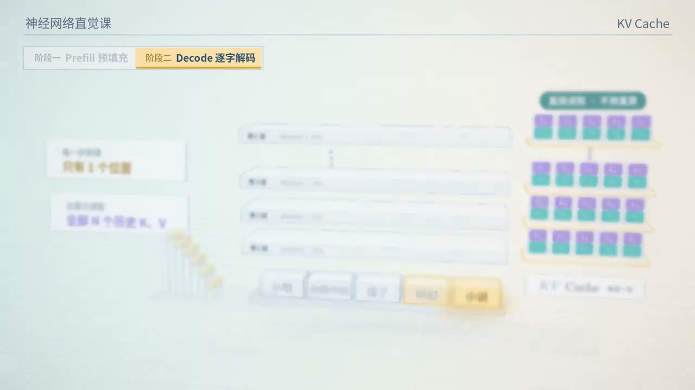

按视频的教学计数，输入长度 $P=1000$，统计 1000 次前向处理，未缓存时处理长度为 1000、1001、……、1999：

$$
S_{\mathrm{no\ cache}}=\sum_{i=0}^{999}(1000+i)=1{,}499{,}500.
$$

若采用“一次处理 1000 个提示词位置，再处理 1000 个新位置”的简化缓存计数：

$$
S_{\mathrm{cache}}=1000+1000=2000.
$$

比值约为 $749.75$，对应处理位置数下降约 $99.8666\%$。严格对齐预测的第一个输出及最后一个输入时，会出现第二节所说的一步计数差；应先说明统计边界。

**这里统计的是送入网络的 Token 位置次数，不是总 FLOPs，也不是实测时间。** KV 缓存下每个新 Query 仍扫描历史 K、V，不能把每步完整计算当作常数。

### 9.1 固定模型宽度与层数时的复杂度

令生成阶段处理 $N$ 个新位置，忽略固定宽度因子：

| 工作 | 无缓存、每次重算前缀 | 有缓存 |
| --- | --- | --- |
| 逐位置投影与 FFN 等 | $\sum_{i=0}^{N-1}(P+i)=O(NP+N^2)$ | $O(P+N)$ |
| 全注意力的分数 / 聚合 | $\sum_{i=0}^{N-1}(P+i)^2$ | Prefill $O(P^2)$，Decode $O(NP+N^2)$ |

取 $P$ 与 $N$ 同阶时，上述注意力部分从约三次增长降到约二次增长。不是所有工作都从平方变成线性，也不能把位置处理次数的比例直接当作 GPU 提速倍数。

## 十、时间省下来，显存为何涨上去？

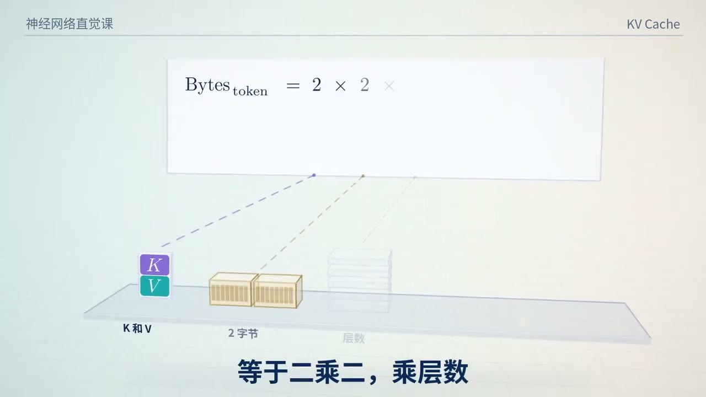

对等长请求、等结构层，K/V 头维度相同：

$$
M_{\mathrm{KV}}=2BTLH_{KV}d_hs.
$$

$B$ 为独立序列数，$T$ 为每条实际保留的长度，$L$ 为层数，$H_{KV}$ 为 KV 头数，$d_h$ 为头维度，$s$ 为每元素字节数。前面的 2 表示 K、V 两份。

取视频演示使用的基线 $L=80,H_{KV}=64,d_h=128,s=2$：每 Token 是 $2{,}621{,}440$ 字节，即 2.5 MiB。每条 4096 Token，单条为 10 GiB；50 条为 500 GiB，约 536.87 GB，尚未计入权重及运行开销。

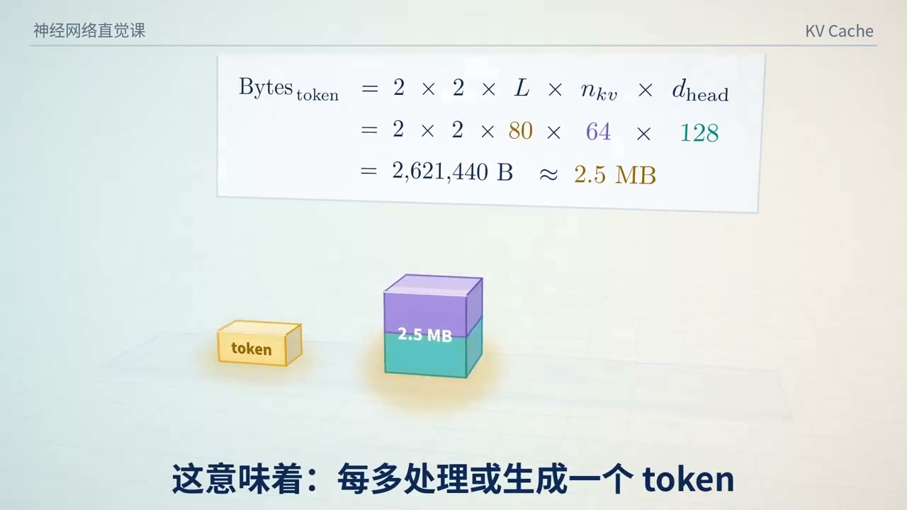

视频用 GB / MB 等作近似展示；本文区分十进制 GB 与二进制 GiB。各请求长度不同应按长度之和计算，前缀共享、滑动窗口和块分配则可能改变占用。

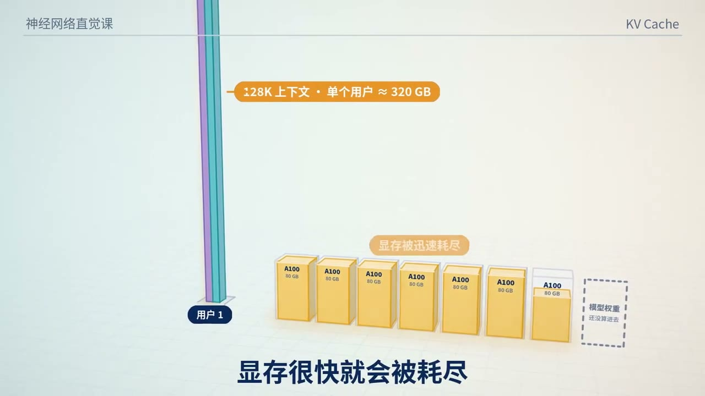

接下来的 MQA / GQA / MLA 就是在缓存规模上继续优化，详见 [进阶专题](../05-KVCache进阶与MLA/05-KVCache_MQA_GQA_MLA_从显存公式到低秩吸收.md)。

## 十一、为什么有缓存，Decode 仍可能受带宽限制？

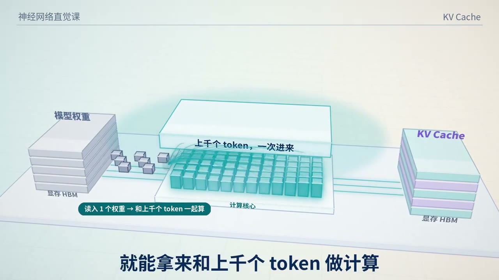

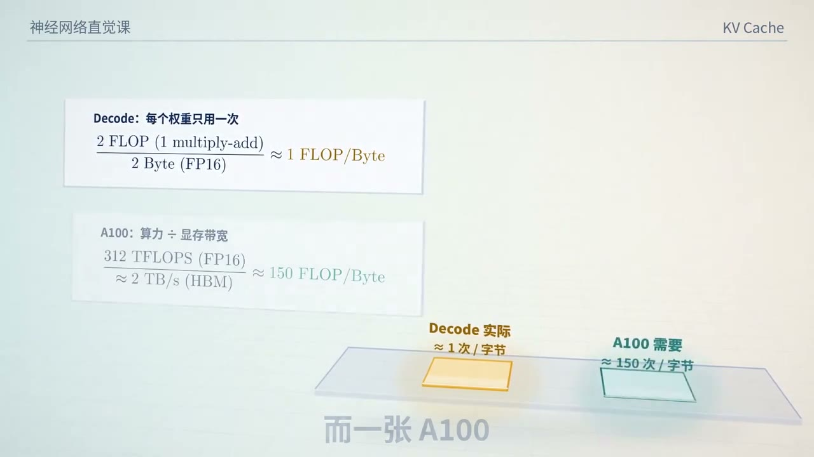

Decode 每步新位置很少，但需要访问模型权重和不断增长的历史 KV。小批量时矩阵计算的权重复用有限；长上下文还增加历史 KV 读取，因此可能受显存带宽而非纯算术吞吐限制。

这是典型瓶颈分析，不是所有模型和所有批量的固定结论。批处理、计算内核、缓存布局、并行通信以及量化都可能改变限制因素。

KV Cache 解决历史位置重算；GQA / MLA 改变缓存表示；PagedAttention 处理缓存分配与共享；高效注意力内核优化数据搬运。这些工作可以互补，不能混成同一种优化。

## 十二、哪些情况下不能直接复用旧缓存？

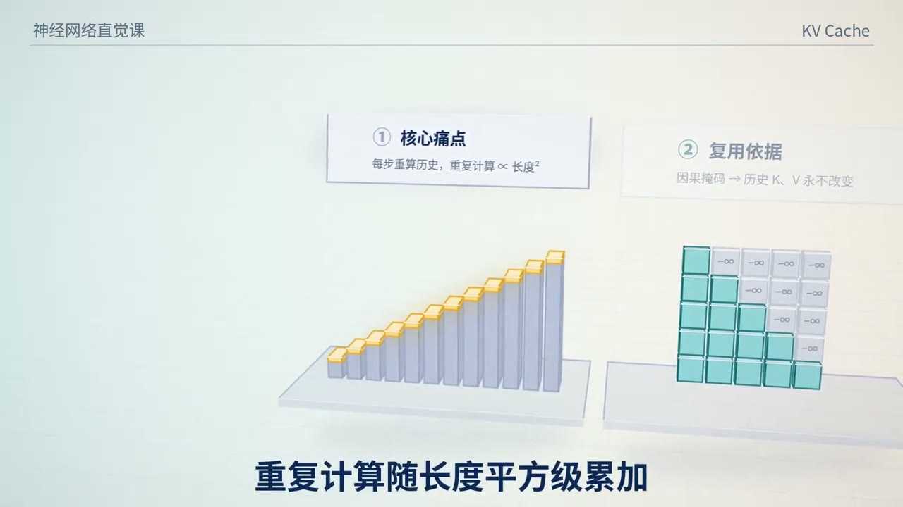

缓存的有效性依赖产生它的输入和计算条件。修改前缀 Token、位置处理、模型权重或适配器后，相关缓存可能失效。相同文本若使用不同的聊天模板、特殊 Token 或位置索引，也不能仅凭显示文字相同就认定缓存等价。

多用户共享前缀要求实际前缀及相关模型条件匹配；不能把不同请求的任意 KV 直接混用。训练中的随机 dropout、反向图和状态管理也与确定性推理不同，不能直接照搬本篇推理流程。

对于会根据总长度改变位置映射的策略，还需确认扩长上下文是否改变旧位置的有效表示。上述因果归纳依赖“固定前缀的输入及位置计算保持一致”这一前提。

## 十三、数值验证：双层注意力全量计算与缓存计算一致

配套 [kv_cache_equivalence.py](kv_cache_equivalence.py) 用标准库实现一个双层、单头、带残差的微型因果注意力网络，使用固定权重与固定输入，不依赖外部模型。

它验证三件事：

1. 对每个前缀，全量重算的各位置输出与逐 Token 缓存输出在浮点容差内一致。
2. 改变最后一个输入，不影响此前位置的输出，验证两层中的因果不变性。
3. 核对第六节 softmax 手算、第九节计数与第十节容量。

```bash
python3 kv_cache_equivalence.py
```

这是针对本篇核心逻辑的数值验证，不是某个生产模型的精度或速度测试；省略了多头、位置编码、Norm、FFN 等组件。

## 十四、技术来源与作者

| 来源 | 作者与内容 |
| --- | --- |
| [Attention Is All You Need](https://arxiv.org/abs/1706.03762)，2017 | Ashish Vaswani、Noam Shazeer、Niki Parmar、Jakob Uszkoreit、Llion Jones、Aidan N. Gomez、Łukasz Kaiser、Illia Polosukhin；注意力与因果解码的基础。本文不将其表述为 KV Cache 的唯一发明来源 |
| [Hugging Face：How caching works](https://huggingface.co/docs/transformers/main/en/cache_explanation) | 官方工程说明，用于对照缓存拼接、注意力掩码与增量处理；本文未依赖某个版本的具体 API |
| [Efficient Memory Management for Large Language Model Serving with PagedAttention](https://arxiv.org/abs/2309.06180)，2023 | Woosuk Kwon 等共同作者，完整署名见论文；将分页思想用于 KV 内存管理，是基础缓存思想之上的系统优化 |

## 十五、截图索引与阅读顺序

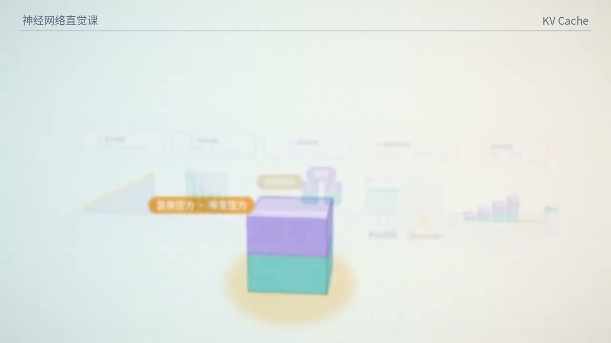

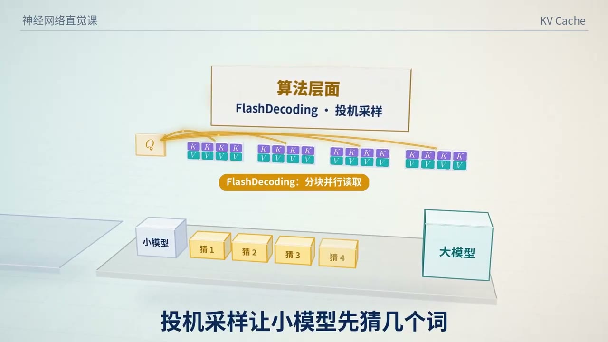

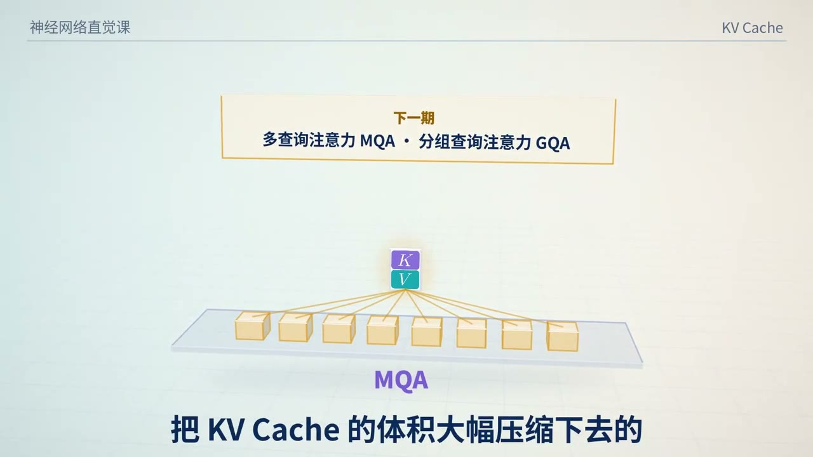

29 张图片均来自指定视频，时间点见图注与文件名。图片版权归原作者或相应权利人所有；数学手算、复杂度口径和代码验证是本文的补充解释。

| 时间点 | 内容 |
| --- | --- |
| 00:00—02:55，每 35 秒一帧 | 生成过程、预测位置与重复计算 |
| 03:30—06:25，每 35 秒一帧 | 上下文与因果不变性 |
| 07:00—08:45，每 35 秒一帧 | Q / K / V 与逐层缓存 |
| 09:20—11:05，每 35 秒一帧 | Prefill、Decode 与计数 |
| 11:40—14:00，每 35 秒一帧 | 缓存显存、并发、共享与带宽 |
| 14:35、15:10、15:45、16:05 | 回顾与下一专题 |

建议阅读路线：本篇 → [MQA / GQA / MLA](../05-KVCache进阶与MLA/05-KVCache_MQA_GQA_MLA_从显存公式到低秩吸收.md) → [LLM Serving Basics I](../../11-哈佛课程解读/llm_serving_basics_1/逐页解读.md)。

## 补充画面索引

### 01:30 · 视频列出缓存要回答的几个问题

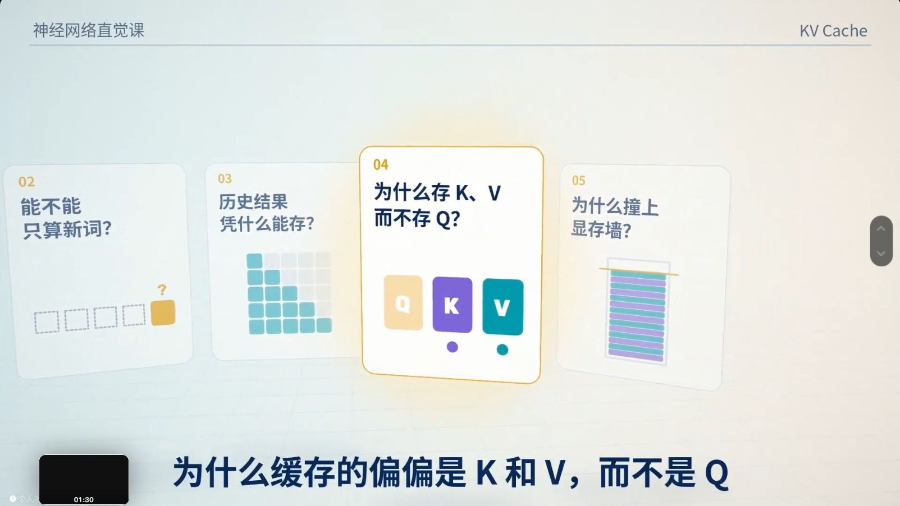

历史可复用、为什么存 K/V、以及显存代价是一条因果链。新位置的 Q 每步重新生成，历史 K/V 为多个后续查询提供读取对象，因此缓存随历史长度增加。

### 05:00 · 只处理新词时逐层读取已算过的历史

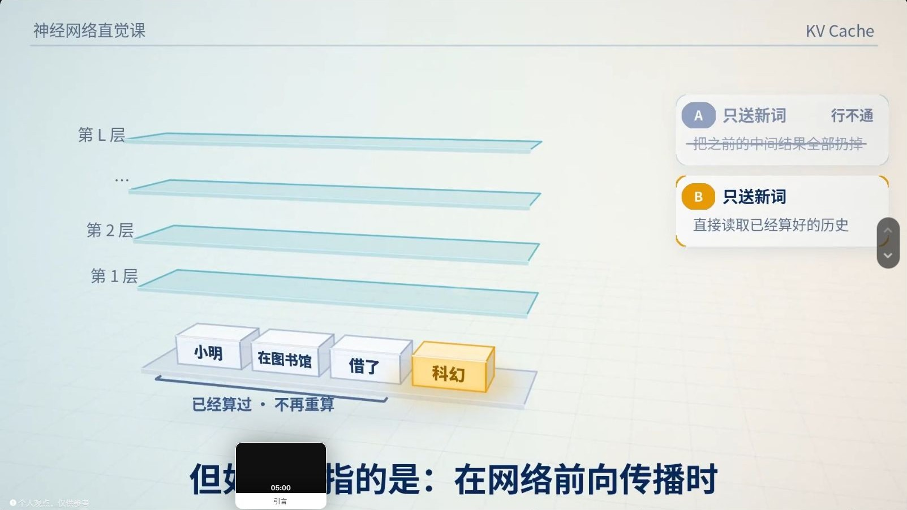

图中的多条横线对应不同层。第一层的新位置用第一层的历史 K/V，第二层用第二层的历史 K/V。把缓存当成一张跨层通用的表，会丢掉各层投影的区别。

### 09:40 · Prefill 一开始还没有历史 KV

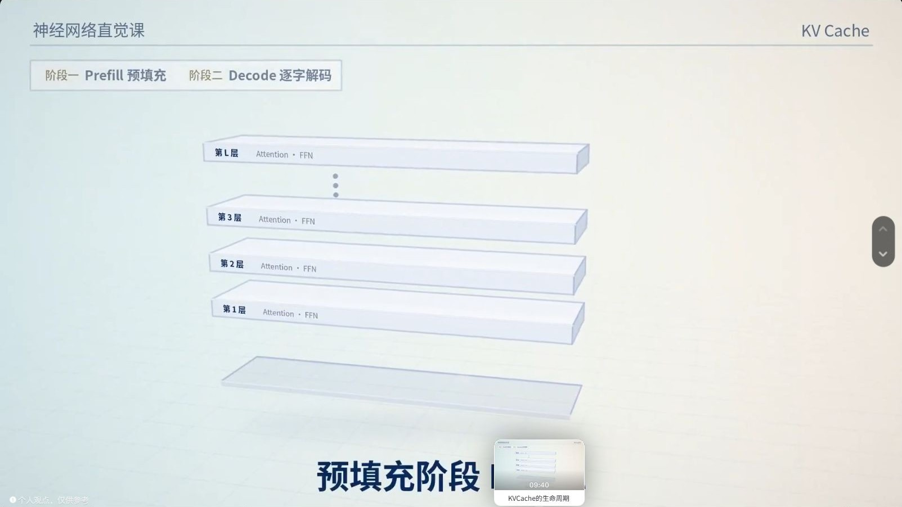

从空缓存出发，提示词一次进入模型。每层为提示词的各位置写入 K/V，并按因果掩码完成计算。得到末位置分数后才能采样，随后的 Decode 才开始只处理新增位置。
