# KV Cache 番外：Prompt Cache 与跨请求前缀复用

单次请求中的 KV Cache 为后续解码步保存历史状态。跨请求的 Prompt Cache 复用已经算过的输入前缀，主要减少重复 Prefill。

轩辕的编程宇宙，2026 年 10 月 8 日发布，时长 09:44。建议在 [KV Cache 基础](03-KVCache基础_从因果不变性到Prefill与Decode.md) 后读。截图和时间戳均来自原视频。 [B 站原视频](https://www.bilibili.com/video/BV1CjH962EVb/)

## 一、请求内缓存如何延伸到跨请求复用

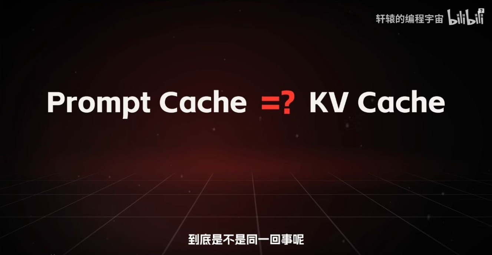

*图 1（00:55） 视频提出 Prompt Cache 与 KV Cache 的关系。*

**KV Cache** 是推理过程中保存的历史 K/V。一次请求内，Prefill 构建提示词的逐层缓存，Decode 追加新位置的 K/V。**Prompt Cache** 在这期视频里指服务端跨请求复用前缀 KV 的能力，常称为 prefix caching。第二次请求如果有已缓存的相同前缀，就能从该前缀的缓存继续处理后面的输入。 [vLLM 自动前缀缓存](https://docs.vllm.ai/en/latest/features/automatic_prefix_caching/)

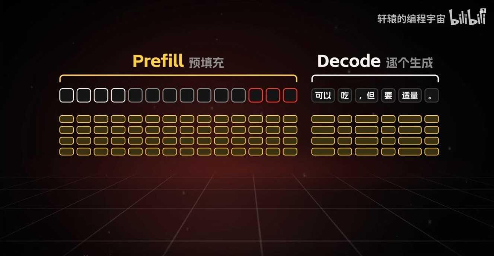

*图 2（01:35） 视频展示 Prefill 和 Decode 都涉及逐层 K/V。*

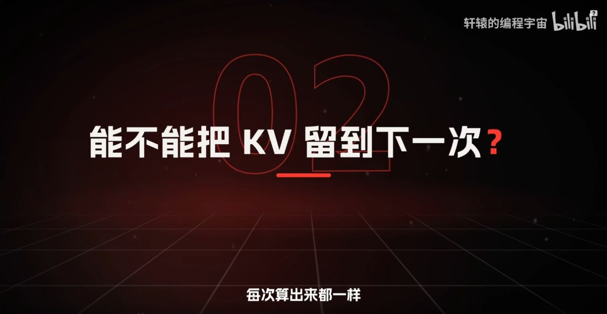

**补图（02:10）。** 同一个请求里的解码步天然沿用当前缓存。下一次请求需要先找到与旧输入一致且仍可访问的前缀，才能接着算。可以把这张提问页与下一节第 100 个位置变化的图一起读。

## 二、共同前缀决定可复用范围

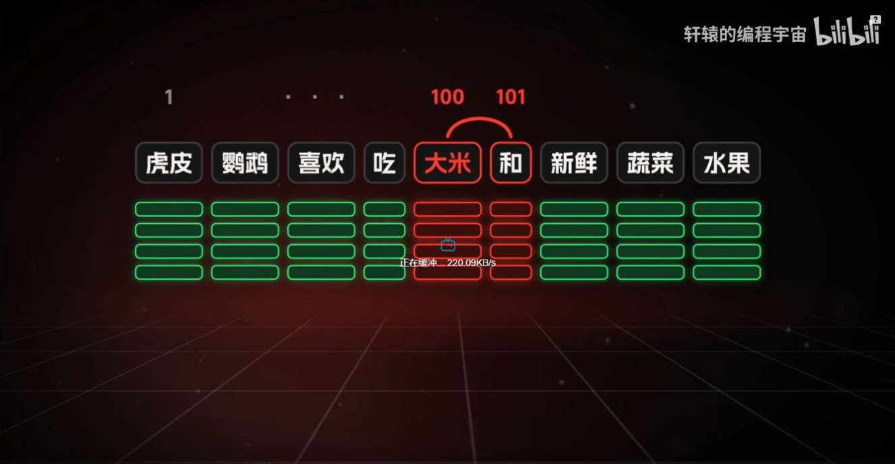

*图 3（02:50） 视频用第 100、101 个位置说明中途修改会影响后续复用。*

假设两次输入在第 100 个 token 首次分叉，前 99 个位置的上下文相同。第 100 个位置起，即使后面出现相同文本，计算它们的因果历史也已经不同。实际引擎可能按完整 token 块复用。例如每块 16 个 token 时，前 99 个相同 token 最多提供 6 个完整块，也就是 96 个可命中位置。模型、输入模板及其他影响缓存内容或隔离策略的条件也要匹配。 [vLLM 前缀缓存设计](https://docs.vllm.ai/en/stable/design/prefix_caching/)

## 三、推理状态与服务端缓存策略

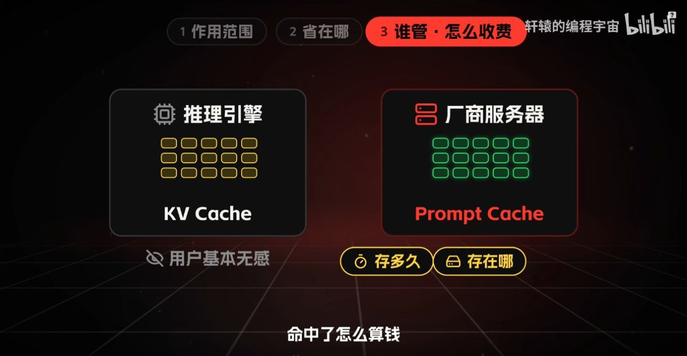

*图 4（04:10） 视频比较 KV Cache 和 Prompt Cache 的管理范围。*

| 关注点 | 请求内 KV Cache | 跨请求 Prompt Cache |
| --- | --- | --- |
| 复用时机 | 同一次生成中的后续解码步 | 之后发来的请求命中共享前缀 |
| 省掉的工作 | 重算历史位置的 K/V 和前向状态 | 重复执行已命中前缀的 Prefill |
| 工程条件 | 活跃序列需要可用的缓存状态 | 前缀匹配、缓存块仍可用且符合隔离规则 |

视频用「推理引擎」和「厂商服务器」帮助区分使用场景。引擎也能直接实现跨请求前缀复用，例如 vLLM 的 KV Cache 管理器会查询共享缓存块。缓存保留多久、命中如何计费，要以实际部署或 API 的规则为准。 [vLLM 前缀缓存设计](https://docs.vllm.ai/en/stable/design/prefix_caching/)

## 四、模板、工具与前缀稳定性

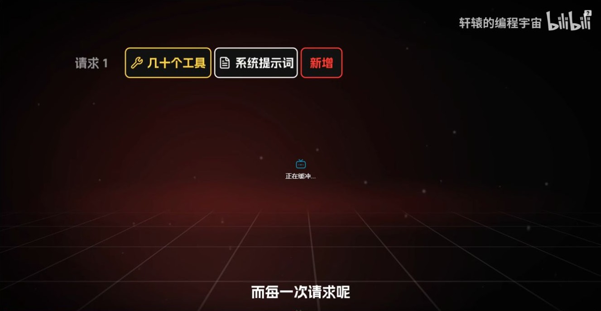

**补图（04:50）。** 应用只修改末尾问题时，工具定义和系统提示词通常仍位于共享前缀里。若在前部插入新工具，实际输入序列可能更早分叉。判断应以服务端拼接后的 token 顺序为准。

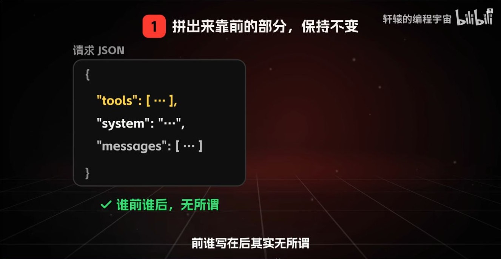

*图 5（05:25） 视频区分请求 JSON 的字段顺序与实际拼接的输入。*

模型看到的是服务端套用聊天模板后生成的 token 序列。把固定系统指令、稳定的工具定义和可复用资料放在可控的前缀里，把时间戳、本轮输入等变量放后面。JSON 外层字段怎样排序，是否影响命中，要看序列化和模板怎样处理它们。

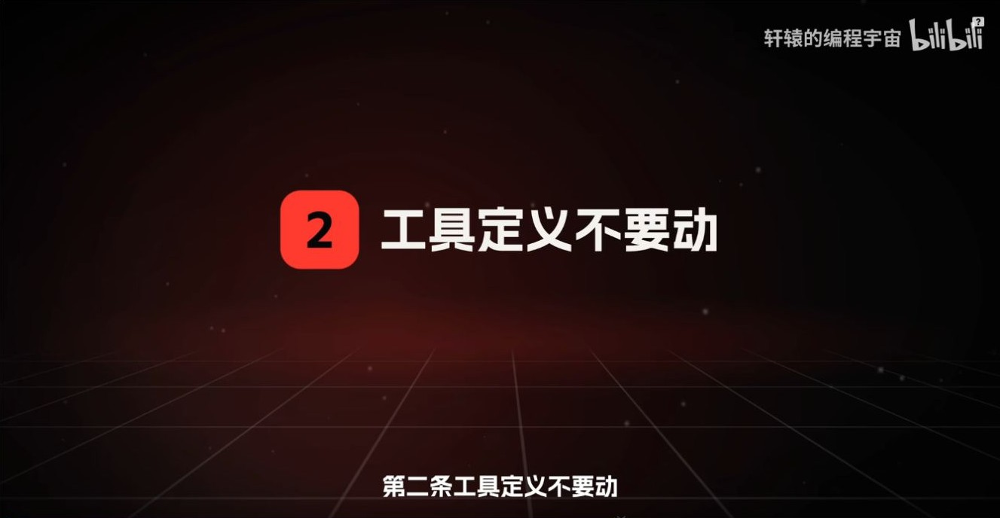

*图 6（06:05） 视频建议保持工具定义稳定。*

工具集合、定义或排列若改变了较早位置的输入 token，就可能提前打断前缀匹配。持续对话里，向末尾追加消息通常更容易保留已有前缀。删除、改写中间消息或重新生成摘要时，要考虑首次分叉的位置。

**延伸解读。** 假设一份 1,000 Token 的固定说明前放了每天变化的日期。只要日期附近的 Token 改了，后面的长说明也可能落在不同的缓存前缀下。把日期挪到说明之后，再核对模板拼接后的实际 Token，就可能保住这段共同前缀。一次冷请求和两次热请求的命中 Token 数，可以直接验证改动。

## 五、命中率、上下文长度与费用

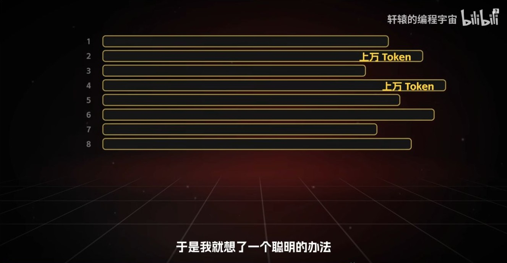

**补图（06:49）。** 每一条可以看成一次输入的总长度。多轮对话即使能复用开头，后续轮次仍可能越来越长。可以分别记录总输入、命中和未命中三个数。只看命中比例，很容易漏掉总输入上涨。

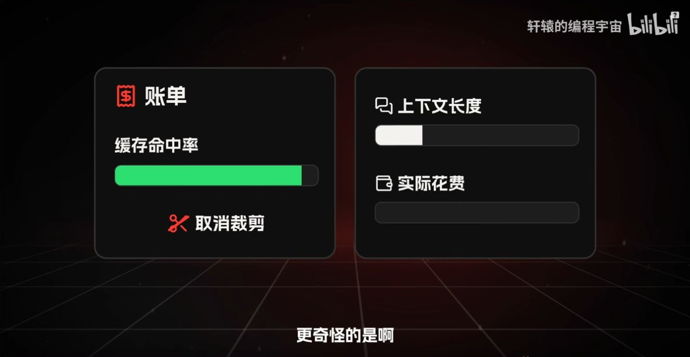

*图 7（07:29） 视频对照缓存命中率、上下文长度与实际花费。*

命中只省重复的前缀预填充。命中的 token 仍占据请求上下文，后续新位置仍可能读取它们。即使服务对命中输入打折，也要同时看输入总量、命中量、未命中量和输出量。举例，若普通输入每 token 计 1 单位、命中输入计 0.1 单位，20,000 个输入 token 即便全部命中仍计 2,000 单位，高于 1,000 个 token 全部未命中的 1,000 单位。这只是说明账单口径的假设费率。 [vLLM 自动前缀缓存的收益范围](https://docs.vllm.ai/en/latest/features/automatic_prefix_caching/)

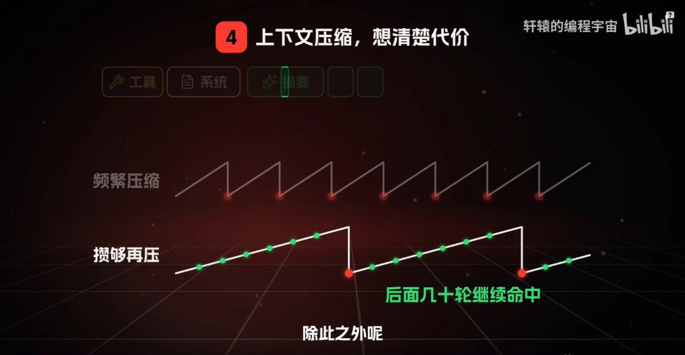

*图 8（08:09） 视频对比频繁压缩与保留较长一段可命中前缀。*

压缩上下文会缩短后续请求，也可能使被改写位置之后的缓存无法命中。若相邻请求共享大量历史，可以保留稳定前缀，把需要变动的信息放到后部，在接近窗口预算或历史干扰任务时再压缩。衡量效果可同时记录命中 token 数、首次响应延迟和单轮成本。

## 六、前缀命中后的读取成本

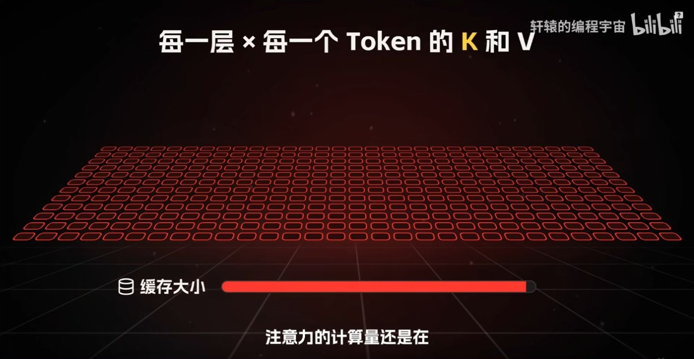

*图 9（09:24） 视频指出逐层缓存仍会占空间，注意力仍有读取成本。*

Prompt Cache 优化的是**跨请求重复 Prefill**。它和 MQA、GQA、MLA、DSA、CSA 可以组合使用，后者改变的是每个位置如何存储、每次查询读取多少内容。 [百万上下文的注意力成本](../06-Attention技术演进/06-视频补充_百万上下文与注意力演进.md)

## 七、用三个请求追踪缓存块

假设块大小为 4，模型及缓存隔离条件一致，服务端按连续完整块复用，且首个请求产生的缓存仍可用。字母代表 token ID。

| 请求 | 输入 token | 和首个请求相同的前缀 | 可复用的完整块 |
| --- | --- | ---: | ---: |
| A | A B C D · E F G H · I J | 建立缓存 | 0 |
| B | A B C D · E F G H · X Y | 8 | 2 |
| C | A B C D · E Z G H · I J | 5 | 1 |

C 的 G、H、I、J 和 A 同位置出现，但 Z 改变了这些位置可见的历史。vLLM 的设计会将父块哈希与当前块 token 一起纳入缓存键，因而后一块相同的 token 仍对应不同的前缀身份。多模态输入、适配器或缓存隔离条件也可能参与键的构造。 [vLLM 前缀缓存设计](https://docs.vllm.ai/en/stable/design/prefix_caching/)

## 八、命中后还要做哪些注意力计算？

以标准稠密因果注意力为例，前缀有 $P$ 个 token，后缀有 $S$ 个 token。假设可直接复用整个前缀 KV，并按每个查询头的可见位置数计数。

| 工作 | 查询与键的位置对数 |
| --- | ---: |
| 冷请求的前缀内部 | $P(P+1)/2$ |
| 后缀查询读取前缀 | $PS$ |
| 后缀内部的因果注意力 | $S(S+1)/2$ |

令 $P=8,S=2$。冷请求对应 $36+16+3=55$ 对，前缀命中后仍有 $16+3=19$ 对，另有实现相关的缓存管理和最后位置处理。这个算例计的是逻辑位置对数，实际耗时还依赖 kernel、批次、显存与缓存所在位置。生成阶段仍按模型的注意力结构访问历史。

## 九、怎样验证应用的提示词改造有收益？

固定模型、工具定义、输出长度和一组测试请求，分别跑冷请求和热请求。一次只改变前缀内容或变量位置，分别记录输入 token 数、命中 token 数、首 token 延迟和实际费用。若使用分块缓存，修改第一个块和只改末尾的效果应明显不同。缓存驱逐、并发排队和路由分流会影响观测，重复测试时应单独记录。 [vLLM 自动前缀缓存](https://docs.vllm.ai/en/latest/features/automatic_prefix_caching/)

**复盘。** 为什么命中 80% 输入 token 后，首 token 延迟未必降低 80%？两段文本完全相同但出现在不同历史之后，为什么可能无法复用？

## 十、原视频截图索引

截图来自文首所列视频，时间点以播放器为准。正文中的手算是教学构造，实验结果另附论文或官方文档出处。

| 图号 | 视频时间 | 对应画面 |
| --- | --- | --- |
| 1 | 00:55 | 视频提出 Prompt Cache 与 KV Cache 的关系 |
| 2 | 01:35 | 视频展示 Prefill 和 Decode 都涉及逐层 K/V |
| 3 | 02:50 | 视频用第 100、101 个位置说明中途修改会影响后续复用 |
| 4 | 04:10 | 视频比较 KV Cache 和 Prompt Cache 的管理范围 |
| 5 | 05:25 | 视频区分请求 JSON 的字段顺序与实际拼接的输入 |
| 6 | 06:05 | 视频建议保持工具定义稳定 |
| 7 | 07:29 | 视频对照缓存命中率、上下文长度与实际花费 |
| 8 | 08:09 | 视频对比频繁压缩与保留较长一段可命中前缀 |
| 9 | 09:24 | 视频指出逐层缓存仍会占空间，注意力仍有读取成本 |

### 补充画面索引

| 视频时间 | 画面 |
| --- | --- |
| 02:10 | 视频提出把已算好的 K/V 留给下一次请求 |
| 04:50 | 视频画出工具定义、系统提示词与新增输入 |
| 06:49 | 视频用多条长条表示连续请求积累的 Token |
