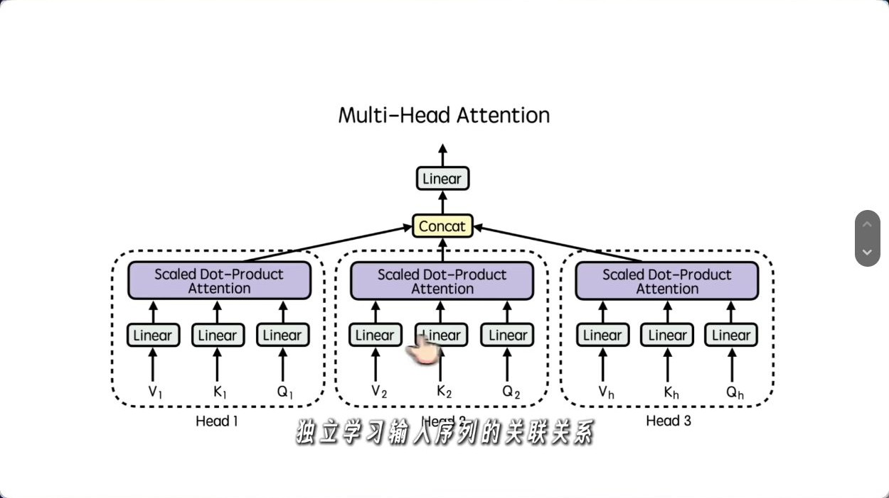
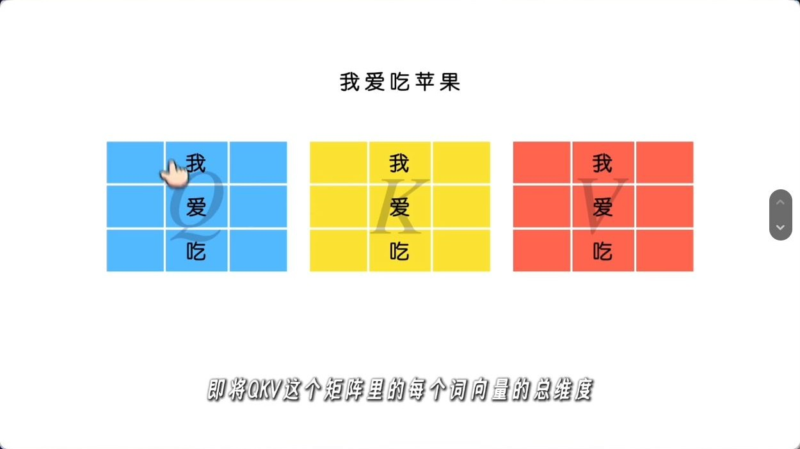
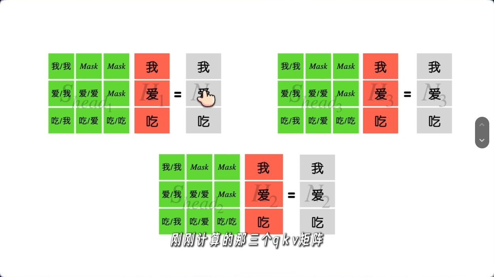
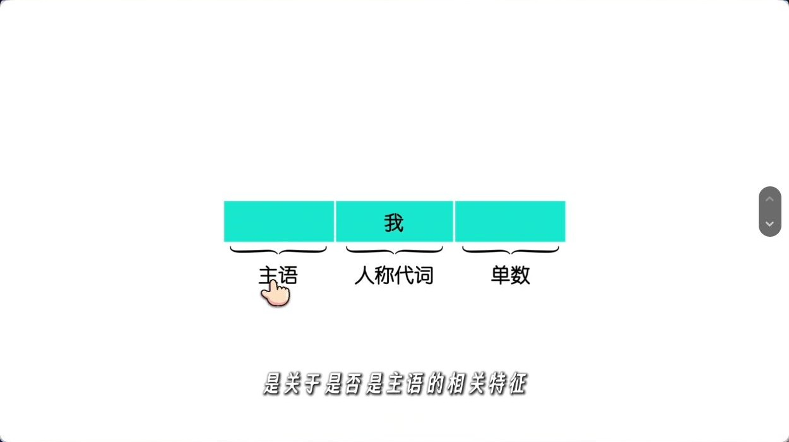
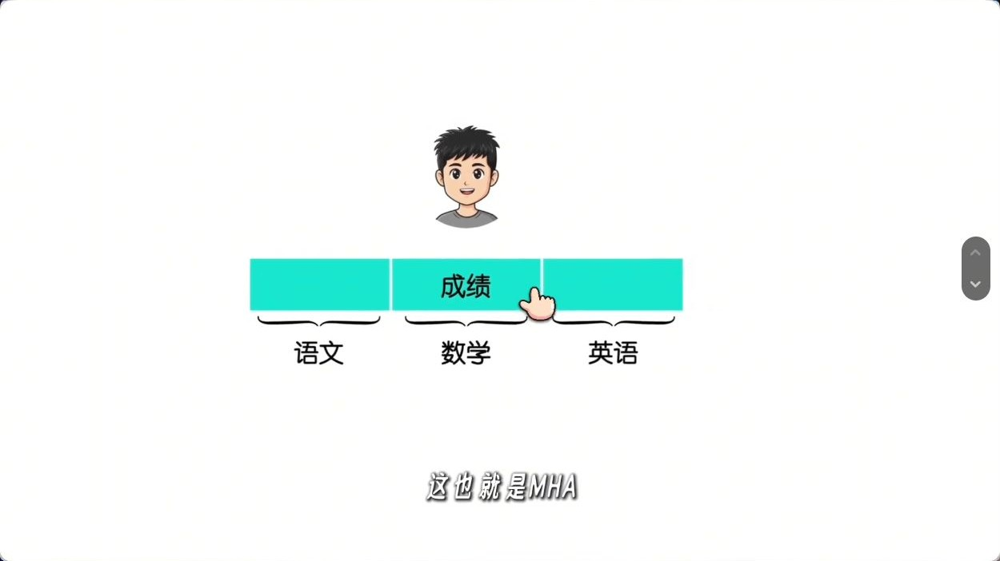
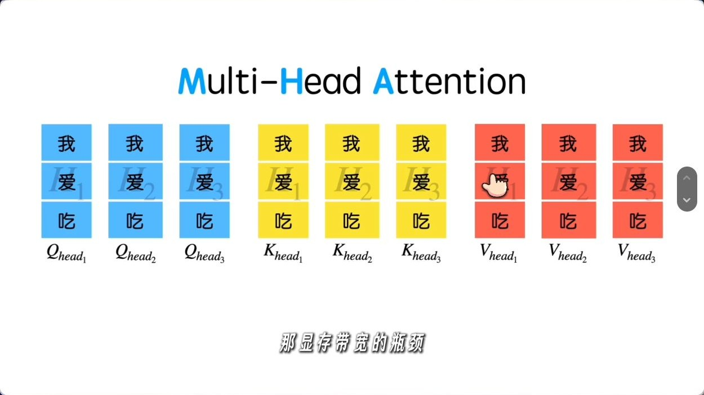
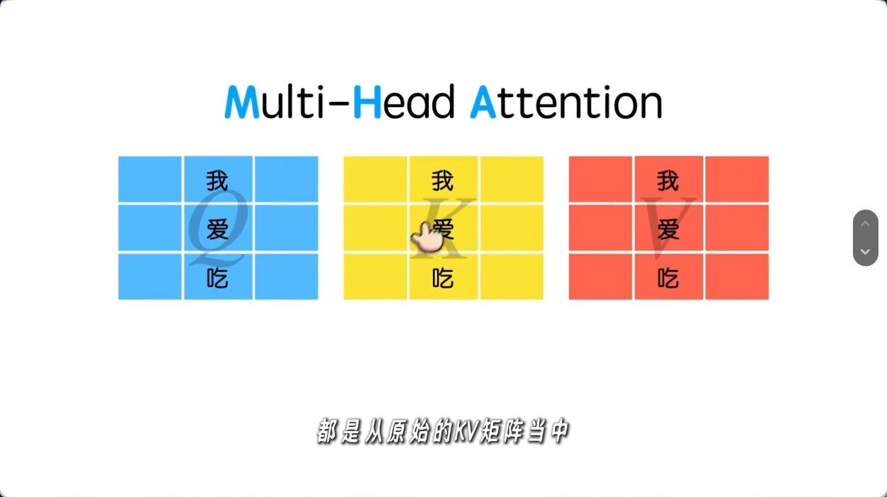
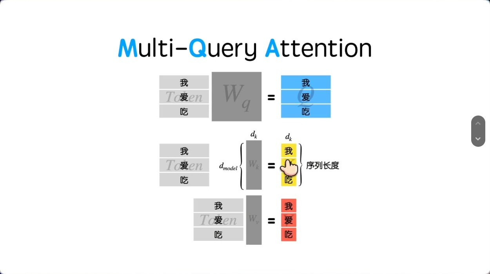
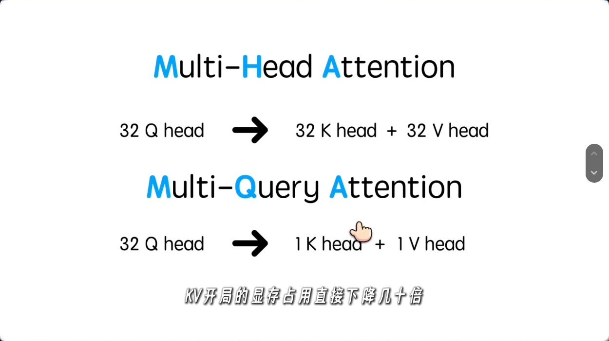
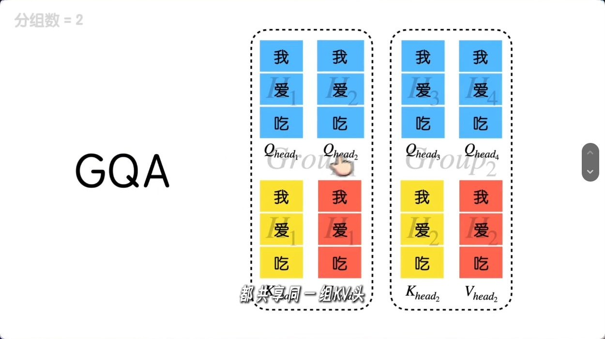

# MHA、MQA 与 GQA：从多头计算到 KV 共享

MHA、MQA 与 GQA 的结构差异可以用一张映射表表示，即每个 Query 头读取哪一组 K/V。这个映射决定 K/V 投影宽度和缓存体积，也影响推理时读取缓存的方式。

视频来自算法魔法师，2026 年 3 月 18 日发布，时长 8 分 17 秒。本文沿用视频的讲解顺序，并补充张量形状、KV Cache 的计算和原始论文。配图截自播放器画面，时间标记精确到秒。 [抖音原视频](https://www.douyin.com/video/7618534128576662835)

| 视频时间 | 主题 |
| --- | --- |
| 00:03 | 引言 |
| 00:24 | MHA 与各头的计算 |
| 03:13 | MQA 与推理时的显存带宽 |
| 06:26 | GQA 与组内共享 |
| 07:37 | 总结 |

## 一、MHA：每个查询头有自己的一对 K/V 头

对一层输入 $X\in\mathbb{R}^{T\times d_{\text{model}}}$，第 $i$ 个头从同一份输入分别投影出 $Q_i=XW_i^Q$、$K_i=XW_i^K$ 和 $V_i=XW_i^V$。$T$ 是序列长度，$d_h$ 是每个头的维度。假设 Q、K 和 V 的头维度相同，三个投影结果的形状都是 $T\times d_h$。

**图 1（00:40）** 每个头独立计算注意力。各头的结果沿特征维拼接，再通过输出投影 $W^O$ 混合。 [Transformer 论文 §3.2](https://arxiv.org/abs/1706.03762)

在实现里，通常先用一个大矩阵完成同类型的投影，再把输出特征轴重排为多个头。以 Q 为例，$XW^Q$ 的形状从 $[T,H_qd_h]$ 重排成 $[T,H_q,d_h]$。这里分头的是**投影结果**，每个头的投影都可以利用 $X$ 的全部输入维度。

**图 2（01:16）** 画面以颜色区分 Q、K、V。矩阵的行是 token 位置，头的划分沿投影后的特征轴进行。

每个头按下面的式子计算。$Q_iK_i^\top$ 给出查询位置与键位置之间的匹配分数，softmax 沿键位置归一化，再用权重对 $V_i$ 求加权和。自回归模型用因果掩码 $M$ 屏蔽未来位置。

$$
O_i=\operatorname{softmax}\left(\frac{Q_iK_i^\top}{\sqrt{d_h}}+M\right)V_i
$$

**图 3（01:55）** 视频展示了各头自己的注意力矩阵。对于第 $t$ 个查询位置，只允许读取位置 $1$ 到 $t$。

**图 4（02:33）** 「主语」「人称代词」「单数」是解释多头分工的类比。模型训练时由各头的投影权重学习特征，头的功能可以重叠，也可能随上下文变化。

**补图（03:06）。** 这个类比帮助把一整行拆成多个分组理解。真实 MHA 先用学习到的矩阵投影，再整理出多个头。每个头的投影都能读取原始输入的全部维度。

## 二、MQA：所有查询头共用一对 K/V 头

自回归解码时，历史 token 的 K、V 会被缓存。生成一个新 token 时，每层计算它自己的 Q、K、V，把新 K、V 追加到缓存，再让新 Q 读取可见历史中的 K、V。上下文越长，每一步读取的缓存就越大，显存带宽可能成为瓶颈。 [MQA 论文 §2–3](https://arxiv.org/abs/1911.02150)

**图 5（04:16）** MHA 为每个头存储单独的历史 K、V。Q 用于当前计算，常规 KV Cache 缓存的是 K 和 V。

MQA 保留多个查询头，把 K、V 的投影各收窄到一个头。所有查询头读取相同的 K、V，但各自的 Q 仍能产生不同的注意力权重。

**补图（04:52）。** 把黄色 K 和红色 V 看作按 token 排列的投影结果。MQA 改的是 K/V 每行的宽度和对应的头数，历史位置仍逐行存在。下一张图可直接对照 Q 保持多头时，K/V 投影如何变窄。

**图 6（05:30）** 单个 K 头和单个 V 头覆盖整个历史序列。共享发生在**头维度**，每个历史 token 仍有自己的 K、V 向量。

**图 7（06:05）** 同样有 32 个 Q 头，MHA 缓存 32 个 K 头和 32 个 V 头，MQA 各缓存 1 个。头维度和精度相同的情况下，后者的 KV Cache 张量体积是前者的 $1/32$。

## 三、GQA：每组查询头共用一对 K/V 头

GQA 把 $H_q$ 个查询头分成 $H_{kv}$ 组，每组共享一对 K/V 头。视频用 4 个查询头、2 个组来示意。第一组的两个查询头共用第一对 K/V，第二组共用第二对 K/V。 [GQA 论文 §2](https://arxiv.org/abs/2305.13245)

**图 8（06:50）** 组内共享 K/V，各查询头仍独立产生注意力权重。令 $g=H_q/H_{kv}$，从 0 编号的查询头 $i$ 使用第 $\lfloor i/g\rfloor$ 个 K/V 头。MHA 对应 $H_{kv}=H_q$，MQA 对应 $H_{kv}=1$。

原论文报告，在其实验设置中，GQA 能达到接近 MHA 的质量和接近 MQA 的速度。实际效果取决于分组数、训练方式和推理实现。 [GQA 论文 §3](https://arxiv.org/abs/2305.13245)

## 四、算一遍 KV Cache

假设标准稠密因果注意力，所有层采用相同的 KV 头数，K 和 V 采用相同的头维度 $d_h$，且每个缓存元素占 $s$ 字节。对 $L$ 层、批大小 $B$、每条序列缓存 $T$ 个 token，有效 K/V 张量总量为

$$
\text{KV bytes}=2\times L\times B\times T\times H_{kv}\times d_h\times s
$$

取 $L=32$、$B=1$、$T=8192$、$H_q=32$、$d_h=128$，KV 使用 BF16（$s=2$）。下表只计算有效 K/V 数据，实际显存还包括模型权重、临时张量和缓存管理开销。

| 机制 | Q 头数 | KV 头数 | 每个 KV 头服务的 Q 头数 | KV Cache |
| --- | ---: | ---: | ---: | ---: |
| MHA | 32 | 32 | 1 | 4 GiB |
| GQA | 32 | 8 | 4 | 1 GiB |
| MQA | 32 | 1 | 32 | 128 MiB |

三种结构在这个例子里都有 32 个 Q 头，且每个 Q 头都对全部可见历史位置计算匹配分数。**KV 体积下降的比例可以直接由头数算出，解码加速比例要看内核能否有效复用共享的 K/V，以及推理是否受显存带宽限制。**

**延伸解读。** 想象 8 个 Q 头分成两组，每组 4 个头。缓存中只有两套 K/V，但仍会产生 8 行注意力权重。读缓存尺寸时看 2，数注意力输出的头时看 8。若内核能在同一组查询间复用一次读入的 KV，减少的显存流量才更容易转化为速度收益。

## 五、从参数形状看共享发生在哪里

固定输入宽度 $d$，并假设各头的 K/V 宽度都是 $d_h$。$W_Q$ 的输出宽度为 $H_qd_h$，$W_K$ 和 $W_V$ 各自的输出宽度为 $H_{kv}d_h$。忽略偏置时，Q/K/V 三个投影一共使用 $dd_h(H_q+2H_{kv})$ 个参数。

| 结构 | 4 个查询头使用的 KV 头编号 | Q 投影宽度 | K 或 V 投影宽度 |
| --- | --- | ---: | ---: |
| MHA | $[0,1,2,3]$ | $4d_h$ | $4d_h$ |
| GQA，两组 | $[0,0,1,1]$ | $4d_h$ | $2d_h$ |
| MQA | $[0,0,0,0]$ | $4d_h$ | $d_h$ |

令共享的一组键为 $k_1=1,k_2=-1$，值为 $v_1=2,v_2=0$。两个查询头分别取 $q_1=1,q_2=-1$，且 $d_h=1$。第一个头的 logits 是 $[1,-1]$，输出约 $1.762$。第二个头的 logits 是 $[-1,1]$，输出约 $0.238$。同一组 K/V 仍可被不同查询头以不同权重读取。

## 六、论文验证的对象与实际推理的瓶颈

| 论文 | 作者与年份 | 阅读重点 |
| --- | --- | --- |
| [Attention Is All You Need](https://arxiv.org/abs/1706.03762) | Ashish Vaswani 等，2017 | §3.2.2 中各头的独立投影与输出拼接 |
| [Fast Transformer Decoding: One Write-Head is All You Need](https://arxiv.org/abs/1911.02150) | Noam Shazeer，2019 | 增量解码时历史 K/V 的读写成本与共享方案 |
| [GQA: Training Generalized Multi-Query Transformer Models from Multi-Head Checkpoints](https://arxiv.org/abs/2305.13245) | Joshua Ainslie 等，2023 | 如何从 MHA checkpoint 得到共享 KV 头，以及继续训练后的质量和速度对照 |

GQA 论文先在组内对原有 K/V 头的投影权重做均值池化，再继续训练。这个过程改写了共享的参数。部署时检查 kernel 能否直接消费 $H_{kv}$ 个头。如果实现把共享 KV 物理复制为 $H_q$ 份才做点积，缓存可以仍以紧凑形式存储，但临时展开与读取成本会影响端到端加速。

**复盘。** 32 个 Q 头、8 个 KV 头时，哪些量缩成四分之一？为什么用同样的 32 个 Q 头时，主注意力仍会为每个头分别产生权重？

## 七、原视频截图索引

截图来自文首所列视频，时间点以播放器为准。正文中的手算是教学构造，实验结果另附论文或官方文档出处。

| 图号 | 视频时间 | 对应画面 |
| --- | --- | --- |
| 1 | 00:40 | MHA 的各个头独立做注意力，输出再拼接和投影 |
| 2 | 01:16 | 视频用「我爱吃苹果」演示 Q、K、V 的特征维度 |
| 3 | 01:55 | 三个注意力头分别应用因果掩码并计算输出 |
| 4 | 02:33 | 视频用主语、人称代词和单数类比不同头 |
| 5 | 04:16 | MHA 中多组 Q、K、V，视频开始讨论显存带宽 |
| 6 | 05:30 | MQA 保留多个 Q 头并分别只投影出一个 K 头和一个 V 头 |
| 7 | 06:05 | 视频比较 32 个查询头时 MHA 和 MQA 的 KV 头数 |
| 8 | 06:50 | GQA 将 4 个查询头分成 2 组，每组共享一对 K/V |

### 补充画面索引

| 视频时间 | 画面 |
| --- | --- |
| 03:06 | 视频用语文、数学、英语的成绩栏类比多头 |
| 04:52 | 视频回到投影后的 Q/K/V 整体矩阵 |
