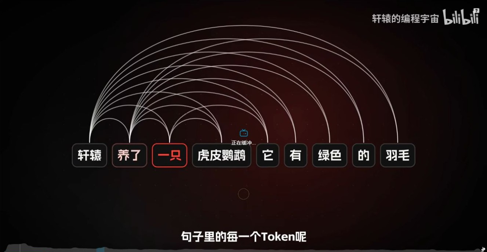
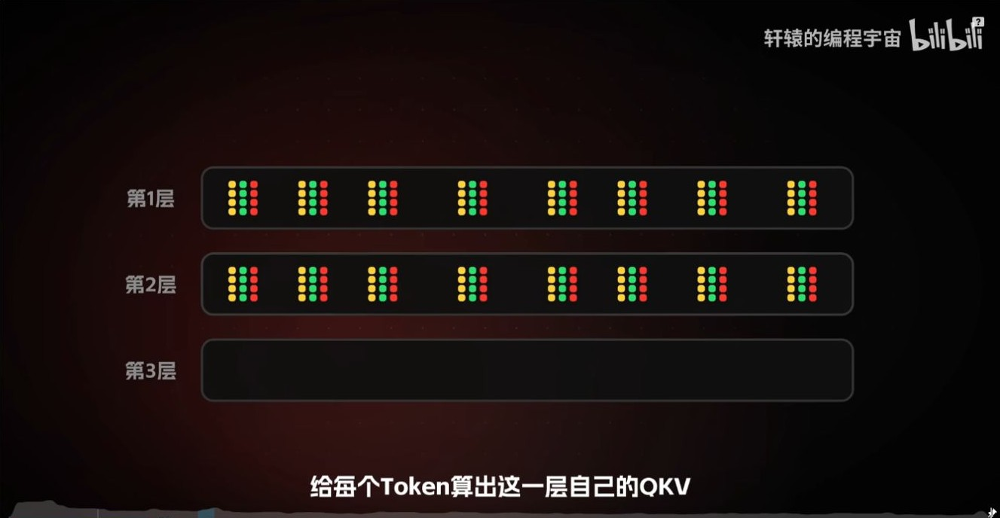
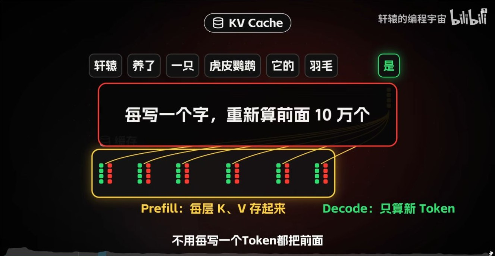
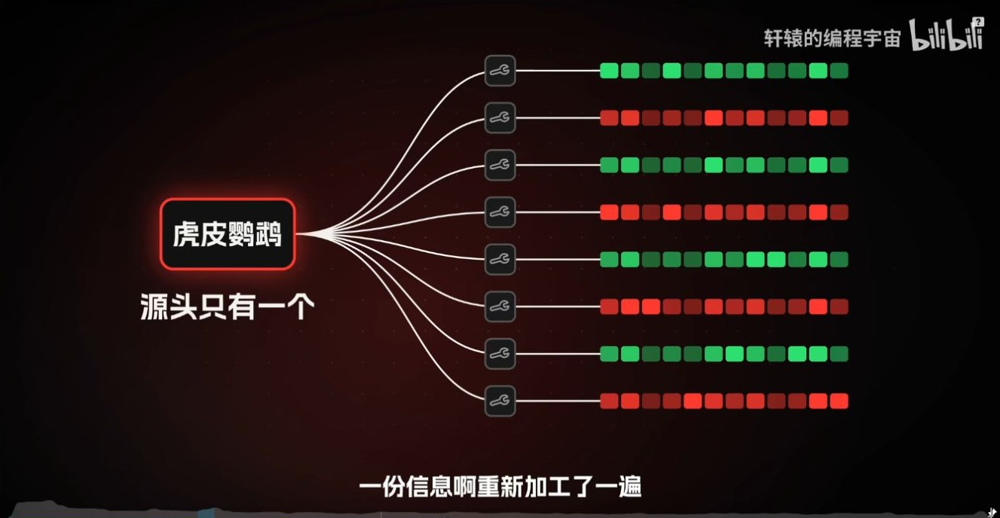
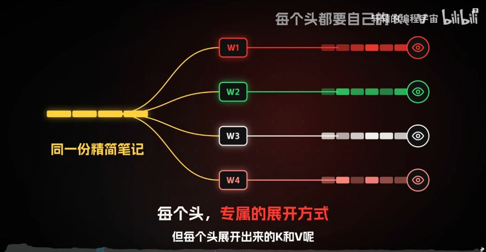
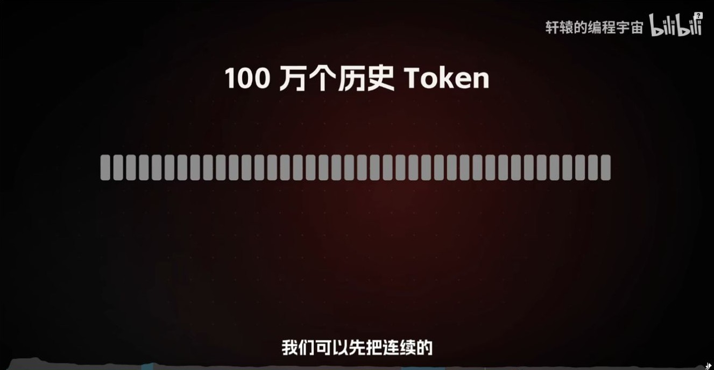
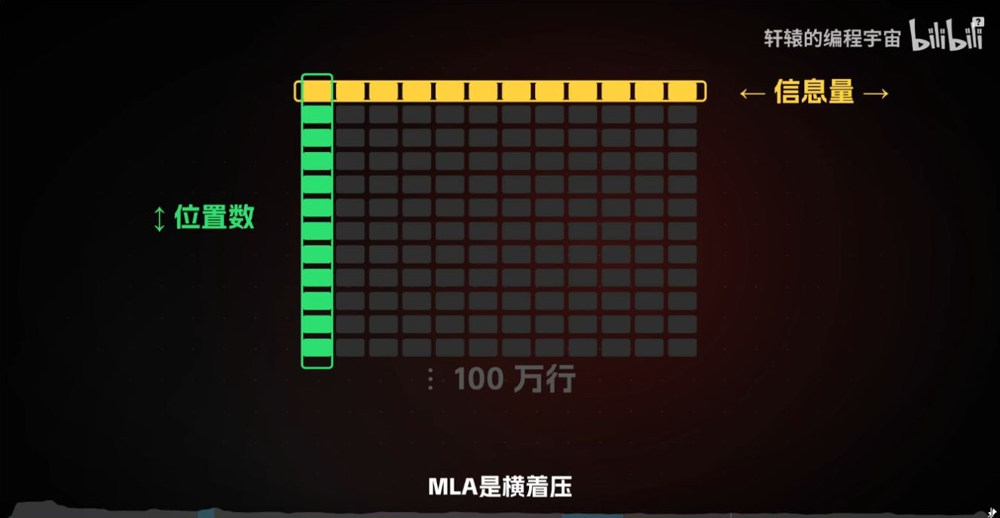
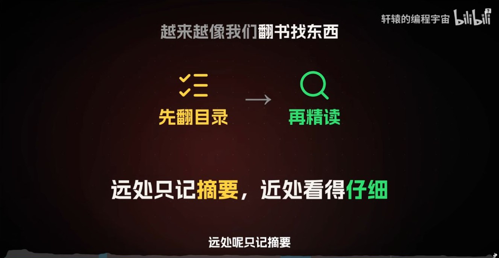
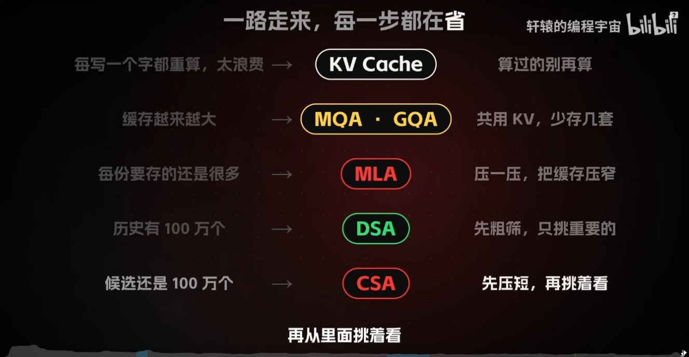

# 百万上下文的注意力成本：从 MHA、MQA、GQA 到 MLA、DSA 与 CSA

长上下文同时增加缓存容量和注意力读取成本。沿这条视频的技术路线，可以分别追踪每个位置存多少、历史有多少条目，以及单次查询读取多少条目。

轩辕的编程宇宙，2026 年 10 月 26 日发布，时长 17:20。下文沿视频的论述顺序展开，时间戳对应原视频截图。 [B 站原视频](https://www.bilibili.com/video/BV1ukno6YEsF/)

## 一、KV Cache 省掉历史位置的重复计算

**补图（01:34）。** 在因果语言模型里，弧线可理解为较晚查询读取较早位置。对长度为 $T$ 的前缀，若每个位置能读自身和历史，每头的可见位置对数为 $T(T+1)/2$。图里的连线说明了上下文变长时打分关系为什么增长得比 token 更快。

*图 1（02:39） 逐层计算各位置的 Q、K、V。*

因果注意力让历史位置的表示只依赖它自己和更早的 token。因此追加新 token 后，之前计算的各层 K/V 可以继续使用。Prefill 批量处理提示词、建立缓存，Decode 每步为新位置计算 Q/K/V，并用新 Q 读取所需的历史缓存。

*图 2（03:39） 视频区分 Prefill 写入 K/V 和 Decode 处理新 token。*

KV Cache 省掉历史位置的重复前向计算。随着序列增长，缓存仍会增大，稠密注意力在每个解码步仍要读取全部可见的 K/V。后面的机制分别处理存储容量、显存带宽和匹配计算量。 [KV Cache 基础](../03-KVCache基础/03-KVCache基础_从因果不变性到Prefill与Decode.md)

## 二、MHA、MQA 与 GQA 改变 KV 头数

*图 3（05:40） 视频讨论把 32 套 KV 头缩到一套的取舍。*

MHA 为每个 Q 头配一对 K/V 头。MQA 让所有 Q 头共享一对 K/V，GQA 让一组 Q 头共享一对 K/V。三个方案仍保留各自的 Q 头，各头独立计算注意力权重。固定层数、头维度和缓存精度时，有效缓存字节数与 KV 头数成正比。 [MHA、MQA 与 GQA 专题](../04-MHA-MQA-GQA/04-MHA-MQA-GQA_从多头计算到KV共享.md)

## 三、MLA 压缩单个位置的表示

*图 4（07:40） 视频展示同一 token 为多个头产生 K/V 表示。*

MLA 为每个 token 保留一份低维的联合 KV 潜向量 $c_t^{KV}$。概念上，每个头可以用自己的投影从这份表示得到对应的 K/V。解码实现还可通过矩阵吸收，把相关线性变换移到查询侧和输出侧，避免把全部历史潜向量显式展开成逐头 K/V。DeepSeek-V2 的设计还缓存独立的 RoPE 键分量。 [DeepSeek-V2 报告 §2.1.1](https://arxiv.org/abs/2405.04434)

*图 5（08:40） 视频用一份精简笔记与各头专属的展开方式说明 MLA。*

## 四、DSA 为每个查询选择历史位置

**补图（10:50）。** 用一个明确线索来理解两阶段读取。索引器先给大量历史位置粗打分，主注意力再读取选中的值。真实索引分数由模型表示算出，相关信息可以来自多个位置，排序漏掉关键线索时后续注意力也无法补读该候选。

*图 6（11:50） 视频说明 Indexer 的任务是筛选候选。*

DeepSeek-V3.2 在 MLA 上引入 DSA。Lightning Indexer 对当前查询可见的历史位置计算较便宜的相关性分数，再让主注意力读取 Top-K 对应的 KV。若有 $T$ 个可见位置、选择 $k$ 个，主注意力读取的位置数从 $T$ 变成至多 $k$。索引器自身仍要打分并做选择，未被这一次查询选中的条目还可能服务后续查询。 [DeepSeek-V3.2 报告 §2](https://modelscope.cn/models/deepseek-ai/DeepSeek-V3.2/resolve/master/assets/paper.pdf)

**延伸解读。** 同一段长历史里，上一问找「发票金额」，下一问找「签收地址」。索引器可能给两次查询选出几乎不重叠的历史位置。把上一问没选中的位置立即丢掉，会让下一问失去候选。记录每次命中的位置集合，可以直观看出稀疏读取和缓存保留是两件事。

## 五、CSA 压缩历史后再检索

*图 7（12:44） 视频引出对大量历史位置沿序列维度压缩。*

MLA 压的是矩阵的特征维，CSA 还压序列维。用 $T$ 行表示 $T$ 个位置，压缩率为 $m$ 时，压缩池大致只需 $T/m$ 个条目。CSA 的索引器在压缩池里挑选 Top-K，近期 token 由局部滑动窗口保留更细的表示。

*图 8（13:40） 视频用矩阵的横轴表示特征量，纵轴表示历史位置数。*

*图 9（14:34） 视频把 CSA 类比为先查目录、再精读，并保留近期细节。*

补充对照 DeepSeek-V4 的另一种层。HCA 沿序列使用更高压缩率，再对可见的压缩条目做稠密注意力。以 $T=1,000,000$、$m=4$ 为例，压缩池约有 250,000 个条目。若再选 512 项，则这一次主注意力的全局分支只读取至多 512 个压缩条目，另有局部窗口和索引开销。这个算例只说明各步骤改变的数量。 [DeepSeek-V4 官方模型卡](https://fe-static.deepseek.com/chat/transparency/deepseek-V4-model-card-EN.pdf)

## 六、从存储与读取两方面比较

*图 10（15:30） 视频汇总 KV Cache、MQA/GQA、MLA、DSA 与 CSA 各自省掉的工作。*

| 机制 | 主要变化 | 观察哪个量 |
| --- | --- | --- |
| KV Cache | 重用历史位置已有的 K/V | 每步重算多少历史位置 |
| MQA / GQA | 多个 Q 头共用 K/V 头 | 每位置缓存多少 KV 头 |
| MLA | 缓存联合潜向量 | 每位置缓存多少元素 |
| DSA | 索引器为每个查询选择历史位置 | 主注意力每次读取多少位置 |
| CSA | 把历史位置压成条目，再做稀疏选择 | 缓存条目数、索引候选数、主注意力读取数 |

上下文窗口上限描述模型和服务能处理的序列长度。窗口内的信息能否被准确找回，还要看任务、信息位置和模型实际表现。继续看同目录的 [Attention 技术演进](06-Attention_技术演进_Transformer至Qwen3.8与DeepSeekV4.1.md)，可对照 V4.1-Flash 如何进一步跨层复用 KV 与索引。

## 七、从一次解码算出存储和读取分别在哪里变小

先固定教学模型为 32 层，batch 为 1，历史长度 1,000,000，每个 KV 头维度为 128，元素为 BF16。忽略分页、索引和运行时工作区，缓存字节数为 $2LT H_{kv}d_hs$，其中首项 2 计 K 和 V，$s=2$ 是每元素字节数。

| 教学配置 | 历史条目数 | 每位置每层有效缓存字节 | 32 层总容量 |
| --- | ---: | ---: | ---: |
| MHA，32 个 KV 头 | 1,000,000 | 16,384 | 524.288 GB |
| GQA，8 个 KV 头 | 1,000,000 | 4,096 | 131.072 GB |
| MQA，1 个 KV 头 | 1,000,000 | 512 | 16.384 GB |

表中 GB 使用十进制口径。这三种配置下每个 Q 头仍可访问整段历史。对于 MLA，估算公式应改成每位置存储的 KV 潜变量与位置键分量的元素数之和，再乘层数、历史长度及对应字节数。对于 DSA，还要分别计算索引所需的存储，以及主注意力实际取回的 KV 数据。 [MLA 复算专题](../05-KVCache进阶与MLA/05-KVCache_MQA_GQA_MLA_从显存公式到低秩吸收.md)

沿用百万位置作为假设，DSA 的索引器若从 1,000,000 个可见位置选择 2,048 个，主注意力覆盖约 0.205% 的位置。若先把历史按 4 比 1 压到约 250,000 个条目，再选择 512 个压缩条目，候选池和主注意力都改变了。512 条压缩表示与 512 个逐 token KV 对应的内容粒度不同，端到端延迟还取决于索引打分、压缩、访存和局部窗口。

## 八、沿 DeepSeek 原始报告核对实现

| 报告 | 首先看哪里 | 能核对什么 |
| --- | --- | --- |
| [DeepSeek-V2](https://arxiv.org/abs/2405.04434) | §2.1.1 | K/V 联合低秩压缩与解耦 RoPE |
| [DeepSeek-V3.2](https://modelscope.cn/models/deepseek-ai/DeepSeek-V3.2/resolve/master/assets/paper.pdf) | §2 | 索引分数、Top-K 选择与 MLA 的组合 |
| [DeepSeek-V4 官方模型卡](https://fe-static.deepseek.com/chat/transparency/deepseek-V4-model-card-EN.pdf) | 模型属性 | CSA 的压缩加稀疏选择与 HCA 的更高压缩加稠密注意力 |
| [DeepSeek-V4.1-Flash](https://arxiv.org/html/2609.19969) | §2.2–2.3 | CED、全局 KV 跨层复用和索引共享 |

拿到一项「百万上下文」结果时，需要核对窗口长度、训练或扩窗配置、长文本任务指标，以及测试中的并发与硬件。缓存占用、首 token 延迟和逐 token 生成速度各自回答不同的部署问题。

**复盘。** DSA 一次只选 Top-K 时，为什么其他位置的 KV 仍可能要存？CSA 压缩的是位置轴，MLA 压缩的是哪一轴？

## 九、原视频截图索引

截图来自文首所列视频，时间点以播放器为准。正文中的手算是教学构造，实验结果另附论文或官方文档出处。

| 图号 | 视频时间 | 对应画面 |
| --- | --- | --- |
| 1 | 02:39 | 逐层计算各位置的 Q、K、V |
| 2 | 03:39 | 视频区分 Prefill 写入 K/V 和 Decode 处理新 token |
| 3 | 05:40 | 视频讨论把 32 套 KV 头缩到一套的取舍 |
| 4 | 07:40 | 视频展示同一 token 为多个头产生 K/V 表示 |
| 5 | 08:40 | 视频用一份精简笔记与各头专属的展开方式说明 MLA |
| 6 | 11:50 | 视频说明 Indexer 的任务是筛选候选 |
| 7 | 12:44 | 视频引出对大量历史位置沿序列维度压缩 |
| 8 | 13:40 | 视频用矩阵的横轴表示特征量，纵轴表示历史位置数 |
| 9 | 14:34 | 视频把 CSA 类比为先查目录、再精读，并保留近期细节 |
| 10 | 15:30 | 视频汇总 KV Cache、MQA/GQA、MLA、DSA 与 CSA 各自省掉的工作 |

### 补充画面索引

| 视频时间 | 画面 |
| --- | --- |
| 01:34 | 视频用跨 token 的连线表示历史位置之间的依赖 |
| 10:50 | 视频用找出虎皮鹦鹉这个词说明索引筛选 |
