# 归一化演进：从 BatchNorm 到 LayerNorm 与 RMSNorm

比较归一化方法时，先确定统计范围，再看减去什么、除以什么，以及统计量在训练和推理时从哪里来。Transformer 还多一个独立的选择，即归一化在残差加法前还是后。

算法魔法师，2026 年 9 月 2 日发布，时长 08:54。本文按视频顺序梳理各方法计算统计量的范围，以及它们在 Transformer 中解决的问题。 [B 站原视频](https://www.bilibili.com/video/BV1JwtW6TE3c/)

## 一、AlexNet 的局部响应归一化

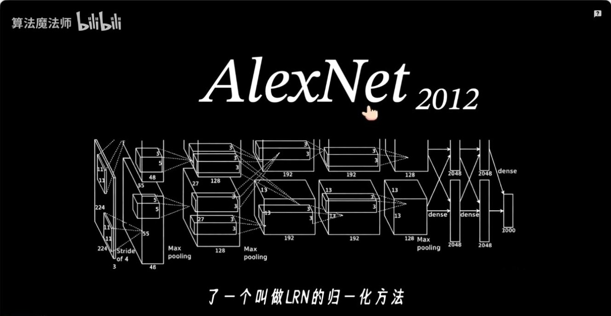

*图 1（01:04） 视频以 AlexNet 的局部响应归一化开场。*

LRN（Local Response Normalization）在同一个空间位置上，使用相邻通道的激活平方和缩放当前通道。它体现的是局部通道响应之间的竞争。后面的 BN、LN 等方法则通过选定统计轴，控制激活的中心和尺度。

## 二、BatchNorm 的统计轴和运行统计量

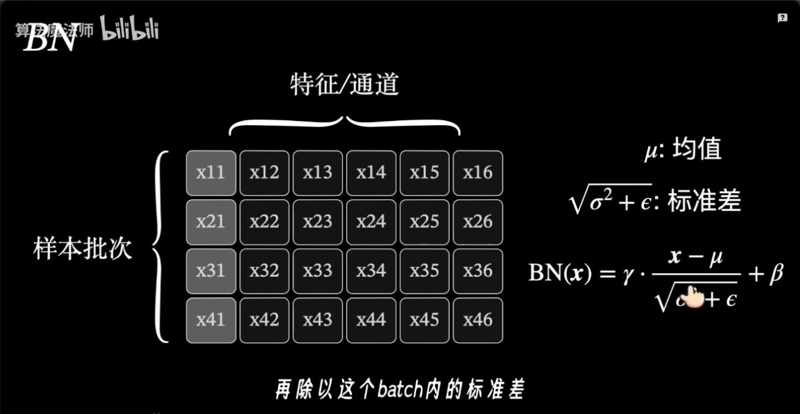

*图 2（01:39） BN 示意图的行是样本，列是特征。*

对形状为 $[B,D]$ 的激活，训练时 BN 对每列特征 $j$ 沿 $B$ 个样本求均值 $\mu_j$ 和方差 $\sigma_j^2$，再计算

$$
y_{bj}=\gamma_j\frac{x_{bj}-\mu_j}{\sqrt{\sigma_j^2+\epsilon}}+\beta_j.
$$

$\epsilon$ 用于数值稳定，$\gamma_j,\beta_j$ 是可学习的缩放和平移参数。常见卷积 BN 会按通道统计，同时汇总 batch 和空间位置。 [Batch Normalization 原论文](https://arxiv.org/abs/1502.03167)

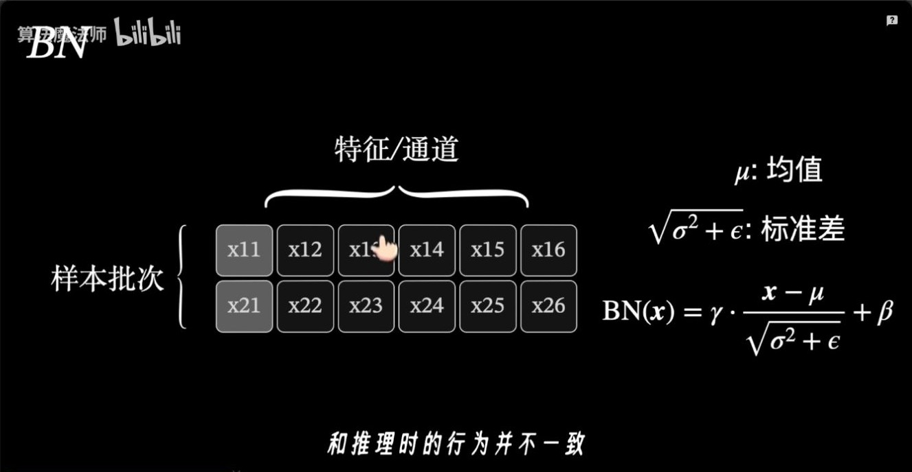

*图 3（02:14） 视频提示 BN 在训练和推理时使用不同的统计量。*

训练时，一个样本的输出会受同批样本影响。常规推理使用训练期间累计的统计量，让单条样本也能独立推理。训练批次用于统计的元素很少时，均值和方差的估计更容易波动。

**延伸解读。** 同一个样本在线上单独到达，或者和其他样本凑成一个批次。使用固定运行统计量的常规 BN 推理，两次结果应相同。如果结果随同批样本变化，先检查模型有没有切到推理模式，再检查实现是否配置为推理时继续使用批内统计。这个对照比只看代码中的 BN 名称更直接。

## 三、LayerNorm 对每个 token 独立计算

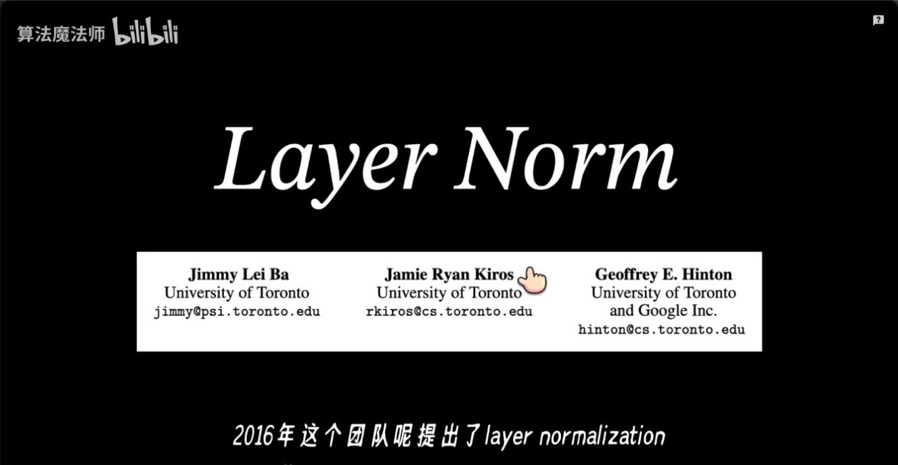

**补图（02:48）。** 这一页从 BN 过渡到 LN。读接下来的矩阵示意时，可以固定一个样本并横向看它的特征，而不是沿列汇总同批样本。对自回归模型，常见做法是固定 batch 和 token 位置，只沿隐藏维计算。

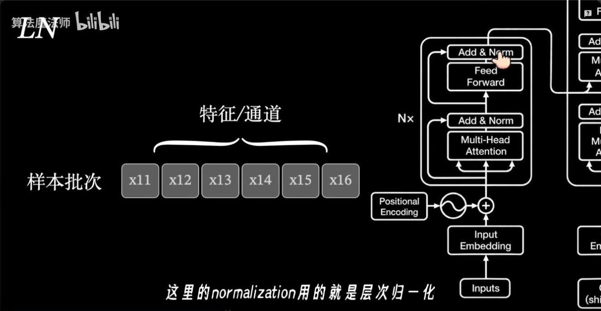

*图 4（03:20） 视频把 LN 的归一化轴与 Transformer 的 Add & Norm 联系起来。*

在 Transformer 常见的 $[B,T,D]$ 表示里，LN 固定样本和 token 位置，只沿隐藏维 $D$ 计算均值和方差。每个 token 使用自己的统计量，训练和推理使用相同计算。原版 Transformer 的 Add & Norm 把 LN 放在残差加法之后。归一化用哪个统计轴，与归一化放在残差前还是后，是两个独立的设计选择。 [Layer Normalization 原论文](https://arxiv.org/abs/1607.06450) · [Transformer 论文 §3.1](https://arxiv.org/abs/1706.03762)

## 四、InstanceNorm、GroupNorm 与 WeightNorm

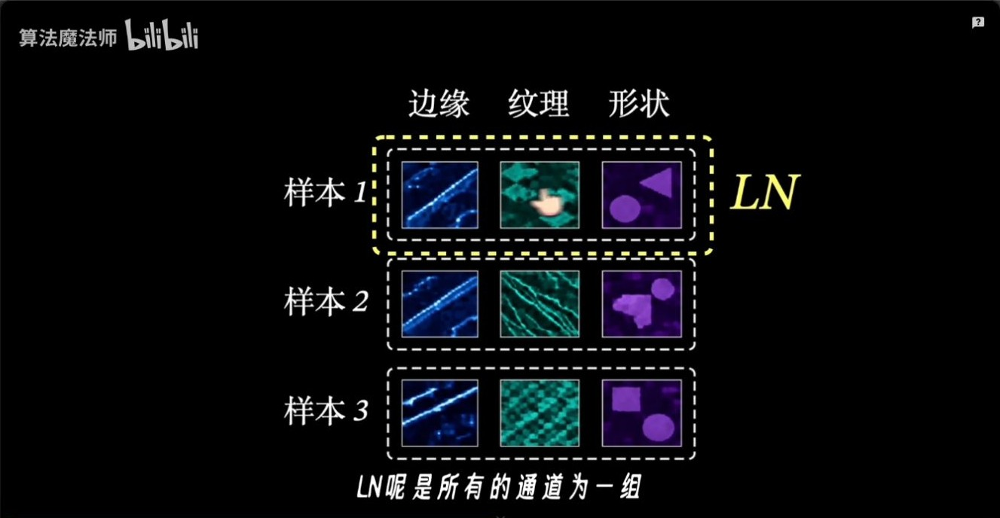

*图 5（04:27） 视频用边缘、纹理与形状类比样本内的通道。*

以卷积特征图 $[B,C,H,W]$ 为例，**InstanceNorm** 对单个样本的每个通道分别沿空间维统计。**GroupNorm** 把通道分组，在单个样本内沿组内通道及空间维统计。这两种方法都可以脱离 batch 统计工作。 [Instance Normalization 论文](https://arxiv.org/abs/1607.08022) · [Group Normalization 论文](https://arxiv.org/abs/1803.08494)

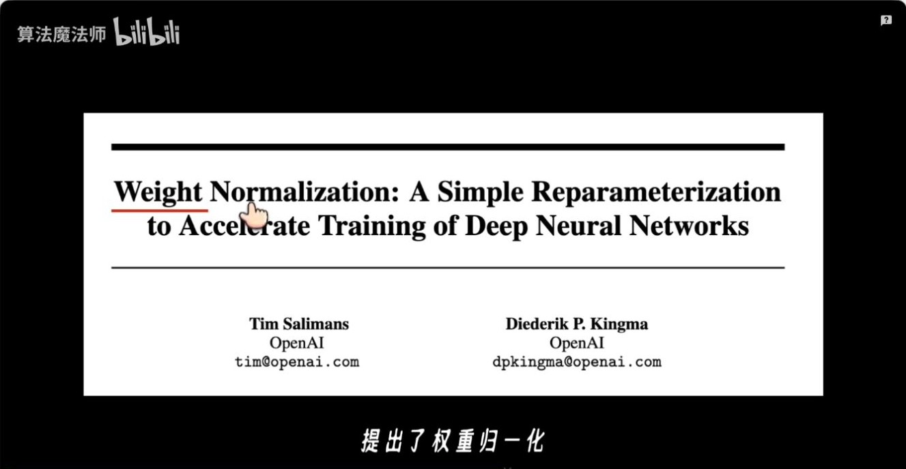

**补图（05:00）。** WeightNorm 讨论的是怎样写出权重向量。对一个输入做前向时，仍可把计算写成 $w^\top x+b$，但训练变量改成决定长度的 $g$ 和决定方向的 $v$。先辨认公式里被归一化的是哪个向量，再和 LN 对照。

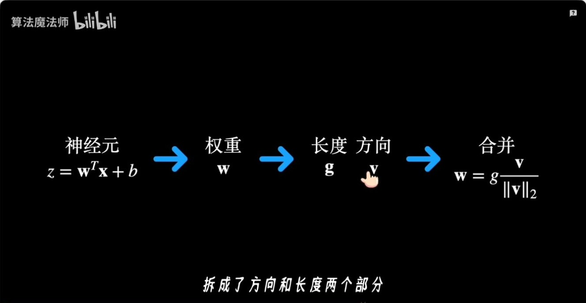

*图 6（05:32） 视频把权重分解为幅值与方向。*

**WeightNorm** 调整的是权重参数化。它用 $w=g\,v/\lVert v\rVert_2$ 表示一组权重，其中 $v/\lVert v\rVert_2$ 表示方向，$|g|$ 控制长度。这一步直接作用于权重，模型仍可在其他位置使用激活归一化。 [Weight Normalization 论文](https://arxiv.org/abs/1602.07868)

## 五、RMSNorm 的均方根分母

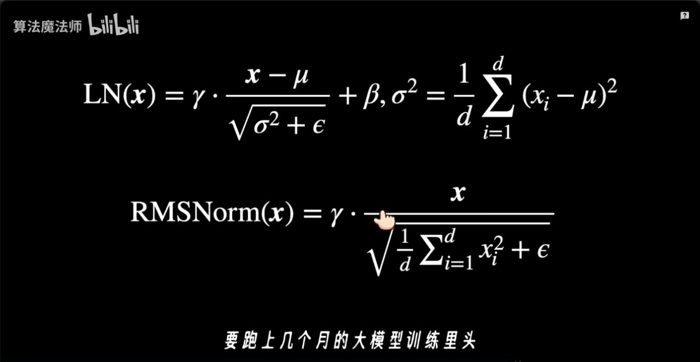

*图 7（06:39） 视频并排展示 LayerNorm 与 RMSNorm 的公式。*

RMSNorm 也可以沿每个 token 的隐藏维计算。它使用原始分量的均方根作为分母，常见形式为

$$
y_i=\gamma_i\,\frac{x_i}{\sqrt{\frac{1}{D}\sum_{j=1}^{D}x_j^2+\epsilon}}.
$$

取 $x=[1,3]$，令缩放为 1、偏置为 0，并忽略 $\epsilon$。LN 先减均值 2，再除以标准差 1，得到 $[-1,1]$。RMSNorm 除以 $\sqrt{5}$，得到约 $[0.447,1.342]$。这个例子展示了两种输出对输入均值的处理差异。 [RMSNorm 原论文](https://arxiv.org/abs/1910.07467)

## 六、DeepNorm 的残差系数

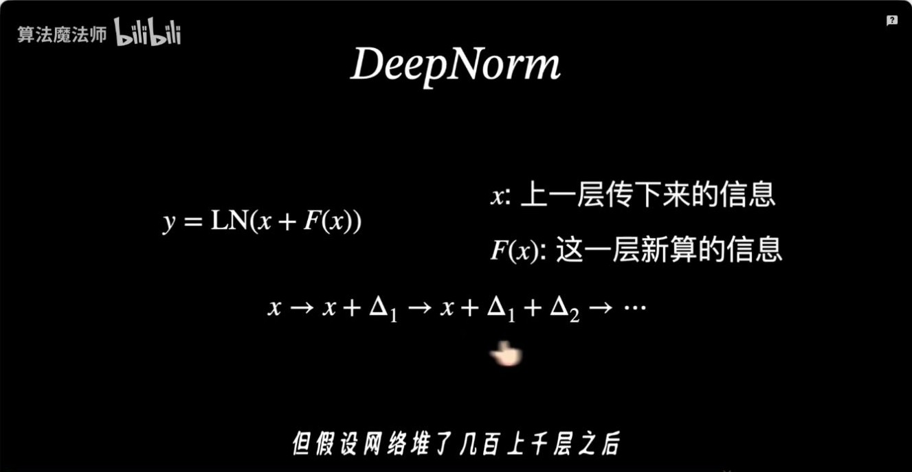

*图 8（07:10） 视频从 Post-LN 的残差结构引出深层网络的尺度问题。*

DeepNorm 保留 LayerNorm，将残差更新写成 $\operatorname{LN}(\alpha x+F(x))$，并配合按深度缩放的初始化。$\alpha$ 与初始化系数由网络深度和架构决定。这一节讨论的是怎样控制大量残差层堆叠后的更新尺度。 [DeepNet 论文](https://arxiv.org/abs/2203.00555)

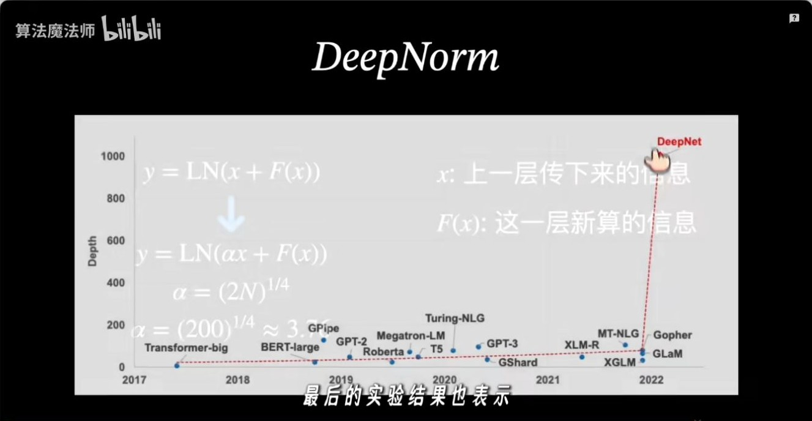

*图 9（07:44） 视频展示 DeepNet 论文中的网络深度对照。*

## 七、BatchNorm 优化机制的论文证据

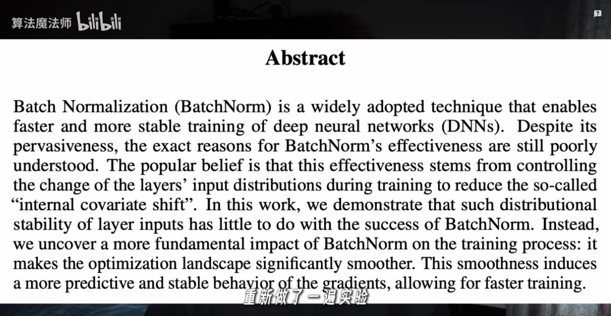

*图 10（08:17） 视频展示对 BatchNorm 机制提出不同解释的论文。*

BN 原论文用 internal covariate shift（内部协变量偏移）解释设计动机。Santurkar 等人的实验发现，层输入分布的稳定程度和 BN 的优化收益联系有限，并观察到 BN 能使优化曲面更平滑、梯度行为更可预测。视频标题里的疑问指向**效果的解释**。BN 的实际效果以及它在某个任务上的收益，仍可通过训练结果衡量。 [BN 原论文](https://arxiv.org/abs/1502.03167) · [How Does Batch Normalization Help Optimization?](https://arxiv.org/abs/1805.11604)

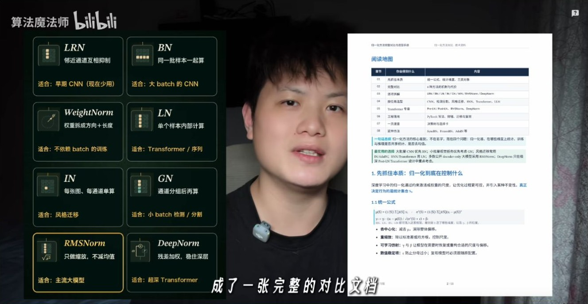

**补图（08:41）。** 回看这张对照图时，可以逐项追踪三件事：归一化对象是权重还是激活，统计范围是否跨样本，以及有没有把残差的尺度一并改动。分类的意义在于预测换 batch、换模型深度时哪些行为可能改变。

## 八、常见归一化方法的统计范围

| 方法 | 统计或调整范围 |
| --- | --- |
| BatchNorm | 每个特征跨 batch 统计，卷积中通常也汇总空间维 |
| LayerNorm | Transformer 中通常对每个 token 的隐藏维求均值与方差 |
| RMSNorm | Transformer 中通常对每个 token 的隐藏维求均方根 |
| DeepNorm | 在 LayerNorm 外调整残差支路系数与权重初始化 |

需要复习梯度以及 Pre-Norm、Post-Norm 的位置关系时，可以对照同目录的专题笔记。 [归一化：从 LayerNorm 到 RMSNorm](归一化_从LayerNorm到RMSNorm.md)

## 九、同一批数，换统计轴会发生什么？

取两个样本 $X=\begin{bmatrix}1&3\\5&7\end{bmatrix}$，忽略 $\epsilon$，令仿射参数为单位缩放与零偏置。BN 和 LN 都减均值并除标准差，区别体现在参与统计的元素上。

| 方法 | 均值 | 标准差 | 归一化结果 |
| --- | --- | --- | --- |
| BN，沿列看 | $[3,5]$ | $[2,2]$ | 第一行 $[-1,-1]$，第二行 $[1,1]$ |
| LN，沿行看 | $[2,6]$ | $[1,1]$ | 两行都为 $[-1,1]$ |

用三个样本可以看到 BN 怎样受同批样本影响。固定一列的前两项 $[1,3]$，第三项为 $5$ 时，第一项输出为 $-2/\sqrt{8/3}\approx-1.225$。第三项换成 $11$ 后，第一项输出为 $-4/\sqrt{56/3}\approx-0.926$。LN 每行只读取自身特征，因此其他行变化时第一行结果保持原值。

## 十、归一化放在残差的哪里？

设子层为 $F$，归一化为 $N$。Pre-Norm 的前向是 $y=x+F(N(x))$，Post-Norm 的前向是 $y=N(x+F(x))$。忽略 dropout，局部 Jacobian 分别为

$$
J_{\rm pre}=I+J_FJ_N,\qquad J_{\rm post}=J_N(I+J_F).
$$

这里各 Jacobian 在各自的输入处求值。Pre-Norm 的残差项直接贡献 $I$。Post-Norm 的残差加法结果还会经过 $J_N$。这个差别和上文 BN/LN 的统计轴属于不同设计选择。Xiong 等人的结论对应初始化时的梯度分析和特定训练实验。 [On Layer Normalization in the Transformer Architecture](https://proceedings.mlr.press/v119/xiong20b.html) · [残差连接专题](../06-技术拆解-残差链接/残差连接_从ResNet到Transformer.md)

| 论文 | 作者与年份 | 阅读重点 |
| --- | --- | --- |
| Batch Normalization | Sergey Ioffe、Christian Szegedy，2015 | 批内统计、训练与推理的区别 |
| Layer Normalization | Jimmy Lei Ba、Jamie Ryan Kiros、Geoffrey E. Hinton，2016 | 每个样本独立归一化 |
| RMSNorm | Biao Zhang、Rico Sennrich，2019 | 去掉中心化后保留尺度归一化 |
| How Does Batch Normalization Help Optimization? | Shibani Santurkar、Dimitris Tsipras、Andrew Ilyas、Aleksander Madry，2018 | 将分布变化和优化曲面行为分开测量 |

**复盘。** 推理时换一批同伴样本，常规 BN 是否还会使用这一批的均值？RMSNorm 对整体正比例缩放与加常数的响应有什么差别？

## 十一、原视频截图索引

截图来自文首所列视频，时间点以播放器为准。正文中的手算是教学构造，实验结果另附论文或官方文档出处。

| 图号 | 视频时间 | 对应画面 |
| --- | --- | --- |
| 1 | 01:04 | 视频以 AlexNet 的局部响应归一化开场 |
| 2 | 01:39 | BN 示意图的行是样本，列是特征 |
| 3 | 02:14 | 视频提示 BN 在训练和推理时使用不同的统计量 |
| 4 | 03:20 | 视频把 LN 的归一化轴与 Transformer 的 Add & Norm 联系起来 |
| 5 | 04:27 | 视频用边缘、纹理与形状类比样本内的通道 |
| 6 | 05:32 | 视频把权重分解为幅值与方向 |
| 7 | 06:39 | 视频并排展示 LayerNorm 与 RMSNorm 的公式 |
| 8 | 07:10 | 视频从 Post-LN 的残差结构引出深层网络的尺度问题 |
| 9 | 07:44 | 视频展示 DeepNet 论文中的网络深度对照 |
| 10 | 08:17 | 视频展示对 BatchNorm 机制提出不同解释的论文 |

### 补充画面索引

| 视频时间 | 画面 |
| --- | --- |
| 02:48 | 视频展示 Layer Normalization 论文署名 |
| 05:00 | 视频展示 Weight Normalization 论文标题 |
| 08:41 | 片尾并列多种归一化方法 |
