# 输出层与采样：从 Logits 到 Temperature、Top-k 与 Top-p

> **整理日期：** 2026-11-09  
> **视频来源：** 神经元出逃计划，《揭秘大模型“吐字”前的最后一步！》，2026-11-04 发布，约 18 分 03 秒。  
> **原视频：** [抖音视频](https://www.douyin.com/video/7704298611915492646)  
> **内容：** 28 张视频截图，串联 LM Head、softmax、贪心、温度、候选过滤、随机采样和复现问题；补充公式、数值例子及标准库复算代码。视频简介中的“19 分钟”是近似描述，本文按实际素材时长标注。

**目录位置：** `09-技术拆解-输出/`，与 [分词与向量化 / Embedding](../03-技术拆解-分词与向量化/Embedding/Token与Embedding_从strawberry计数到向量查表.md) 对应：前者解释模型如何接收输入，本篇解释隐藏状态怎样变成下一个 Token。

```text
当前前缀 → 最后层隐藏向量 h → LM Head → logits
→ 温度及其他处理 → 概率分布与候选过滤 → 选择 Token → 追加前缀 → 下一步
```

本篇使用这一教学顺序。真实推理框架的处理器、约束与过滤顺序以实现为准；截图中的具体模型配置、概率和接口仅作为视频演示记录。

## 一、同一个问题，为何可能得到不同回答？


模型通常输出对下一个 Token 的分数，而不是直接输出唯一的完整答案。解码器再依据规则选取一个 Token。只要某步选出了不同 Token，下一步前缀就改变，后续分布也随之改变。

随机性是来源之一，但不是全部。模型版本、提示模板、上下文、工具结果和计算实现变化也可能改变输出。相反，开启采样不代表每次必然得到不同答案。

## 二、LM Head：给词表每个候选打分

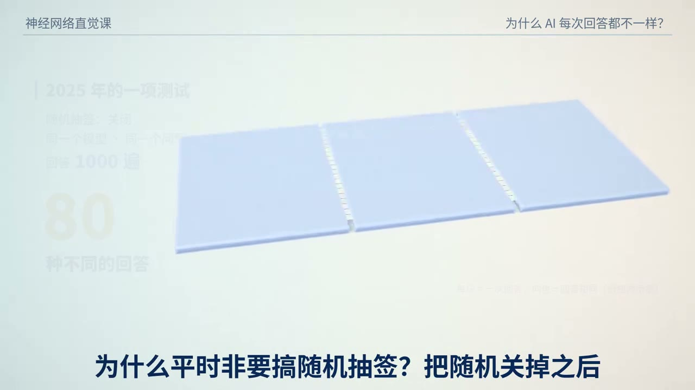

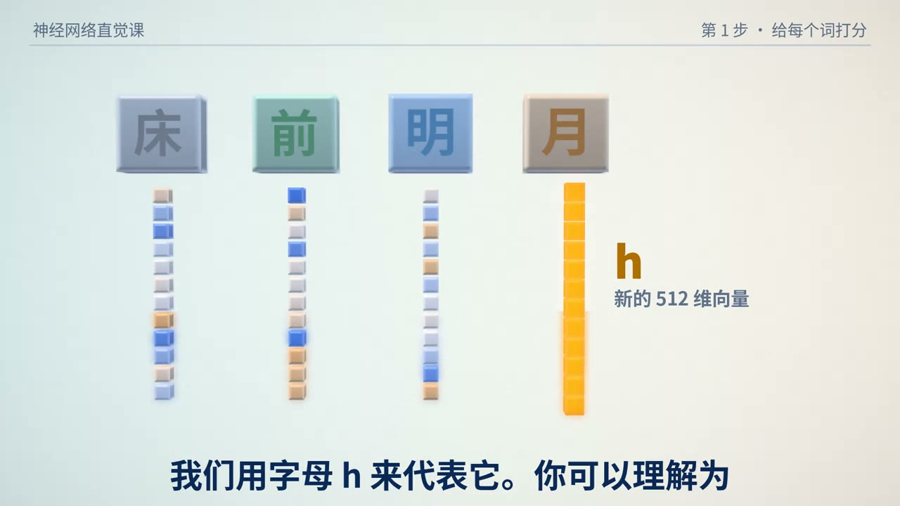

采用列向量，最后层相关归一化后的状态为 $h\in\mathbb R^d$，词表可预测条目数为 $V$。输出投影为：

$$
z=W_{\mathrm{out}}h+b,\qquad W_{\mathrm{out}}\in\mathbb R^{V\times d},\quad z\in\mathbb R^V.
$$

对第 $i$ 个候选，$z_i=w_i^Th+b_i$。这些未归一化分数称为 logits，可为负，也不要求加起来为 1。有些模型省略偏置，或在投影前后加入其他结构。

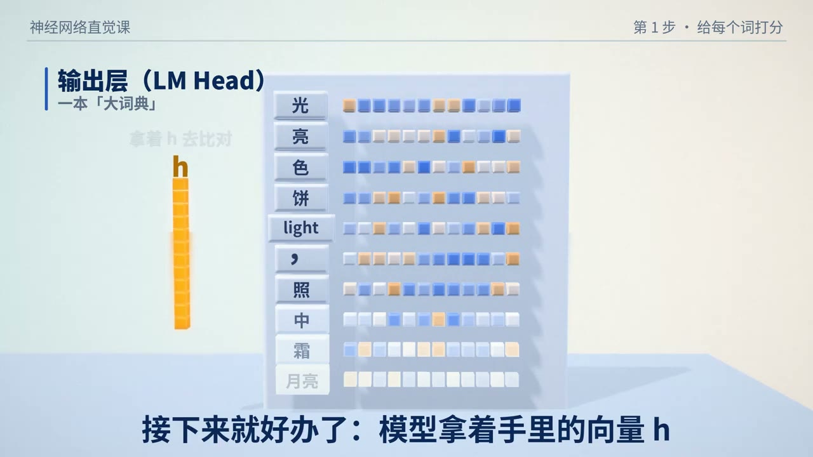

视频把点积称为“相似度”，可以理解为匹配分数，但普通点积不等于余弦相似度，也不自动等于正确率。

### 2.1 输入表与输出表是否是同一张？

输入查表为 $E[\mathrm{id},:]$；输出投影为对各候选行与 $h$ 做点积。形状允许时，模型可共享两者权重，也可以使用独立参数。是否共享需要检查具体架构，不能从“第二张一样大的表”推出一定多一份独立权重。

若输出矩阵形状为 $V\times d$，其参数量为 $Vd$，偏置另计。关于输入表的容量与梯度，可参照 [Embedding 专题](../03-技术拆解-分词与向量化/Embedding/Token与Embedding_从strawberry计数到向量查表.md)。

## 三、softmax：从分数到概率分布

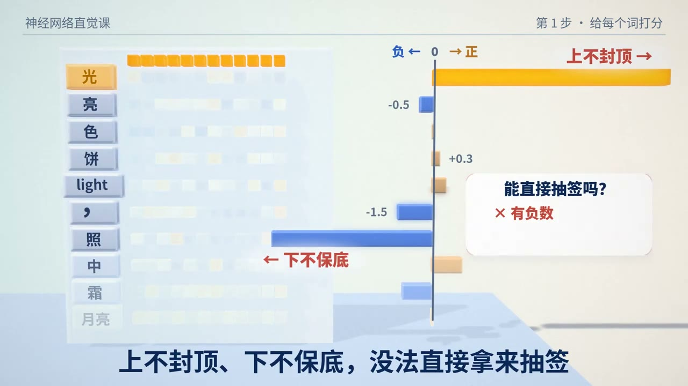

$$
p_i=\frac{e^{z_i}}{\sum_j e^{z_j}}.
$$

结果非负且总和为 1。数值稳定实现先减去最大分数 $m=\max_j z_j$：

$$
p_i=\frac{e^{z_i-m}}{\sum_j e^{z_j-m}}.
$$

共同减去同一个值不会改变结果，却能减少指数溢出的风险。

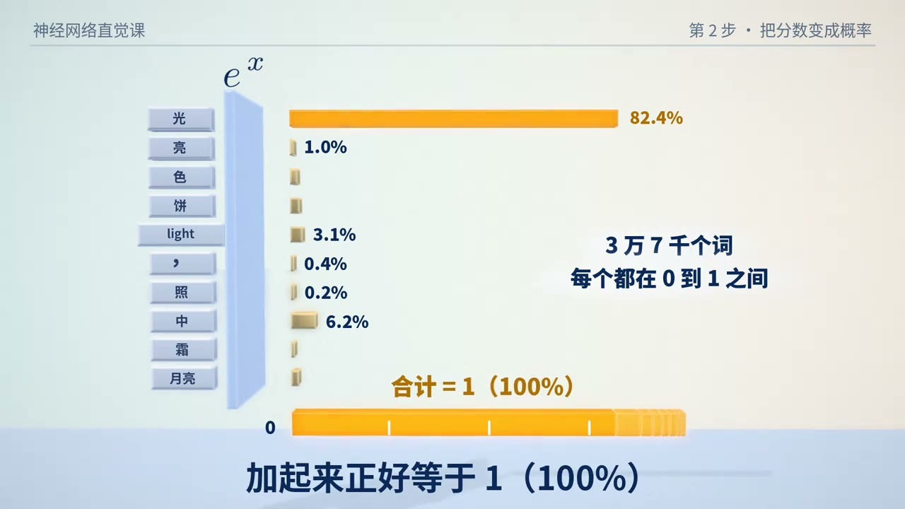

两个候选的概率比为 $p_i/p_j=e^{z_i-z_j}$。分数差 2 对应概率比约 $e^2=7.389$；不是“分数翻倍，概率也翻倍”。

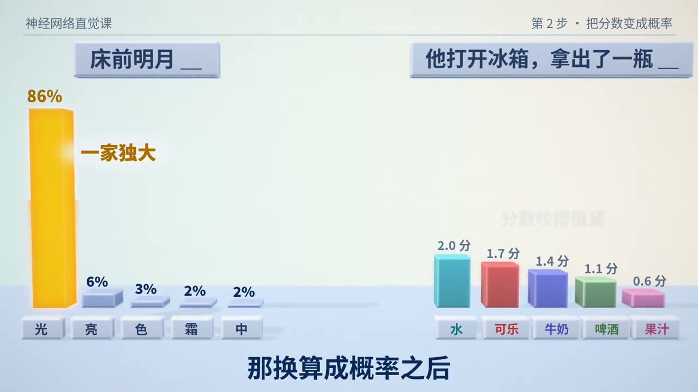

这些数值是模型对续写候选的条件分布；概率 90% 不表示答案有 90% 的事实正确率。错误续写同样可能获得高分。

### 3.1 一套贯穿全文的手算

定义三个示意 Token A、B、C，取 logits：

$$
z=[\ln6,\ln3,0].
$$

指数为 $[6,3,1]$，总和 10，因此 $p=[0.6,0.3,0.1]$。这些是本文自建数字，不是从真实模型测得的分布。

## 四、贪心：每一步都选当前最大值

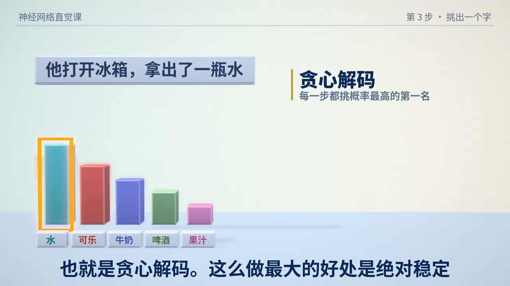

贪心规则为 $i^*=\arg\max_i z_i$。在本例中总选 A。对任意正温度，softmax 与除温度都保留 logits 排序，因此不改变严格最大值对应的候选。


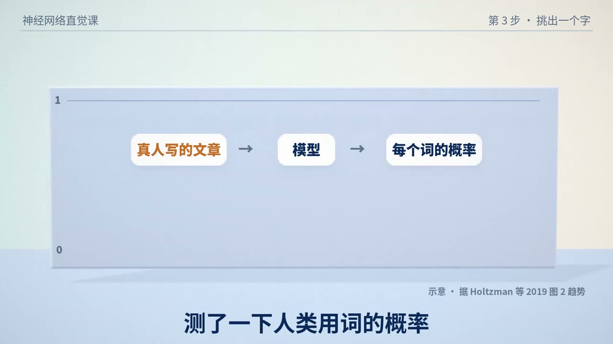

贪心不保证整段序列概率最大。例如第一步 A 概率 0.6、B 概率 0.4，若后续路径条件概率分别为 0.1 和 0.9，两条完整路径概率是 0.06 与 0.36。每步局部选择 A，可能错过更高概率的完整路径。

这也不表示完整序列概率最大就最符合用户需求。事实正确、创造性和任务成功并不等于最大化同一个序列概率目标。视频讨论重复退化，相关研究见 [The Curious Case of Neural Text Degeneration](https://arxiv.org/abs/1904.09751)。

## 五、采样：按分布选取，而不是永远选第一名

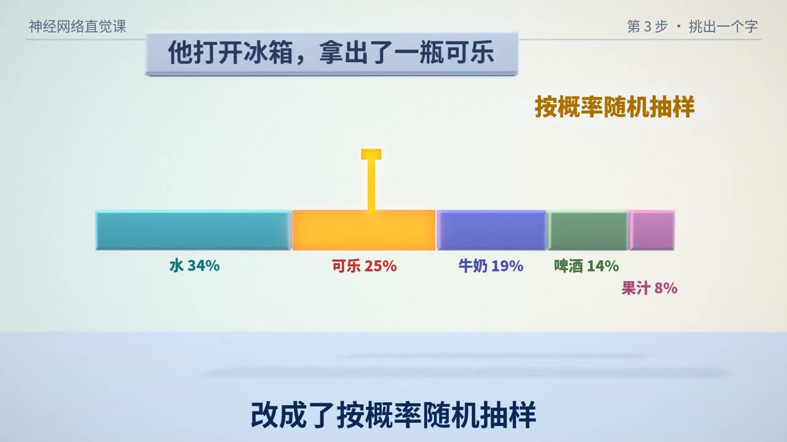

对 $p=[0.6,0.3,0.1]$，可以把 $[0,1)$ 分成：

| 区间 | 返回 Token |
| --- | --- |
| $[0,0.6)$ | A |
| $[0.6,0.9)$ | B |
| $[0.9,1)$ | C |

取均匀随机数 $u$，落在哪个区间就返回相应 Token。例如 $u=0.72$ 返回 B。长期重复这一固定分布抽样，频率趋近相应概率；但自回归文本每一步的分布通常都会变化。

概率大不意味着下一次一定选中；概率小也不意味着永远不会选中。

**延伸解读。** 设前两名 Token 的概率为 0.6 和 0.4，连续两次生成从同一个前缀开始。第一次抽到第一名、第二次抽到第二名时，两个后续步骤看到的上下文已经不同，分布也可能随之变化。比较解码策略时可以先固定前缀看一次采样，再比较完整生成，避免把后续上下文变化混到第一步里。

## 六、Temperature：改变分布尖锐程度

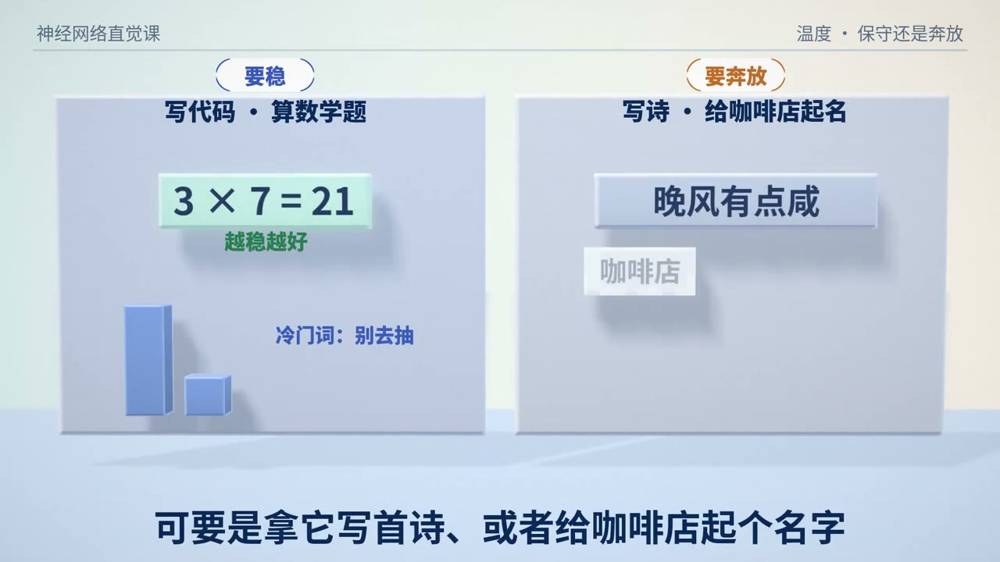

温度 $\tau>0$ 时：

$$
p_i(\tau)=\frac{\exp(z_i/\tau)}{\sum_j\exp(z_j/\tau)},\qquad
\frac{p_i}{p_j}=\exp\left(\frac{z_i-z_j}{\tau}\right).
$$

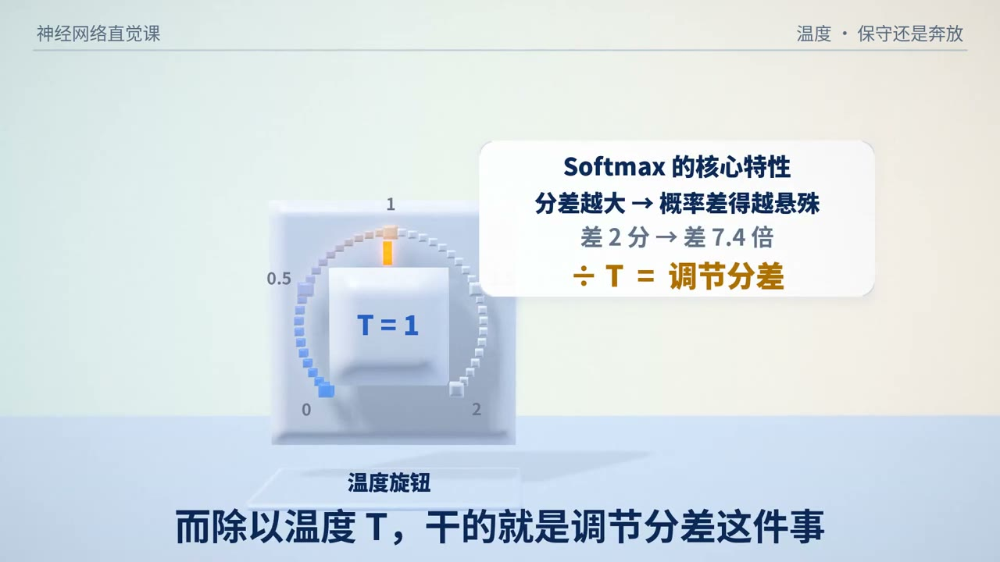

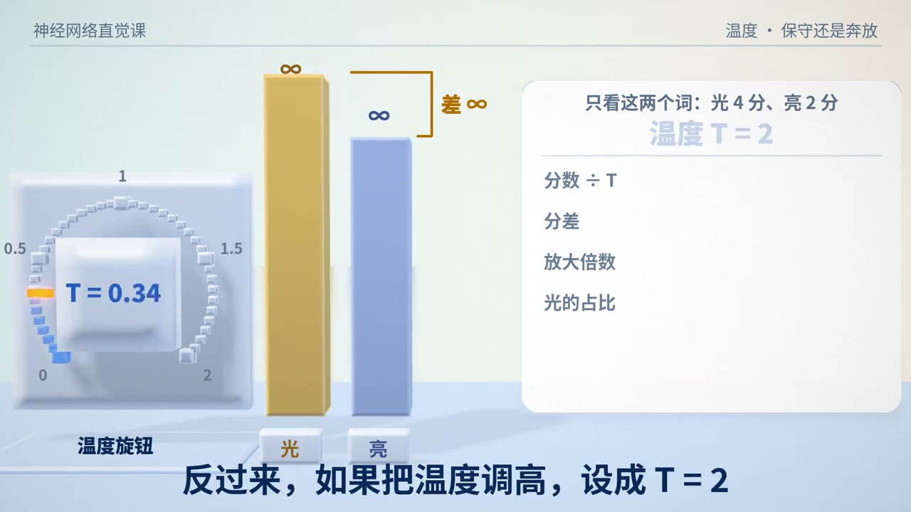

对于第三节数字：

| 温度 | softmax 前相对权重 | 概率约值 |
| --- | --- | --- |
| $\tau=1$ | $[6,3,1]$ | $[0.6,0.3,0.1]$ |
| $\tau=0.5$ | $[36,9,1]$ | $[0.782609,0.195652,0.021739]$ |
| $\tau=2$ | $[\sqrt6,\sqrt3,1]$ | $[0.472734,0.334273,0.192993]$ |


低温让较高分候选更占优势，高温让较低分候选更有机会。温度不增加知识，不把低概率内容变成正确事实，也不保证高温产生更有用的创造性。

当 $\tau\to0^+$ 且最大值唯一时，概率趋近于该候选。不能在公式里直接除以零；某些接口把“温度为零”解释为切换到贪心，但支持范围与语义必须以实现为准。

## 七、为什么要截断低概率长尾？

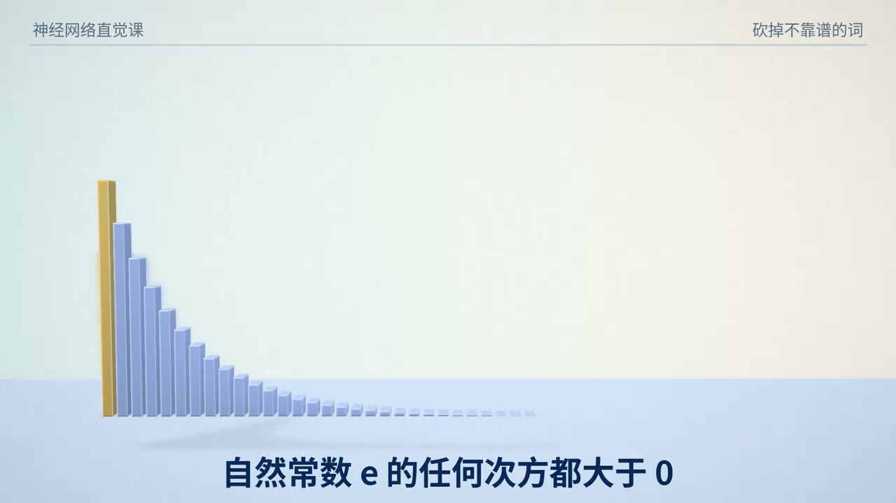

即使每个低概率候选的概率很小，数量很多时，长尾总概率仍可能不小。温度升高还可能增加它们的相对机会。因此采样常结合过滤，先排除一部分候选，再重新归一化。

过滤不会判断事实真假，只是依据分数或其他约束调整可选集合。排在前面的候选也可能错误。

## 八、Top-p：保留累计概率达到阈值的最小前缀

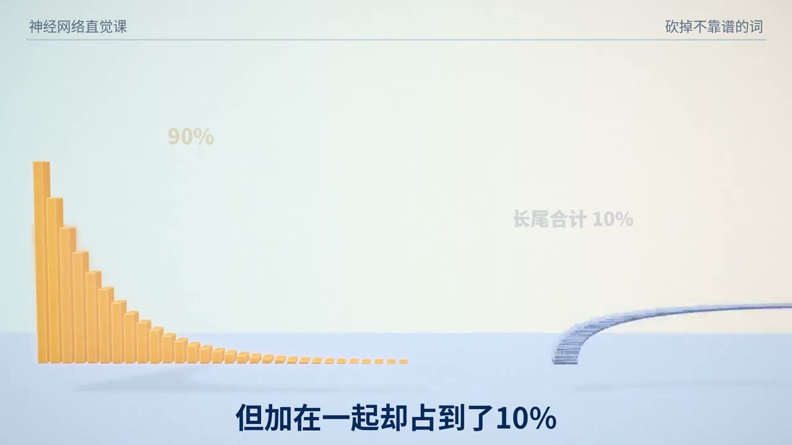

将概率从大到小排序，取最小数量 $m$，使：

$$
\sum_{i=1}^{m}p_{(i)}\ge p_{\mathrm{cut}},
\qquad0<p_{\mathrm{cut}}\le1.
$$

保留这 $m$ 个候选，包括使累计和首次达到或越过阈值的那一个，再归一化。Top-p 不是“保留每个概率大于 p 的 Token”，也不是只选一个 Token。

对 $[0.6,0.3,0.1]$，Top-p=0.8 保留 A、B，因为 $0.6<0.8$、$0.6+0.3=0.9\ge0.8$；重新归一化为 $[2/3,1/3,0]$。

Top-p 的候选数量随分布变化。例如阈值 0.9：分布 $[0.95,0.03,0.02]$ 只留一个；分布 $[0.4,0.35,0.25]$ 需要留三个。

## 九、Top-k：保留概率最高的 k 个候选

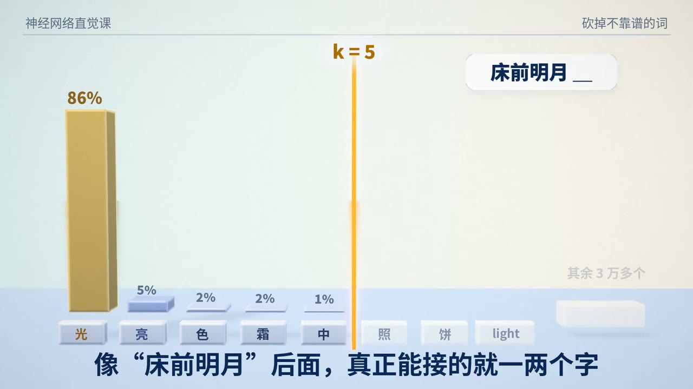

Top-k=2 在主例中同样保留 A、B，结果也为 $[2/3,1/3,0]$。这是本例碰巧相同，不代表 Top-k 与 Top-p 等价。

| 方法 | 固定什么 | 随分布变化什么 |
| --- | --- | --- |
| Top-k | 候选数量上限 | 保留的总概率 |
| Top-p | 累计概率阈值 | 候选数量 |

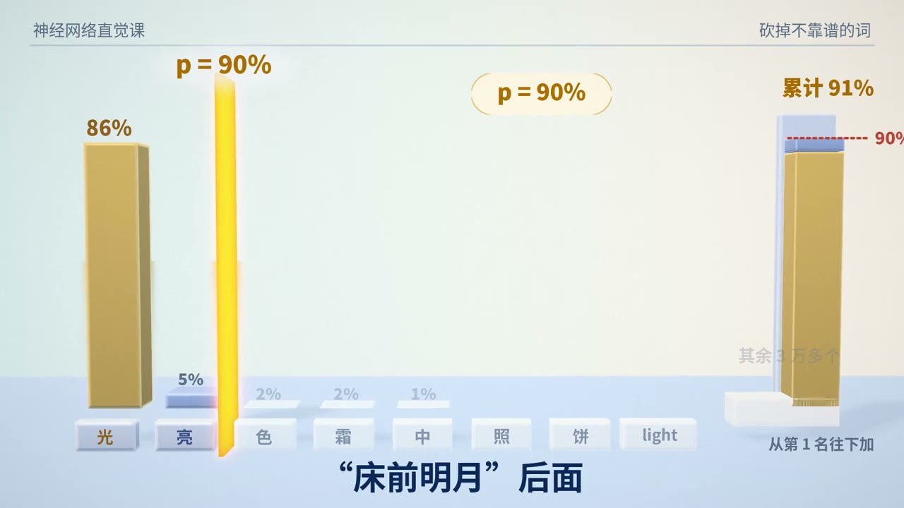

截图展示的是视频所用接口，不将其默认参数、取值范围或效果推广到其他服务。Top-k 的零值含义、并列分数如何处理、最少保留几个候选也需看实现。

### 9.1 处理顺序影响 Top-p

温度不改变严格排序，因此理想情况下单独 Top-k 的候选 ID 不因正温度改变；但 Top-p 根据概率累计，温度改变后可能保留不同数量。组合过滤时，更应明确在哪个分布上计算阈值。

例如原分布 $[0.6,0.3,0.1]$、Top-p=0.8 保留前两个；温度提高到 2 后，前两个累计约 0.8070，仍留两个。若阈值改为 0.85，原分布仍留两个，而高温后的分布需要留三个。

## 十、随机种子与可复现：固定的到底是什么？

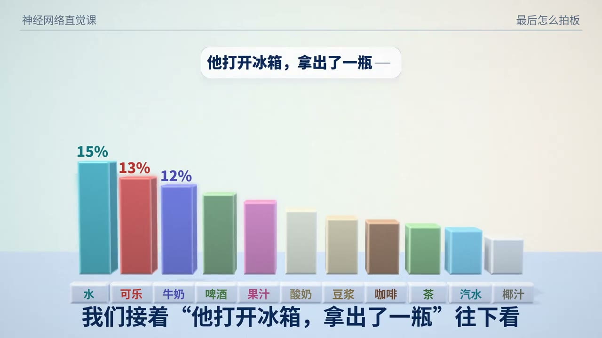

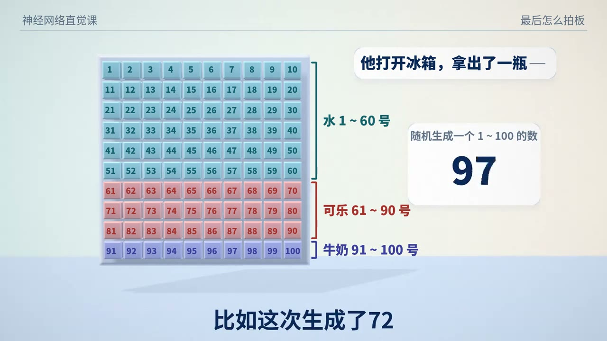

在同样的伪随机数算法、种子及调用顺序下，可以得到相同的伪随机序列。但这还不保证不同设备、框架版本、batch 或内核会算出完全相同的 logits。

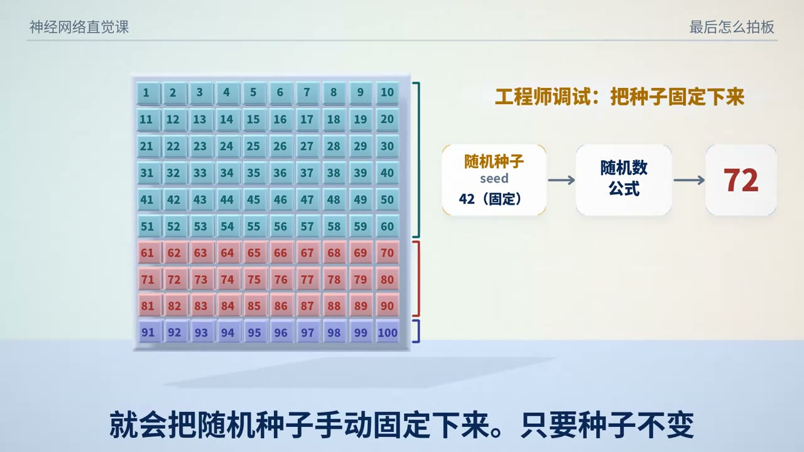

实际流程还可能包含禁用 Token、重复惩罚、结构化输出约束、最短长度和 EOS 等处理。本篇只用基础流程解释原理，不将视频简图当作所有框架的完整实现。

## 十一、关闭随机采样，是否必然逐字相同？

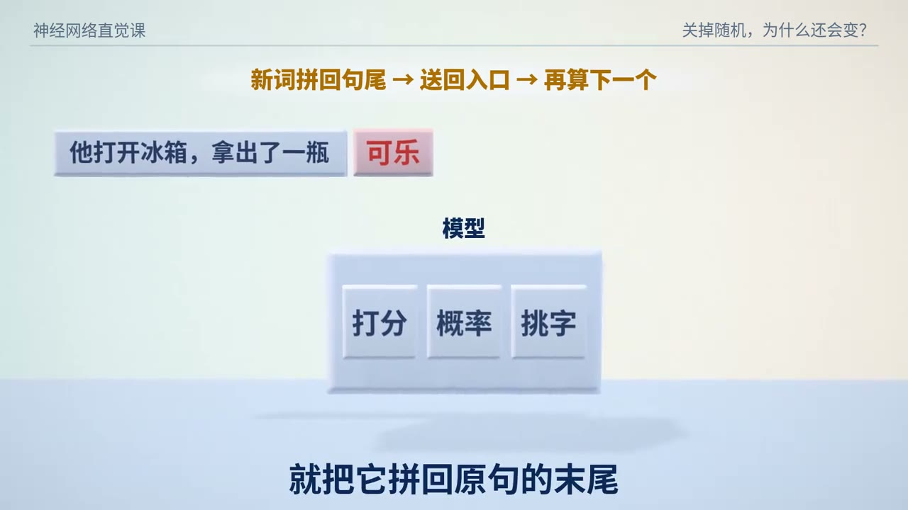

固定权重、输入、数值结果与确定的并列处理规则，贪心应返回同样结果。但如果计算导致 logits 有变化，极接近的候选可能交换名次，随后自回归路径也会改变。

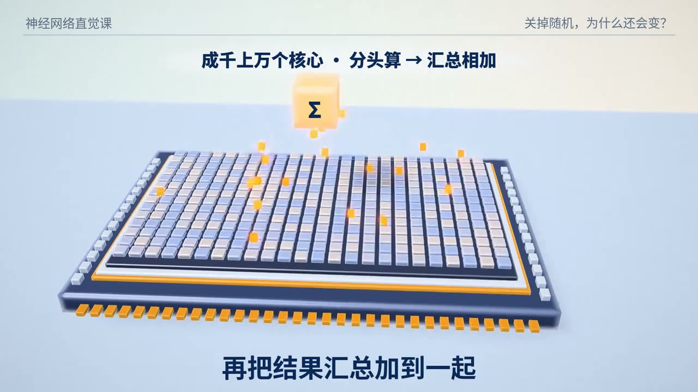

浮点数不是精确实数运算。例如双精度常见情形下：

```text
(1e16 + -1e16) + 1 = 1
1e16 + (-1e16 + 1) = 0
```

这展示结合顺序可能影响结果，不证明某个具体部署必然不确定。若最高候选与次高候选间隔远大于误差，微小扰动可能完全不改变选择。

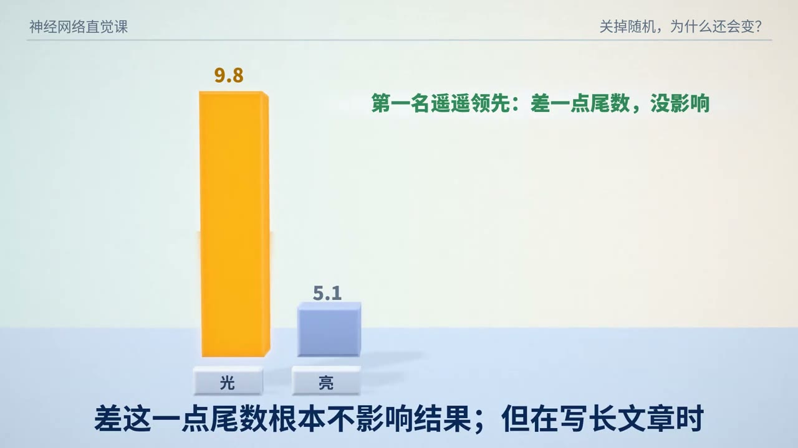

因此“温度为零”不能单独作为跨版本、跨硬件的逐字复现保证；也不能反过来说贪心总是随机的。

## 十二、从 Token 回到文本，再进入下一轮


选出的 Token ID 经分词器解码形成文本片段。一个 Token 不一定对应一个字；字节级 Token 的流式解码还需处理不完整字符，不能机械地将每个 Token 独立解码再拼接替代符号。

选出的 Token 追加到前缀并参与后续计算，直到 EOS、停止规则或长度限制触发。标准增量推理通过 [KV Cache](../05-技术拆解-注意力机制/03-KVCache基础/03-KVCache基础_从因果不变性到Prefill与Decode.md) 复用历史，但新 Query 及新位置的网络计算仍然需要进行。

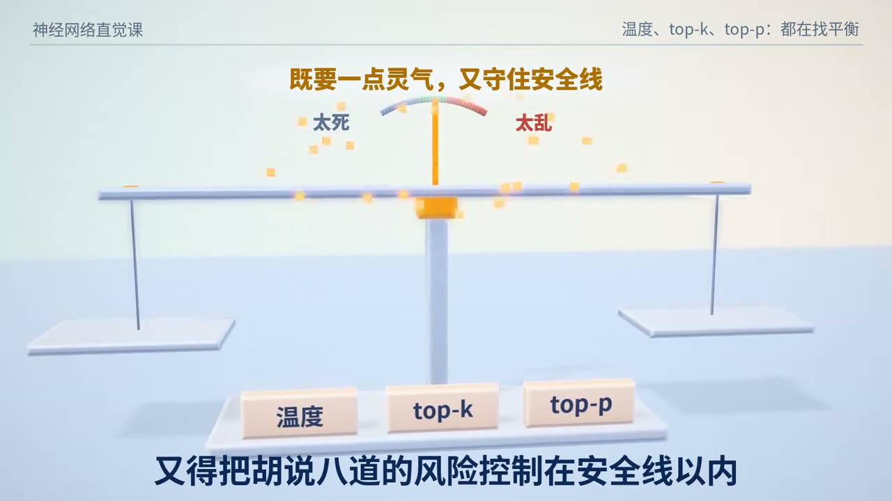

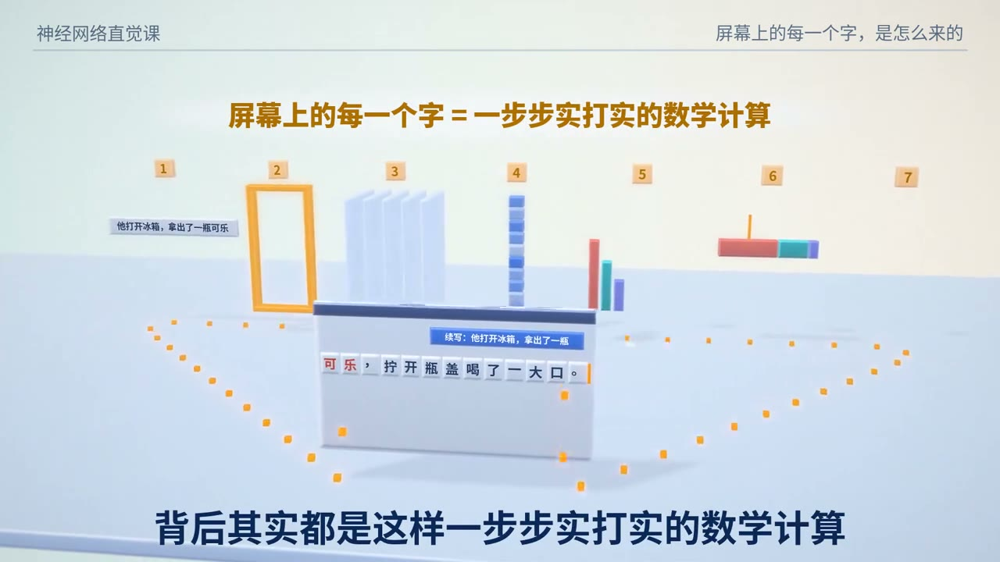

温度、Top-k、Top-p 和贪心控制的是选择机制。实际取值应依据具体模型、任务和测量决定，本篇不给出脱离条件的“最佳参数”。

## 十三、配套复算

[sampling_math.py](sampling_math.py) 使用标准库验证稳定 softmax、温度、Top-k / Top-p 边界、累计区间采样、种子复现和浮点加法例子。它不依赖真实模型，也不作为服务端采样实现的逐比特复刻。

```bash
python3 sampling_math.py
```

## 十四、作者、原始资料与截图索引

| 首次公开 | 原始资料与作者 | 对应问题 |
| --- | --- | --- |
| 2016-11-04 | Hakan Inan、Khashayar Khosravi、Richard Socher，[Tying Word Vectors and Word Classifiers](https://arxiv.org/abs/1611.01462) | 输入 Embedding 与输出投影共享权重的一项代表工作 |
| 2019-04-22；ICLR 2020 | Ari Holtzman、Jan Buys、Li Du、Maxwell Forbes、Yejin Choi，[The Curious Case of Neural Text Degeneration](https://arxiv.org/abs/1904.09751) | 退化与 Nucleus / Top-p 采样；实验结论有具体模型和任务范围 |
| 工程文档 | [Hugging Face GenerationConfig](https://huggingface.co/docs/transformers/main/en/main_classes/text_generation) | 温度、采样、过滤和停止条件的配置说明；参数语义以所用版本为准 |

28 张截图包括 00:00—17:20 每 40 秒一帧及 17:50 收尾，版权归原作者或相应权利人所有。文中教学分布与代码由本文提供，没有复现视频中的真实模型生成实验。

## 补充画面索引

### 03:40 · 指数把两分之差变成约 7.4 倍的权重比

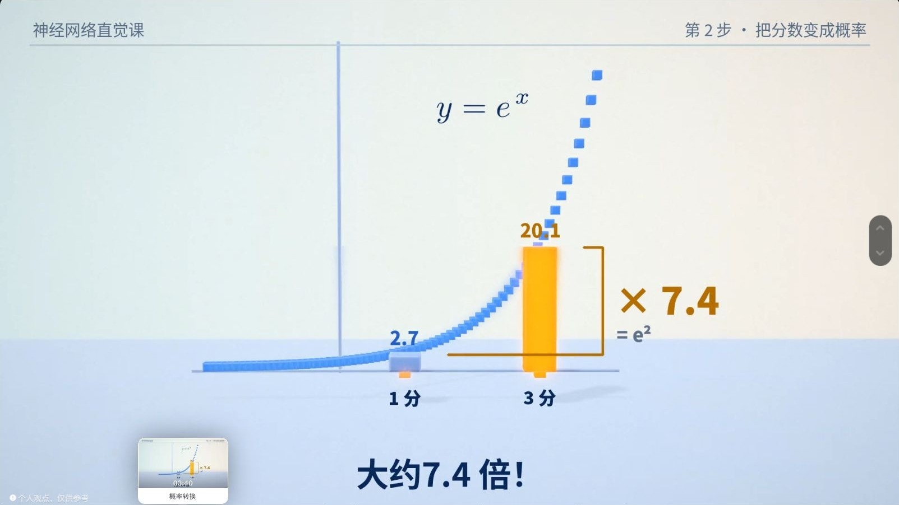

$e^3/e^1=e^2\approx7.39$。共同除以 softmax 分母不会改变这两个候选的比值。若词表中还有其他候选，二者各自的概率仍会随公共分母变化。

### 08:20 · 温度 0.5 把 logits 差从 2 放大到 4

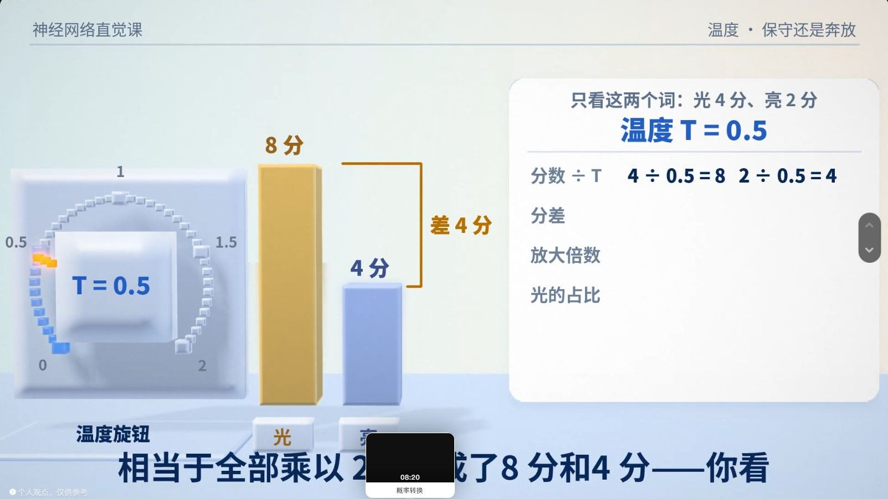

图上 4 分和 2 分分别变成 8 和 4。候选的相对权重由 $e^2$ 倍变成 $e^4$ 倍，排序保持一致。温度改变的是概率差距，后续仍可按分布抽样。

### 13:40 · 随机种子驱动一次抽样

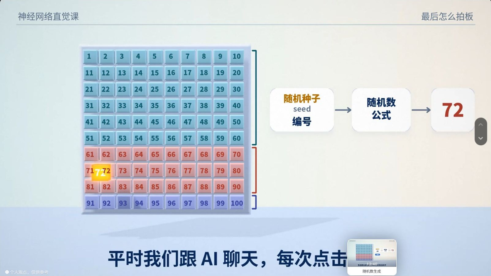

画面把抽样画成挑中编号 72。可以把累计概率想成一条分段区间，随机数落在哪段就选哪项。复现还要固定候选概率、采样算法与随机数消耗顺序。
